# adminlte-crm Design System

You are building UI for **adminlte-crm**. Dark-themed, neutral palette, sans-serif typography (Mulish), standard density on a 5px grid, expressive motion.

## Visual Reference

**IMPORTANT**: Study ALL screenshots below before writing any UI. Match colors, typography, spacing, layout, and motion exactly as shown.

### Homepage


### Scroll Journey (Cinematic Visual States)

> These screenshots capture the website at different scroll depths. The design changes dramatically as you scroll — each frame shows a different cinematic state. Replicate these exact visual transitions.

#### 0% — Hero / Above the fold

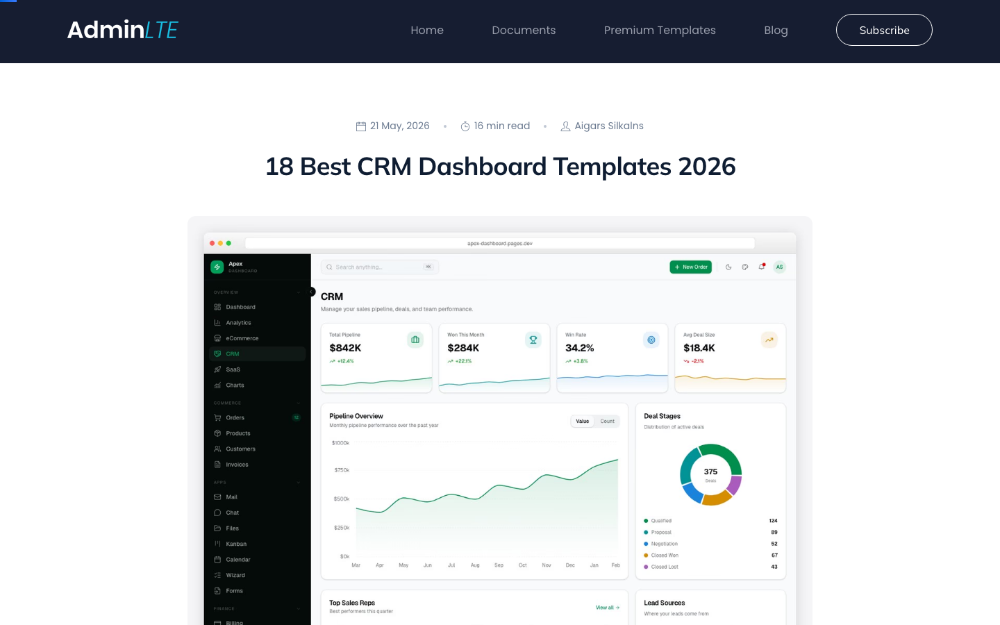

#### 17% — Mid-page at 17% scroll

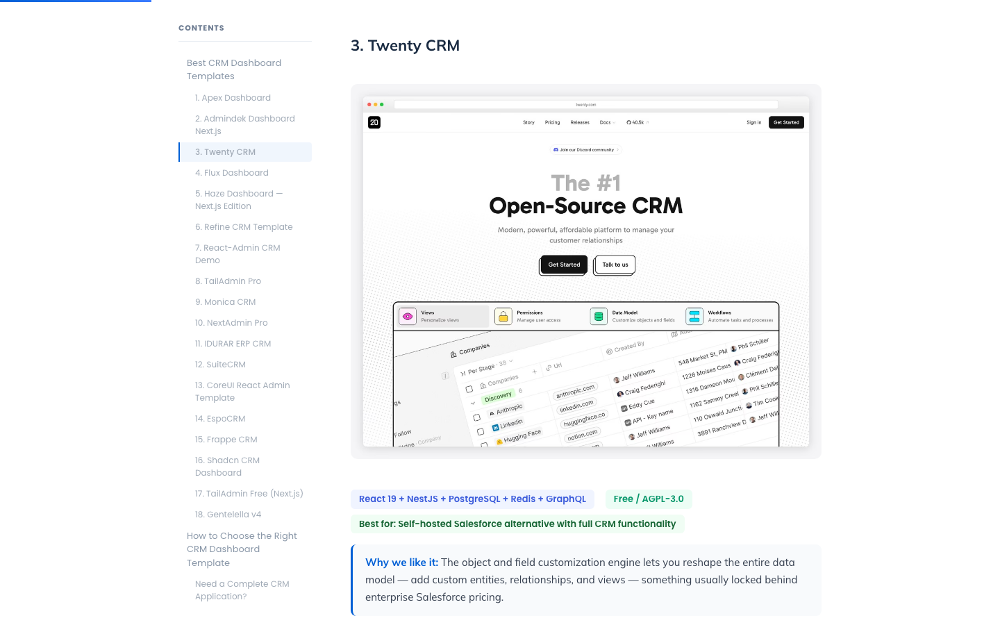

#### 33% — Mid-page at 33% scroll

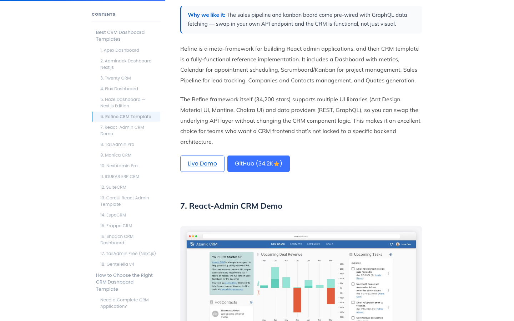

#### 50% — Mid-page at 50% scroll

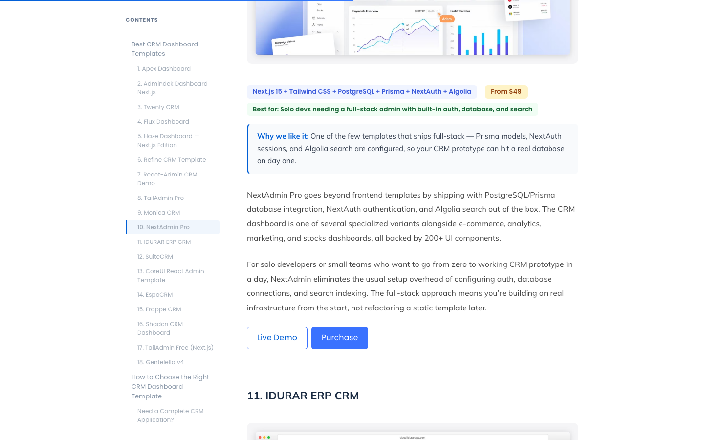

#### 67% — Mid-page at 67% scroll

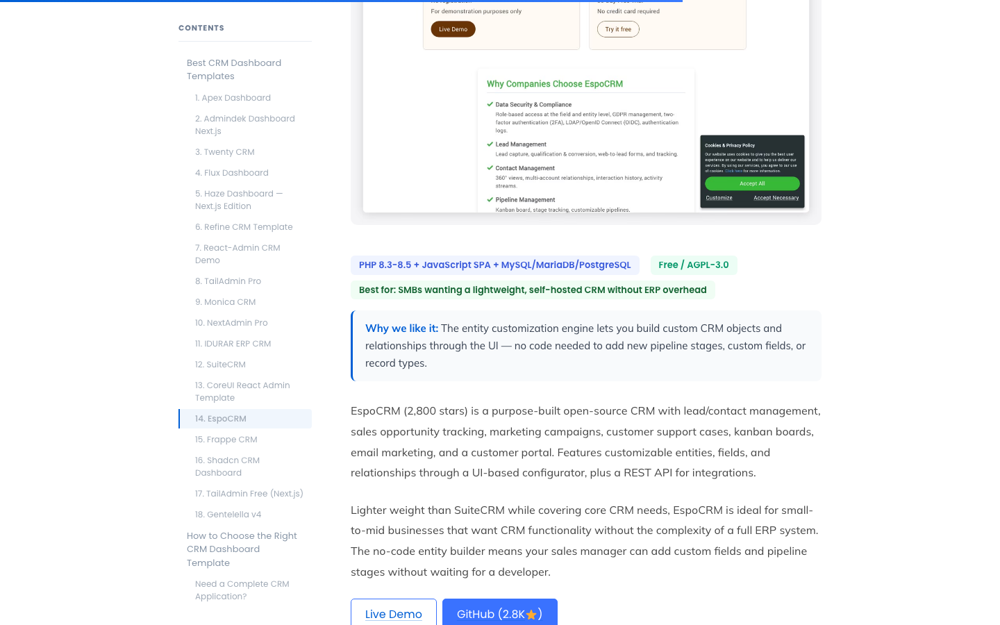

#### 83% — Mid-page at 83% scroll

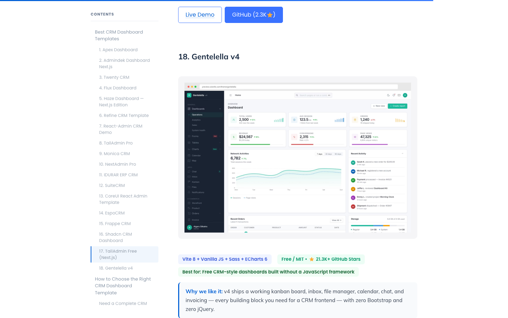

#### 100% — Footer / End of page

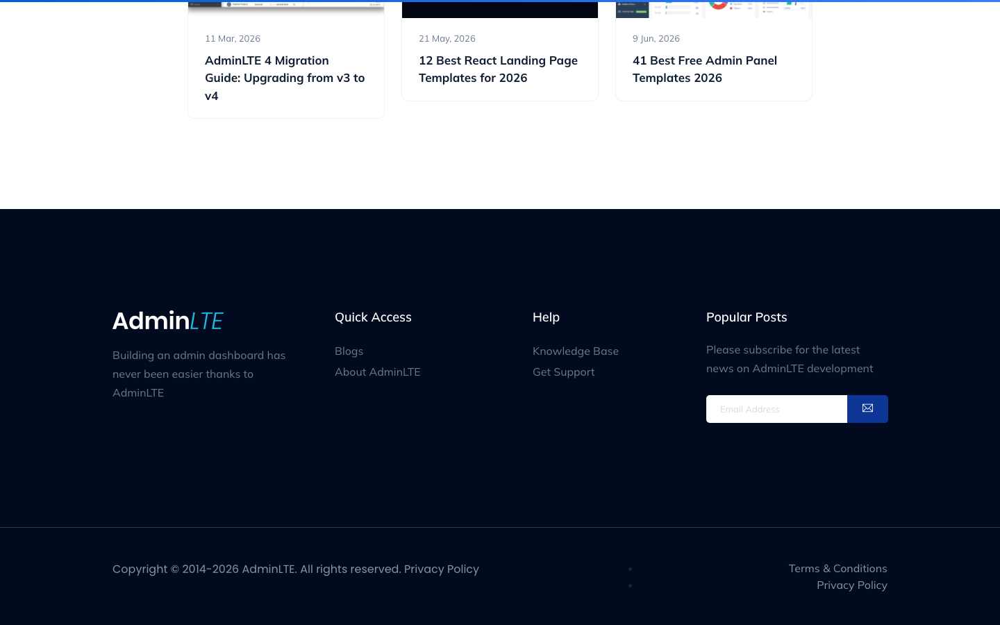

> Read `references/DESIGN.md` for full token details. Read `references/ANIMATIONS.md` for motion specs. Read `references/LAYOUT.md` for layout structure. Read `references/COMPONENTS.md` for component patterns.

## Ultra Reference Files

This package includes extended documentation. **Read these files before implementing:**

| File                         | Contents                                                           |
| ---------------------------- | ------------------------------------------------------------------ |
| `references/DESIGN.md`       | Full design system tokens, colors, typography, spacing             |
| `references/VISUAL_GUIDE.md` | **START HERE** — Master visual guide with all screenshots embedded |
| `references/ANIMATIONS.md`   | CSS keyframes, scroll triggers, motion library stack, video specs  |
| `references/LAYOUT.md`       | Flex/grid containers, page structure, spacing relationships        |
| `references/COMPONENTS.md`   | DOM component patterns, HTML structure, class fingerprints         |
| `references/INTERACTIONS.md` | Hover/focus states with before/after style diffs                   |
| `screens/scroll/`            | 7 scroll journey screenshots showing cinematic states              |

## Design Philosophy

- **Layered depth** — use shadow tokens to create a sense of physical layering. Each elevation level has a specific shadow.
- **Gradient accents** — gradients are used thoughtfully for emphasis, not decoration.
- **Type pairing** — Mulish for body/UI text, Poppins for headings/display. Never introduce a third typeface.
- **standard density** — 5px base grid. Every dimension is a multiple of 5.
- **neutral palette** — the color temperature runs neutral, matching the sans-serif typography.
- **Expressive motion** — animations are an integral part of the experience. Use spring physics and layout animations.

## Color System

### Core Palette

| Role         | Token            | Hex       | Use                    |
| ------------ | ---------------- | --------- | ---------------------- |
| Background   | `--background`   | `#212529` | Page/app background    |
| Surface      | `--surface`      | `#000000` | Cards, panels, modals  |
| Text Primary | `--text-primary` | `#ffffff` | Headings, body text    |
| Text Muted   | `--text-muted`   | `#41464b` | Captions, placeholders |

### Status Colors

| Status | Hex       | Use                         |
| ------ | --------- | --------------------------- |
| Danger | `#ce9178` | Errors, destructive actions |

### Extended Palette

- `#005fd5`
- **bs-secondary:** `#6c757d` — Secondary text, placeholder text
- **bs-secondary-border-subtle:** `#c4c8cb` — Secondary text, placeholder text
- **bs-primary:** `#0d6efd`
- `#1f3e64`
- `#032044`
- `#6b7a90`
- `#d8d0d0`

### CSS Variable Tokens

```css
--bs-primary: #0d6efd;
--bs-secondary: #6c757d;
--bs-primary-rgb: 13, 110, 253;
--bs-secondary-rgb: 108, 117, 125;
--bs-primary-text-emphasis: #052c65;
--bs-secondary-text-emphasis: #2b2f32;
--bs-primary-bg-subtle: #cfe2ff;
--bs-secondary-bg-subtle: #e2e3e5;
--bs-primary-border-subtle: #9ec5fe;
--bs-secondary-border-subtle: #c4c8cb;
--bs-success-border-subtle: #a3cfbb;
--bs-info-border-subtle: #9eeaf9;
--bs-warning-border-subtle: #ffe69c;
--bs-danger-border-subtle: #f1aeb5;
--bs-light-border-subtle: #e9ecef;
--bs-dark-border-subtle: #adb5bd;
--bs-secondary-color: rgba(33, 37, 41, 0.75);
--bs-secondary-color-rgb: 33, 37, 41;
--bs-secondary-bg: #e9ecef;
--bs-secondary-bg-rgb: 233, 236, 239;
```

## Typography

### Font Stack

- **Mulish** — Heading 1, Heading 2, Heading 3
- **Poppins** — Body, Caption
- **SFMono-Regular** — Code

### Font Sources

```css
@font-face {
  font-family: 'Poppins';
  src: url('fonts/Poppins-Bold.ttf') format('truetype');
  font-weight: 700;
}
@font-face {
  font-family: 'Poppins';
  src: url('fonts/Poppins-Regular.ttf') format('truetype');
  font-weight: 400;
}
@font-face {
  font-family: 'Mulish';
  src: url('fonts/Mulish-Bold.ttf') format('truetype');
  font-weight: 700;
}
@font-face {
  font-family: 'Mulish';
  src: url('fonts/Mulish-Regular.ttf') format('truetype');
  font-weight: 400;
}
@font-face {
  font-family: 'themify';
  src: url('fonts/themify-Regular.woff') format('woff');
  font-weight: 400;
}
@font-face {
  font-family: 'swiper-icons';
  src: url('data:application/font-woff;charset=utf-8;base64, d09GRgABAAAAAAZgABAAAAAADAAAAAAAAAAAAAAAAAAAAAAAAAAAAAAAAABGRlRNAAAGRAAAABoAAAAci6qHkUdERUYAAAWgAAAAIwAAACQAYABXR1BPUwAABhQAAAAuAAAANuAY7+xHU1VCAAAFxAAAAFAAAABm2fPczU9TLzIAAAHcAAAASgAAAGBP9V5RY21hcAAAAkQAAACIAAABYt6F0cBjdnQgAAACzAAAAAQAAAAEABEBRGdhc3AAAAWYAAAACAAAAAj//wADZ2x5ZgAAAywAAADMAAAD2MHtryVoZWFkAAABbAAAADAAAAA2E2+eoWhoZWEAAAGcAAAAHwAAACQC9gDzaG10eAAAAigAAAAZAAAArgJkABFsb2NhAAAC0AAAAFoAAABaFQAUGG1heHAAAAG8AAAAHwAAACAAcABAbmFtZQAAA/gAAAE5AAACXvFdBwlwb3N0AAAFNAAAAGIAAACE5s74hXjaY2BkYGAAYpf5Hu/j+W2+MnAzMYDAzaX6QjD6/4//Bxj5GA8AuRwMYGkAPywL13jaY2BkYGA88P8Agx4j+/8fQDYfA1AEBWgDAIB2BOoAeNpjYGRgYNBh4GdgYgABEMnIABJzYNADCQAACWgAsQB42mNgYfzCOIGBlYGB0YcxjYGBwR1Kf2WQZGhhYGBiYGVmgAFGBiQQkOaawtDAoMBQxXjg/wEGPcYDDA4wNUA2CCgwsAAAO4EL6gAAeNpj2M0gyAACqxgGNWBkZ2D4/wMA+xkDdgAAAHjaY2BgYGaAYBkGRgYQiAHyGMF8FgYHIM3DwMHABGQrMOgyWDLEM1T9/w8UBfEMgLzE////P/5//f/V/xv+r4eaAAeMbAxwIUYmIMHEgKYAYjUcsDAwsLKxc3BycfPw8jEQA/gZBASFhEVExcQlJKWkZWTl5BUUlZRVVNXUNTQZBgMAAMR+E+gAEQFEAAAAKgAqACoANAA+AEgAUgBcAGYAcAB6AIQAjgCYAKIArAC2AMAAygDUAN4A6ADyAPwBBgEQARoBJAEuATgBQgFMAVYBYAFqAXQBfgGIAZIBnAGmAbIBzgHsAAB42u2NMQ6CUAyGW568x9AneYYgm4MJbhKFaExIOAVX8ApewSt4Bic4AfeAid3VOBixDxfPYEza5O+Xfi04YADggiUIULCuEJK8VhO4bSvpdnktHI5QCYtdi2sl8ZnXaHlqUrNKzdKcT8cjlq+rwZSvIVczNiezsfnP/uznmfPFBNODM2K7MTQ45YEAZqGP81AmGGcF3iPqOop0r1SPTaTbVkfUe4HXj97wYE+yNwWYxwWu4v1ugWHgo3S1XdZEVqWM7ET0cfnLGxWfkgR42o2PvWrDMBSFj/IHLaF0zKjRgdiVMwScNRAoWUoH78Y2icB/yIY09An6AH2Bdu/UB+yxopYshQiEvnvu0dURgDt8QeC8PDw7Fpji3fEA4z/PEJ6YOB5hKh4dj3EvXhxPqH/SKUY3rJ7srZ4FZnh1PMAtPhwP6fl2PMJMPDgeQ4rY8YT6Gzao0eAEA409DuggmTnFnOcSCiEiLMgxCiTI6Cq5DZUd3Qmp10vO0LaLTd2cjN4fOumlc7lUYbSQcZFkutRG7g6JKZKy0RmdLY680CDnEJ+UMkpFFe1RN7nxdVpXrC4aTtnaurOnYercZg2YVmLN/d/gczfEimrE/fs/bOuq29Zmn8tloORaXgZgGa78yO9/cnXm2BpaGvq25Dv9S4E9+5SIc9PqupJKhYFSSl47+Qcr1mYNAAAAeNptw0cKwkAAAMDZJA8Q7OUJvkLsPfZ6zFVERPy8qHh2YER+3i/BP83vIBLLySsoKimrqKqpa2hp6+jq6RsYGhmbmJqZSy0sraxtbO3sHRydnEMU4uR6yx7JJXveP7WrDycAAAAAAAH//wACeNpjYGRgYOABYhkgZgJCZgZNBkYGLQZtIJsFLMYAAAw3ALgAeNolizEKgDAQBCchRbC2sFER0YD6qVQiBCv/H9ezGI6Z5XBAw8CBK/m5iQQVauVbXLnOrMZv2oLdKFa8Pjuru2hJzGabmOSLzNMzvutpB3N42mNgZGBg4GKQYzBhYMxJLMlj4GBgAYow/P/PAJJhLM6sSoWKfWCAAwDAjgbRAAB42mNgYGBkAIIbCZo5IPrmUn0hGA0AO8EFTQAA');
  font-weight: 400;
}
```

### Type Scale

| Role      | Family         | Size   | Weight |
| --------- | -------------- | ------ | ------ |
| Heading 1 | Mulish         | 5rem   | 700    |
| Heading 2 | Mulish         | 4.5rem | 700    |
| Heading 3 | Mulish         | 4rem   | 700    |
| Body      | Poppins        | 14px   | 400    |
| Caption   | Poppins        | 16px   | 400    |
| Code      | SFMono-Regular | 14px   | 400    |

### Typography Rules

- Body/UI: **Mulish**, Headings: **Poppins** — these are the only display fonts
- Max 3-4 font sizes per screen
- Headings: weight 600-700, body: weight 400
- Use color and opacity for text hierarchy, not additional font sizes
- Line height: 1.5 for body, 1.2 for headings

## Spacing & Layout

### Base Grid: 5px

Every dimension (margin, padding, gap, width, height) must be a multiple of **5px**.

### Spacing Scale

`5, 10, 15, 20, 25, 30, 35, 40, 45, 50, 55, 60` px

### Spacing as Meaning

| Spacing | Use                                 |
| ------- | ----------------------------------- |
| 2.5-5px | Tight: related items within a group |
| 10px    | Medium: between groups              |
| 15-20px | Wide: between sections              |
| 30px+   | Vast: major section breaks          |

### Border Radius

Scale: `0px 4px 4px 0px, 0px 5px 5px 0px, 0px 0px 5px 5px, .25rem, .25em, .375rem, .75rem, 1rem, 2em, 4px, 5px, inherit, 2px, 3px, 5px 5px 0px 0px, 6px, 8px, 10px, 10px 10px 0px 0px, 12px, 14px, 16px, 50px, 100px, 999px`
Default: `2px`

### Container

Max-width: `61.93em`, centered with auto margins.

### Breakpoints

| Name | Value      |
| ---- | ---------- |
| xs   | 21.25em    |
| xs   | 24.37em    |
| sm   | 37.5em     |
| md   | 47.93em    |
| lg   | 61.93em    |
| xl   | 75em       |
| xl   | 79.375em   |
| 2xl  | 103.0625em |
| 2xl  | 103.125em  |
| sm   | 575px      |
| sm   | 575.98px   |
| sm   | 576px      |
| sm   | 600px      |
| md   | 767.98px   |
| md   | 768px      |
| lg   | 991px      |
| lg   | 991.98px   |
| lg   | 992px      |
| xl   | 1199.98px  |
| xl   | 1200px     |
| 2xl  | 1399.98px  |
| 2xl  | 1400px     |

Mobile-first: design for small screens, layer on responsive overrides.

## Component Patterns

### Card

```css
.card {
  background: #000000;
  border-radius: 2px;
  padding: 20px;
  box-shadow: 0 0 0 0.25rem rgba(13, 110, 253, 0.25);
}
```

```html
<div class="card">
  <h3>Card Title</h3>
  <p>Card content goes here.</p>
</div>
```

### Button

```css
/* Primary */
.btn-primary {
  background: #444444;
  color: #ffffff;
  border-radius: 2px;
  padding: 10px 20px;
  font-weight: 500;
  transition: opacity 150ms ease;
}
.btn-primary:hover {
  opacity: 0.9;
}

/* Ghost */
.btn-ghost {
  background: transparent;
  border: 1px solid #444444;
  color: #ffffff;
  border-radius: 2px;
  padding: 10px 20px;
}
```

```html
<button class="btn-primary">Get Started</button>
<button class="btn-ghost">Learn More</button>
```

### Input

```css
.input {
  background: #212529;
  border: 1px solid #444444;
  border-radius: 2px;
  padding: 10px 15px;
  color: #ffffff;
  font-size: 14px;
}
.input:focus {
  border-color: var(--accent);
  outline: none;
}
```

```html
<input class="input" type="text" placeholder="Search..." />
```

### Badge / Chip

```css
.badge {
  display: inline-flex;
  align-items: center;
  padding: 5px 10px;
  border-radius: 9999px;
  font-size: 12px;
  font-weight: 500;
  background: #000000;
  color: #41464b;
}
```

```html
<span class="badge">New</span> <span class="badge">Beta</span>
```

### Modal / Dialog

```css
.modal-backdrop {
  background: rgba(0, 0, 0, 0.6);
}
.modal {
  background: #000000;
  border-radius: 999px;
  padding: 30px;
  max-width: 480px;
  width: 90vw;
  box-shadow: 0px 7px 18px rgba(0, 96, 213, 0.44);
}
```

```html
<div class="modal-backdrop">
  <div class="modal">
    <h2>Dialog Title</h2>
    <p>Dialog content.</p>
    <button class="btn-primary">Confirm</button>
    <button class="btn-ghost">Cancel</button>
  </div>
</div>
```

### Table

```css
.table {
  width: 100%;
  border-collapse: collapse;
}
.table th {
  text-align: left;
  padding: 10px 15px;
  font-weight: 500;
  font-size: 12px;
  color: #41464b;
  text-transform: uppercase;
  letter-spacing: 0.05em;
  border-bottom: 1px solid #444444;
}
.table td {
  padding: 15px;
  border-bottom: 1px solid #444444;
}
```

```html
<table class="table">
  <thead>
    <tr>
      <th>Name</th>
      <th>Status</th>
      <th>Date</th>
    </tr>
  </thead>
  <tbody>
    <tr>
      <td>Item One</td>
      <td>Active</td>
      <td>Jan 1</td>
    </tr>
    <tr>
      <td>Item Two</td>
      <td>Pending</td>
      <td>Jan 2</td>
    </tr>
  </tbody>
</table>
```

### Navigation

```css
.nav {
  display: flex;
  align-items: center;
  gap: 10px;
  padding: 15px 20px;
}
.nav-link {
  color: #41464b;
  padding: 10px 15px;
  border-radius: 2px;
  transition: color 150ms;
}
.nav-link:hover {
  color: #ffffff;
}
```

```html
<nav class="nav">
  <a href="/" class="nav-link active">Home</a>
  <a href="/about" class="nav-link">About</a>
  <a href="/pricing" class="nav-link">Pricing</a>
  <button class="btn-primary" style="margin-left: auto">Get Started</button>
</nav>
```

## Page Structure

The following page sections were detected:

- **Navigation** — Top navigation bar (4 items)
- **Hero** — Hero section (detected from heading structure)
- **Faq** — FAQ/accordion section
- **Footer** — Page footer with links and info (7 items)
- **Cards** — Grid of 18 card elements (18 items)
- **Hero** — Hero/banner section with headline and CTAs
- **Stats** — Statistics/metrics display
- **Cta** — Call-to-action section

When building pages, follow this section order and structure.

## Animation & Motion

This project uses **expressive motion**. Animations are part of the design language.

### CSS Animations

- `progress-bar-stripes`
- `spinner-border`
- `spinner-grow`
- `placeholder-glow`
- `placeholder-wave`

### Motion Tokens

- **Duration scale:** `0ms`, `50ms`, `100ms`, `150ms`, `200ms`, `300ms`, `350ms`, `500ms`, `600ms`
- **Easing functions:** `ease-in-out`, `linear`, `ease`, `ease-out`
- **Animated properties:** `border-color`, `box-shadow`

### Motion Guidelines

- **Duration:** Use values from the duration scale above. Short (0ms) for micro-interactions, long (600ms) for page transitions
- **Easing:** Use `ease-in-out` as the default easing curve
- **Direction:** Elements enter from bottom/right, exit to top/left
- **Reduced motion:** Always respect `prefers-reduced-motion` — disable animations when set

## Depth & Elevation

### Shadow Tokens

- Subtle: `0 0 0 1px #fff,0 0 0 .25rem rgba(13,110,253,.25)`
- Subtle: `rgba(255, 255, 255, 0.15) 0px 1px 0px 0px inset, rgba(0, 0, 0, 0.075) 0px 1px 1px 0px`
- Raised (cards, buttons): `0 0 0 .25rem rgba(13,110,253,.25)`
- Raised (cards, buttons): `0 0 0 .25rem rgba(var(--bs-success-rgb),.25)`
- Raised (cards, buttons): `0 0 0 .25rem rgba(var(--bs-danger-rgb),.25)`
- Raised (cards, buttons): `var(--bs-btn-focus-box-shadow)`

### Z-Index Scale

`0, 1, 2, 3, 4, 5, 9, 10, 50, 98, 99, 1020, 1030, 1040, 10000, 100000`

Use these exact values — never invent z-index values.

## Anti-Patterns (Never Do)

- **No blur effects** — no backdrop-blur, no filter: blur()
- **No zebra striping** — tables and lists use borders for separation
- **No invented colors** — every hex value must come from the palette above
- **No arbitrary spacing** — every dimension is a multiple of 5px
- **No extra fonts** — only Mulish and Poppins and SFMono-Regular are allowed
- **No arbitrary border-radius** — use the scale: .25rem, .25em, .375rem, .75rem, 1rem, 2em, 4px, 5px, 2px, 3px
- **No opacity for disabled states** — use muted colors instead

## Workflow

1. **Read** `references/DESIGN.md` before writing any UI code
2. **Pick colors** from the Color System section — never invent new ones
3. **Set typography** — Mulish, Poppins, SFMono-Regular only, using the type scale
4. **Build layout** on the 5px grid — check every margin, padding, gap
5. **Match components** to patterns above before creating new ones
6. **Apply elevation** — use shadow tokens
7. **Validate** — every value traces back to a design token. No magic numbers.

## Brand Spec

- **Favicon:** `https://adminlte.io/wp-content/uploads/2021/03/cropped-logo-32x32.png`
- **Site URL:** `https://adminlte.io/blog/crm-dashboard-templates/`
- **Brand typeface:** Mulish

## Quick Reference

```
Background:     #212529
Surface:        #000000
Text:           #ffffff / #41464b
Accent:         (not extracted)
Border:         (not extracted)
Font:           Mulish
Spacing:        5px grid
Radius:         2px
Components:     11 detected
```

## When to Trigger

Activate this skill when:

- Creating new components, pages, or visual elements for adminlte-crm
- Writing CSS, Tailwind classes, styled-components, or inline styles
- Building page layouts, templates, or responsive designs
- Reviewing UI code for design consistency
- The user mentions "adminlte-crm" design, style, UI, or theme
- Generating mockups, wireframes, or visual prototypes

---

# Full Reference Files

> Every output file is embedded below. Claude has full design system context from /skills alone.

## Design System Tokens (DESIGN.md)

# adminlte-crm DESIGN.md

> Auto-generated design system — reverse-engineered via static analysis by skillui.
> Frameworks: None detected
> Colors: 20 · Fonts: 3 · Components: 11
> Icon library: not detected · State: not detected
> Primary theme: dark · Dark mode toggle: no · Motion: expressive

## Visual Reference

**Match this design exactly** — study colors, fonts, spacing, and component shapes before writing any UI code.


---

## 1. Visual Theme & Atmosphere

This is a **dark-themed** interface with a neutral tone. Depth is expressed through layered shadows and subtle surface color variation. Typography pairs **Poppins** for display/headings with **Mulish** for body text, creating clear visual hierarchy through type contrast. Spacing follows a **5px base grid** (standard density), with scale: 5, 10, 15, 20, 25, 30, 35, 40px. Motion is expressive — spring physics, layout animations, and staggered reveals are part of the visual language.

---

## 2. Color Palette & Roles

| Token                      | Hex       | Role         | Use                                    |
| -------------------------- | --------- | ------------ | -------------------------------------- |
| bs-body-color              | `#212529` | background   | Page background, darkest surface       |
| bs-emphasis-color          | `#000000` | surface      | Card and panel backgrounds             |
| bs-emphasis-color          | `#ffffff` | text-primary | Headings and body text                 |
| bs-secondary-border-subtle | `#41464b` | text-muted   | Captions, placeholders, secondary info |
| bs-secondary-text-emphasis | `#a7acb1` | text-muted   | Captions, placeholders, secondary info |
| danger                     | `#ce9178` | danger       | Error states, destructive actions      |
| info                       | `#005fd5` | info         | Informational highlights               |
| bs-secondary               | `#6c757d` | unknown      | Palette color                          |
| bs-secondary-border-subtle | `#c4c8cb` | unknown      | Palette color                          |
| bs-primary                 | `#0d6efd` | unknown      | Palette color                          |
| unknown                    | `#1f3e64` | unknown      | Palette color                          |
| unknown                    | `#032044` | unknown      | Palette color                          |
| unknown                    | `#6b7a90` | unknown      | Palette color                          |
| unknown                    | `#d8d0d0` | unknown      | Palette color                          |
| unknown                    | `#9a9fad` | unknown      | Palette color                          |
| bs-secondary-bg-subtle     | `#e2e3e5` | unknown      | Palette color                          |
| bs-primary-bg-subtle       | `#031633` | unknown      | Palette color                          |
| unknown                    | `#162544` | unknown      | Palette color                          |
| unknown                    | `#f1f5f9` | unknown      | Palette color                          |
| bs-secondary-bg-subtle     | `#161719` | unknown      | Palette color                          |

### CSS Variable Tokens

```css
--bs-primary: #0d6efd;
--bs-secondary: #6c757d;
--bs-primary-rgb: 13, 110, 253;
--bs-secondary-rgb: 108, 117, 125;
--bs-primary-text-emphasis: #052c65;
--bs-secondary-text-emphasis: #2b2f32;
--bs-primary-bg-subtle: #cfe2ff;
--bs-secondary-bg-subtle: #e2e3e5;
--bs-primary-border-subtle: #9ec5fe;
--bs-secondary-border-subtle: #c4c8cb;
--bs-success-border-subtle: #a3cfbb;
--bs-info-border-subtle: #9eeaf9;
--bs-warning-border-subtle: #ffe69c;
--bs-danger-border-subtle: #f1aeb5;
--bs-light-border-subtle: #e9ecef;
--bs-dark-border-subtle: #adb5bd;
--bs-secondary-color: rgba(33, 37, 41, 0.75);
--bs-secondary-color-rgb: 33, 37, 41;
--bs-secondary-bg: #e9ecef;
--bs-secondary-bg-rgb: 233, 236, 239;
```

---

## 3. Typography Rules

**Font Stack:**

- **Mulish** — Heading 1, Heading 2, Heading 3
- **Poppins** — Body, Caption
- **SFMono-Regular** — Code

**Font Sources:**

```css
@font-face {
  font-family: 'Poppins';
  src: url('fonts/Poppins-Bold.ttf') format('truetype');
  font-weight: 700;
}
@font-face {
  font-family: 'Poppins';
  src: url('fonts/Poppins-Regular.ttf') format('truetype');
  font-weight: 400;
}
@font-face {
  font-family: 'Mulish';
  src: url('fonts/Mulish-Bold.ttf') format('truetype');
  font-weight: 700;
}
@font-face {
  font-family: 'Mulish';
  src: url('fonts/Mulish-Regular.ttf') format('truetype');
  font-weight: 400;
}
@font-face {
  font-family: 'themify';
  src: url('fonts/themify-Regular.woff') format('woff');
  font-weight: 400;
}
@font-face {
  font-family: 'swiper-icons';
  src: url('data:application/font-woff;charset=utf-8;base64, d09GRgABAAAAAAZgABAAAAAADAAAAAAAAAAAAAAAAAAAAAAAAAAAAAAAAABGRlRNAAAGRAAAABoAAAAci6qHkUdERUYAAAWgAAAAIwAAACQAYABXR1BPUwAABhQAAAAuAAAANuAY7+xHU1VCAAAFxAAAAFAAAABm2fPczU9TLzIAAAHcAAAASgAAAGBP9V5RY21hcAAAAkQAAACIAAABYt6F0cBjdnQgAAACzAAAAAQAAAAEABEBRGdhc3AAAAWYAAAACAAAAAj//wADZ2x5ZgAAAywAAADMAAAD2MHtryVoZWFkAAABbAAAADAAAAA2E2+eoWhoZWEAAAGcAAAAHwAAACQC9gDzaG10eAAAAigAAAAZAAAArgJkABFsb2NhAAAC0AAAAFoAAABaFQAUGG1heHAAAAG8AAAAHwAAACAAcABAbmFtZQAAA/gAAAE5AAACXvFdBwlwb3N0AAAFNAAAAGIAAACE5s74hXjaY2BkYGAAYpf5Hu/j+W2+MnAzMYDAzaX6QjD6/4//Bxj5GA8AuRwMYGkAPywL13jaY2BkYGA88P8Agx4j+/8fQDYfA1AEBWgDAIB2BOoAeNpjYGRgYNBh4GdgYgABEMnIABJzYNADCQAACWgAsQB42mNgYfzCOIGBlYGB0YcxjYGBwR1Kf2WQZGhhYGBiYGVmgAFGBiQQkOaawtDAoMBQxXjg/wEGPcYDDA4wNUA2CCgwsAAAO4EL6gAAeNpj2M0gyAACqxgGNWBkZ2D4/wMA+xkDdgAAAHjaY2BgYGaAYBkGRgYQiAHyGMF8FgYHIM3DwMHABGQrMOgyWDLEM1T9/w8UBfEMgLzE////P/5//f/V/xv+r4eaAAeMbAxwIUYmIMHEgKYAYjUcsDAwsLKxc3BycfPw8jEQA/gZBASFhEVExcQlJKWkZWTl5BUUlZRVVNXUNTQZBgMAAMR+E+gAEQFEAAAAKgAqACoANAA+AEgAUgBcAGYAcAB6AIQAjgCYAKIArAC2AMAAygDUAN4A6ADyAPwBBgEQARoBJAEuATgBQgFMAVYBYAFqAXQBfgGIAZIBnAGmAbIBzgHsAAB42u2NMQ6CUAyGW568x9AneYYgm4MJbhKFaExIOAVX8ApewSt4Bic4AfeAid3VOBixDxfPYEza5O+Xfi04YADggiUIULCuEJK8VhO4bSvpdnktHI5QCYtdi2sl8ZnXaHlqUrNKzdKcT8cjlq+rwZSvIVczNiezsfnP/uznmfPFBNODM2K7MTQ45YEAZqGP81AmGGcF3iPqOop0r1SPTaTbVkfUe4HXj97wYE+yNwWYxwWu4v1ugWHgo3S1XdZEVqWM7ET0cfnLGxWfkgR42o2PvWrDMBSFj/IHLaF0zKjRgdiVMwScNRAoWUoH78Y2icB/yIY09An6AH2Bdu/UB+yxopYshQiEvnvu0dURgDt8QeC8PDw7Fpji3fEA4z/PEJ6YOB5hKh4dj3EvXhxPqH/SKUY3rJ7srZ4FZnh1PMAtPhwP6fl2PMJMPDgeQ4rY8YT6Gzao0eAEA409DuggmTnFnOcSCiEiLMgxCiTI6Cq5DZUd3Qmp10vO0LaLTd2cjN4fOumlc7lUYbSQcZFkutRG7g6JKZKy0RmdLY680CDnEJ+UMkpFFe1RN7nxdVpXrC4aTtnaurOnYercZg2YVmLN/d/gczfEimrE/fs/bOuq29Zmn8tloORaXgZgGa78yO9/cnXm2BpaGvq25Dv9S4E9+5SIc9PqupJKhYFSSl47+Qcr1mYNAAAAeNptw0cKwkAAAMDZJA8Q7OUJvkLsPfZ6zFVERPy8qHh2YER+3i/BP83vIBLLySsoKimrqKqpa2hp6+jq6RsYGhmbmJqZSy0sraxtbO3sHRydnEMU4uR6yx7JJXveP7WrDycAAAAAAAH//wACeNpjYGRgYOABYhkgZgJCZgZNBkYGLQZtIJsFLMYAAAw3ALgAeNolizEKgDAQBCchRbC2sFER0YD6qVQiBCv/H9ezGI6Z5XBAw8CBK/m5iQQVauVbXLnOrMZv2oLdKFa8Pjuru2hJzGabmOSLzNMzvutpB3N42mNgZGBg4GKQYzBhYMxJLMlj4GBgAYow/P/PAJJhLM6sSoWKfWCAAwDAjgbRAAB42mNgYGBkAIIbCZo5IPrmUn0hGA0AO8EFTQAA');
  font-weight: 400;
}
```

| Role      | Font           | Size   | Weight |
| --------- | -------------- | ------ | ------ |
| Heading 1 | Mulish         | 5rem   | 700    |
| Heading 2 | Mulish         | 4.5rem | 700    |
| Heading 3 | Mulish         | 4rem   | 700    |
| Body      | Poppins        | 14px   | 400    |
| Caption   | Poppins        | 16px   | 400    |
| Code      | SFMono-Regular | 14px   | 400    |

**Typographic Rules:**

- Limit to 3 font families max per screen
- Use **Mulish** for body/UI text, **Poppins** for display/headings
- Maintain consistent hierarchy: no more than 3-4 font sizes per screen
- Headings use bold (600-700), body uses regular (400)
- Line height: 1.5 for body text, 1.2 for headings
- Use color and opacity for secondary hierarchy, not additional font sizes

---

## 4. Component Stylings

### Layout (1)

**Footer** — `html`

### Navigation (1)

**Navigation** — `html`

### Data Display (3)

**Card** — `html`

**Badge** — `html`

**List** — `html`

### Data Input (2)

**Button** — `html`

- Animation:

**Input** — `html`

- State: :focus, :placeholder

### Overlay (1)

**Modal** — `html`

### Media (3)

**Image** — `html`

**Icon** — `html`

**Map/Canvas** — `html`

---

## 5. Layout Principles

- **Base spacing unit:** 5px
- **Spacing scale:** 5, 10, 15, 20, 25, 30, 35, 40, 45, 50, 55, 60
- **Border radius:** 0px 4px 4px 0px, 0px 5px 5px 0px, 0px 0px 5px 5px, .25rem, .25em, .375rem, .75rem, 1rem, 2em, 4px, 5px, inherit, 2px, 3px, 5px 5px 0px 0px, 6px, 8px, 10px, 10px 10px 0px 0px, 12px, 14px, 16px, 50px, 100px, 999px
- **Max content width:** 61.93em

**Spacing as Meaning:**
| Spacing | Use |
|---|---|
| 2.5-5px | Tight: related items within a group |
| 10px | Medium: between groups |
| 15-20px | Wide: between sections |
| 30px+ | Vast: major section breaks |

---

## 6. Depth & Elevation

### Flat — subtle depth hints

- `0 0 0 1px #fff,0 0 0 .25rem rgba(13,110,253,.25)`
- `rgba(255, 255, 255, 0.15) 0px 1px 0px 0px inset, rgba(0, 0, 0, 0.075) 0px 1px 1px 0px`

### Raised — cards, buttons, interactive elements

- `0 0 0 .25rem rgba(13,110,253,.25)`
- `0 0 0 .25rem rgba(var(--bs-success-rgb),.25)`
- `0 0 0 .25rem rgba(var(--bs-danger-rgb),.25)`

### Floating — dropdowns, popovers, modals

- `0px 7px 18px rgba(0,96,213,.44)`
- `0px 7px 18px rgba(26,188,225,.44)`
- `0 4px 20px rgba(0,95,213,.08)`

### Overlay — full-screen overlays, top-level dialogs

- `inset 0 0 0 9999px var(--bs-table-bg-state,var(--bs-table-bg-type,var(--bs-table-accent-bg)))`
- `0 4px 24px rgba(0,0,0,.04)`
- `0 12px 28px rgba(0,0,0,.06)`

### Z-Index Scale

`0, 1, 2, 3, 4, 5, 9, 10, 50, 98, 99, 1020, 1030, 1040, 10000, 100000`

---

## 7. Animation & Motion

This project uses **expressive motion**. Animations are an integral part of the experience.

### CSS Animations

- `@keyframes progress-bar-stripes`
- `@keyframes spinner-border`
- `@keyframes spinner-grow`
- `@keyframes placeholder-glow`
- `@keyframes placeholder-wave`
- `@keyframes swiper-preloader-spin`

### Animated Components

- **Button**:

### Motion Guidelines

- Duration: 150-300ms for micro-interactions, 300-500ms for page transitions
- Easing: `ease-out` for enters, `ease-in` for exits
- Always respect `prefers-reduced-motion`

---

## 8. Do's and Don'ts

### Do's

- Use `#212529` as the primary page background
- Pair **Mulish** (body) with **Poppins** (display) — these are the only allowed fonts
- Follow the **5px** spacing grid for all margins, padding, and gaps
- Use the defined shadow tokens for elevation — see Section 6
- Use border-radius from the scale: 0px 4px 4px 0px, 0px 5px 5px 0px, 0px 0px 5px 5px, .25rem, .25em
- Reuse existing components from Section 4 before creating new ones

### Don'ts

- Don't introduce colors outside this palette — extend the design tokens first
- Don't introduce additional font families beyond Mulish and Poppins and SFMono-Regular
- Don't use arbitrary spacing values — stick to multiples of 5px
- Don't create custom box-shadow values outside the system tokens
- Don't use arbitrary border-radius values — pick from the defined scale
- Don't duplicate component patterns — check Section 4 first
- Don't use backdrop-blur or blur effects

### Anti-Patterns (detected from codebase)

- No blur or backdrop-blur effects
- No zebra striping on tables/lists

---

## 9. Responsive Behavior

| Name | Value      | Source |
| ---- | ---------- | ------ |
| xs   | 21.25em    | css    |
| xs   | 24.37em    | css    |
| sm   | 37.5em     | css    |
| md   | 47.93em    | css    |
| lg   | 61.93em    | css    |
| xl   | 75em       | css    |
| xl   | 79.375em   | css    |
| 2xl  | 103.0625em | css    |
| 2xl  | 103.125em  | css    |
| sm   | 575px      | css    |
| sm   | 575.98px   | css    |
| sm   | 576px      | css    |
| sm   | 600px      | css    |
| md   | 767.98px   | css    |
| md   | 768px      | css    |
| lg   | 991px      | css    |
| lg   | 991.98px   | css    |
| lg   | 992px      | css    |
| xl   | 1199.98px  | css    |
| xl   | 1200px     | css    |
| 2xl  | 1399.98px  | css    |
| 2xl  | 1400px     | css    |

**Approach:** Use `@media (min-width: ...)` queries matching the breakpoints above.

---

## 10. Agent Prompt Guide

Use these as starting points when building new UI:

### Build a Card

```
Background: #000000
Border: 1px solid var(--border)
Radius: 2px
Padding: 20px
Font: Mulish
Use shadow tokens from Section 6.
```

### Build a Button

```
Primary: bg var(--accent), text white
Ghost: bg transparent, border var(--border)
Padding: 10px 20px
Radius: 2px
Hover: opacity 0.9 or lighter shade
Focus: ring with var(--accent)
```

### Build a Page Layout

```
Background: #212529
Max-width: 61.93em, centered
Grid: 5px base
Responsive: mobile-first, breakpoints from Section 9
```

### Build a Stats Card

```
Surface: #000000
Label: #41464b (muted, 12px, uppercase)
Value: #ffffff (primary, 24-32px, bold)
Status: use success/warning/danger from Section 2
```

### Build a Form

```
Input bg: #212529
Input border: 1px solid var(--border)
Focus: border-color var(--accent)
Label: #41464b 12px
Spacing: 20px between fields
Radius: 2px
```

### General Component

```
1. Read DESIGN.md Sections 2-6 for tokens
2. Colors: only from palette
3. Font: Mulish, type scale from Section 3
4. Spacing: 5px grid
5. Components: match patterns from Section 4
6. Elevation: shadow tokens
```

## Visual Guide — Screenshots (VISUAL_GUIDE.md)

# adminlte-crm — Visual Guide

> Master visual reference. Study every screenshot carefully before implementing any UI.
> Match colors, layout, typography, spacing, and motion states exactly.

## Scroll Journey

The page has cinematic scroll animations. Each screenshot below shows the exact visual state at that scroll depth.
**Replicate these transitions precisely** — the design changes dramatically as you scroll.

### Hero — Above the fold

_Scroll position: 0px of 30297px total_


### 17% scroll depth

_Scroll position: 4997px of 30297px total_


### 33% scroll depth

_Scroll position: 9701px of 30297px total_


### 50% scroll depth

_Scroll position: 14699px of 30297px total_


### 67% scroll depth

_Scroll position: 19696px of 30297px total_


### 83% scroll depth

_Scroll position: 24400px of 30297px total_


### Footer — End of page

_Scroll position: 29397px of 30297px total_


## Full Page Screenshots

### 18 Best CRM Dashboard Templates 2026 - AdminLTE.IO

_URL: `https://adminlte.io/blog/crm-dashboard-templates/`_


### AdminLTE — #1 Free Bootstrap Admin Dashboard Template | 45K+ GitHub Stars

_URL: `https://adminlte.io/`_


### Introduction | AdminLTE 4

_URL: `https://adminlte.io/docs`_


### Premium Admin Dashboard Templates — Professional Bootstrap & Tailwind

_URL: `https://adminlte.io/premium/`_


### AdminLTE Blog — Bootstrap, Tailwind & Admin Dashboard Guides

_URL: `https://adminlte.io/blog/`_


## Section Screenshots

Clipped sections showing individual components in context.

### Section 1 — `section`

_1440×1200px_


### Section 1 — `section`

_1440×989px_


### Section 1 — `main > div`

_1190×1200px_


### Section 1 — `section`

_1440×1200px_


### Section 1 — `section`

_1440×1200px_


## Animations & Motion (ANIMATIONS.md)

# Animation Reference

> Cinematic motion design extracted from live DOM. Follow these specs exactly to recreate the experience.

## Motion Technology Stack

Pure CSS animations — no external animation libraries detected.

## Scroll Journey

The page is **30,297px** tall. Each frame below shows what the user sees at that scroll depth.

> **Use these screenshots to understand WHAT animates, WHEN it animates, and HOW it moves.**

### 0% — Top / Hero

Scroll position: 0px


### 17% — Opening Section

Scroll position: 4,997px


### 33% — First Feature Section

Scroll position: 9,701px


### 50% — Mid-Page

Scroll position: 14,699px


### 67% — Lower Content

Scroll position: 19,696px


### 83% — Near Footer

Scroll position: 24,400px


### 100% — Bottom / Footer

Scroll position: 29,397px


## CSS Keyframes (5 extracted)

### `@keyframes progress-bar-stripes`

Duration: `1s` · Easing: `linear` · Delay: `0s` · Iteration: `infinite` · Fill: `none`

Used by: `.progress-bar-animated`

```css
@keyframes progress-bar-stripes {
  0% {
    background-position-x: var(--bs-progress-height);
  }
}
```

> Background color/gradient shift · Background position (shimmer/scroll)

### `@keyframes placeholder-glow`

Duration: `2s` · Easing: `ease-in-out` · Delay: `0s` · Iteration: `infinite` · Fill: `none`

Used by: `.placeholder-glow .placeholder`

```css
@keyframes placeholder-glow {
  50% {
    opacity: 0.2;
  }
}
```

> Opacity fade

### `@keyframes placeholder-wave`

Duration: `2s` · Easing: `linear` · Delay: `0s` · Iteration: `infinite` · Fill: `none`

Used by: `.placeholder-wave`

```css
@keyframes placeholder-wave {
  100% {
    -webkit-mask-position-x: -200%;
    -webkit-mask-position-y: 0%;
  }
}
```

### `@keyframes spinner-border`

```css
@keyframes spinner-border {
  100% {
    transform: rotate(360deg);
  }
}
```

> Transform/motion animation

### `@keyframes spinner-grow`

```css
@keyframes spinner-grow {
  0% {
    transform: scale(0);
  }
  50% {
    opacity: 1;
    transform: none;
  }
}
```

> Fade + motion enter animation

## Global Transition Declarations

These `transition` values were extracted from CSS rules across the site:

```css
transition:
  border-color 0.15s ease-in-out,
  box-shadow 0.15s ease-in-out;
transition:
  color 0.15s ease-in-out,
  background-color 0.15s ease-in-out,
  border-color 0.15s ease-in-out,
  box-shadow 0.15s ease-in-out;
transition: background-position 0.15s ease-in-out;
transition:
  background-color 0.15s ease-in-out,
  border-color 0.15s ease-in-out,
  box-shadow 0.15s ease-in-out;
transition:
  opacity 0.1s ease-in-out,
  transform 0.1s ease-in-out;
transition: opacity 0.15s linear;
transition: height 0.35s;
transition: width 0.35s;
transition:
  color 0.15s ease-in-out,
  background-color 0.15s ease-in-out,
  border-color 0.15s ease-in-out;
transition: var(--bs-navbar-toggler-transition);
transition: var(--bs-accordion-transition);
transition: var(--bs-accordion-btn-icon-transition);
```

## How to Recreate This Motion Design

### Step 2 — Scroll-Reveal Pattern

Elements that animate into view follow this pattern:

```css
/* Initial hidden state */
.reveal {
  opacity: 0;
  transform: translateY(40px);
  transition:
    opacity 0.15s cubic-bezier(0.4, 0, 0.2, 1),
    transform 0.15s cubic-bezier(0.4, 0, 0.2, 1);
}
.reveal.visible {
  opacity: 1;
  transform: translateY(0);
}
```

### Step 3 — Key Motion Principles

- **Duration scale:** `0.15s` — use these values, never invent new durations
- **Always add** `@media (prefers-reduced-motion: reduce) { * { animation-duration: 0.01ms !important; transition-duration: 0.01ms !important; } }`

### Step 4 — Scroll Journey Reference

Match what happens at each scroll position:

- **0%** (`0px`) → `screens/scroll/scroll-000.png`
- **17%** (`4997px`) → `screens/scroll/scroll-017.png`
- **33%** (`9701px`) → `screens/scroll/scroll-033.png`
- **50%** (`14699px`) → `screens/scroll/scroll-050.png`
- **67%** (`19696px`) → `screens/scroll/scroll-067.png`
- **83%** (`24400px`) → `screens/scroll/scroll-083.png`
- **100%** (`29397px`) → `screens/scroll/scroll-100.png`

## Layout & Grid (LAYOUT.md)

# Layout Reference

> Auto-extracted from live DOM. Use this to understand how the site is structured spatially.

## Spacing System

**Base grid:** 5px

**Scale:** `5, 10, 15, 20, 25, 30, 35, 40, 45, 50, 55, 60, 65, 70, 75` px

| Spacing | Semantic Use                   |
| ------- | ------------------------------ |
| 5px     | Tight — within a component     |
| 10px    | Medium — between sibling items |
| 20px    | Wide — between sections        |
| 40px    | Vast — major section breaks    |

## Flex Layouts

| Element          | Direction | Justify | Align | Gap | Children |
| ---------------- | --------- | ------- | ----- | --- | -------- |
| `div.row`        | row       | —       | —     | —   | 2        |
| `div.row.d-flex` | row       | center  | —     | —   | 2        |
| `div.row`        | row       | —       | —     | —   | 4        |
| `div.row`        | row       | —       | —     | —   | 2        |
| `div.row`        | row       | —       | —     | —   | 3        |

## Grid Layouts

| Element                     | Template Columns | Gap  | Children |
| --------------------------- | ---------------- | ---- | -------- |
| `div.blog__details__layout` | `200px 678px`    | 48px | 2        |

## Structural Containers

### `<header>` (`header.header.header-normal`)

```
display:          block
padding:          20px 0px 25px
children:         1
```

### `<main>` (`main#main-content`)

```
display:          block
children:         1
```

### `<footer>` (`footer#footerSection.footer`)

```
display:          block
padding:          145px 0px 0px
children:         2
```

### `<section>` (`section.blog-details.spad`)

```
display:          block
padding:          80px 0px 100px
children:         1
```

### `<nav>` (`nav.toc-sidebar__inner`)

```
display:          block
padding:          0px 8px 0px 0px
children:         2
```

## Layout Rules

- **Container max-width:** `1270px` — always center with `margin: auto`
- Primary layout system: **Flexbox**
- Secondary layout system: **CSS Grid** (used for card grids and multi-column layouts)
- Every spacing value must be a multiple of **5px**
- Never use arbitrary margin/padding values outside the spacing scale

## Component Patterns (COMPONENTS.md)

# Component Reference

> Repeated DOM patterns detected by structural analysis. Each component appeared 3+ times.

## Detected Components

| Component                   | Category | Instances | Key Classes                                                  |
| --------------------------- | -------- | --------- | ------------------------------------------------------------ |
| **Toc Subitem**             | card     | 24×       | `.toc__subitem`                                              |
| **Wp Block Heading**        | unknown  | 24×       | `.wp-block-heading`                                          |
| **Wp Block Image**          | unknown  | 18×       | `.wp-block-image`                                            |
| **Template Card**           | card     | 18×       | `.template-card`                                             |
| **Template Card Meta**      | card     | 18×       | `.template-card__meta`                                       |
| **Template Card Badge**     | card     | 18×       | `.template-card__badge`, `.template-card__badge--stack`      |
| **Template Card Badge**     | card     | 18×       | `.template-card__badge`, `.template-card__badge--best-for`   |
| **Template Card Highlight** | card     | 18×       | `.template-card__highlight`                                  |
| **Blog Btn**                | button   | 18×       | `.blog-btn`                                                  |
| **Primary Btn**             | button   | 18×       | `.primary-btn`, `.prw`                                       |
| **Template Card Badge**     | card     | 11×       | `.template-card__badge`, `.template-card__badge--price-free` |
| **Dwn**                     | button   | 10×       | `.dwn`, `.primary-btn`                                       |
| **Dwn**                     | button   | 8×        | `.dwn`, `.primary-btn`                                       |
| **Template Card Badge**     | card     | 6×        | `.template-card__badge`, `.template-card__badge--price-paid` |
| **Quick Picks Item**        | card     | 5×        | `.quick-picks__item`                                         |
| **Wp Block Heading**        | unknown  | 4×        | `.wp-block-heading`                                          |
| **Container**               | unknown  | 3×        | `.container`                                                 |
| **Col Md 4**                | unknown  | 3×        | `.col-md-4`                                                  |
| **Related Item**            | card     | 3×        | `.related__item`                                             |
| **Related Item Pic**        | card     | 3×        | `.related__item__pic`                                        |

## Cards

### Toc Subitem

**Instances found:** 24

**CSS classes:** `.toc__subitem`

**HTML structure:**

```html
<li class="toc__subitem"><a href="#section-2">1. Apex Dashboard</a></li>
```

**Base styles (from design tokens):**

````css
.toc__subitem {
  background: #000000;
  border-radius: 2px;
  padding: 10px;
}```

### Template Card

**Instances found:** 18

**CSS classes:** `.template-card`

**HTML structure:**

```html
<div class="template-card"> <div class="template-card__meta"> <span class="template-card__badge template-card__badge--stack">Next.js 16 + React 19 + TypeScript 5 + T…</span><br> <span class="template-card__badge template-card__badge--price-paid">From $69</span><br> <span class="template-card__badge template-card__badge--best-for">Best for: Teams needing a polished, CRM-…</span> </div> <p class="template-card__highlight"><strong>Why we like it:</strong> The CRM dashboard packs real sales pipeline intelligence — deal stage funnels, quarterly target trackers, and per-rep performance cards — not j
````

**Base styles (from design tokens):**

````css
.template-card {
  background: #000000;
  border-radius: 2px;
  padding: 10px;
}```

### Template Card  Meta

**Instances found:** 18

**CSS classes:** `.template-card__meta`

**HTML structure:**

```html
<div class="template-card__meta"> <span class="template-card__badge template-card__badge--stack">Next.js 16 + React 19 + TypeScript 5 + T…</span><br> <span class="template-card__badge template-card__badge--price-paid">From $69</span><br> <span class="template-card__badge template-card__badge--best-for">Best for: Teams needing a polished, CRM-…</span> </div>
````

**Base styles (from design tokens):**

````css
.template-card__meta {
  background: #000000;
  border-radius: 2px;
  padding: 10px;
}```

### Template Card  Badge

**Instances found:** 18

**CSS classes:** `.template-card__badge` `.template-card__badge--stack`

**HTML structure:**

```html
<span class="template-card__badge template-card__badge--stack">Next.js 16 + React 19 + TypeScript 5 + Tailwind CSS v4 + shadcn/ui</span>
````

**Base styles (from design tokens):**

````css
.template-card__badge {
  background: #000000;
  border-radius: 2px;
  padding: 10px;
}```

### Template Card  Badge

**Instances found:** 18

**CSS classes:** `.template-card__badge` `.template-card__badge--best-for`

**HTML structure:**

```html
<span class="template-card__badge template-card__badge--best-for">Best for: Teams needing a polished, CRM-ready Next.js admin with 6 dashboard variants</span>
````

**Base styles (from design tokens):**

````css
.template-card__badge {
  background: #000000;
  border-radius: 2px;
  padding: 10px;
}```

### Template Card  Highlight

**Instances found:** 18

**CSS classes:** `.template-card__highlight`

**HTML structure:**

```html
<p class="template-card__highlight"><strong>Why we like it:</strong> The CRM dashboard packs real sales pipeline intelligence — deal stage funnels, quarterly target trackers, and per-rep performance cards — not just generic chart widgets rebranded as “CRM.”</p>
````

**Base styles (from design tokens):**

````css
.template-card__highlight {
  background: #000000;
  border-radius: 2px;
  padding: 10px;
}```

### Template Card  Badge

**Instances found:** 11

**CSS classes:** `.template-card__badge` `.template-card__badge--price-free`

**HTML structure:**

```html
<span class="template-card__badge template-card__badge--price-free">Free / AGPL-3.0</span>
````

**Base styles (from design tokens):**

````css
.template-card__badge {
  background: #000000;
  border-radius: 2px;
  padding: 10px;
}```

### Template Card  Badge

**Instances found:** 6

**CSS classes:** `.template-card__badge` `.template-card__badge--price-paid`

**HTML structure:**

```html
<span class="template-card__badge template-card__badge--price-paid">From $69</span>
````

**Base styles (from design tokens):**

````css
.template-card__badge {
  background: #000000;
  border-radius: 2px;
  padding: 10px;
}```

### Quick Picks  Item

**Instances found:** 5

**CSS classes:** `.quick-picks__item`

**HTML structure:**

```html
<li class="quick-picks__item"><strong>Best overall CRM template:</strong> <a href="#apex">Apex Dashboard</a> — 125+ pages, dedicated CRM variant with pipeline KPIs, deal funnels, and per-rep performance cards</li>
````

**Base styles (from design tokens):**

````css
.quick-picks__item {
  background: #000000;
  border-radius: 2px;
  padding: 10px;
}```

### Related  Item

**Instances found:** 3

**CSS classes:** `.related__item`

**HTML structure:**

```html
<div class="related__item"> <div class="related__item__pic"> <a href="https://adminlte.io/blog/adminlte-upgrading-from-v3-to-v4/">  <a href="https://adminlte.io/blog/adminlte-upgrading-from-v3-to-v4/">  <a class="primary-btn dwn" href="https://dashboardpack.com/theme-details/apex-dashboard-nextjs/?utm_source=adminlte&amp;utm_medium=blog&amp;utm_content=crm-dashboard-templates" target="_blank" rel="nofollow noopener">Info / Download</a> <a class="primary-btn prw" href="https://dashboardpack.com/live-demo-preview/?livedemo=391333" target="_blank" rel="nofollow noopener">Preview</a> </div>
````

**Base styles (from design tokens):**

````css
.blog-btn {
  color: #ffffff;
  border-radius: 2px;
  padding: 5px 10px;
  cursor: pointer;
}```

### Primary Btn

**Instances found:** 18

**CSS classes:** `.primary-btn` `.prw`

**HTML structure:**

```html
<a class="primary-btn prw" href="https://dashboardpack.com/live-demo-preview/?livedemo=391333" target="_blank" rel="nofollow noopener">Preview</a>
````

**Base styles (from design tokens):**

````css
.primary-btn {
  color: #ffffff;
  border-radius: 2px;
  padding: 5px 10px;
  cursor: pointer;
}```

### Dwn

**Instances found:** 10

**CSS classes:** `.dwn` `.primary-btn`

**HTML structure:**

```html
<a class="primary-btn dwn" href="https://github.com/twentyhq/twenty" target="_blank" rel="nofollow noopener">GitHub (40.5K )</a>
````

**Base styles (from design tokens):**

````css
.dwn {
  color: #ffffff;
  border-radius: 2px;
  padding: 5px 10px;
  cursor: pointer;
}```

### Dwn

**Instances found:** 8

**CSS classes:** `.dwn` `.primary-btn`

**HTML structure:**

```html
<a class="primary-btn dwn" href="https://dashboardpack.com/theme-details/apex-dashboard-nextjs/?utm_source=adminlte&amp;utm_medium=blog&amp;utm_content=crm-dashboard-templates" target="_blank" rel="nofollow noopener">Info / Download</a>
````

**Base styles (from design tokens):**

````css
.dwn {
  color: #ffffff;
  border-radius: 2px;
  padding: 5px 10px;
  cursor: pointer;
}```

## Other Components

### Wp Block Heading

**Instances found:** 24

**CSS classes:** `.wp-block-heading`

**HTML structure:**

```html
<h3 class="wp-block-heading" id="section-2">1. Apex Dashboard</h3>
````

**Base styles (from design tokens):**

````css
.wp-block-heading {
  background: #000000;
  padding: 5px;
}```

### Wp Block Image

**Instances found:** 18

**CSS classes:** `.wp-block-image`

**HTML structure:**

```html
<figure class="wp-block-image"></figure>
````

**Base styles (from design tokens):**

````css
.wp-block-image {
  background: #000000;
  padding: 5px;
}```

### Wp Block Heading

**Instances found:** 4

**CSS classes:** `.wp-block-heading`

**HTML structure:**

```html
<h2 class="wp-block-heading" id="section-1">Best CRM Dashboard Templates</h2>
````

**Base styles (from design tokens):**

````css
.wp-block-heading {
  background: #000000;
  padding: 5px;
}```

### Container

**Instances found:** 3

**CSS classes:** `.container`

**HTML structure:**

```html
<div class="container"> <div class="row d-flex justify-content-center"> <!-- Reading progress bar --> <div class="reading-progress" id="reading-progress"></div> <div class="col-lg-10 col-xl-10"> <div class="blog__details__content"> <!-- Article header --> <div class="blog__details__header"> <div class="blog__details__meta"> <span><i class="ti-calendar" aria-hidden="true"></i> 21 May, 2026</span> <span class="meta__divider"></span> <span><i class="ti-timer" aria-hidden="true"></i> 16 min read</span> <span class="meta__divider"></span> </div> </div> <!-- Article layout: sidebar TOC + content -->
````

**Base styles (from design tokens):**

````css
.container {
  background: #000000;
  padding: 5px;
}```

### Col Md 4

**Instances found:** 3

**CSS classes:** `.col-md-4`

**HTML structure:**

```html
<div class="col-md-4"> <div class="related__item"> <div class="related__item__pic"> <a href="https://adminlte.io/blog/adminlte-upgrading-from-v3-to-v4/">  Micro-interactions extracted from live DOM. Recreate these exactly for authentic feel.

## Coverage

| Component Type | Count | States Captured |
|----------------|-------|----------------|
| Button | 1 | default, hover, focus |
| Link | 3 | default, hover, focus |
| Input | 1 | default, hover, focus |

## Transition System

These transition declarations were extracted from interactive elements:

```css
transition: all;
transition: all, 0.3s;
````

Apply these to all interactive elements. Never invent new durations or easings.

## Button Interactions

### Button 1 — `Subscribe`

**States:**

- Default: `../screens/states/button-1-default.png`
- Hover: `../screens/states/button-1-hover.png`
- Focus: `../screens/states/button-1-focus.png`

**On focus:**

```css
/* outline: rgb(255, 255, 255) none 3px → */
outline: rgb(0, 95, 213) solid 2px;
/* outline-color: rgb(255, 255, 255) → */
outline-color: rgb(0, 95, 213);
```

**Transition:** `all`

## Link Interactions

### Link 1 — `a`

**States:**

- Default: `../screens/states/link-1-default.png`
- Hover: `../screens/states/link-1-hover.png`
- Focus: `../screens/states/link-1-focus.png`

**On hover:**

```css
/* color: rgb(13, 110, 253) → */
color: rgb(10, 88, 202);
/* border-color: rgb(13, 110, 253) → */
border-color: rgb(10, 88, 202);
/* outline: rgb(13, 110, 253) none 3px → */
outline: rgb(10, 88, 202) none 3px;
/* outline-color: rgb(13, 110, 253) → */
outline-color: rgb(10, 88, 202);
```

**On focus:**

```css
/* outline: rgb(13, 110, 253) none 3px → */
outline: rgb(0, 95, 213) solid 2px;
/* outline-color: rgb(13, 110, 253) → */
outline-color: rgb(0, 95, 213);
```

**Transition:** `all`

### Link 2 — `Home`

**States:**

- Default: `../screens/states/link-2-default.png`
- Hover: `../screens/states/link-2-hover.png`
- Focus: `../screens/states/link-2-focus.png`

**On hover:**

```css
/* color: rgb(154, 159, 173) → */
color: rgb(255, 255, 255);
/* border-color: rgb(154, 159, 173) → */
border-color: rgb(255, 255, 255);
/* outline: rgb(154, 159, 173) none 3px → */
outline: rgb(255, 255, 255) none 3px;
/* outline-color: rgb(154, 159, 173) → */
outline-color: rgb(255, 255, 255);
```

**On focus:**

```css
/* outline: rgb(154, 159, 173) none 3px → */
outline: rgb(0, 95, 213) solid 2px;
/* outline-color: rgb(154, 159, 173) → */
outline-color: rgb(0, 95, 213);
```

**Transition:** `all, 0.3s`

### Link 3 — `Documents`

**States:**

- Default: `../screens/states/link-3-default.png`
- Hover: `../screens/states/link-3-hover.png`
- Focus: `../screens/states/link-3-focus.png`

**On hover:**

```css
/* color: rgb(154, 159, 173) → */
color: rgb(255, 255, 255);
/* border-color: rgb(154, 159, 173) → */
border-color: rgb(255, 255, 255);
/* outline: rgb(154, 159, 173) none 3px → */
outline: rgb(255, 255, 255) none 3px;
/* outline-color: rgb(154, 159, 173) → */
outline-color: rgb(255, 255, 255);
```

**On focus:**

```css
/* outline: rgb(154, 159, 173) none 3px → */
outline: rgb(0, 95, 213) solid 2px;
/* outline-color: rgb(154, 159, 173) → */
outline-color: rgb(0, 95, 213);
```

**Transition:** `all, 0.3s`

## Input Interactions

### Input 1 — `Email Address`

**States:**

- Default: `../screens/states/input-1-default.png`
- Hover: `../screens/states/input-1-hover.png`
- Focus: `../screens/states/input-1-focus.png`

**On focus:**

```css
/* outline: rgb(216, 218, 223) none 3px → */
outline: rgb(0, 95, 213) solid 2px;
/* outline-color: rgb(216, 218, 223) → */
outline-color: rgb(0, 95, 213);
```

**Transition:** `all`

## Interaction Rules

- Hover effects include **color transitions** — use the extracted values, not approximations
- Focus states use **outline** (not box-shadow) — always match the extracted focus ring
- Transition durations in use: `0.3s`
- Always respect `prefers-reduced-motion` — set all transitions to `0s` when enabled

## Design Tokens — JSON Files

### tokens/colors.json

```json
{
  "$schema": "https://design-tokens.github.io/community-group/format/",
  "core": {
    "background": {
      "value": "#212529",
      "role": "background",
      "name": "bs-body-color"
    },
    "text-primary": {
      "value": "#ffffff",
      "role": "text-primary",
      "name": "bs-emphasis-color"
    },
    "text-muted": {
      "value": "#a7acb1",
      "role": "text-muted",
      "name": "bs-secondary-text-emphasis"
    },
    "surface": {
      "value": "#000000",
      "role": "surface",
      "name": "bs-emphasis-color"
    }
  },
  "status": {
    "danger": {
      "value": "#ce9178",
      "role": "danger"
    }
  },
  "extended": {
    "color-005fd5": {
      "value": "#005fd5",
      "role": "info"
    },
    "bs-secondary": {
      "value": "#6c757d",
      "role": "unknown",
      "name": "bs-secondary"
    },
    "bs-secondary-border-subtle": {
      "value": "#c4c8cb",
      "role": "unknown",
      "name": "bs-secondary-border-subtle"
    },
    "bs-primary": {
      "value": "#0d6efd",
      "role": "unknown",
      "name": "bs-primary"
    },
    "color-1f3e64": {
      "value": "#1f3e64",
      "role": "unknown"
    },
    "color-032044": {
      "value": "#032044",
      "role": "unknown"
    },
    "color-6b7a90": {
      "value": "#6b7a90",
      "role": "unknown"
    },
    "color-d8d0d0": {
      "value": "#d8d0d0",
      "role": "unknown"
    },
    "color-9a9fad": {
      "value": "#9a9fad",
      "role": "unknown"
    },
    "bs-secondary-bg-subtle": {
      "value": "#161719",
      "role": "unknown",
      "name": "bs-secondary-bg-subtle"
    },
    "bs-primary-bg-subtle": {
      "value": "#031633",
      "role": "unknown",
      "name": "bs-primary-bg-subtle"
    },
    "color-162544": {
      "value": "#162544",
      "role": "unknown"
    },
    "color-f1f5f9": {
      "value": "#f1f5f9",
      "role": "unknown"
    }
  },
  "meta": {
    "theme": "dark",
    "extracted": "2026-06-14"
  }
}
```

### tokens/spacing.json

```json
{
  "base": {
    "value": "5px",
    "description": "Grid unit — all spacing must be multiples of this"
  },
  "unit": "px",
  "scale": {
    "xs": {
      "value": "5px",
      "px": 5
    },
    "sm": {
      "value": "10px",
      "px": 10
    },
    "md": {
      "value": "15px",
      "px": 15
    },
    "lg": {
      "value": "20px",
      "px": 20
    },
    "xl": {
      "value": "25px",
      "px": 25
    },
    "2xl": {
      "value": "30px",
      "px": 30
    },
    "3xl": {
      "value": "35px",
      "px": 35
    },
    "4xl": {
      "value": "40px",
      "px": 40
    },
    "5xl": {
      "value": "45px",
      "px": 45
    },
    "6xl": {
      "value": "50px",
      "px": 50
    }
  },
  "multipliers": {
    "1x": {
      "value": "5px",
      "raw": 5
    },
    "2x": {
      "value": "10px",
      "raw": 10
    },
    "3x": {
      "value": "15px",
      "raw": 15
    },
    "4x": {
      "value": "20px",
      "raw": 20
    },
    "5x": {
      "value": "25px",
      "raw": 25
    },
    "6x": {
      "value": "30px",
      "raw": 30
    },
    "7x": {
      "value": "35px",
      "raw": 35
    },
    "8x": {
      "value": "40px",
      "raw": 40
    },
    "9x": {
      "value": "45px",
      "raw": 45
    },
    "10x": {
      "value": "50px",
      "raw": 50
    },
    "11x": {
      "value": "55px",
      "raw": 55
    },
    "12x": {
      "value": "60px",
      "raw": 60
    },
    "13x": {
      "value": "65px",
      "raw": 65
    },
    "14x": {
      "value": "70px",
      "raw": 70
    },
    "15x": {
      "value": "75px",
      "raw": 75
    },
    "16x": {
      "value": "80px",
      "raw": 80
    }
  },
  "meta": {
    "totalValues": 15,
    "min": 5,
    "max": 75
  }
}
```

### tokens/typography.json

```json
{
  "families": ["Mulish", "Poppins", "SFMono-Regular"],
  "scale": {
    "heading-1": {
      "fontFamily": "Mulish",
      "fontSize": "5rem",
      "fontWeight": "700",
      "lineHeight": null,
      "source": "css"
    },
    "heading-2": {
      "fontFamily": "Mulish",
      "fontSize": "4.5rem",
      "fontWeight": "700",
      "lineHeight": null,
      "source": "css"
    },
    "heading-3": {
      "fontFamily": "Mulish",
      "fontSize": "4rem",
      "fontWeight": "700",
      "lineHeight": null,
      "source": "css"
    },
    "body": {
      "fontFamily": "Poppins",
      "fontSize": "14px",
      "fontWeight": "400",
      "lineHeight": null,
      "source": "css"
    },
    "caption": {
      "fontFamily": "Poppins",
      "fontSize": "16px",
      "fontWeight": "400",
      "lineHeight": null,
      "source": "css"
    },
    "code": {
      "fontFamily": "SFMono-Regular",
      "fontSize": "14px",
      "fontWeight": "400",
      "lineHeight": null,
      "source": "css"
    }
  },
  "fontFaces": [
    {
      "family": "Poppins",
      "src": "https://fonts.gstatic.com/s/poppins/v24/pxiEyp8kv8JHgFVrFJA.ttf",
      "format": "truetype",
      "weight": "400"
    },
    {
      "family": "Poppins",
      "src": "https://fonts.gstatic.com/s/poppins/v24/pxiByp8kv8JHgFVrLGT9V1s.ttf",
      "format": "truetype",
      "weight": "500"
    },
    {
      "family": "Poppins",
      "src": "https://fonts.gstatic.com/s/poppins/v24/pxiByp8kv8JHgFVrLEj6V1s.ttf",
      "format": "truetype",
      "weight": "600"
    },
    {
      "family": "Poppins",
      "src": "https://fonts.gstatic.com/s/poppins/v24/pxiByp8kv8JHgFVrLCz7V1s.ttf",
      "format": "truetype",
      "weight": "700"
    },
    {
      "family": "Poppins",
      "src": "https://fonts.gstatic.com/s/poppins/v24/pxiByp8kv8JHgFVrLDD4V1s.ttf",
      "format": "truetype",
      "weight": "800"
    },
    {
      "family": "Mulish",
      "src": "https://fonts.gstatic.com/s/mulish/v18/1Ptyg83HX_SGhgqO0yLcmjzUAuWexZNRwaA.ttf",
      "format": "truetype",
      "weight": "400"
    },
    {
      "family": "Mulish",
      "src": "https://fonts.gstatic.com/s/mulish/v18/1Ptyg83HX_SGhgqO0yLcmjzUAuWexaFRwaA.ttf",
      "format": "truetype",
      "weight": "500"
    },
    {
      "family": "Mulish",
      "src": "https://fonts.gstatic.com/s/mulish/v18/1Ptyg83HX_SGhgqO0yLcmjzUAuWexU1WwaA.ttf",
      "format": "truetype",
      "weight": "600"
    },
    {
      "family": "Mulish",
      "src": "https://fonts.gstatic.com/s/mulish/v18/1Ptyg83HX_SGhgqO0yLcmjzUAuWexXRWwaA.ttf",
      "format": "truetype",
      "weight": "700"
    },
    {
      "family": "themify",
      "src": "https://adminlte.io/wp-content/themes/theme-promo/assets/fonts/themify.eot?-fvbane",
      "format": "truetype",
      "weight": "400"
    },
    {
      "family": "themify",
      "src": "https://adminlte.io/wp-content/themes/theme-promo/assets/fonts/themify.eot?#iefix-fvbane",
      "format": "truetype",
      "weight": "400"
    },
    {
      "family": "themify",
      "src": "https://adminlte.io/wp-content/themes/theme-promo/assets/fonts/themify.woff?-fvbane",
      "format": "truetype",
      "weight": "400"
    },
    {
      "family": "themify",
      "src": "https://adminlte.io/wp-content/themes/theme-promo/assets/fonts/themify.ttf?-fvbane",
      "format": "truetype",
      "weight": "400"
    },
    {
      "family": "themify",
      "src": "https://adminlte.io/wp-content/themes/theme-promo/assets/fonts/themify.svg?-fvbane#themify",
      "format": "truetype",
      "weight": "400"
    },
    {
      "family": "swiper-icons",
      "src": "data:application/font-woff;charset=utf-8;base64, d09GRgABAAAAAAZgABAAAAAADAAAAAAAAAAAAAAAAAAAAAAAAAAAAAAAAABGRlRNAAAGRAAAABoAAAAci6qHkUdERUYAAAWgAAAAIwAAACQAYABXR1BPUwAABhQAAAAuAAAANuAY7+xHU1VCAAAFxAAAAFAAAABm2fPczU9TLzIAAAHcAAAASgAAAGBP9V5RY21hcAAAAkQAAACIAAABYt6F0cBjdnQgAAACzAAAAAQAAAAEABEBRGdhc3AAAAWYAAAACAAAAAj//wADZ2x5ZgAAAywAAADMAAAD2MHtryVoZWFkAAABbAAAADAAAAA2E2+eoWhoZWEAAAGcAAAAHwAAACQC9gDzaG10eAAAAigAAAAZAAAArgJkABFsb2NhAAAC0AAAAFoAAABaFQAUGG1heHAAAAG8AAAAHwAAACAAcABAbmFtZQAAA/gAAAE5AAACXvFdBwlwb3N0AAAFNAAAAGIAAACE5s74hXjaY2BkYGAAYpf5Hu/j+W2+MnAzMYDAzaX6QjD6/4//Bxj5GA8AuRwMYGkAPywL13jaY2BkYGA88P8Agx4j+/8fQDYfA1AEBWgDAIB2BOoAeNpjYGRgYNBh4GdgYgABEMnIABJzYNADCQAACWgAsQB42mNgYfzCOIGBlYGB0YcxjYGBwR1Kf2WQZGhhYGBiYGVmgAFGBiQQkOaawtDAoMBQxXjg/wEGPcYDDA4wNUA2CCgwsAAAO4EL6gAAeNpj2M0gyAACqxgGNWBkZ2D4/wMA+xkDdgAAAHjaY2BgYGaAYBkGRgYQiAHyGMF8FgYHIM3DwMHABGQrMOgyWDLEM1T9/w8UBfEMgLzE////P/5//f/V/xv+r4eaAAeMbAxwIUYmIMHEgKYAYjUcsDAwsLKxc3BycfPw8jEQA/gZBASFhEVExcQlJKWkZWTl5BUUlZRVVNXUNTQZBgMAAMR+E+gAEQFEAAAAKgAqACoANAA+AEgAUgBcAGYAcAB6AIQAjgCYAKIArAC2AMAAygDUAN4A6ADyAPwBBgEQARoBJAEuATgBQgFMAVYBYAFqAXQBfgGIAZIBnAGmAbIBzgHsAAB42u2NMQ6CUAyGW568x9AneYYgm4MJbhKFaExIOAVX8ApewSt4Bic4AfeAid3VOBixDxfPYEza5O+Xfi04YADggiUIULCuEJK8VhO4bSvpdnktHI5QCYtdi2sl8ZnXaHlqUrNKzdKcT8cjlq+rwZSvIVczNiezsfnP/uznmfPFBNODM2K7MTQ45YEAZqGP81AmGGcF3iPqOop0r1SPTaTbVkfUe4HXj97wYE+yNwWYxwWu4v1ugWHgo3S1XdZEVqWM7ET0cfnLGxWfkgR42o2PvWrDMBSFj/IHLaF0zKjRgdiVMwScNRAoWUoH78Y2icB/yIY09An6AH2Bdu/UB+yxopYshQiEvnvu0dURgDt8QeC8PDw7Fpji3fEA4z/PEJ6YOB5hKh4dj3EvXhxPqH/SKUY3rJ7srZ4FZnh1PMAtPhwP6fl2PMJMPDgeQ4rY8YT6Gzao0eAEA409DuggmTnFnOcSCiEiLMgxCiTI6Cq5DZUd3Qmp10vO0LaLTd2cjN4fOumlc7lUYbSQcZFkutRG7g6JKZKy0RmdLY680CDnEJ+UMkpFFe1RN7nxdVpXrC4aTtnaurOnYercZg2YVmLN/d/gczfEimrE/fs/bOuq29Zmn8tloORaXgZgGa78yO9/cnXm2BpaGvq25Dv9S4E9+5SIc9PqupJKhYFSSl47+Qcr1mYNAAAAeNptw0cKwkAAAMDZJA8Q7OUJvkLsPfZ6zFVERPy8qHh2YER+3i/BP83vIBLLySsoKimrqKqpa2hp6+jq6RsYGhmbmJqZSy0sraxtbO3sHRydnEMU4uR6yx7JJXveP7WrDycAAAAAAAH//wACeNpjYGRgYOABYhkgZgJCZgZNBkYGLQZtIJsFLMYAAAw3ALgAeNolizEKgDAQBCchRbC2sFER0YD6qVQiBCv/H9ezGI6Z5XBAw8CBK/m5iQQVauVbXLnOrMZv2oLdKFa8Pjuru2hJzGabmOSLzNMzvutpB3N42mNgZGBg4GKQYzBhYMxJLMlj4GBgAYow/P/PAJJhLM6sSoWKfWCAAwDAjgbRAAB42mNgYGBkAIIbCZo5IPrmUn0hGA0AO8EFTQAA",
      "format": "truetype",
      "weight": "400"
    }
  ],
  "rules": {
    "maxSizesPerScreen": 4,
    "headingWeightRange": "600-700",
    "bodyWeight": 400,
    "lineHeightBody": 1.5,
    "lineHeightHeading": 1.2
  }
}
```

## Bundled Fonts (fonts/)

The following font files are bundled in the `fonts/` directory:

- `fonts/Mulish-Black.ttf`
- `fonts/Mulish-Bold.ttf`
- `fonts/Mulish-ExtraBold.ttf`
- `fonts/Mulish-ExtraLight.ttf`
- `fonts/Mulish-Light.ttf`
- `fonts/Mulish-Medium.ttf`
- `fonts/Mulish-Regular.ttf`
- `fonts/Mulish-SemiBold.ttf`
- `fonts/Poppins-Black.ttf`
- `fonts/Poppins-Bold.ttf`
- `fonts/Poppins-ExtraBold.ttf`
- `fonts/Poppins-ExtraLight.ttf`
- `fonts/Poppins-Light.ttf`
- `fonts/Poppins-Medium.ttf`
- `fonts/Poppins-Regular.ttf`
- `fonts/Poppins-SemiBold.ttf`
- `fonts/Poppins-Thin.ttf`
- `fonts/themify-Regular.ttf`
- `fonts/themify-Regular.woff`

Use these local font files in `@font-face` declarations instead of fetching from Google Fonts.

## Screenshots Inventory (screens/)

> Study all screenshots carefully before implementing any UI. Match every visual detail exactly.

### Scroll Journey (screens/scroll/)

_Cinematic scroll states — page visual at each scroll depth_


### Full Page Screenshots (screens/pages/)

_Full-page screenshots of each crawled URL_


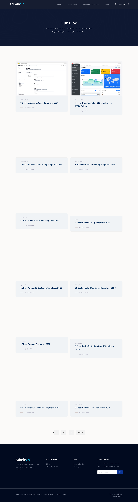

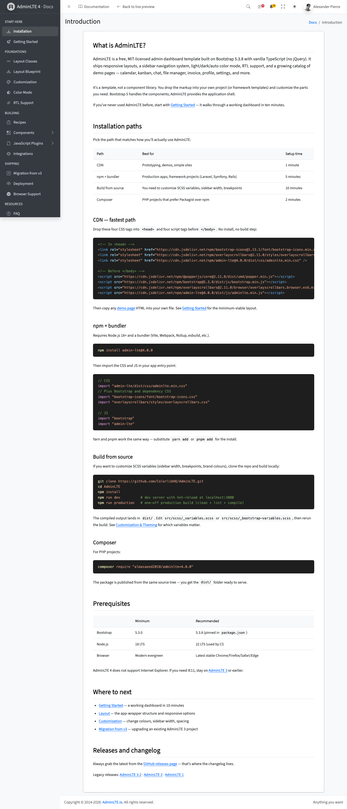


### Section Clips (screens/sections/)

_Clipped individual sections and components_

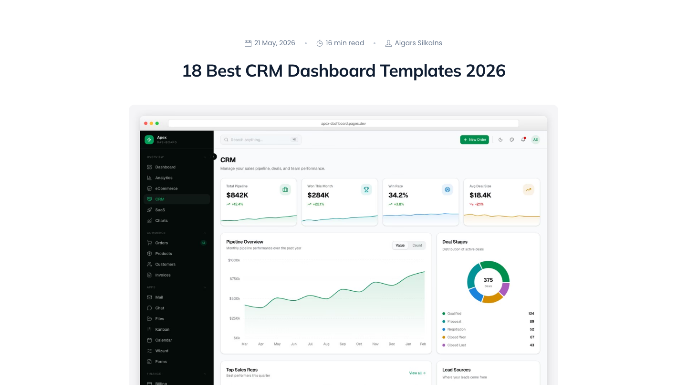

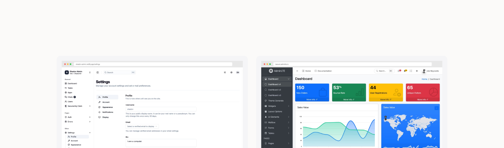

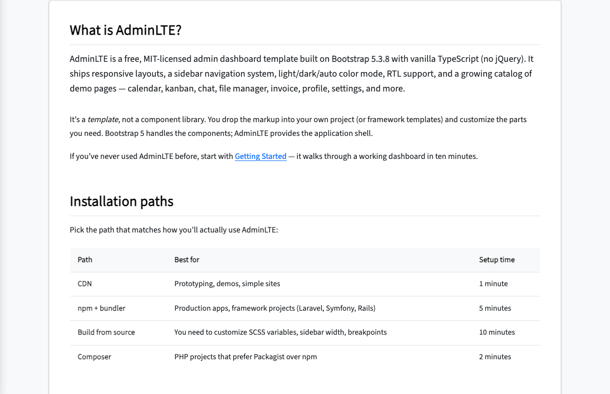

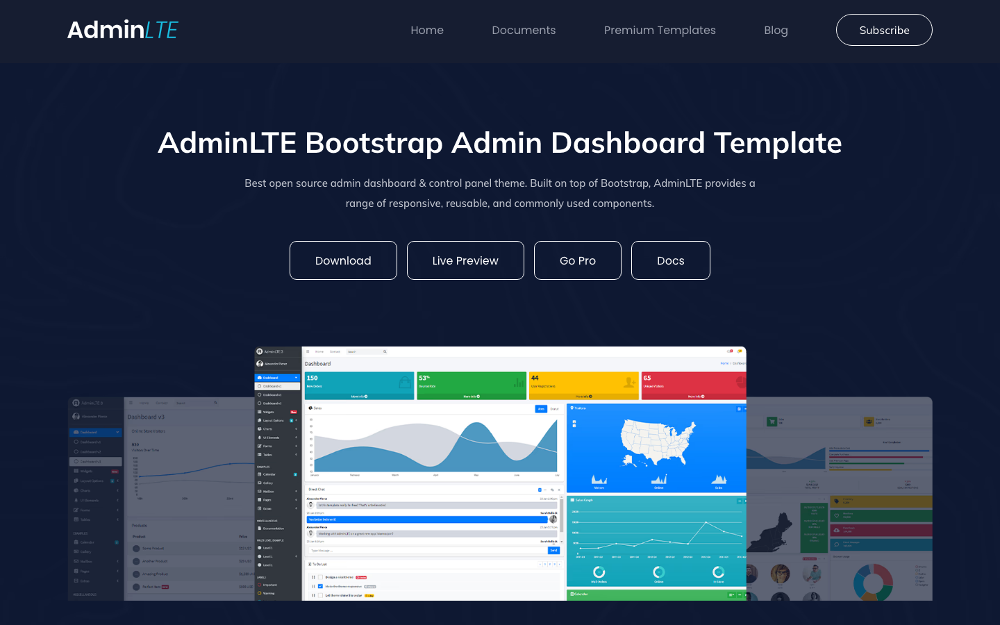

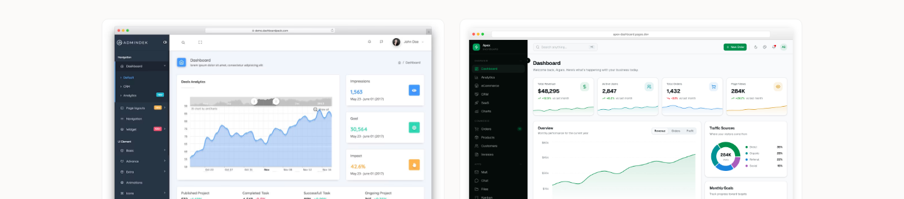

### Interaction States (screens/states/)

_Hover, focus, and active state captures_


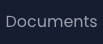


### Screenshot Index (screens/INDEX.md)

# Screenshot Index

## Scroll Journey

> Shows the cinematic state at each point of the page

| Scroll | Y Position | File                            |
| ------ | ---------- | ------------------------------- |
| 0%     | 0px        | `screens/scroll/scroll-000.png` |
| 17%    | 4997px     | `screens/scroll/scroll-017.png` |
| 33%    | 9701px     | `screens/scroll/scroll-033.png` |
| 50%    | 14699px    | `screens/scroll/scroll-050.png` |
| 67%    | 19696px    | `screens/scroll/scroll-067.png` |
| 83%    | 24400px    | `screens/scroll/scroll-083.png` |
| 100%   | 29397px    | `screens/scroll/scroll-100.png` |

## Pages

| Page                                                                  | URL                                                 | File                                             |
| --------------------------------------------------------------------- | --------------------------------------------------- | ------------------------------------------------ | ------------------------ |
| 18 Best CRM Dashboard Templates 2026 - AdminLTE.IO                    | `https://adminlte.io/blog/crm-dashboard-templates/` | `screens/pages/blog-crm-dashboard-templates.png` |
| AdminLTE — #1 Free Bootstrap Admin Dashboard Template                 | 45K+ GitHub Stars                                   | `https://adminlte.io/`                           | `screens/pages/home.png` |
| Introduction                                                          | AdminLTE 4                                          | `https://adminlte.io/docs`                       | `screens/pages/docs.png` |
| Premium Admin Dashboard Templates — Professional Bootstrap & Tailwind | `https://adminlte.io/premium/`                      | `screens/pages/premium.png`                      |
| AdminLTE Blog — Bootstrap, Tailwind & Admin Dashboard Guides          | `https://adminlte.io/blog/`                         | `screens/pages/blog.png`                         |

## Sections

| Page                         | Section         | File                                                          |
| ---------------------------- | --------------- | ------------------------------------------------------------- |
| blog-crm-dashboard-templates | #1 (section)    | `screens/sections/blog-crm-dashboard-templates-section-1.png` |
| home                         | #1 (section)    | `screens/sections/home-section-1.png`                         |
| docs                         | #1 (main > div) | `screens/sections/docs-section-1.png`                         |
| premium                      | #1 (section)    | `screens/sections/premium-section-1.png`                      |
| blog                         | #1 (section)    | `screens/sections/blog-section-1.png`                         |

## Homepage Screenshots (screenshots/)


