# attio Design System

You are building UI for **attio**. Dark-themed, neutral palette, monospace typography (inter), compact density on a 4px grid, expressive motion.

## Visual Reference

**IMPORTANT**: Study ALL screenshots below before writing any UI. Match colors, typography, spacing, layout, and motion exactly as shown.

### Scroll Journey (Cinematic Visual States)

> These screenshots capture the website at different scroll depths. The design changes dramatically as you scroll — each frame shows a different cinematic state. Replicate these exact visual transitions.

#### 0% — Hero / Above the fold

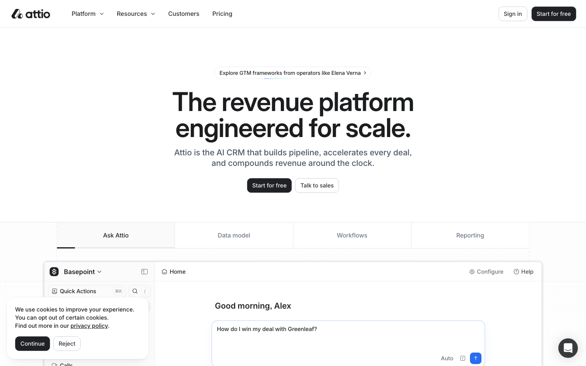

#### 17% — Mid-page at 17% scroll

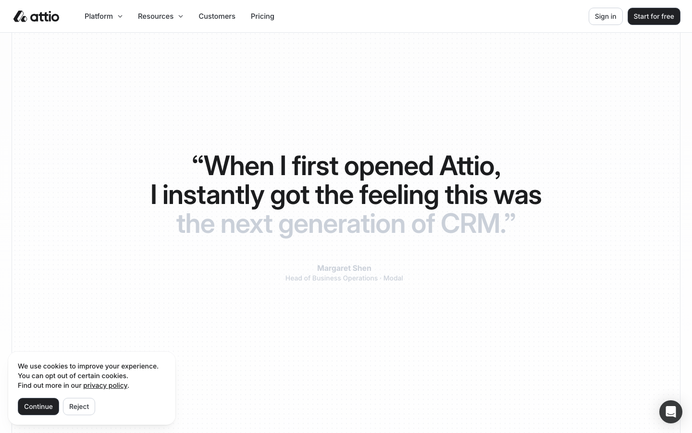

#### 33% — Mid-page at 33% scroll

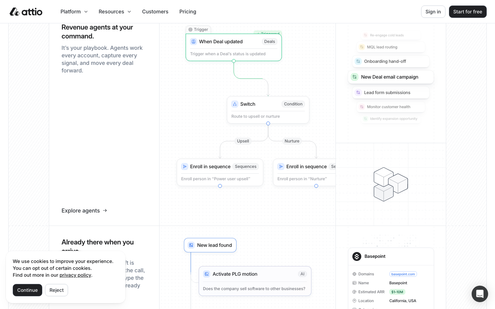

#### 50% — Mid-page at 50% scroll

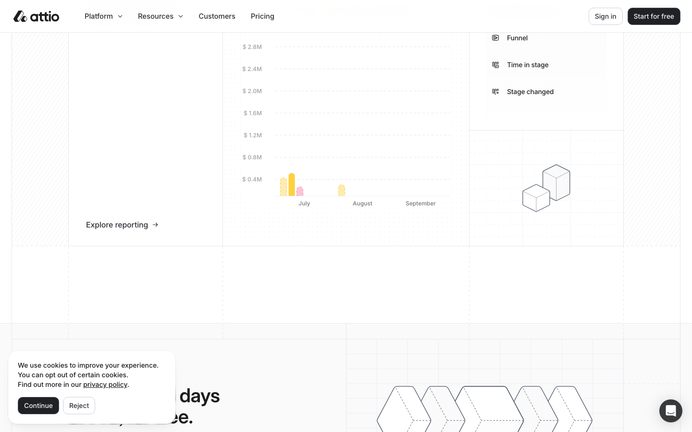

#### 67% — Mid-page at 67% scroll

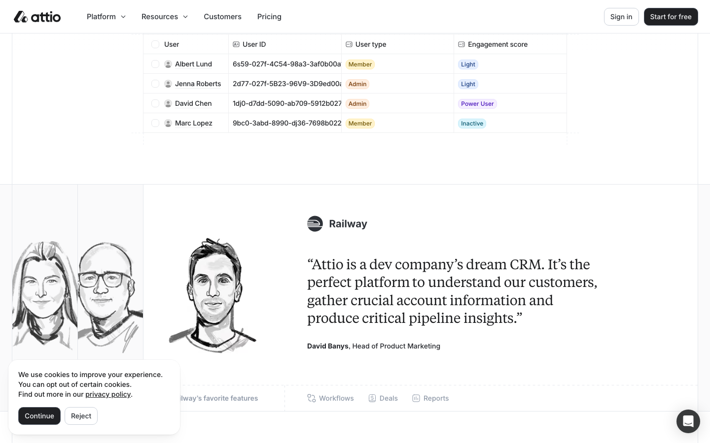

#### 83% — Mid-page at 83% scroll

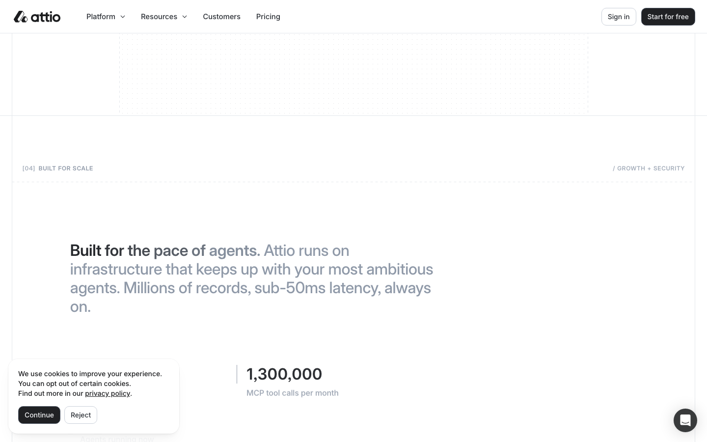

#### 100% — Footer / End of page

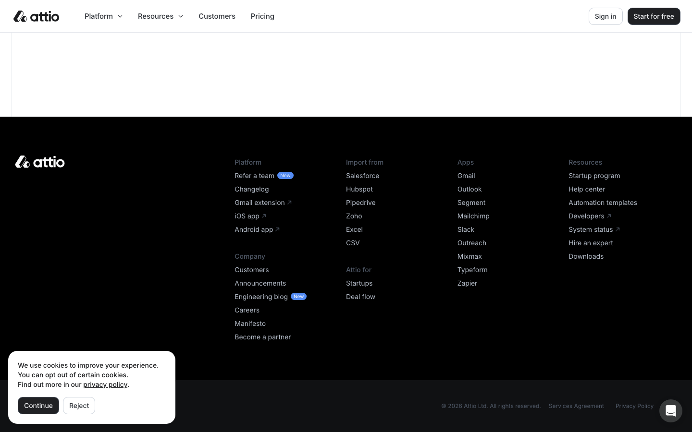

> Read `references/DESIGN.md` for full token details. Read `references/ANIMATIONS.md` for motion specs. Read `references/LAYOUT.md` for layout structure. Read `references/COMPONENTS.md` for component patterns.

## Ultra Reference Files

This package includes extended documentation. **Read these files before implementing:**

| File                         | Contents                                                           |
| ---------------------------- | ------------------------------------------------------------------ |
| `references/DESIGN.md`       | Full design system tokens, colors, typography, spacing             |
| `references/VISUAL_GUIDE.md` | **START HERE** — Master visual guide with all screenshots embedded |
| `references/ANIMATIONS.md`   | CSS keyframes, scroll triggers, motion library stack, video specs  |
| `references/LAYOUT.md`       | Flex/grid containers, page structure, spacing relationships        |
| `references/COMPONENTS.md`   | DOM component patterns, HTML structure, class fingerprints         |
| `references/INTERACTIONS.md` | Hover/focus states with before/after style diffs                   |
| `screens/scroll/`            | 7 scroll journey screenshots showing cinematic states              |

### Animation Stack Detected

- **Web Animations API (1 active)** — animation

## Design Philosophy

- **Layered depth** — use shadow tokens to create a sense of physical layering. Each elevation level has a specific shadow.
- **Gradient accents** — gradients are used thoughtfully for emphasis, not decoration.
- **Single typeface** — inter carries all text. Hierarchy comes from size, weight, and color — never font mixing.
- **compact density** — 4px base grid. Every dimension is a multiple of 4.
- **neutral palette** — the color temperature runs neutral, matching the monospace typography.
- **Expressive motion** — animations are an integral part of the experience. Use spring physics and layout animations.

## Color System

### Core Palette

| Role         | Token            | Hex       | Use                    |
| ------------ | ---------------- | --------- | ---------------------- |
| Background   | `--background`   | `#000000` | Page/app background    |
| Surface      | `--surface`      | `#1a2233` | Cards, panels, modals  |
| Text Primary | `--text-primary` | `#cad0d9` | Headings, body text    |
| Text Muted   | `--text-muted`   | `#505154` | Captions, placeholders |
| Border       | `--border`       | `#505967` | Dividers, card borders |

### Status Colors

| Status  | Hex       | Use                           |
| ------- | --------- | ----------------------------- |
| Warning | `#f5b900` | Caution states, pending items |
| Danger  | `#ff5b59` | Errors, destructive actions   |

### Extended Palette

- **tw-ring-offset-color:** `#ffffff` — Light surface or highlight color
- **color-white-200:** `#f5f0ff` — Light surface or highlight color
- **color-white-500:** `#e4e7ec` — Light surface or highlight color
- **color-black-700:** `#6f7988`
- **color-black-100:** `#1c1d1f` — Deep background layer or shadow color
- **color-blue-500:** `#266df0`
- **color-black-800:** `#8f99a8`
- `#18274b`

### CSS Variable Tokens

```css
--button-primary-bg-from: var(--button-primary-bg-hover-from);
--button-primary-bg-to: var(--button-primary-bg-hover-to);
--button-primary-bg-from: var(--button-primary-bg-focus-from);
--button-primary-bg-to: var(--button-primary-bg-focus-to);
--button-primary-bg-from: var(--button-primary-bg-active-from);
--button-primary-bg-to: var(--button-primary-bg-active-to);
--button-primary-bg-from: var(--button-primary-bg-disabled-from);
--button-primary-bg-to: var(--button-primary-bg-disabled-to);
--button-primary-bg-from: var(--color-black-200);
--button-primary-bg-to: var(--color-black-200);
--button-primary-bg-fallback: var(--color-black-200);
--button-primary-border: var(--color-black-600);
--button-primary-text: var(--color-white-300);
--button-primary-bg-hover-from: var(--color-black-600);
--button-primary-bg-hover-to: var(--color-black-200);
--button-primary-bg-hover-fallback: var(--color-black-500);
--button-primary-border-hover: var(--color-black-600);
--button-primary-text-hover: var(--color-white-100);
--button-primary-bg-focus-from: var(--color-black-600);
--button-primary-bg-focus-to: var(--color-black-200);
```

## Typography

### Font Stack

- **inter** — Heading 1, Heading 2, Heading 3
- **JetBrains Mono** — Body, Caption, Code

### Font Sources

```css
@font-face {
  font-family: 'JetBrains Mono';
  src: url('fonts/JetBrainsMono-Bold.ttf') format('truetype');
  font-weight: 700;
}
@font-face {
  font-family: 'JetBrains Mono';
  src: url('fonts/JetBrainsMono-Regular.ttf') format('truetype');
  font-weight: 400;
}
@font-face {
  font-family: 'inter';
  src: url('fonts/inter-Regular.woff2') format('woff2');
  font-weight: 400;
}
@font-face {
  font-family: 'inter';
  src: url('fonts/inter-700.woff2') format('woff2');
  font-weight: 700;
}
@font-face {
  font-family: 'interDisplay';
  src: url('fonts/interDisplay-700.woff2') format('woff2');
  font-weight: 700;
}
@font-face {
  font-family: 'tiemposText';
  src: url('fonts/tiemposText-Regular.woff2') format('woff2');
  font-weight: 400;
}
```

### Type Scale

| Role      | Family         | Size  | Weight |
| --------- | -------------- | ----- | ------ |
| Heading 1 | inter          | 112px | 700    |
| Heading 2 | inter          | 80px  | 700    |
| Heading 3 | inter          | 72px  | 700    |
| Body      | JetBrains Mono | 12px  | 400    |
| Caption   | JetBrains Mono | 13px  | 400    |
| Code      | JetBrains Mono | 14px  | 400    |

### Typography Rules

- All text uses **inter** — never add another font family
- Max 3-4 font sizes per screen
- Headings: weight 600-700, body: weight 400
- Use color and opacity for text hierarchy, not additional font sizes
- Line height: 1.5 for body, 1.2 for headings

## Spacing & Layout

### Base Grid: 4px

Every dimension (margin, padding, gap, width, height) must be a multiple of **4px**.

### Spacing Scale

`2, 4, 6, 8, 10, 12, 14, 16, 18, 20, 22, 24` px

### Spacing as Meaning

| Spacing | Use                                                |
| ------- | -------------------------------------------------- |
| 4-8px   | Tight: related items (icon + label, avatar + name) |
| 12-16px | Medium: between groups within a section            |
| 24-32px | Wide: between distinct sections                    |
| 48px+   | Vast: major page section breaks                    |

### Border Radius

Scale: `2px, 2.5px, 3px, 3.5px, 4px, 4.5px, 4.8px, 5px, 6px, 6.5px, 7px, 8px, 9px, 9.5px, 10px, 11px, 12px, 13px, 14px, 15px, 16px, 17px, 18px, 19px, 20px, 22px, 24px, 28px, 30%, 37px, 40px, 100%, inherit`
Default: `12px`

### Container

Max-width: `1536px`, centered with auto margins.

### Breakpoints

| Name | Value  |
| ---- | ------ |
| xs   | 375px  |
| xs   | 450px  |
| sm   | 576px  |
| md   | 768px  |
| lg   | 992px  |
| xl   | 1078px |
| xl   | 1199px |
| xl   | 1200px |
| 2xl  | 1320px |
| 2xl  | 1360px |
| 2xl  | 1536px |

Mobile-first: design for small screens, layer on responsive overrides.

## Component Patterns

### Card

```css
.card {
  background: #1a2233;
  border: 1px solid #505967;
  border-radius: 12px;
  padding: 16px;
  box-shadow:
    0 1px 3px #0000000a,
    0 0 2px #1c28402e;
}
```

```html
<div class="card">
  <h3>Card Title</h3>
  <p>Card content goes here.</p>
</div>
```

### Button

```css
/* Primary */
.btn-primary {
  background: #444444;
  color: #cad0d9;
  border-radius: 12px;
  padding: 8px 16px;
  font-weight: 500;
  transition: opacity 150ms ease;
}
.btn-primary:hover {
  opacity: 0.9;
}

/* Ghost */
.btn-ghost {
  background: transparent;
  border: 1px solid #505967;
  color: #cad0d9;
  border-radius: 12px;
  padding: 8px 16px;
}
```

```html
<button class="btn-primary">Get Started</button>
<button class="btn-ghost">Learn More</button>
```

### Input

```css
.input {
  background: #000000;
  border: 1px solid #505967;
  border-radius: 12px;
  padding: 8px 12px;
  color: #cad0d9;
  font-size: 14px;
}
.input:focus {
  border-color: var(--accent);
  outline: none;
}
```

```html
<input class="input" type="text" placeholder="Search..." />
```

### Badge / Chip

```css
.badge {
  display: inline-flex;
  align-items: center;
  padding: 4px 8px;
  border-radius: 9999px;
  font-size: 12px;
  font-weight: 500;
  background: #1a2233;
  color: #505154;
}
```

```html
<span class="badge">New</span> <span class="badge">Beta</span>
```

### Modal / Dialog

```css
.modal-backdrop {
  background: rgba(0, 0, 0, 0.6);
}
.modal {
  background: #1a2233;
  border: 1px solid #505967;
  border-radius: inherit;
  padding: 24px;
  max-width: 480px;
  width: 90vw;
  box-shadow:
    rgba(0, 0, 0, 0) 0px 0px 0px 0px,
    rgba(0, 0, 0, 0) 0px 0px 0px 0px,
    rgba(0, 0, 0, 0) 0px 0px 0px 0px,
    rgba(0, 0, 0, 0) 0px 0px 0px 0px,
    rgba(28, 29, 31, 0.1) 0px 0px 0px 1px,
    rgba(28, 29, 31, 0.05) 0px 1px 2px 0px,
    rgba(28, 29, 31, 0.02) 0px 2px 4px -1px,
    rgba(28, 29, 31, 0.03) 0px 4px 8px -2px,
    rgba(28, 29, 31, 0.04) 0px 8px 16px -4px,
    rgba(28, 29, 31, 0.05) 0px 16px 32px -8px,
    rgba(28, 29, 31, 0.06) 0px 32px 64px -8px;
}
```

```html
<div class="modal-backdrop">
  <div class="modal">
    <h2>Dialog Title</h2>
    <p>Dialog content.</p>
    <button class="btn-primary">Confirm</button>
    <button class="btn-ghost">Cancel</button>
  </div>
</div>
```

### Table

```css
.table {
  width: 100%;
  border-collapse: collapse;
}
.table th {
  text-align: left;
  padding: 8px 12px;
  font-weight: 500;
  font-size: 12px;
  color: #505154;
  text-transform: uppercase;
  letter-spacing: 0.05em;
  border-bottom: 1px solid #505967;
}
.table td {
  padding: 12px;
  border-bottom: 1px solid #505967;
}
```

```html
<table class="table">
  <thead>
    <tr>
      <th>Name</th>
      <th>Status</th>
      <th>Date</th>
    </tr>
  </thead>
  <tbody>
    <tr>
      <td>Item One</td>
      <td>Active</td>
      <td>Jan 1</td>
    </tr>
    <tr>
      <td>Item Two</td>
      <td>Pending</td>
      <td>Jan 2</td>
    </tr>
  </tbody>
</table>
```

### Navigation

```css
.nav {
  display: flex;
  align-items: center;
  gap: 8px;
  padding: 12px 16px;
  border-bottom: 1px solid #505967;
}
.nav-link {
  color: #505154;
  padding: 8px 12px;
  border-radius: 12px;
  transition: color 150ms;
}
.nav-link:hover {
  color: #cad0d9;
}
```

```html
<nav class="nav">
  <a href="/" class="nav-link active">Home</a>
  <a href="/about" class="nav-link">About</a>
  <a href="/pricing" class="nav-link">Pricing</a>
  <button class="btn-primary" style="margin-left: auto">Get Started</button>
</nav>
```

### Extracted Components

These components were found in the codebase:

**Button** (`html`)

**Input** (`html`)

**Card** (`html`)

- Variants: `running`, `completed`, `connection`

**Navigation** (`html`)

**Footer** (`html`)

## Page Structure

The following page sections were detected:

- **Navigation** — Top navigation bar (25 items)
- **Hero** — Hero/banner section with headline and CTAs
- **Footer** — Page footer with links and info (43 items)
- **Testimonials** — Testimonials/reviews section
- **Cards** — Grid of 15 card elements (15 items)

When building pages, follow this section order and structure.

## Animation & Motion

This project uses **expressive motion**. Animations are part of the design language.

### CSS Animations

- `ai-hero-box-gradient-spin`
- `rotate-reporting`
- `pricing-cards-grid-line-appear`
- `rotate`
- `connection`

### Motion Tokens

- **Duration scale:** `0s`, `0ms`, `.1s`, `.15s`, `.2s`, `.25s`, `.3s`, `.4s`, `.5s`, `.6s`, `.7s`, `1s`, `1.25s`, `1.5s`, `2s`, `50ms`, `100ms`, `125ms`, `150ms`, `200ms`, `300ms`, `400ms`, `450ms`, `500ms`, `600ms`, `620ms`, `700ms`, `1200ms`
- **Easing functions:** `ease-out`, `ease-in-out`, `linear`, `cubic-bezier(.22,1,.36,1)`, `cubic-bezier(.7,0,.84,0)`, `cubic-bezier(.32,0,.67,0)`, `cubic-bezier(.33,1,.68,1)`, `cubic-bezier(.37,0,.63,1)`, `cubic-bezier(.45,0,.55,1)`, `cubic-bezier(.65,0,.35,1)`, `cubic-bezier(0,0,0,1)`, `cubic-bezier(.16,1,.3,1)`, `cubic-bezier(.215,.61,.355,1)`
- **Animated properties:** `opacity`, `translate`

### Motion Guidelines

- **Duration:** Use values from the duration scale above. Short (0s) for micro-interactions, long (1200ms) for page transitions
- **Easing:** Use `ease-out` as the default easing curve
- **Direction:** Elements enter from bottom/right, exit to top/left
- **Reduced motion:** Always respect `prefers-reduced-motion` — disable animations when set

## Dark Mode

This project supports **light and dark mode** via CSS variables.

### Token Mapping

| Variable                                    | Light                    | Dark                     |
| ------------------------------------------- | ------------------------ | ------------------------ |
| `--button-outline-bg`                       | `var(--color-white-100)` | `var(--color-black-50)`  |
| `--button-outline-border`                   | `var(--color-white-800)` | `var(--color-black-400)` |
| `--button-outline-text`                     | `var(--color-black-400)` | `var(--color-white-400)` |
| `--button-outline-bg-hover`                 | `var(--color-white-100)` | `var(--color-black-100)` |
| `--button-outline-border-hover`             | `var(--color-black-700)` | `var(--color-black-500)` |
| `--button-outline-text-hover`               | `var(--color-black-400)` | `var(--color-white-400)` |
| `--button-outline-bg-focus`                 | `var(--color-white-100)` | `var(--color-black-200)` |
| `--button-outline-border-focus`             | `var(--color-black-700)` | `var(--color-black-600)` |
| `--button-outline-text-focus`               | `var(--color-black-400)` | `var(--color-white-400)` |
| `--button-outline-bg-active`                | `var(--color-white-300)` | `var(--color-black-350)` |
| `--button-outline-border-active`            | `var(--color-black-500)` | `var(--color-white-100)` |
| `--button-outline-text-active`              | `var(--color-black-300)` | `var(--color-white-100)` |
| `--button-outline-bg-disabled`              | `var(--color-white-100)` | `var(--color-black-200)` |
| `--button-outline-border-disabled`          | `var(--color-white-500)` | `var(--color-black-400)` |
| `--button-outline-text-disabled-foreground` | `var(--color-white-800)` | `var(--color-black-500)` |

### Implementation

- Toggle via `.dark` class on `<html>` or `[data-theme="dark"]`
- Always use CSS variables for colors — never hardcode hex values
- Test both modes for contrast and readability

## Depth & Elevation

### Shadow Tokens

- Subtle: `0 0 0 1px #fff`
- Raised (cards, buttons): `0 1px 3px #0000000a,0 0 2px #1c28402e`
- Overlay (modals, dialogs): `rgba(0, 0, 0, 0) 0px 0px 0px 0px, rgba(0, 0, 0, 0) 0px 0px 0px 0px, rgba(0, 0, 0, 0) 0px 0px 0px 0px, rgba(0, 0, 0, 0) 0px 0px 0px 0px, rgba(28, 29, 31, 0.1) 0px 0px 0px 1px, rgba(28, 29, 31, 0.05) 0px 1px 2px 0px, rgba(28, 29, 31, 0.02) 0px 2px 4px -1px, rgba(28, 29, 31, 0.03) 0px 4px 8px -2px, rgba(28, 29, 31, 0.04) 0px 8px 16px -4px, rgba(28, 29, 31, 0.05) 0px 16px 32px -8px, rgba(28, 29, 31, 0.06) 0px 32px 64px -8px`

### Z-Index Scale

`0, 1, 2, 3, 10, 20, 30, 40, 50, 90, 91, 92, 93, 100, 101, 200, 201, 202, 999, 9999, 10000, 2147483647`

Use these exact values — never invent z-index values.

## Anti-Patterns (Never Do)

- **No blur effects** — no backdrop-blur, no filter: blur()
- **No zebra striping** — tables and lists use borders for separation
- **No invented colors** — every hex value must come from the palette above
- **No arbitrary spacing** — every dimension is a multiple of 4px
- **No extra fonts** — only inter and JetBrains Mono are allowed
- **No arbitrary border-radius** — use the scale: 2px, 2.5px, 3px, 3.5px, 4px, 4.5px, 4.8px, 5px, 6px, 6.5px
- **No opacity for disabled states** — use muted colors instead
- **No pill shapes** — this design doesn't use rounded-full / 9999px radius

## Workflow

1. **Read** `references/DESIGN.md` before writing any UI code
2. **Pick colors** from the Color System section — never invent new ones
3. **Set typography** — inter, JetBrains Mono only, using the type scale
4. **Build layout** on the 4px grid — check every margin, padding, gap
5. **Match components** to patterns above before creating new ones
6. **Apply elevation** — use shadow tokens
7. **Validate** — every value traces back to a design token. No magic numbers.

## Brand Spec

- **Favicon:** `/favicon.ico`
- **Site URL:** `https://attio.com/`
- **Brand typeface:** inter

## Quick Reference

```
Background:     #000000
Surface:        #1a2233
Text:           #cad0d9 / #505154
Accent:         (not extracted)
Border:         #505967
Font:           inter
Spacing:        4px grid
Radius:         12px
Components:     10 detected
```

## When to Trigger

Activate this skill when:

- Creating new components, pages, or visual elements for attio
- Writing CSS, Tailwind classes, styled-components, or inline styles
- Building page layouts, templates, or responsive designs
- Reviewing UI code for design consistency
- The user mentions "attio" design, style, UI, or theme
- Generating mockups, wireframes, or visual prototypes

---

# Full Reference Files

> Every output file is embedded below. Claude has full design system context from /skills alone.

## Design System Tokens (DESIGN.md)

# attio DESIGN.md

> Auto-generated design system — reverse-engineered via static analysis by skillui.
> Frameworks: None detected
> Colors: 20 · Fonts: 2 · Components: 10
> Icon library: not detected · State: not detected
> Primary theme: dark · Dark mode toggle: yes · Motion: expressive

---

## 1. Visual Theme & Atmosphere

This is a **dark-themed** interface with a neutral tone. Depth is expressed through layered shadows and subtle surface color variation. Typography uses **inter** throughout — a technical, developer-focused choice that maintains consistency. Spacing follows a **4px base grid** (compact density), with scale: 2, 4, 6, 8, 10, 12, 14, 16px. Motion is expressive — spring physics, layout animations, and staggered reveals are part of the visual language.

---

## 2. Color Palette & Roles

| Token                      | Hex       | Role         | Use                                    |
| -------------------------- | --------- | ------------ | -------------------------------------- |
| color-black-0              | `#000000` | background   | Page background, darkest surface       |
| color-blue-800             | `#1a2233` | surface      | Card and panel backgrounds             |
| color-white-800            | `#cad0d9` | text-primary | Headings and body text                 |
| text-muted                 | `#505154` | text-muted   | Captions, placeholders, secondary info |
| button-primary-border      | `#505967` | border       | Dividers, card borders, outlines       |
| color-red-500              | `#ff5b59` | danger       | Error states, destructive actions      |
| color-yellow-500           | `#f5b900` | warning      | Warning states, caution indicators     |
| color-blue-500             | `#266df0` | info         | Informational highlights               |
| tw-ring-offset-color       | `#ffffff` | unknown      | Palette color                          |
| color-white-200            | `#f5f0ff` | unknown      | Palette color                          |
| color-white-500            | `#e4e7ec` | unknown      | Palette color                          |
| color-black-700            | `#6f7988` | unknown      | Palette color                          |
| color-black-100            | `#1c1d1f` | unknown      | Palette color                          |
| color-black-800            | `#8f99a8` | unknown      | Palette color                          |
| unknown                    | `#18274b` | unknown      | Palette color                          |
| unknown                    | `#9ea1a4` | unknown      | Palette color                          |
| color-blue-100             | `#daf4fc` | unknown      | Palette color                          |
| color-blue-400             | `#70a1f0` | unknown      | Palette color                          |
| color-black-500            | `#383e47` | unknown      | Palette color                          |
| button-primary-bg-hover-to | `#c8dcff` | unknown      | Palette color                          |

### Dark Mode Token Mapping

| Variable                                    | Light                    | Dark                     |
| ------------------------------------------- | ------------------------ | ------------------------ |
| `--button-outline-bg`                       | `var(--color-white-100)` | `var(--color-black-50)`  |
| `--button-outline-border`                   | `var(--color-white-800)` | `var(--color-black-400)` |
| `--button-outline-text`                     | `var(--color-black-400)` | `var(--color-white-400)` |
| `--button-outline-bg-hover`                 | `var(--color-white-100)` | `var(--color-black-100)` |
| `--button-outline-border-hover`             | `var(--color-black-700)` | `var(--color-black-500)` |
| `--button-outline-text-hover`               | `var(--color-black-400)` | `var(--color-white-400)` |
| `--button-outline-bg-focus`                 | `var(--color-white-100)` | `var(--color-black-200)` |
| `--button-outline-border-focus`             | `var(--color-black-700)` | `var(--color-black-600)` |
| `--button-outline-text-focus`               | `var(--color-black-400)` | `var(--color-white-400)` |
| `--button-outline-bg-active`                | `var(--color-white-300)` | `var(--color-black-350)` |
| `--button-outline-border-active`            | `var(--color-black-500)` | `var(--color-white-100)` |
| `--button-outline-text-active`              | `var(--color-black-300)` | `var(--color-white-100)` |
| `--button-outline-bg-disabled`              | `var(--color-white-100)` | `var(--color-black-200)` |
| `--button-outline-border-disabled`          | `var(--color-white-500)` | `var(--color-black-400)` |
| `--button-outline-text-disabled-foreground` | `var(--color-white-800)` | `var(--color-black-500)` |
| `--button-ghost-text`                       | `var(--color-black-400)` | `var(--color-white-500)` |
| `--button-ghost-bg-hover`                   | `var(--color-white-300)` | `var(--color-black-400)` |
| `--button-ghost-text-hover`                 | `var(--color-black-300)` | `var(--color-white-100)` |
| `--button-ghost-bg-focus`                   | `var(--color-white-300)` | `var(--color-black-400)` |
| `--button-ghost-text-focus`                 | `var(--color-black-300)` | `var(--color-white-100)` |

### CSS Variable Tokens

```css
--button-primary-bg-from: var(--button-primary-bg-hover-from);
--button-primary-bg-to: var(--button-primary-bg-hover-to);
--button-primary-bg-from: var(--button-primary-bg-focus-from);
--button-primary-bg-to: var(--button-primary-bg-focus-to);
--button-primary-bg-from: var(--button-primary-bg-active-from);
--button-primary-bg-to: var(--button-primary-bg-active-to);
--button-primary-bg-from: var(--button-primary-bg-disabled-from);
--button-primary-bg-to: var(--button-primary-bg-disabled-to);
--button-primary-bg-from: var(--color-black-200);
--button-primary-bg-to: var(--color-black-200);
--button-primary-bg-fallback: var(--color-black-200);
--button-primary-border: var(--color-black-600);
--button-primary-text: var(--color-white-300);
--button-primary-bg-hover-from: var(--color-black-600);
--button-primary-bg-hover-to: var(--color-black-200);
--button-primary-bg-hover-fallback: var(--color-black-500);
--button-primary-border-hover: var(--color-black-600);
--button-primary-text-hover: var(--color-white-100);
--button-primary-bg-focus-from: var(--color-black-600);
--button-primary-bg-focus-to: var(--color-black-200);
```

---

## 3. Typography Rules

**Font Stack:**

- **inter** — Heading 1, Heading 2, Heading 3
- **JetBrains Mono** — Body, Caption, Code

**Font Sources:**

```css
@font-face {
  font-family: 'JetBrains Mono';
  src: url('fonts/JetBrainsMono-Bold.ttf') format('truetype');
  font-weight: 700;
}
@font-face {
  font-family: 'JetBrains Mono';
  src: url('fonts/JetBrainsMono-Regular.ttf') format('truetype');
  font-weight: 400;
}
@font-face {
  font-family: 'inter';
  src: url('fonts/inter-Regular.woff2') format('woff2');
  font-weight: 400;
}
@font-face {
  font-family: 'inter';
  src: url('fonts/inter-700.woff2') format('woff2');
  font-weight: 700;
}
@font-face {
  font-family: 'interDisplay';
  src: url('fonts/interDisplay-700.woff2') format('woff2');
  font-weight: 700;
}
@font-face {
  font-family: 'tiemposText';
  src: url('fonts/tiemposText-Regular.woff2') format('woff2');
  font-weight: 400;
}
```

| Role      | Font           | Size  | Weight |
| --------- | -------------- | ----- | ------ |
| Heading 1 | inter          | 112px | 700    |
| Heading 2 | inter          | 80px  | 700    |
| Heading 3 | inter          | 72px  | 700    |
| Body      | JetBrains Mono | 12px  | 400    |
| Caption   | JetBrains Mono | 13px  | 400    |
| Code      | JetBrains Mono | 14px  | 400    |

**Typographic Rules:**

- Use **inter** for all text — do not mix font families
- Maintain consistent hierarchy: no more than 3-4 font sizes per screen
- Headings use bold (600-700), body uses regular (400)
- Line height: 1.5 for body text, 1.2 for headings
- Use color and opacity for secondary hierarchy, not additional font sizes

---

## 4. Component Stylings

### Layout (1)

**Footer** — `html`

### Navigation (1)

**Navigation** — `html`

### Data Display (2)

**Card** — `html`

- Variants: `running`, `completed`, `connection`

**List** — `html`

### Data Input (2)

**Button** — `html`

- Animation:

**Input** — `html`

- State: :focus, :placeholder

### Overlay (1)

**Modal** — `html`

### Media (3)

**Image** — `html`

**Icon** — `html`

**Map/Canvas** — `html`

---

## 5. Layout Principles

- **Base spacing unit:** 4px
- **Spacing scale:** 2, 4, 6, 8, 10, 12, 14, 16, 18, 20, 22, 24
- **Border radius:** 2px, 2.5px, 3px, 3.5px, 4px, 4.5px, 4.8px, 5px, 6px, 6.5px, 7px, 8px, 9px, 9.5px, 10px, 11px, 12px, 13px, 14px, 15px, 16px, 17px, 18px, 19px, 20px, 22px, 24px, 28px, 30%, 37px, 40px, 100%, inherit
- **Max content width:** 1536px

**Spacing as Meaning:**
| Spacing | Use |
|---|---|
| 4-8px | Tight: related items within a group |
| 12-16px | Medium: between groups |
| 24-32px | Wide: between sections |
| 48px+ | Vast: major section breaks |

---

## 6. Depth & Elevation

### Flat — subtle depth hints

- `0 0 0 1px #fff`

### Raised — cards, buttons, interactive elements

- `0 1px 3px #0000000a,0 0 2px #1c28402e`

### Overlay — full-screen overlays, top-level dialogs

- `rgba(0, 0, 0, 0) 0px 0px 0px 0px, rgba(0, 0, 0, 0) 0px 0px 0px 0px, rgba(0, 0, 0, 0) 0px 0px 0px 0px, rgba(0, 0, 0, 0) 0px 0px 0px 0px, rgba(28, 29, 31, 0.1) 0px 0px 0px 1px, rgba(28, 29, 31, 0.05) 0px 1px 2px 0px, rgba(28, 29, 31, 0.02) 0px 2px 4px -1px, rgba(28, 29, 31, 0.03) 0px 4px 8px -2px, rgba(28, 29, 31, 0.04) 0px 8px 16px -4px, rgba(28, 29, 31, 0.05) 0px 16px 32px -8px, rgba(28, 29, 31, 0.06) 0px 32px 64px -8px`

### Z-Index Scale

`0, 1, 2, 3, 10, 20, 30, 40, 50, 90, 91, 92, 93, 100, 101, 200, 201, 202, 999, 9999, 10000, 2147483647`

---

## 7. Animation & Motion

This project uses **expressive motion**. Animations are an integral part of the experience.

### CSS Animations

- `@keyframes ai-hero-box-gradient-spin`
- `@keyframes rotate-reporting`
- `@keyframes pricing-cards-grid-line-appear`
- `@keyframes rotate`
- `@keyframes connection`
- `@keyframes running`
- `@keyframes completed`
- `@keyframes spin`

### Animated Components

- **Button**:

### Motion Guidelines

- Duration: 150-300ms for micro-interactions, 300-500ms for page transitions
- Easing: `ease-out` for enters, `ease-in` for exits
- Always respect `prefers-reduced-motion`

---

## 8. Do's and Don'ts

### Do's

- Use `#000000` as the primary page background
- Use **inter** for all UI text
- Follow the **4px** spacing grid for all margins, padding, and gaps
- Use the defined shadow tokens for elevation — see Section 6
- Use border-radius from the scale: 2px, 2.5px, 3px, 3.5px, 4px
- Reuse existing components from Section 4 before creating new ones
- Always use CSS variables for colors — never hardcode hex
- Test both light and dark modes for contrast

### Don'ts

- Don't introduce colors outside this palette — extend the design tokens first
- Don't mix font families — use inter consistently
- Don't use arbitrary spacing values — stick to multiples of 4px
- Don't create custom box-shadow values outside the system tokens
- Don't use arbitrary border-radius values — pick from the defined scale
- Don't duplicate component patterns — check Section 4 first
- Don't use backdrop-blur or blur effects

### Anti-Patterns (detected from codebase)

- No blur or backdrop-blur effects
- No zebra striping on tables/lists

---

## 9. Responsive Behavior

| Name | Value  | Source |
| ---- | ------ | ------ |
| xs   | 375px  | css    |
| xs   | 450px  | css    |
| sm   | 576px  | css    |
| md   | 768px  | css    |
| lg   | 992px  | css    |
| xl   | 1078px | css    |
| xl   | 1199px | css    |
| xl   | 1200px | css    |
| 2xl  | 1320px | css    |
| 2xl  | 1360px | css    |
| 2xl  | 1536px | css    |

**Approach:** Use `@media (min-width: ...)` queries matching the breakpoints above.

---

## 10. Agent Prompt Guide

Use these as starting points when building new UI:

### Build a Card

```
Background: #1a2233
Border: 1px solid #505967
Radius: 12px
Padding: 16px
Font: inter
Use shadow tokens from Section 6.
```

### Build a Button

```
Primary: bg var(--accent), text white
Ghost: bg transparent, border #505967
Padding: 8px 16px
Radius: 12px
Hover: opacity 0.9 or lighter shade
Focus: ring with var(--accent)
```

### Build a Page Layout

```
Background: #000000
Max-width: 1536px, centered
Grid: 4px base
Responsive: mobile-first, breakpoints from Section 9
```

### Build a Stats Card

```
Surface: #1a2233
Label: #505154 (muted, 12px, uppercase)
Value: #cad0d9 (primary, 24-32px, bold)
Status: use success/warning/danger from Section 2
```

### Build a Form

```
Input bg: #000000
Input border: 1px solid #505967
Focus: border-color var(--accent)
Label: #505154 12px
Spacing: 16px between fields
Radius: 12px
```

### General Component

```
1. Read DESIGN.md Sections 2-6 for tokens
2. Colors: only from palette
3. Font: inter, type scale from Section 3
4. Spacing: 4px grid
5. Components: match patterns from Section 4
6. Elevation: shadow tokens
```

## Visual Guide — Screenshots (VISUAL_GUIDE.md)

# attio — Visual Guide

> Master visual reference. Study every screenshot carefully before implementing any UI.
> Match colors, layout, typography, spacing, and motion states exactly.

**Motion Stack:** **Web Animations API (1 active)**

## Scroll Journey

The page has cinematic scroll animations. Each screenshot below shows the exact visual state at that scroll depth.
**Replicate these transitions precisely** — the design changes dramatically as you scroll.

### Hero — Above the fold

_Scroll position: 0px of 12802px total_


### 17% scroll depth

_Scroll position: 2023px of 12802px total_


### 33% scroll depth

_Scroll position: 3928px of 12802px total_


### 50% scroll depth

_Scroll position: 5951px of 12802px total_


### 67% scroll depth

_Scroll position: 7974px of 12802px total_


### 83% scroll depth

_Scroll position: 9879px of 12802px total_


### Footer — End of page

_Scroll position: 11902px of 12802px total_


## Full Page Screenshots

### Attio: Ask more from CRM

_URL: `https://attio.com/`_


### Agents and automations | Attio

_URL: `https://attio.com/platform/workflows`_


### Customers | Attio

_URL: `https://attio.com/customers`_


### Pricing | Attio

_URL: `https://attio.com/pricing`_


### Ask Attio | Attio

_URL: `https://attio.com/platform/ask`_


## Section Screenshots

Clipped sections showing individual components in context.

### Section 1 — `section`

_1440×1200px_


### Section 8 — `main > div`

_1440×790px_


### Section 3 — `header`

_1158×492px_


### Section 5 — `main > div`

_1440×314px_


### Section 3 — `main > div`

_1440×774px_


### Section 1 — `section`

_1440×983px_


## Animations & Motion (ANIMATIONS.md)

# Animation Reference

> Cinematic motion design extracted from live DOM. Follow these specs exactly to recreate the experience.

## Motion Technology Stack

| Library                           | Type      | Notes               |
| --------------------------------- | --------- | ------------------- |
| **Web Animations API (1 active)** | animation |                     |
| Canvas (5 elements)               | 2D Canvas | 2D canvas rendering |

## Scroll Journey

The page is **12,802px** tall. Each frame below shows what the user sees at that scroll depth.

> **Use these screenshots to understand WHAT animates, WHEN it animates, and HOW it moves.**

### 0% — Top / Hero

Scroll position: 0px


### 17% — Opening Section

Scroll position: 2,023px


### 33% — First Feature Section

Scroll position: 3,928px


### 50% — Mid-Page

Scroll position: 5,951px


### 67% — Lower Content

Scroll position: 7,974px


### 83% — Near Footer

Scroll position: 9,879px


### 100% — Bottom / Footer

Scroll position: 11,902px


## Scroll Animation Patterns

| Pattern                  | Library | Element Count | Duration | Delay | Easing |
| ------------------------ | ------- | ------------- | -------- | ----- | ------ |
| parallax / sticky scroll | CSS     | 2             | —        | —     | —      |

### CSS Implementation

## CSS Keyframes (50 extracted)

### `@keyframes pricing-cards-grid-line-appear`

Duration: `1.5s` · Easing: `ease-out` · Delay: `0s` · Iteration: `1` · Fill: `both`

Used by: `.pricing-cards-grid-line`, `.pricing-cards-grid-line-vertical`

```css
@keyframes pricing-cards-grid-line-appear {
  100% {
    --pricing-cards-grid-line-position-start: 100%;
    --pricing-cards-grid-line-position-end: 130%;
  }
}
```

### `@keyframes ai-hero-box-gradient-spin`

Duration: `30s` · Easing: `linear` · Delay: `0s` · Iteration: `infinite` · Fill: `none`

Used by: `.ai-hero-box-gradient-progress`

```css
@keyframes ai-hero-box-gradient-spin {
  0% {
    --ai-hero-box-gradient-angle: 0deg;
  }
  100% {
    --ai-hero-box-gradient-angle: 360deg;
  }
}
```

### `@keyframes rotate-reporting`

Duration: `10s` · Easing: `linear` · Delay: `0s` · Iteration: `infinite` · Fill: `none`

Used by: `.reporting-hero-card-reports`

```css
@keyframes rotate-reporting {
  0% {
    --reporting-hero-card-reports-gradient-angle: 0deg;
  }
  100% {
    --reporting-hero-card-reports-gradient-angle: 360deg;
  }
}
```

### `@keyframes rotate`

Duration: `var(--duration)` · Easing: `linear` · Fill: `forwards`

Used by: `.workflows-hero-card`

```css
@keyframes rotate {
  0% {
    --workflows-card-gradient-angle: 0deg;
  }
  18% {
    --workflows-card-gradient-angle: 76deg;
  }
  27% {
    --workflows-card-gradient-angle: 104deg;
  }
  63% {
    --workflows-card-gradient-angle: 256deg;
  }
  72% {
    --workflows-card-gradient-angle: 284deg;
  }
  100% {
    --workflows-card-gradient-angle: 360deg;
  }
}
```

### `@keyframes connection`

Used by: `.workflows-hero-card .workflows-hero-card-connection`

```css
@keyframes connection {
  100% {
    opacity: 1;
  }
}
```

> Opacity fade

### `@keyframes running`

Used by: `.workflows-hero-card .workflows-hero-card-running`

```css
@keyframes running {
  0% {
    opacity: 0;
    top: 0px;
  }
  15%,
  85% {
    opacity: 1;
    top: -28px;
  }
  100% {
    opacity: 0;
    top: 0px;
  }
}
```

> Opacity fade

### `@keyframes completed`

Used by: `.workflows-hero-card .workflows-hero-card-completed`

```css
@keyframes completed {
  0%,
  85% {
    opacity: 0;
    top: 0px;
  }
  100% {
    opacity: 1;
    top: -28px;
  }
}
```

> Opacity fade

### `@keyframes data-model-cards-mobile-connection-container`

Duration: `10s` · Easing: `linear` · Delay: `0s` · Iteration: `infinite` · Fill: `none`

Used by: `.data-model-cards-mobile-connection-container`

```css
@keyframes data-model-cards-mobile-connection-container {
  0% {
    opacity: 1;
  }
  50% {
    opacity: 0.99;
  }
}
```

> Opacity fade

### `@keyframes data-model-cards-mobile-connection-forwards`

Used by: `.data-model-cards-mobile-connection-active-forwards`

```css
@keyframes data-model-cards-mobile-connection-forwards {
  0% {
    stroke-dashoffset: 1px;
  }
  100% {
    stroke-dashoffset: 0;
  }
}
```

> SVG stroke animation

### `@keyframes data-model-cards-mobile-connection-backwards`

Used by: `.data-model-cards-mobile-connection-active-backwards`

```css
@keyframes data-model-cards-mobile-connection-backwards {
  0% {
    stroke-dashoffset: -1px;
  }
  100% {
    stroke-dashoffset: 0;
  }
}
```

> SVG stroke animation

### `@keyframes data-model-progress-process`

Duration: `4s` · Easing: `cubic-bezier(0.33, 1, 0.68, 1)` · Delay: `0s` · Iteration: `1` · Fill: `both`

Used by: `.data-model-progress-active`

```css
@keyframes data-model-progress-process {
  0%,
  100% {
    --data-model-progress-color-1: #d2d7de;
    --data-model-progress-color-2: #d2d7de;
    --data-model-progress-color-3: #d2d7de;
  }
  33%,
  66% {
    --data-model-progress-color-1: #f5b900;
    --data-model-progress-color-2: #ff5b59;
    --data-model-progress-color-3: #266df0;
  }
}
```

> Text color shift

### `@keyframes reveal-to-right`

Duration: `1.6s` · Easing: `cubic-bezier(0.38, 0.01, 0.12, 1)` · Delay: `0s` · Iteration: `1` · Fill: `both`

Used by: `.mask-reveal-to-right`

```css
@keyframes reveal-to-right {
  0% {
    -webkit-mask-position-x: 100%;
    -webkit-mask-position-y: 0px;
  }
  100% {
    -webkit-mask-position-x: 0px;
    -webkit-mask-position-y: 0px;
  }
}
```

### `@keyframes reveal-to-bottom`

Duration: `1.6s` · Easing: `cubic-bezier(0.38, 0.01, 0.12, 1)` · Delay: `0s` · Iteration: `1` · Fill: `both`

Used by: `.mask-reveal-to-bottom`

```css
@keyframes reveal-to-bottom {
  0% {
    -webkit-mask-position-x: 0px;
    -webkit-mask-position-y: 100%;
  }
  100% {
    -webkit-mask-position-x: 0px;
    -webkit-mask-position-y: 0px;
  }
}
```

### `@keyframes swipe-out-left`

Used by: `[data-sonner-toast][data-swipe-out="true"][data-swipe-direction="left"]`

```css
@keyframes swipe-out-left {
  0% {
    transform: var(--y) translateX(var(--swipe-amount-x));
    opacity: 1;
  }
  100% {
    transform: var(--y) translateX(calc(var(--swipe-amount-x) - 100%));
    opacity: 0;
  }
}
```

> Fade + motion enter animation

### `@keyframes swipe-out-right`

Used by: `[data-sonner-toast][data-swipe-out="true"][data-swipe-direction="right"]`

```css
@keyframes swipe-out-right {
  0% {
    transform: var(--y) translateX(var(--swipe-amount-x));
    opacity: 1;
  }
  100% {
    transform: var(--y) translateX(calc(var(--swipe-amount-x) + 100%));
    opacity: 0;
  }
}
```

> Fade + motion enter animation

### `@keyframes swipe-out-up`

Used by: `[data-sonner-toast][data-swipe-out="true"][data-swipe-direction="up"]`

```css
@keyframes swipe-out-up {
  0% {
    transform: var(--y) translateY(var(--swipe-amount-y));
    opacity: 1;
  }
  100% {
    transform: var(--y) translateY(calc(var(--swipe-amount-y) - 100%));
    opacity: 0;
  }
}
```

> Fade + motion enter animation

### `@keyframes swipe-out-down`

Used by: `[data-sonner-toast][data-swipe-out="true"][data-swipe-direction="down"]`

```css
@keyframes swipe-out-down {
  0% {
    transform: var(--y) translateY(var(--swipe-amount-y));
    opacity: 1;
  }
  100% {
    transform: var(--y) translateY(calc(var(--swipe-amount-y) + 100%));
    opacity: 0;
  }
}
```

> Fade + motion enter animation

### `@keyframes sonner-fade-in`

Duration: `0.3s` · Easing: `ease` · Delay: `0s` · Iteration: `1` · Fill: `forwards`

Used by: `[data-sonner-toast][data-promise="true"] [data-icon] > svg`

```css
@keyframes sonner-fade-in {
  0% {
    opacity: 0;
    transform: scale(0.8);
  }
  100% {
    opacity: 1;
    transform: scale(1);
  }
}
```

> Fade + motion enter animation

### `@keyframes sonner-fade-out`

Duration: `0.2s` · Easing: `ease` · Delay: `0s` · Iteration: `1` · Fill: `forwards`

Used by: `.sonner-loading-wrapper[data-visible="false"]`

```css
@keyframes sonner-fade-out {
  0% {
    opacity: 1;
    transform: scale(1);
  }
  100% {
    opacity: 0;
    transform: scale(0.8);
  }
}
```

> Fade + motion enter animation

### `@keyframes sonner-spin`

Duration: `1.2s` · Easing: `linear` · Delay: `0s` · Iteration: `infinite` · Fill: `none`

Used by: `.sonner-loading-bar`

```css
@keyframes sonner-spin {
  0% {
    opacity: 1;
  }
  100% {
    opacity: 0.15;
  }
}
```

> Opacity fade

### `@keyframes fadeIn`

Used by: `[data-vaul-overlay][data-vaul-snap-points="false"][data-state="open"]`

```css
@keyframes fadeIn {
  0% {
    opacity: 0;
  }
  100% {
    opacity: 1;
  }
}
```

> Opacity fade

### `@keyframes fadeOut`

Used by: `[data-vaul-overlay][data-state="closed"]`

```css
@keyframes fadeOut {
  100% {
    opacity: 0;
  }
}
```

> Opacity fade

### `@keyframes slideFromBottom`

Used by: `[data-vaul-drawer][data-vaul-snap-points="false"][data-vaul-drawer-direction="bo`

```css
@keyframes slideFromBottom {
  0% {
    transform: translate3d(0, var(--initial-transform, 100%), 0);
  }
  100% {
    transform: translate3d(0px, 0px, 0px);
  }
}
```

> Transform/motion animation

### `@keyframes slideToBottom`

Used by: `[data-vaul-drawer][data-vaul-snap-points="false"][data-vaul-drawer-direction="bo`

```css
@keyframes slideToBottom {
  100% {
    transform: translate3d(0, var(--initial-transform, 100%), 0);
  }
}
```

> Transform/motion animation

### `@keyframes slideFromTop`

Used by: `[data-vaul-drawer][data-vaul-snap-points="false"][data-vaul-drawer-direction="to`

```css
@keyframes slideFromTop {
  0% {
    transform: translate3d(0, calc(var(--initial-transform, 100%) * -1), 0);
  }
  100% {
    transform: translate3d(0px, 0px, 0px);
  }
}
```

> Transform/motion animation

### `@keyframes slideToTop`

Used by: `[data-vaul-drawer][data-vaul-snap-points="false"][data-vaul-drawer-direction="to`

```css
@keyframes slideToTop {
  100% {
    transform: translate3d(0, calc(var(--initial-transform, 100%) * -1), 0);
  }
}
```

> Transform/motion animation

### `@keyframes slideFromLeft`

Used by: `[data-vaul-drawer][data-vaul-snap-points="false"][data-vaul-drawer-direction="le`

```css
@keyframes slideFromLeft {
  0% {
    transform: translate3d(calc(var(--initial-transform, 100%) * -1), 0, 0);
  }
  100% {
    transform: translate3d(0px, 0px, 0px);
  }
}
```

> Transform/motion animation

### `@keyframes slideToLeft`

Used by: `[data-vaul-drawer][data-vaul-snap-points="false"][data-vaul-drawer-direction="le`

```css
@keyframes slideToLeft {
  100% {
    transform: translate3d(calc(var(--initial-transform, 100%) * -1), 0, 0);
  }
}
```

> Transform/motion animation

### `@keyframes slideFromRight`

Used by: `[data-vaul-drawer][data-vaul-snap-points="false"][data-vaul-drawer-direction="ri`

```css
@keyframes slideFromRight {
  0% {
    transform: translate3d(var(--initial-transform, 100%), 0, 0);
  }
  100% {
    transform: translate3d(0px, 0px, 0px);
  }
}
```

> Transform/motion animation

### `@keyframes slideToRight`

Used by: `[data-vaul-drawer][data-vaul-snap-points="false"][data-vaul-drawer-direction="ri`

```css
@keyframes slideToRight {
  100% {
    transform: translate3d(var(--initial-transform, 100%), 0, 0);
  }
}
```

> Transform/motion animation

### `@keyframes intercom-lightweight-app-gradient`

Duration: `200ms` · Easing: `ease-out` · Delay: `0s` · Iteration: `1` · Fill: `none`

Used by: `.intercom-lightweight-app-gradient`

```css
@keyframes intercom-lightweight-app-gradient {
  0% {
    opacity: 0;
  }
  100% {
    opacity: 1;
  }
}
```

> Opacity fade

### `@keyframes intercom-lightweight-app-messenger`

Duration: `250ms` · Easing: `cubic-bezier(0, 1, 1, 1)` · Delay: `0s` · Iteration: `1` · Fill: `none`

Used by: `.intercom-lightweight-app-messenger`

```css
@keyframes intercom-lightweight-app-messenger {
  0% {
    opacity: 0;
    transform: scale(0);
  }
  40% {
    opacity: 1;
  }
  100% {
    transform: scale(1);
  }
}
```

> Fade + motion enter animation

### `@keyframes spin`

```css
@keyframes spin {
  100% {
    transform: rotate(360deg);
  }
}
```

> Transform/motion animation

### `@keyframes pulse`

```css
@keyframes pulse {
  50% {
    opacity: 0.5;
  }
}
```

> Opacity fade

### `@keyframes enter`

```css
@keyframes enter {
  0% {
    opacity: var(--tw-enter-opacity, 1);
    transform: translate3d(
        var(--tw-enter-translate-x, 0),
        var(--tw-enter-translate-y, 0),
        var(--tw-enter-translate-z, 0)
      )
      scale3d(
        var(--tw-enter-scale, 1),
        var(--tw-enter-scale, 1),
        var(--tw-enter-scale, 1)
      )
      rotateX(var(--tw-enter-rotate-x, 0)) rotateY(var(--tw-enter-rotate-y, 0))
      rotate(var(--tw-enter-rotate, 0));
  }
}
```

> Fade + motion enter animation

### `@keyframes exit`

```css
@keyframes exit {
  100% {
    opacity: var(--tw-exit-opacity, 1);
    transform: translate3d(
        var(--tw-exit-translate-x, 0),
        var(--tw-exit-translate-y, 0),
        var(--tw-exit-translate-z, 0)
      )
      scale3d(
        var(--tw-exit-scale, 1),
        var(--tw-exit-scale, 1),
        var(--tw-exit-scale, 1)
      )
      rotateX(var(--tw-exit-rotate-x, 0)) rotateY(var(--tw-exit-rotate-y, 0))
      rotate(var(--tw-exit-rotate, 0));
  }
}
```

> Fade + motion enter animation

### `@keyframes navigation-enter-from-right`

```css
@keyframes navigation-enter-from-right {
  0% {
    opacity: 0;
    filter: blur(8px);
    transform: translate(200px);
  }
  100% {
    opacity: 1;
    filter: blur();
    transform: translate(0px);
  }
}
```

> Fade + motion enter animation · Filter effect (blur/brightness)

### `@keyframes navigation-enter-from-left`

```css
@keyframes navigation-enter-from-left {
  0% {
    opacity: 0;
    filter: blur(8px);
    transform: translate(-200px);
  }
  100% {
    opacity: 1;
    filter: blur();
    transform: translate(0px);
  }
}
```

> Fade + motion enter animation · Filter effect (blur/brightness)

### `@keyframes navigation-exit-to-right`

```css
@keyframes navigation-exit-to-right {
  0% {
    opacity: 1;
    filter: blur();
    transform: translate(0px);
  }
  100% {
    opacity: 0;
    filter: blur(8px);
    transform: translate(200px);
  }
}
```

> Fade + motion enter animation · Filter effect (blur/brightness)

### `@keyframes navigation-exit-to-left`

```css
@keyframes navigation-exit-to-left {
  0% {
    opacity: 1;
    filter: blur();
    transform: translate(0px);
  }
  100% {
    opacity: 0;
    filter: blur(8px);
    transform: translate(-200px);
  }
}
```

> Fade + motion enter animation · Filter effect (blur/brightness)

### `@keyframes dialog-scale-in`

```css
@keyframes dialog-scale-in {
  0% {
    opacity: 0;
    transform: scale(0.96);
  }
}
```

> Fade + motion enter animation

### `@keyframes dialog-scale-out`

```css
@keyframes dialog-scale-out {
  100% {
    opacity: 0;
    transform: scale(0.96);
  }
}
```

> Fade + motion enter animation

### `@keyframes search-shine`

```css
@keyframes search-shine {
  0% {
    transform: translate(-100%);
  }
  100% {
    transform: translate(200%);
  }
}
```

> Transform/motion animation

### `@keyframes productivity-intro-width`

```css
@keyframes productivity-intro-width {
  0% {
    opacity: 0.8;
    width: 0px;
  }
  100% {
    opacity: 0.3;
    width: 100vw;
  }
}
```

> Opacity fade · Dimension expand/collapse

### `@keyframes productivity-intro-height`

```css
@keyframes productivity-intro-height {
  0% {
    opacity: 0.8;
    height: 0px;
  }
  100% {
    height: var(--productivity-intro-height-to);
    opacity: 0.3;
  }
}
```

> Opacity fade · Dimension expand/collapse

### `@keyframes slideDown`

```css
@keyframes slideDown {
  0% {
    height: 0px;
  }
  100% {
    height: var(--radix-accordion-content-height);
  }
}
```

> Dimension expand/collapse

### `@keyframes slideUp`

```css
@keyframes slideUp {
  0% {
    height: var(--radix-accordion-content-height);
  }
  100% {
    height: 0px;
  }
}
```

> Dimension expand/collapse

### `@keyframes collapsibleSlideDown`

```css
@keyframes collapsibleSlideDown {
  0% {
    height: 0px;
  }
  100% {
    height: var(--radix-collapsible-content-height);
  }
}
```

> Dimension expand/collapse

### `@keyframes collapsibleSlideUp`

```css
@keyframes collapsibleSlideUp {
  0% {
    height: var(--radix-collapsible-content-height);
  }
  100% {
    height: 0px;
  }
}
```

> Dimension expand/collapse

### `@keyframes intercom-lightweight-app-launcher`

```css
@keyframes intercom-lightweight-app-launcher {
  0% {
    opacity: 0;
    transform: scale(0.5);
  }
  100% {
    opacity: 1;
    transform: scale(1);
  }
}
```

> Fade + motion enter animation

## Motion Tokens (CSS Variables)

### Duration Tokens

```css
--default-transition-duration: 0.15s;
```

### Easing Tokens

```css
--ease-in: cubic-bezier(0.3, 0, 1, 1);
--ease-in-out-cubic: cubic-bezier(0.65, 0, 0.35, 1);
--default-transition-timing-function: cubic-bezier(0.4, 0, 0.2, 1);
--ease-in-out-expo: cubic-bezier(1, 0, 0, 1);
--ease-out: cubic-bezier(0, 0, 0, 1);
--ease-linear: cubic-bezier(0, 0, 1, 1);
--ease-emphasized-in-out: cubic-bezier(0.2, 0, 0, 1);
--ease-in-out: cubic-bezier(0.2, 0, 0, 1);
--ease-out-cubic: cubic-bezier(0.33, 1, 0.68, 1);
--ease-in-out-quad: cubic-bezier(0.45, 0.05, 0.55, 0.95);
--ease-in-cubic: cubic-bezier(0.32, 0, 0.67, 0);
```

## Global Transition Declarations

These `transition` values were extracted from CSS rules across the site:

```css
transition: transform 0.4s;
transition:
  transform 0.4s,
  opacity 0.4s,
  height 0.4s,
  box-shadow 0.2s;
transition:
  opacity 0.4s,
  box-shadow 0.2s;
transition:
  opacity 0.1s,
  background 0.2s,
  border-color 0.2s;
transition: opacity 0.4s;
transition:
  transform 0.5s,
  opacity 0.2s;
transition:
  opacity 0.2s,
  transform 0.2s;
transition: transform 0.5s cubic-bezier(0.32, 0.72, 0, 1);
transition: opacity 0.5s cubic-bezier(0.32, 0.72, 0, 1);
transition: transform 167ms cubic-bezier(0.33, 0, 0, 1);
transition: transform 250ms cubic-bezier(0.33, 0, 0, 1);
transition: transform 134ms cubic-bezier(0.45, 0, 0.2, 1);
```

## How to Recreate This Motion Design

### Step 1 — Install Dependencies

```bash

```

### Step 2 — Scroll-Reveal Pattern

Elements that animate into view follow this pattern:

```css
/* Initial hidden state */
.reveal {
  opacity: 0;
  transform: translateY(40px);
  transition:
    opacity 0.15s cubic-bezier(0.3, 0, 1, 1),
    transform 0.15s cubic-bezier(0.3, 0, 1, 1);
}
.reveal.visible {
  opacity: 1;
  transform: translateY(0);
}
```

### Step 3 — Key Motion Principles

- **Canvas elements (5)** — animated via requestAnimationFrame loop. Use canvas for particle effects, gradient animations, and WebGL scenes
- **Duration scale:** `.15s` · `0.4s` · `0.2s` — use these values, never invent new durations
- **Always add** `@media (prefers-reduced-motion: reduce) { * { animation-duration: 0.01ms !important; transition-duration: 0.01ms !important; } }`

### Step 4 — Scroll Journey Reference

Match what happens at each scroll position:

- **0%** (`0px`) → `screens/scroll/scroll-000.png`
- **17%** (`2023px`) → `screens/scroll/scroll-017.png`
- **33%** (`3928px`) → `screens/scroll/scroll-033.png`
- **50%** (`5951px`) → `screens/scroll/scroll-050.png`
- **67%** (`7974px`) → `screens/scroll/scroll-067.png`
- **83%** (`9879px`) → `screens/scroll/scroll-083.png`
- **100%** (`11902px`) → `screens/scroll/scroll-100.png`

## Layout & Grid (LAYOUT.md)

# Layout Reference

> Auto-extracted from live DOM. Use this to understand how the site is structured spatially.

## Spacing System

**Base grid:** 4px

**Scale:** `2, 4, 6, 8, 10, 12, 14, 16, 18, 20, 22, 24, 26, 28, 30` px

| Spacing | Semantic Use                   |
| ------- | ------------------------------ |
| 4px     | Tight — within a component     |
| 8px     | Medium — between sibling items |
| 16px    | Wide — between sections        |
| 32px    | Vast — major section breaks    |

## Flex Layouts

| Element                          | Direction   | Justify       | Align   | Gap | Children |
| -------------------------------- | ----------- | ------------- | ------- | --- | -------- |
| `div.flex.min-h-screen`          | column      | space-between | —       | —   | 3        |
| `div.pointer-events-none.fixed`  | row         | start         | —       | —   | 1        |
| `footer.relative.flex`           | column      | space-between | —       | —   | 3        |
| `section#home-bento.flex.w-full` | column      | center        | center  | —   | 1        |
| `div.container.flex`             | column      | —             | —       | —   | 1        |
| `section.flex.w-full`            | column      | center        | center  | —   | 1        |
| `div.relative.flex`              | column      | —             | center  | —   | 1        |
| `div.flex.w-full`                | column      | —             | —       | —   | 1        |
| `div.relative.z-1`               | column      | —             | —       | 0px | 3        |
| `div.mt-4.flex`                  | row         | —             | —       | 8px | 2        |
| `div.relative.flex`              | column      | —             | —       | —   | 5        |
| `div.pt-20.lg:flex`              | column      | —             | center  | —   | 2        |
| `div.flex.flex-col`              | row-reverse | —             | stretch | —   | 6        |
| `div.flex.flex-col`              | column      | —             | —       | —   | 3        |
| `div.relative.flex`              | column      | center        | —       | —   | 2        |

## Grid Layouts

| Element                         | Template Columns                                     | Gap         | Children |
| ------------------------------- | ---------------------------------------------------- | ----------- | -------- |
| `div.grid.grid-cols-12`         | `115.828px 115.828px 115.828px 115.828px 115.828px ` | 48px normal | 2        |
| `div.relative.grid`             | `1440px`                                             | —           | 2        |
| `div.grid.grid-rows-[auto_1fr]` | `1390px`                                             | —           | 3        |

## Structural Containers

### `<main>` (`main.bg-primary-background`)

```
display:          block
children:         16
```

### `<footer>` (`footer.relative.flex`)

```
display:          flex
flex-direction:   column
justify-content:  space-between
align-items:      —
children:         3
```

### `<header>` (`header.border-subtle-stroke.border-b`)

```
display:          block
children:         3
```

### `<section>` (`section#home-bento.flex.w-full`)

```
display:          flex
flex-direction:   column
justify-content:  center
align-items:      center
max-width:        1440px
children:         1
```

### `<section>` (`section.flex.w-full`)

```
display:          flex
flex-direction:   column
justify-content:  center
align-items:      center
max-width:        1440px
children:         1
```

### `<nav>` (`nav.pt-2.pb-[7px]`)

```
display:          block
padding:          16px 0px 15px
children:         1
```

## Layout Rules

- **Container max-width:** `1440px` — always center with `margin: auto`
- Primary layout system: **Flexbox**
- Secondary layout system: **CSS Grid** (used for card grids and multi-column layouts)
- Every spacing value must be a multiple of **4px**
- Never use arbitrary margin/padding values outside the spacing scale

## Component Patterns (COMPONENTS.md)

# Component Reference

> Repeated DOM patterns detected by structural analysis. Each component appeared 3+ times.

## Detected Components

| Component                 | Category | Instances | Key Classes                                                    |
| ------------------------- | -------- | --------- | -------------------------------------------------------------- |
| **Flex**                  | unknown  | 17×       | `.flex`, `.flex-col`, `.w-full`                                |
| **Duration 500**          | card     | 17×       | `.duration-500`, `.ease-in-cubic`, `.flex`                     |
| **Font Medium**           | unknown  | 17×       | `.font-medium`, `.leading-[10px]`, `.text-[#242629]`           |
| **Inline Flex**           | unknown  | 14×       | `.inline-flex`, `.relative`, `.text-white-800`                 |
| **Div**                   | unknown  | 12×       |                                                                |
| **Active:Duration 50**    | button   | 8×        | `.active:duration-50`, `.border`, `.button-outline`            |
| **Container**             | unknown  | 7×        | `.container`                                                   |
| **Flex**                  | unknown  | 7×        | `.flex`, `.pl-[8px]`, `.relative`                              |
| **Relative**              | unknown  | 5×        | `.relative`                                                    |
| **Active:Duration 50**    | button   | 4×        | `.active:duration-50`, `.border`, `.button-outline`            |
| **Active:Duration 50**    | button   | 4×        | `.active:duration-50`, `.border`, `.button-primary`            |
| **Flex**                  | card     | 4×        | `.flex`, `.items-center`                                       |
| **Inline Flex**           | unknown  | 3×        | `.inline-flex`, `.relative`, `.text-white-800`                 |
| **Overflow Hidden**       | unknown  | 3×        | `.overflow-hidden`, `.relative`, `.w-full`                     |
| **Bg Primary Background** | button   | 3×        | `.bg-primary-background`, `.border-b`, `.border-subtle-stroke` |
| **Flex**                  | card     | 3×        | `.flex`, `.items-center`, `.justify-center`                    |
| **Font Medium**           | unknown  | 3×        | `.font-medium`, `.leading-[10px]`, `.text-[7px]`               |
| **Flex**                  | unknown  | 3×        | `.flex`, `.flex-col`, `.w-full`                                |
| **Flex**                  | card     | 3×        | `.flex`, `.gap-[6px]`, `.items-center`                         |
| **Flex**                  | card     | 3×        | `.flex`, `.gap-[2px]`, `.items-center`                         |

## Cards

### Duration 500

**Instances found:** 17

**CSS classes:** `.duration-500` `.ease-in-cubic` `.flex` `.gap-[3px]` `.h-[14px]` `.items-center`

**HTML structure:**

```html
<div class="flex h-[14px] items-center gap-[3px] rounded-[4.5px] px-[4px] lg:h-[28px] lg:gap-[6px] lg:rounded-[9px] lg:px-[8px] transition-colors duration-500 ease-in-cubic"><svg class="size-[7px] shrink-0 lg:size-[14px]" viewBox="0 0 14 14" fill="none"><path d="M8.06958 11.8779C8.20948 11.6399 8.51513 11.5604 8.75317 11.7002C8.99086 11.8402 9.07063 12.1459 8.93091 12.3838C8.86917 12.4888 8.79983 12.5894 8.7229 12.6826C8.31268 13.1797 7.69409 13.4999 7.00024 13.5C6.17538 13.5 5.45986 13.0474 5.06958 12.3838C4.92978 12.1458 5.00931 11.8401 5.24731 11.7002C5.48536 11.5604 5.79101 11.6399 5.93091
```

**Base styles (from design tokens):**

````css
.duration-500 {
  background: #1a2233;
  border: 1px solid #505967;
  border-radius: 12px;
  padding: 8px;
}```

### Flex

**Instances found:** 4

**CSS classes:** `.flex` `.items-center`

**HTML structure:**

```html
<div class="flex items-center"><div class="flex shrink-0 items-center justify-center h-[10px] min-w-[10px] rounded-[3px] px-[2px] lg:h-[20px] lg:min-w-[20px] lg:rounded-[6px] lg:px-[4px]"><svg width="14" height="14" viewBox="0 0 14 14" fill="none" xmlns="http://www.w3.org/2000/svg" class="size-[7px] lg:size-[14px]"><path d="M8.14648 3.14673C8.34175 2.95147 8.65825 2.95147 8.85352 3.14673C9.04863 3.342 9.04873 3.65855 8.85352 3.85376L5.70703 7.00024L8.85352 10.1467C9.04863 10.342 9.04873 10.6585 8.85352 10.8538C8.6583 11.049 8.34176 11.0489 8.14648 10.8538L4.64648 7.35376C4.45122 7.1585 4.45122
````

**Base styles (from design tokens):**

````css
.flex {
  background: #1a2233;
  border: 1px solid #505967;
  border-radius: 12px;
  padding: 8px;
}```

### Flex

**Instances found:** 3

**CSS classes:** `.flex` `.items-center` `.justify-center` `.px-[0.5px]` `.shrink-0`

**HTML structure:**

```html
<div class="flex shrink-0 items-center justify-center px-[0.5px] lg:px-px"><span class="font-medium text-[7px] text-[rgba(0,0,0,0.55)] leading-[10px] tracking-[-0.07px] lg:text-[14px] lg:leading-[20px] lg:tracking-[-0.14px]">Configure</span></div>
````

**Base styles (from design tokens):**

````css
.flex {
  background: #1a2233;
  border: 1px solid #505967;
  border-radius: 12px;
  padding: 8px;
}```

### Flex

**Instances found:** 3

**CSS classes:** `.flex` `.gap-[6px]` `.items-center` `.justify-between` `.pl-[3px]` `.pr-[5px]`

**HTML structure:**

```html
<div class="flex items-center justify-between gap-[6px] rounded-[5px] py-[3px] pr-[5px] pl-[3px] lg:gap-[12px] lg:rounded-[10px] lg:py-[6px] lg:pr-[10px] lg:pl-[6px]"><div class="flex items-center gap-[2px] lg:gap-[4px]"><div class="flex shrink-0 items-center justify-center size-[10px] min-w-[10px] rounded-[3px] lg:size-[20px] lg:min-w-[20px] lg:rounded-[6px]"><div class="rounded-full size-[4px] lg:size-[8px]" style="background-color: rgb(245, 163, 0);"></div></div><span class="font-medium text-[#242629] text-[7px] leading-[10px] tracking-[-0.07px] lg:text-[14px] lg:leading-[20px] lg:tracking-
````

**Base styles (from design tokens):**

````css
.flex {
  background: #1a2233;
  border: 1px solid #505967;
  border-radius: 12px;
  padding: 8px;
}```

### Flex

**Instances found:** 3

**CSS classes:** `.flex` `.gap-[2px]` `.items-center`

**HTML structure:**

```html
<div class="flex items-center gap-[2px] lg:gap-[4px]"><div class="flex shrink-0 items-center justify-center size-[10px] min-w-[10px] rounded-[3px] lg:size-[20px] lg:min-w-[20px] lg:rounded-[6px]"><div class="rounded-full size-[4px] lg:size-[8px]" style="background-color: rgb(245, 163, 0);"></div></div><span class="font-medium text-[#242629] text-[7px] leading-[10px] tracking-[-0.07px] lg:text-[14px] lg:leading-[20px] lg:tracking-[-0.14px] line-through opacity-30">Basepoint x Stripe</span></div>
````

**Base styles (from design tokens):**

````css
.flex {
  background: #1a2233;
  border: 1px solid #505967;
  border-radius: 12px;
  padding: 8px;
}```

## Buttons

### Active:Duration 50

**Instances found:** 8

**CSS classes:** `.active:duration-50` `.border` `.button-outline` `.cursor-pointer` `.disabled:cursor-default` `.disabled:pointer-events-none`

**HTML structure:**

```html
<button class="relative inline-flex cursor-pointer items-center justify-center text-nowrap border transition-colors duration-300 ease-in-out hover:duration-50 active:duration-50 disabled:pointer-events-none disabled:cursor-default h-9 gap-x-1.5 rounded-[10px] px-3 text-sm has-[&gt;svg:last-child,&gt;img:last-child]:pr-2 has-[&gt;svg:first-child,&gt;img:first-child]:pl-2 max-lg:h-11.5 max-lg:gap-x-2 max-lg:rounded-xl max-lg:px-3.5 max-lg:text-base max-lg:has-[&gt;svg:last-child,&gt;img:last-child]:pr-3 max-lg:has-[&gt;svg:first-child,&gt;img:first-child]:pl-3 button-outline max-md:hidden" data-
````

**Base styles (from design tokens):**

````css
.active:duration-50 {
  color: #cad0d9;
  border-radius: 12px;
  padding: 4px 8px;
  cursor: pointer;
}```

### Active:Duration 50

**Instances found:** 4

**CSS classes:** `.active:duration-50` `.border` `.button-outline` `.cursor-pointer` `.disabled:cursor-default` `.disabled:pointer-events-none`

**HTML structure:**

```html
<a href="https://app.attio.com/" class="relative inline-flex cursor-pointer items-center justify-center text-nowrap border transition-colors duration-300 ease-in-out hover:duration-50 active:duration-50 disabled:pointer-events-none disabled:cursor-default h-9 gap-x-1.5 rounded-[10px] px-3 text-sm has-[&gt;svg:last-child,&gt;img:last-child]:pr-2 has-[&gt;svg:first-child,&gt;img:first-child]:pl-2 max-lg:h-11.5 max-lg:gap-x-2 max-lg:rounded-xl max-lg:px-3.5 max-lg:text-base max-lg:has-[&gt;svg:last-child,&gt;img:last-child]:pr-3 max-lg:has-[&gt;svg:first-child,&gt;img:first-child]:pl-3 button-out
````

**Base styles (from design tokens):**

````css
.active:duration-50 {
  color: #cad0d9;
  border-radius: 12px;
  padding: 4px 8px;
  cursor: pointer;
}```

### Active:Duration 50

**Instances found:** 4

**CSS classes:** `.active:duration-50` `.border` `.button-primary` `.cursor-pointer` `.disabled:cursor-default` `.disabled:pointer-events-none`

**HTML structure:**

```html
<a href="https://app.attio.com/welcome/sign-in" class="relative inline-flex cursor-pointer items-center justify-center text-nowrap border transition-colors duration-300 ease-in-out hover:duration-50 active:duration-50 disabled:pointer-events-none disabled:cursor-default h-9 gap-x-1.5 rounded-[10px] px-3 text-sm has-[&gt;svg:last-child,&gt;img:last-child]:pr-2 has-[&gt;svg:first-child,&gt;img:first-child]:pl-2 max-lg:h-11.5 max-lg:gap-x-2 max-lg:rounded-xl max-lg:px-3.5 max-lg:text-base max-lg:has-[&gt;svg:last-child,&gt;img:last-child]:pr-3 max-lg:has-[&gt;svg:first-child,&gt;img:first-child]:
````

**Base styles (from design tokens):**

````css
.active:duration-50 {
  color: #cad0d9;
  border-radius: 12px;
  padding: 4px 8px;
  cursor: pointer;
}```

### Bg Primary Background

**Instances found:** 3

**CSS classes:** `.bg-primary-background` `.border-b` `.border-subtle-stroke` `.cursor-pointer` `.duration-150` `.ease-out`

**HTML structure:**

```html
<button type="button" class="flex h-16 w-full items-center justify-center border-subtle-stroke border-b bg-primary-background px-4 font-medium text-[15px] text-accent-foreground leading-5 cursor-pointer hover:text-secondary-foreground transition-colors duration-150 ease-out">Data model</button>
````

**Base styles (from design tokens):**

````css
.bg-primary-background {
  color: #cad0d9;
  border-radius: 12px;
  padding: 4px 8px;
  cursor: pointer;
}```

## Other Components

### Flex

**Instances found:** 17

**CSS classes:** `.flex` `.flex-col` `.w-full`

**HTML structure:**

```html
<div class="flex w-full flex-col"><div class="flex h-[14px] items-center gap-[3px] rounded-[4.5px] px-[4px] lg:h-[28px] lg:gap-[6px] lg:rounded-[9px] lg:px-[8px] transition-colors duration-500 ease-in-cubic bg-[#EEEFF1]"><svg class="size-[7px] shrink-0 lg:size-[14px]" viewBox="0 0 14 14" fill="none"><path d="M5.41699 1.14917C6.33787 0.395804 7.66213 0.395804 8.58301 1.14917L11.8994 3.86304C12.5957 4.43275 12.9999 5.28467 13 6.18433V9.99976C13 11.6566 11.6569 12.9998 10 12.9998H4C2.34315 12.9998 1 11.6566 1 9.99976V6.18433C1.0001 5.28467 1.40429 4.43275 2.10059 3.86304L5.41699 1.14917ZM7.9502 1
````

**Base styles (from design tokens):**

````css
.flex {
  background: #1a2233;
  padding: 4px;
}```

### Font Medium

**Instances found:** 17

**CSS classes:** `.font-medium` `.leading-[10px]` `.text-[#242629]` `.text-[7px]` `.tracking-[-0.14px]`

**HTML structure:**

```html
<span class="font-medium text-[#242629] text-[7px] leading-[10px] tracking-[-0.14px] lg:text-[14px] lg:leading-[20px] lg:tracking-[-0.28px]">Notifications</span>
````

**Base styles (from design tokens):**

````css
.font-medium {
  background: #1a2233;
  padding: 4px;
}```

### Inline Flex

**Instances found:** 14

**CSS classes:** `.inline-flex` `.relative` `.text-white-800`

**HTML structure:**

```html
<span class="relative inline-flex text-white-800" style="color: rgb(202, 208, 217);">“When<span class="">&nbsp;</span></span>
````

**Base styles (from design tokens):**

````css
.inline-flex {
  background: #1a2233;
  padding: 4px;
}```

### Div

**Instances found:** 12

**HTML structure:**

```html
<div class=""><div class="grid grid-cols-12 justify-items-center py-25"><div class="col-[2/-2]"><div class="grid max-w-7xl grid-cols-6 gap-x-8 gap-y-4.5 max-xl:grid-cols-4 max-xl:gap-y-5 max-lg:gap-x-5 max-lg:gap-y-3 max-md:grid-cols-3 max-md:gap-x-4 max-md:gap-y-2 max-md:[&amp;&gt;*:nth-child(1n+10)]:hidden"><div class="flex flex-col items-center relative mt-24 mb-18 max-xl:mt-20 max-lg:mt-20 max-lg:mb-16"><div data-visual-test="blackout"><a href="https://atlas.attio.com" class="relative block border border-weak-stroke active:border-subtle-stroke transition-colors duration-300 ease-in-out" style="border-radius: 13px;"><div class="absolute -inset-px" style="opacity: 1;"><div class="h-full w-full bg-[conic-gradient(from_var(--angle)_at_var(--x)_var(--y),#A3ECE900,#A3ECE9_20deg,#709FF5_100deg,#709FF5_120deg,#0000_83deg)]" style="border-radius: 13px; --angle: 100deg; --x: 244.61
````

**Base styles (from design tokens):**

````css
.container {
  background: #1a2233;
  padding: 4px;
}```

### Flex

**Instances found:** 7

**CSS classes:** `.flex` `.pl-[8px]` `.relative`

**HTML structure:**

```html
<div class="relative flex pl-[8px] lg:pl-[16px]"><div class="absolute left-[7px] h-[14.5px] w-px -translate-y-[1px] bg-[#D1D3D6] opacity-40 lg:left-[14px] lg:h-[29px] lg:-translate-y-[2px]"></div><div class="flex w-full flex-col"><div class="flex h-[14px] items-center gap-[3px] rounded-[4.5px] px-[4px] lg:h-[28px] lg:gap-[6px] lg:rounded-[9px] lg:px-[8px] transition-colors duration-500 ease-in-cubic"><svg class="size-[7px] shrink-0 lg:size-[14px]" viewBox="0 0 14 14" fill="none"><g clip-path="url(#clip0_19835_2442)"><path d="M0.909424 2.94067C0.263132 1.64598 1.64375 0.276495 2.93286 0.933838L
````

**Base styles (from design tokens):**

````css
.flex {
  background: #1a2233;
  padding: 4px;
}```

### Relative

**Instances found:** 5

**CSS classes:** `.relative`

**HTML structure:**

```html
<div class="relative"><div class="grid w-full grid-cols-2 gap-x-px bg-subtle-stroke lg:grid-cols-4"><div class="relative w-full overflow-hidden"><button type="button" class="flex h-16 w-full items-center justify-center border-subtle-stroke border-b px-4 font-medium text-[15px] leading-5 cursor-pointer hover:text-secondary-foreground transition-colors duration-150 ease-out bg-secondary-background text-secondary-foreground">Ask Attio</button><div class="absolute inset-x-0 bottom-0 h-[3px] bg-subtle-stroke" style="transform: none;"><div class="h-full bg-black-100" style="width: 12.0162%;"></div><
````

**Base styles (from design tokens):**

````css
.relative {
  background: #1a2233;
  padding: 4px;
}```

### Inline Flex

**Instances found:** 3

**CSS classes:** `.inline-flex` `.relative` `.text-white-800`

**HTML structure:**

```html
<span class="relative inline-flex text-white-800" style="color: rgb(202, 208, 217);">CRM.”</span>
````

**Base styles (from design tokens):**

````css
.inline-flex {
  background: #1a2233;
  padding: 4px;
}```

### Overflow Hidden

**Instances found:** 3

**CSS classes:** `.overflow-hidden` `.relative` `.w-full`

**HTML structure:**

```html
<div class="relative w-full overflow-hidden"><button type="button" class="flex h-16 w-full items-center justify-center border-subtle-stroke border-b bg-primary-background px-4 font-medium text-[15px] text-accent-foreground leading-5 cursor-pointer hover:text-secondary-foreground transition-colors duration-150 ease-out">Data model</button></div>
````

**Base styles (from design tokens):**

````css
.overflow-hidden {
  background: #1a2233;
  padding: 4px;
}```

### Font Medium

**Instances found:** 3

**CSS classes:** `.font-medium` `.leading-[10px]` `.text-[7px]` `.text-[rgba(0,0,0,0.55)]` `.tracking-[-0.07px]`

**HTML structure:**

```html
<span class="font-medium text-[7px] text-[rgba(0,0,0,0.55)] leading-[10px] tracking-[-0.07px] lg:text-[14px] lg:leading-[20px] lg:tracking-[-0.14px]">Configure</span>
````

**Base styles (from design tokens):**

````css
.font-medium {
  background: #1a2233;
  padding: 4px;
}```

### Flex

**Instances found:** 3

**CSS classes:** `.flex` `.flex-col` `.w-full`

**HTML structure:**

```html
<div class="flex w-full flex-col"><div class="flex h-[14px] items-center gap-[3px] rounded-[4.5px] px-[4px] lg:h-[28px] lg:gap-[6px] lg:rounded-[9px] lg:px-[8px] transition-colors duration-500 ease-in-cubic"><svg class="size-[7px] shrink-0 lg:size-[14px]" viewBox="0 0 14 14" fill="none"><path d="M3.80469 1.13867C4.18661 1.10126 4.55892 1.2251 4.93945 1.40527C5.32254 1.58669 5.79059 1.86365 6.375 2.20898L10.2578 4.50293C10.8248 4.83799 11.2802 5.10682 11.6152 5.34863C11.9487 5.5893 12.23 5.8495 12.3818 6.19434C12.6078 6.7077 12.6078 7.2923 12.3818 7.80566C12.23 8.15046 11.9487 8.41071 11.6152 8
````

**Base styles (from design tokens):**

````css
.flex {
  background: #1a2233;
  padding: 4px;
}```

## Component Rules

- Match class names exactly from the patterns above
- Each component instance must be visually identical to others of its type
- Do not add extra wrappers or change the DOM structure
- Use `#505967` for all dividers within components

## Interactions & States (INTERACTIONS.md)

# Interaction Reference

> Micro-interactions extracted from live DOM. Recreate these exactly for authentic feel.

## Coverage

| Component Type | Count | States Captured |
|----------------|-------|----------------|
| Button | 3 | default, hover, focus |
| Role Button | 1 | default, hover, focus |
| Link | 3 | default, hover, focus |

## Transition System

These transition declarations were extracted from interactive elements:

```css
transition: color 0.3s cubic-bezier(0.2, 0, 0, 1), background-color 0.3s cubic-bezier(0.2, 0, 0, 1), border-color 0.3s cubic-bezier(0.2, 0, 0, 1), outline-color 0.3s cubic-bezier(0.2, 0, 0, 1), text-decoration-color 0.3s cubic-bezier(0.2, 0, 0, 1), fill 0.3s cubic-bezier(0.2, 0, 0, 1), stroke 0.3s cubic-bezier(0.2, 0, 0, 1), --tw-gradient-from 0.3s cubic-bezier(0.2, 0, 0, 1), --tw-gradient-via 0.3s cubic-bezier(0.2, 0, 0, 1), --tw-gradient-to 0.3s cubic-bezier(0.2, 0, 0, 1);
transition: transform 0.167s cubic-bezier(0.33, 0, 0, 1);
transition: all;
````

Apply these to all interactive elements. Never invent new durations or easings.

## Button Interactions

### Button 1 — `Platform`

**States:**

- Default: `../screens/states/button-1-default.png`
- Hover: `../screens/states/button-1-hover.png`
- Focus: `../screens/states/button-1-focus.png`

**On hover:**

```css
/* background-color: rgba(0, 0, 0, 0) → */
background-color: lab(96.1596 -0.0828803 -1.13571);
/* color: lab(20.5697 -0.638425 -4.44436) → */
color: lab(14.599 -0.159428 -2.99254);
/* outline: lab(20.5697 -0.638425 -4.44436) none 3px → */
outline: lab(14.599 -0.159428 -2.99254) none 3px;
/* outline-color: lab(20.5697 -0.638425 -4.44436) → */
outline-color: lab(14.599 -0.159428 -2.99254);
/* transition: color 0.3s cubic-bezier(0.2, 0, 0, 1), background-color 0.3s cubic-bezier(0.2, 0, 0, 1), border-color 0.3s cubic-bezier(0.2, 0, 0, 1), outline-color 0.3s cubic-bezier(0.2, 0, 0, 1), text-decoration-color 0.3s cubic-bezier(0.2, 0, 0, 1), fill 0.3s cubic-bezier(0.2, 0, 0, 1), stroke 0.3s cubic-bezier(0.2, 0, 0, 1), --tw-gradient-from 0.3s cubic-bezier(0.2, 0, 0, 1), --tw-gradient-via 0.3s cubic-bezier(0.2, 0, 0, 1), --tw-gradient-to 0.3s cubic-bezier(0.2, 0, 0, 1) → */
transition:
  color 0.05s cubic-bezier(0.2, 0, 0, 1),
  background-color 0.05s cubic-bezier(0.2, 0, 0, 1),
  border-color 0.05s cubic-bezier(0.2, 0, 0, 1),
  outline-color 0.05s cubic-bezier(0.2, 0, 0, 1),
  text-decoration-color 0.05s cubic-bezier(0.2, 0, 0, 1),
  fill 0.05s cubic-bezier(0.2, 0, 0, 1),
  stroke 0.05s cubic-bezier(0.2, 0, 0, 1),
  --tw-gradient-from 0.05s cubic-bezier(0.2, 0, 0, 1),
  --tw-gradient-via 0.05s cubic-bezier(0.2, 0, 0, 1),
  --tw-gradient-to 0.05s cubic-bezier(0.2, 0, 0, 1);
```

**On focus:**

```css
/* background-color: rgba(0, 0, 0, 0) → */
background-color: lab(96.1596 -0.0828803 -1.13571);
/* color: lab(20.5697 -0.638425 -4.44436) → */
color: lab(14.599 -0.159428 -2.99254);
/* box-shadow: none → */
box-shadow:
  rgba(0, 0, 0, 0) 0px 0px 0px 0px,
  rgba(0, 0, 0, 0) 0px 0px 0px 0px,
  rgba(0, 0, 0, 0) 0px 0px 0px 0px,
  oklab(0.569989 -0.0314532 -0.207309 / 0.3) 0px 0px 0px 3px,
  rgba(0, 0, 0, 0) 0px 0px 0px 0px;
/* outline: lab(20.5697 -0.638425 -4.44436) none 3px → */
outline: rgb(0, 95, 204) none 1px;
/* outline-color: lab(20.5697 -0.638425 -4.44436) → */
outline-color: rgb(0, 95, 204);
```

**Transition:** `color 0.3s cubic-bezier(0.2, 0, 0, 1), background-color 0.3s cubic-bezier(0.2, 0, 0, 1), border-color 0.3s cubic-bezier(0.2, 0, 0, 1), outline-color 0.3s cubic-bezier(0.2, 0, 0, 1), text-decoration-color 0.3s cubic-bezier(0.2, 0, 0, 1), fill 0.3s cubic-bezier(0.2, 0, 0, 1), stroke 0.3s cubic-bezier(0.2, 0, 0, 1), --tw-gradient-from 0.3s cubic-bezier(0.2, 0, 0, 1), --tw-gradient-via 0.3s cubic-bezier(0.2, 0, 0, 1), --tw-gradient-to 0.3s cubic-bezier(0.2, 0, 0, 1)`

### Button 2 — `Resources`

**States:**

- Default: `../screens/states/button-2-default.png`
- Hover: `../screens/states/button-2-hover.png`
- Focus: `../screens/states/button-2-focus.png`

**On hover:**

```css
/* background-color: rgba(0, 0, 0, 0) → */
background-color: lab(96.1596 -0.0828803 -1.13571);
/* color: lab(20.5697 -0.638425 -4.44436) → */
color: lab(14.599 -0.159428 -2.99254);
/* outline: lab(20.5697 -0.638425 -4.44436) none 3px → */
outline: lab(14.599 -0.159428 -2.99254) none 3px;
/* outline-color: lab(20.5697 -0.638425 -4.44436) → */
outline-color: lab(14.599 -0.159428 -2.99254);
/* transition: color 0.3s cubic-bezier(0.2, 0, 0, 1), background-color 0.3s cubic-bezier(0.2, 0, 0, 1), border-color 0.3s cubic-bezier(0.2, 0, 0, 1), outline-color 0.3s cubic-bezier(0.2, 0, 0, 1), text-decoration-color 0.3s cubic-bezier(0.2, 0, 0, 1), fill 0.3s cubic-bezier(0.2, 0, 0, 1), stroke 0.3s cubic-bezier(0.2, 0, 0, 1), --tw-gradient-from 0.3s cubic-bezier(0.2, 0, 0, 1), --tw-gradient-via 0.3s cubic-bezier(0.2, 0, 0, 1), --tw-gradient-to 0.3s cubic-bezier(0.2, 0, 0, 1) → */
transition:
  color 0.05s cubic-bezier(0.2, 0, 0, 1),
  background-color 0.05s cubic-bezier(0.2, 0, 0, 1),
  border-color 0.05s cubic-bezier(0.2, 0, 0, 1),
  outline-color 0.05s cubic-bezier(0.2, 0, 0, 1),
  text-decoration-color 0.05s cubic-bezier(0.2, 0, 0, 1),
  fill 0.05s cubic-bezier(0.2, 0, 0, 1),
  stroke 0.05s cubic-bezier(0.2, 0, 0, 1),
  --tw-gradient-from 0.05s cubic-bezier(0.2, 0, 0, 1),
  --tw-gradient-via 0.05s cubic-bezier(0.2, 0, 0, 1),
  --tw-gradient-to 0.05s cubic-bezier(0.2, 0, 0, 1);
```

**On focus:**

```css
/* background-color: rgba(0, 0, 0, 0) → */
background-color: oklab(0.966998 -0.000296682 -0.00296348 / 0.999973);
/* color: lab(20.5697 -0.638425 -4.44436) → */
color: oklab(0.2641 -0.000779235 -0.00795579);
/* box-shadow: none → */
box-shadow:
  rgba(0, 0, 0, 0) 0px 0px 0px 0px,
  rgba(0, 0, 0, 0) 0px 0px 0px 0px,
  rgba(0, 0, 0, 0) 0px 0px 0px 0px,
  oklab(0.569989 -0.0314532 -0.207309 / 0.3) 0px 0px 0px 3px,
  rgba(0, 0, 0, 0) 0px 0px 0px 0px;
/* outline: lab(20.5697 -0.638425 -4.44436) none 3px → */
outline: rgb(0, 95, 204) none 1px;
/* outline-color: lab(20.5697 -0.638425 -4.44436) → */
outline-color: rgb(0, 95, 204);
```

**Transition:** `color 0.3s cubic-bezier(0.2, 0, 0, 1), background-color 0.3s cubic-bezier(0.2, 0, 0, 1), border-color 0.3s cubic-bezier(0.2, 0, 0, 1), outline-color 0.3s cubic-bezier(0.2, 0, 0, 1), text-decoration-color 0.3s cubic-bezier(0.2, 0, 0, 1), fill 0.3s cubic-bezier(0.2, 0, 0, 1), stroke 0.3s cubic-bezier(0.2, 0, 0, 1), --tw-gradient-from 0.3s cubic-bezier(0.2, 0, 0, 1), --tw-gradient-via 0.3s cubic-bezier(0.2, 0, 0, 1), --tw-gradient-to 0.3s cubic-bezier(0.2, 0, 0, 1)`

### Button 3 — `Talk to sales`

**States:**

- Default: `../screens/states/button-3-default.png`
- Hover: `../screens/states/button-3-hover.png`
- Focus: `../screens/states/button-3-focus.png`

**On hover:**

```css
/* border-color: lab(83.208 -0.844151 -5.26234) → */
border-color: lab(50.3787 -1.31875 -9.56043);
/* transition: color 0.3s cubic-bezier(0.2, 0, 0, 1), background-color 0.3s cubic-bezier(0.2, 0, 0, 1), border-color 0.3s cubic-bezier(0.2, 0, 0, 1), outline-color 0.3s cubic-bezier(0.2, 0, 0, 1), text-decoration-color 0.3s cubic-bezier(0.2, 0, 0, 1), fill 0.3s cubic-bezier(0.2, 0, 0, 1), stroke 0.3s cubic-bezier(0.2, 0, 0, 1), --tw-gradient-from 0.3s cubic-bezier(0.2, 0, 0, 1), --tw-gradient-via 0.3s cubic-bezier(0.2, 0, 0, 1), --tw-gradient-to 0.3s cubic-bezier(0.2, 0, 0, 1) → */
transition:
  color 0.05s cubic-bezier(0.2, 0, 0, 1),
  background-color 0.05s cubic-bezier(0.2, 0, 0, 1),
  border-color 0.05s cubic-bezier(0.2, 0, 0, 1),
  outline-color 0.05s cubic-bezier(0.2, 0, 0, 1),
  text-decoration-color 0.05s cubic-bezier(0.2, 0, 0, 1),
  fill 0.05s cubic-bezier(0.2, 0, 0, 1),
  stroke 0.05s cubic-bezier(0.2, 0, 0, 1),
  --tw-gradient-from 0.05s cubic-bezier(0.2, 0, 0, 1),
  --tw-gradient-via 0.05s cubic-bezier(0.2, 0, 0, 1),
  --tw-gradient-to 0.05s cubic-bezier(0.2, 0, 0, 1);
```

**On focus:**

```css
/* border-color: lab(83.208 -0.844151 -5.26234) → */
border-color: oklab(0.573006 -0.0052601 -0.0255506);
/* box-shadow: none → */
box-shadow:
  rgba(0, 0, 0, 0) 0px 0px 0px 0px,
  rgba(0, 0, 0, 0) 0px 0px 0px 0px,
  rgba(0, 0, 0, 0) 0px 0px 0px 0px,
  oklab(0.569989 -0.0314532 -0.207309 / 0.3) 0px 0px 0px 3px,
  rgba(0, 0, 0, 0) 0px 0px 0px 0px;
/* outline: lab(20.5697 -0.638425 -4.44436) none 3px → */
outline: rgb(0, 95, 204) none 1px;
/* outline-color: lab(20.5697 -0.638425 -4.44436) → */
outline-color: rgb(0, 95, 204);
```

**Transition:** `color 0.3s cubic-bezier(0.2, 0, 0, 1), background-color 0.3s cubic-bezier(0.2, 0, 0, 1), border-color 0.3s cubic-bezier(0.2, 0, 0, 1), outline-color 0.3s cubic-bezier(0.2, 0, 0, 1), text-decoration-color 0.3s cubic-bezier(0.2, 0, 0, 1), fill 0.3s cubic-bezier(0.2, 0, 0, 1), stroke 0.3s cubic-bezier(0.2, 0, 0, 1), --tw-gradient-from 0.3s cubic-bezier(0.2, 0, 0, 1), --tw-gradient-via 0.3s cubic-bezier(0.2, 0, 0, 1), --tw-gradient-to 0.3s cubic-bezier(0.2, 0, 0, 1)`

## Role Button Interactions

### Role Button 1 — `Open Intercom Messenger`

**States:**

- Default: `../screens/states/role-button-1-default.png`
- Hover: `../screens/states/role-button-1-hover.png`
- Focus: `../screens/states/role-button-1-focus.png`

**On hover:**

```css
/* transform: none → */
transform: matrix(1.1, 0, 0, 1.1, 0, 0);
/* transition: transform 0.167s cubic-bezier(0.33, 0, 0, 1) → */
transition: transform 0.25s cubic-bezier(0.33, 0, 0, 1);
```

**On focus:**

```css
/* box-shadow: rgba(0, 0, 0, 0.06) 0px 1px 6px 0px, rgba(0, 0, 0, 0.16) 0px 2px 32px 0px → */
box-shadow:
  rgba(0, 0, 0, 0) 0px 0px 0px 0px,
  rgba(0, 0, 0, 0) 0px 0px 0px 0px,
  rgba(0, 0, 0, 0) 0px 0px 0px 0px,
  oklab(0.569989 -0.0314532 -0.207309 / 0.3) 0px 0px 0px 3px,
  rgba(0, 0, 0, 0) 0px 0px 0px 0px;
```

**Transition:** `transform 0.167s cubic-bezier(0.33, 0, 0, 1)`

## Link Interactions

### Link 1 — `Attio homepage`

**States:**

- Default: `../screens/states/link-1-default.png`
- Hover: `../screens/states/link-1-hover.png`
- Focus: `../screens/states/link-1-focus.png`

**On focus:**

```css
/* box-shadow: none → */
box-shadow:
  rgba(0, 0, 0, 0) 0px 0px 0px 0px,
  rgba(0, 0, 0, 0) 0px 0px 0px 0px,
  rgba(0, 0, 0, 0) 0px 0px 0px 0px,
  oklab(0.569989 -0.0314532 -0.207309 / 0.3) 0px 0px 0px 3px,
  rgba(0, 0, 0, 0) 0px 0px 0px 0px;
/* outline: lab(10.7201 -0.0959039 -1.54182) none 3px → */
outline: rgb(0, 95, 204) none 1px;
/* outline-color: lab(10.7201 -0.0959039 -1.54182) → */
outline-color: rgb(0, 95, 204);
```

**Transition:** `all`

### Link 2 — `Customers`

**States:**

- Default: `../screens/states/link-2-default.png`
- Hover: `../screens/states/link-2-hover.png`
- Focus: `../screens/states/link-2-focus.png`

**On hover:**

```css
/* background-color: rgba(0, 0, 0, 0) → */
background-color: lab(96.1596 -0.0828803 -1.13571);
/* color: lab(20.5697 -0.638425 -4.44436) → */
color: lab(14.599 -0.159428 -2.99254);
/* outline: lab(20.5697 -0.638425 -4.44436) none 3px → */
outline: lab(14.599 -0.159428 -2.99254) none 3px;
/* outline-color: lab(20.5697 -0.638425 -4.44436) → */
outline-color: lab(14.599 -0.159428 -2.99254);
/* transition: color 0.3s cubic-bezier(0.2, 0, 0, 1), background-color 0.3s cubic-bezier(0.2, 0, 0, 1), border-color 0.3s cubic-bezier(0.2, 0, 0, 1), outline-color 0.3s cubic-bezier(0.2, 0, 0, 1), text-decoration-color 0.3s cubic-bezier(0.2, 0, 0, 1), fill 0.3s cubic-bezier(0.2, 0, 0, 1), stroke 0.3s cubic-bezier(0.2, 0, 0, 1), --tw-gradient-from 0.3s cubic-bezier(0.2, 0, 0, 1), --tw-gradient-via 0.3s cubic-bezier(0.2, 0, 0, 1), --tw-gradient-to 0.3s cubic-bezier(0.2, 0, 0, 1) → */
transition:
  color 0.05s cubic-bezier(0.2, 0, 0, 1),
  background-color 0.05s cubic-bezier(0.2, 0, 0, 1),
  border-color 0.05s cubic-bezier(0.2, 0, 0, 1),
  outline-color 0.05s cubic-bezier(0.2, 0, 0, 1),
  text-decoration-color 0.05s cubic-bezier(0.2, 0, 0, 1),
  fill 0.05s cubic-bezier(0.2, 0, 0, 1),
  stroke 0.05s cubic-bezier(0.2, 0, 0, 1),
  --tw-gradient-from 0.05s cubic-bezier(0.2, 0, 0, 1),
  --tw-gradient-via 0.05s cubic-bezier(0.2, 0, 0, 1),
  --tw-gradient-to 0.05s cubic-bezier(0.2, 0, 0, 1);
```

**On focus:**

```css
/* background-color: rgba(0, 0, 0, 0) → */
background-color: oklab(0.966998 -0.000296682 -0.00296348 / 0.999971);
/* color: lab(20.5697 -0.638425 -4.44436) → */
color: oklab(0.2641 -0.000779238 -0.0079558);
/* box-shadow: none → */
box-shadow:
  rgba(0, 0, 0, 0) 0px 0px 0px 0px,
  rgba(0, 0, 0, 0) 0px 0px 0px 0px,
  rgba(0, 0, 0, 0) 0px 0px 0px 0px,
  oklab(0.569989 -0.0314532 -0.207309 / 0.3) 0px 0px 0px 3px,
  rgba(0, 0, 0, 0) 0px 0px 0px 0px;
/* outline: lab(20.5697 -0.638425 -4.44436) none 3px → */
outline: rgb(0, 95, 204) none 1px;
/* outline-color: lab(20.5697 -0.638425 -4.44436) → */
outline-color: rgb(0, 95, 204);
```

**Transition:** `color 0.3s cubic-bezier(0.2, 0, 0, 1), background-color 0.3s cubic-bezier(0.2, 0, 0, 1), border-color 0.3s cubic-bezier(0.2, 0, 0, 1), outline-color 0.3s cubic-bezier(0.2, 0, 0, 1), text-decoration-color 0.3s cubic-bezier(0.2, 0, 0, 1), fill 0.3s cubic-bezier(0.2, 0, 0, 1), stroke 0.3s cubic-bezier(0.2, 0, 0, 1), --tw-gradient-from 0.3s cubic-bezier(0.2, 0, 0, 1), --tw-gradient-via 0.3s cubic-bezier(0.2, 0, 0, 1), --tw-gradient-to 0.3s cubic-bezier(0.2, 0, 0, 1)`

### Link 3 — `Pricing`

**States:**

- Default: `../screens/states/link-3-default.png`
- Hover: `../screens/states/link-3-hover.png`
- Focus: `../screens/states/link-3-focus.png`

**On hover:**

```css
/* background-color: rgba(0, 0, 0, 0) → */
background-color: lab(96.1596 -0.0828803 -1.13571);
/* color: lab(20.5697 -0.638425 -4.44436) → */
color: lab(14.599 -0.159428 -2.99254);
/* outline: lab(20.5697 -0.638425 -4.44436) none 3px → */
outline: lab(14.599 -0.159428 -2.99254) none 3px;
/* outline-color: lab(20.5697 -0.638425 -4.44436) → */
outline-color: lab(14.599 -0.159428 -2.99254);
/* transition: color 0.3s cubic-bezier(0.2, 0, 0, 1), background-color 0.3s cubic-bezier(0.2, 0, 0, 1), border-color 0.3s cubic-bezier(0.2, 0, 0, 1), outline-color 0.3s cubic-bezier(0.2, 0, 0, 1), text-decoration-color 0.3s cubic-bezier(0.2, 0, 0, 1), fill 0.3s cubic-bezier(0.2, 0, 0, 1), stroke 0.3s cubic-bezier(0.2, 0, 0, 1), --tw-gradient-from 0.3s cubic-bezier(0.2, 0, 0, 1), --tw-gradient-via 0.3s cubic-bezier(0.2, 0, 0, 1), --tw-gradient-to 0.3s cubic-bezier(0.2, 0, 0, 1) → */
transition:
  color 0.05s cubic-bezier(0.2, 0, 0, 1),
  background-color 0.05s cubic-bezier(0.2, 0, 0, 1),
  border-color 0.05s cubic-bezier(0.2, 0, 0, 1),
  outline-color 0.05s cubic-bezier(0.2, 0, 0, 1),
  text-decoration-color 0.05s cubic-bezier(0.2, 0, 0, 1),
  fill 0.05s cubic-bezier(0.2, 0, 0, 1),
  stroke 0.05s cubic-bezier(0.2, 0, 0, 1),
  --tw-gradient-from 0.05s cubic-bezier(0.2, 0, 0, 1),
  --tw-gradient-via 0.05s cubic-bezier(0.2, 0, 0, 1),
  --tw-gradient-to 0.05s cubic-bezier(0.2, 0, 0, 1);
```

**On focus:**

```css
/* background-color: rgba(0, 0, 0, 0) → */
background-color: oklab(0.966998 -0.000296682 -0.00296348 / 0.999971);
/* color: lab(20.5697 -0.638425 -4.44436) → */
color: oklab(0.2641 -0.000779237 -0.0079558);
/* box-shadow: none → */
box-shadow:
  rgba(0, 0, 0, 0) 0px 0px 0px 0px,
  rgba(0, 0, 0, 0) 0px 0px 0px 0px,
  rgba(0, 0, 0, 0) 0px 0px 0px 0px,
  oklab(0.569989 -0.0314532 -0.207309 / 0.3) 0px 0px 0px 3px,
  rgba(0, 0, 0, 0) 0px 0px 0px 0px;
/* outline: lab(20.5697 -0.638425 -4.44436) none 3px → */
outline: rgb(0, 95, 204) none 1px;
/* outline-color: lab(20.5697 -0.638425 -4.44436) → */
outline-color: rgb(0, 95, 204);
```

**Transition:** `color 0.3s cubic-bezier(0.2, 0, 0, 1), background-color 0.3s cubic-bezier(0.2, 0, 0, 1), border-color 0.3s cubic-bezier(0.2, 0, 0, 1), outline-color 0.3s cubic-bezier(0.2, 0, 0, 1), text-decoration-color 0.3s cubic-bezier(0.2, 0, 0, 1), fill 0.3s cubic-bezier(0.2, 0, 0, 1), stroke 0.3s cubic-bezier(0.2, 0, 0, 1), --tw-gradient-from 0.3s cubic-bezier(0.2, 0, 0, 1), --tw-gradient-via 0.3s cubic-bezier(0.2, 0, 0, 1), --tw-gradient-to 0.3s cubic-bezier(0.2, 0, 0, 1)`

## Interaction Rules

- Hover effects include **color transitions** — use the extracted values, not approximations
- Focus states use **outline** (not box-shadow) — always match the extracted focus ring
- Transition durations in use: `0.3s`, `0.167s`
- Always respect `prefers-reduced-motion` — set all transitions to `0s` when enabled

## Design Tokens — JSON Files

### tokens/colors.json

```json
{
  "$schema": "https://design-tokens.github.io/community-group/format/",
  "core": {
    "background": {
      "value": "#000000",
      "role": "background",
      "name": "color-black-0"
    },
    "text-primary": {
      "value": "#cad0d9",
      "role": "text-primary",
      "name": "color-white-800"
    },
    "surface": {
      "value": "#1a2233",
      "role": "surface",
      "name": "color-blue-800"
    },
    "text-muted": {
      "value": "#505154",
      "role": "text-muted"
    },
    "border": {
      "value": "#505967",
      "role": "border",
      "name": "button-primary-border"
    }
  },
  "status": {
    "danger": {
      "value": "#ff5b59",
      "role": "danger",
      "name": "color-red-500"
    },
    "warning": {
      "value": "#f5b900",
      "role": "warning",
      "name": "color-yellow-500"
    }
  },
  "extended": {
    "tw-ring-offset-color": {
      "value": "#ffffff",
      "role": "unknown",
      "name": "tw-ring-offset-color"
    },
    "color-white-200": {
      "value": "#f5f0ff",
      "role": "unknown",
      "name": "color-white-200"
    },
    "color-white-500": {
      "value": "#e4e7ec",
      "role": "unknown",
      "name": "color-white-500"
    },
    "color-black-700": {
      "value": "#6f7988",
      "role": "unknown",
      "name": "color-black-700"
    },
    "color-black-100": {
      "value": "#1c1d1f",
      "role": "unknown",
      "name": "color-black-100"
    },
    "color-blue-500": {
      "value": "#266df0",
      "role": "info",
      "name": "color-blue-500"
    },
    "color-black-800": {
      "value": "#8f99a8",
      "role": "unknown",
      "name": "color-black-800"
    },
    "color-18274b": {
      "value": "#18274b",
      "role": "unknown"
    },
    "color-9ea1a4": {
      "value": "#9ea1a4",
      "role": "unknown"
    },
    "color-blue-100": {
      "value": "#daf4fc",
      "role": "unknown",
      "name": "color-blue-100"
    },
    "color-blue-400": {
      "value": "#70a1f0",
      "role": "unknown",
      "name": "color-blue-400"
    },
    "color-black-500": {
      "value": "#383e47",
      "role": "unknown",
      "name": "color-black-500"
    },
    "button-primary-bg-hover-to": {
      "value": "#c8dcff",
      "role": "unknown",
      "name": "button-primary-bg-hover-to"
    }
  },
  "meta": {
    "theme": "dark",
    "extracted": "2026-06-14"
  }
}
```

### tokens/spacing.json

```json
{
  "base": {
    "value": "4px",
    "description": "Grid unit — all spacing must be multiples of this"
  },
  "unit": "px",
  "scale": {
    "xs": {
      "value": "2px",
      "px": 2
    },
    "sm": {
      "value": "4px",
      "px": 4
    },
    "md": {
      "value": "6px",
      "px": 6
    },
    "lg": {
      "value": "8px",
      "px": 8
    },
    "xl": {
      "value": "10px",
      "px": 10
    },
    "2xl": {
      "value": "12px",
      "px": 12
    },
    "3xl": {
      "value": "14px",
      "px": 14
    },
    "4xl": {
      "value": "16px",
      "px": 16
    },
    "5xl": {
      "value": "18px",
      "px": 18
    },
    "6xl": {
      "value": "20px",
      "px": 20
    }
  },
  "multipliers": {
    "1x": {
      "value": "4px",
      "raw": 4
    },
    "2x": {
      "value": "8px",
      "raw": 8
    },
    "3x": {
      "value": "12px",
      "raw": 12
    },
    "4x": {
      "value": "16px",
      "raw": 16
    },
    "5x": {
      "value": "20px",
      "raw": 20
    },
    "6x": {
      "value": "24px",
      "raw": 24
    },
    "7x": {
      "value": "28px",
      "raw": 28
    },
    "8x": {
      "value": "32px",
      "raw": 32
    },
    "9x": {
      "value": "36px",
      "raw": 36
    },
    "10x": {
      "value": "40px",
      "raw": 40
    },
    "11x": {
      "value": "44px",
      "raw": 44
    },
    "12x": {
      "value": "48px",
      "raw": 48
    },
    "13x": {
      "value": "52px",
      "raw": 52
    },
    "14x": {
      "value": "56px",
      "raw": 56
    },
    "15x": {
      "value": "60px",
      "raw": 60
    },
    "16x": {
      "value": "64px",
      "raw": 64
    }
  },
  "meta": {
    "totalValues": 15,
    "min": 2,
    "max": 30
  }
}
```

### tokens/typography.json

```json
{
  "families": ["inter", "JetBrains Mono"],
  "scale": {
    "heading-1": {
      "fontFamily": "inter",
      "fontSize": "112px",
      "fontWeight": "700",
      "lineHeight": null,
      "source": "css"
    },
    "heading-2": {
      "fontFamily": "inter",
      "fontSize": "80px",
      "fontWeight": "700",
      "lineHeight": null,
      "source": "css"
    },
    "heading-3": {
      "fontFamily": "inter",
      "fontSize": "72px",
      "fontWeight": "700",
      "lineHeight": null,
      "source": "css"
    },
    "body": {
      "fontFamily": "JetBrains Mono",
      "fontSize": "12px",
      "fontWeight": "400",
      "lineHeight": null,
      "source": "css"
    },
    "caption": {
      "fontFamily": "JetBrains Mono",
      "fontSize": "13px",
      "fontWeight": "400",
      "lineHeight": null,
      "source": "css"
    },
    "code": {
      "fontFamily": "JetBrains Mono",
      "fontSize": "14px",
      "fontWeight": "400",
      "lineHeight": null,
      "source": "css"
    }
  },
  "fontFaces": [
    {
      "family": "JetBrains Mono",
      "src": "https://attio.com/_next/static/media/13bf9871fe164e7f-s.0s19wthhh_6~m.woff2?dpl=dpl_AsUok5eHy36yBT8disTG2Ch1LHzt",
      "format": "truetype",
      "weight": "100"
    },
    {
      "family": "JetBrains Mono",
      "src": "https://attio.com/_next/static/media/cc545e633e20c56d-s.0dza.stei.9v7.woff2?dpl=dpl_AsUok5eHy36yBT8disTG2Ch1LHzt",
      "format": "truetype",
      "weight": "100"
    },
    {
      "family": "JetBrains Mono",
      "src": "https://attio.com/_next/static/media/71b036adf157cdcf-s.03nf~dfjdkf~..woff2?dpl=dpl_AsUok5eHy36yBT8disTG2Ch1LHzt",
      "format": "truetype",
      "weight": "100"
    },
    {
      "family": "JetBrains Mono",
      "src": "https://attio.com/_next/static/media/89b21bb081cb7469-s.0gfhww.tctz1o.woff2?dpl=dpl_AsUok5eHy36yBT8disTG2Ch1LHzt",
      "format": "truetype",
      "weight": "100"
    },
    {
      "family": "JetBrains Mono",
      "src": "https://attio.com/_next/static/media/3fe682a82f50d426-s.p.09q3q1i5159bl.woff2?dpl=dpl_AsUok5eHy36yBT8disTG2Ch1LHzt",
      "format": "truetype",
      "weight": "100"
    },
    {
      "family": "JetBrains Mono",
      "src": "https://attio.com/_next/static/media/70bc3e132a0a741e-s.1409xf.ylxg8g.woff2?dpl=dpl_AsUok5eHy36yBT8disTG2Ch1LHzt",
      "format": "truetype",
      "weight": "100"
    },
    {
      "family": "inter",
      "src": "https://attio.com/_next/static/media/inter_regular-s.p.14d~dgkwwinsr.woff2?dpl=dpl_AsUok5eHy36yBT8disTG2Ch1LHzt",
      "format": "truetype",
      "weight": "400"
    },
    {
      "family": "inter",
      "src": "https://attio.com/_next/static/media/inter_medium-s.p.0mb6cdaxva~_b.woff2?dpl=dpl_AsUok5eHy36yBT8disTG2Ch1LHzt",
      "format": "truetype",
      "weight": "500"
    },
    {
      "family": "inter",
      "src": "https://attio.com/_next/static/media/inter_semibold-s.p.0i89rz5dgvr85.woff2?dpl=dpl_AsUok5eHy36yBT8disTG2Ch1LHzt",
      "format": "truetype",
      "weight": "600"
    },
    {
      "family": "inter",
      "src": "https://attio.com/_next/static/media/inter_bold-s.p.17izycnw7mk7o.woff2?dpl=dpl_AsUok5eHy36yBT8disTG2Ch1LHzt",
      "format": "truetype",
      "weight": "700"
    },
    {
      "family": "interDisplay",
      "src": "https://attio.com/_next/static/media/inter_display_medium-s.p.18b1yud.1tn.g.woff2?dpl=dpl_AsUok5eHy36yBT8disTG2Ch1LHzt",
      "format": "truetype",
      "weight": "500"
    },
    {
      "family": "interDisplay",
      "src": "https://attio.com/_next/static/media/inter_display_semibold-s.p.07numhg7zlt5z.woff2?dpl=dpl_AsUok5eHy36yBT8disTG2Ch1LHzt",
      "format": "truetype",
      "weight": "600"
    },
    {
      "family": "interDisplay",
      "src": "https://attio.com/_next/static/media/inter_display_bold-s.p.08z.2j4gcre0y.woff2?dpl=dpl_AsUok5eHy36yBT8disTG2Ch1LHzt",
      "format": "truetype",
      "weight": "700"
    },
    {
      "family": "tiemposText",
      "src": "https://attio.com/_next/static/media/tiempos_text_regular-s.p.09inv_nvjux_7.woff2?dpl=dpl_AsUok5eHy36yBT8disTG2Ch1LHzt",
      "format": "truetype",
      "weight": "400"
    },
    {
      "family": "tiemposText",
      "src": "https://attio.com/_next/static/media/tiempos_text_regular_italic-s.p.01tz5540cqey6.woff2?dpl=dpl_AsUok5eHy36yBT8disTG2Ch1LHzt",
      "format": "truetype",
      "weight": "400"
    }
  ],
  "rules": {
    "maxSizesPerScreen": 4,
    "headingWeightRange": "600-700",
    "bodyWeight": 400,
    "lineHeightBody": 1.5,
    "lineHeightHeading": 1.2
  }
}
```

## Bundled Fonts (fonts/)

The following font files are bundled in the `fonts/` directory:

- `fonts/JetBrainsMono-Bold.ttf`
- `fonts/JetBrainsMono-ExtraBold.ttf`
- `fonts/JetBrainsMono-ExtraLight.ttf`
- `fonts/JetBrainsMono-Light.ttf`
- `fonts/JetBrainsMono-Medium.ttf`
- `fonts/JetBrainsMono-Regular.ttf`
- `fonts/JetBrainsMono-SemiBold.ttf`
- `fonts/JetBrainsMono-Thin.ttf`
- `fonts/inter-500.woff2`
- `fonts/inter-600.woff2`
- `fonts/inter-700.woff2`
- `fonts/inter-Regular.woff2`
- `fonts/interDisplay-500.woff2`
- `fonts/interDisplay-600.woff2`
- `fonts/interDisplay-700.woff2`
- `fonts/tiemposText-Regular.woff2`

Use these local font files in `@font-face` declarations instead of fetching from Google Fonts.

## Screenshots Inventory (screens/)

> Study all screenshots carefully before implementing any UI. Match every visual detail exactly.

### Scroll Journey (screens/scroll/)

_Cinematic scroll states — page visual at each scroll depth_


### Full Page Screenshots (screens/pages/)

_Full-page screenshots of each crawled URL_

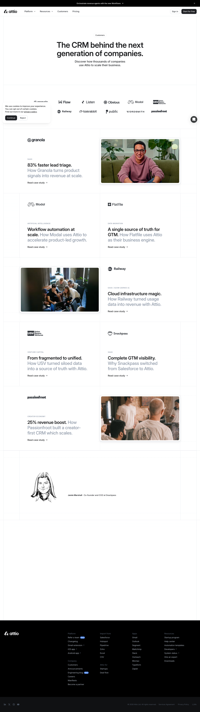


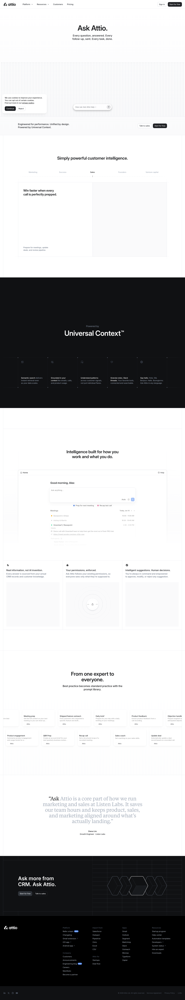

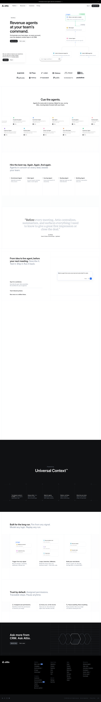

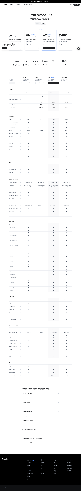

### Section Clips (screens/sections/)

_Clipped individual sections and components_

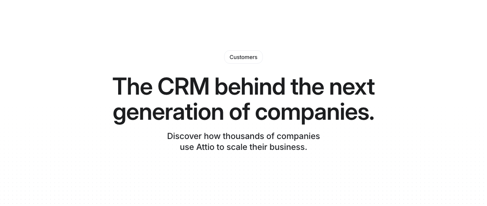

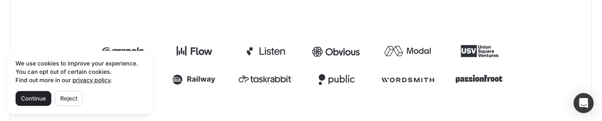

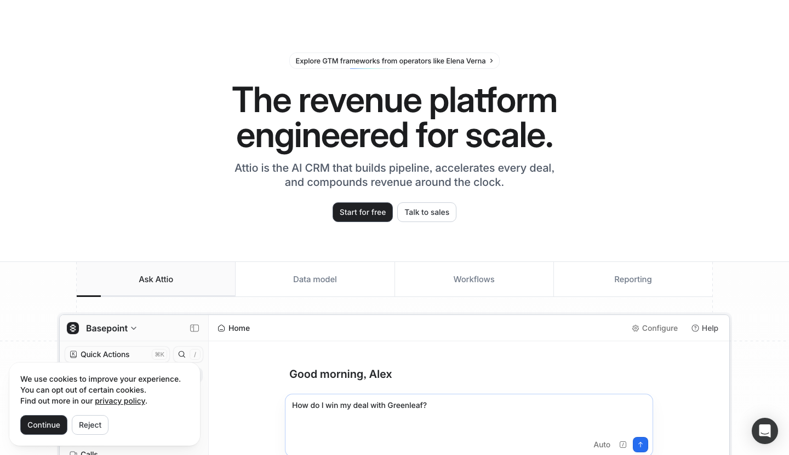

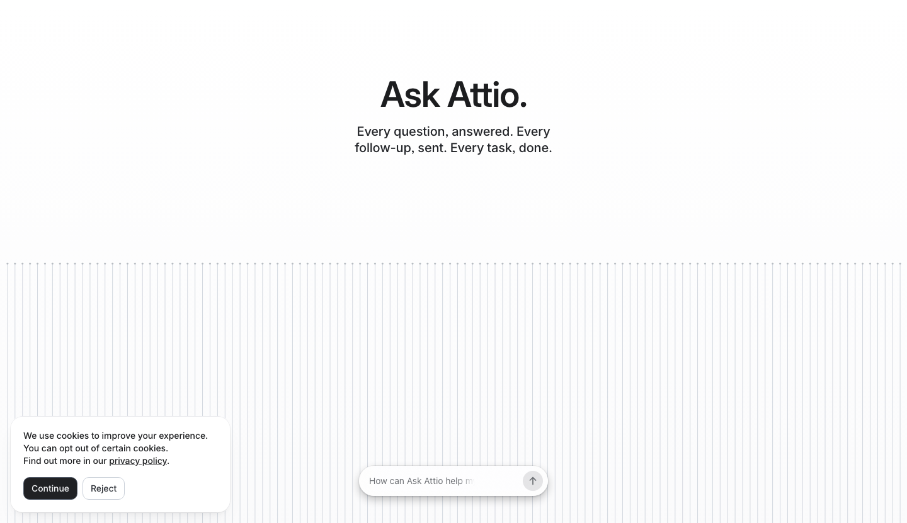

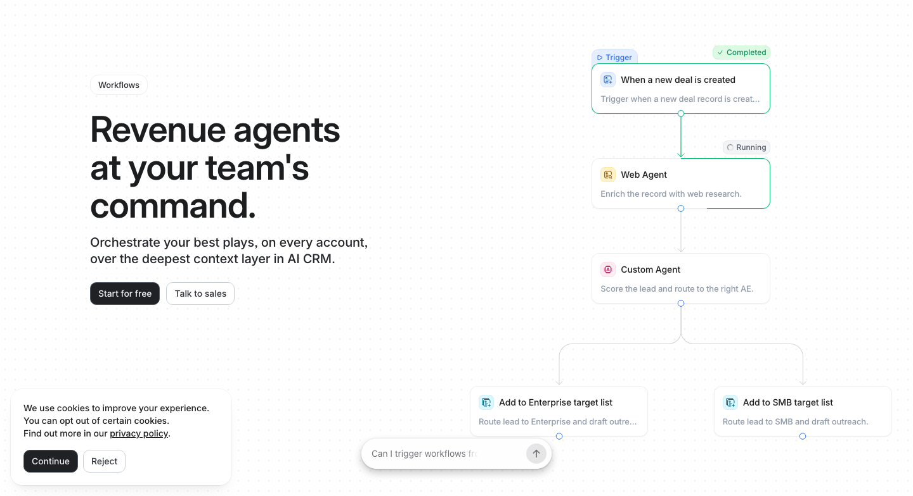

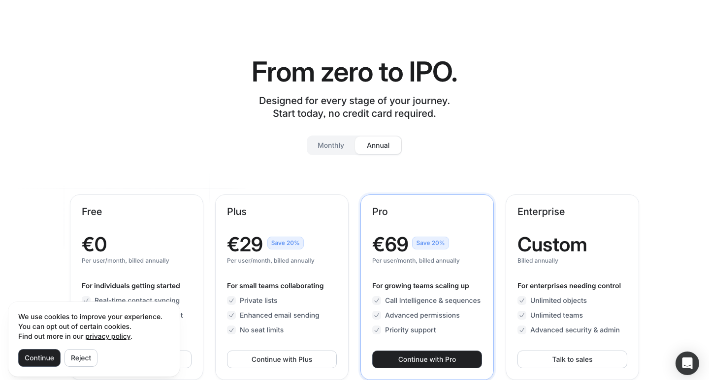

### Interaction States (screens/states/)

_Hover, focus, and active state captures_

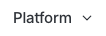

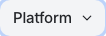

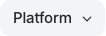


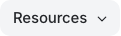


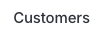

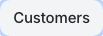

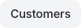

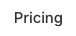


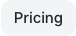


### Screenshot Index (screens/INDEX.md)

# Screenshot Index

## Scroll Journey

> Shows the cinematic state at each point of the page

| Scroll | Y Position | File                            |
| ------ | ---------- | ------------------------------- |
| 0%     | 0px        | `screens/scroll/scroll-000.png` |
| 17%    | 2023px     | `screens/scroll/scroll-017.png` |
| 33%    | 3928px     | `screens/scroll/scroll-033.png` |
| 50%    | 5951px     | `screens/scroll/scroll-050.png` |
| 67%    | 7974px     | `screens/scroll/scroll-067.png` |
| 83%    | 9879px     | `screens/scroll/scroll-083.png` |
| 100%   | 11902px    | `screens/scroll/scroll-100.png` |

## Pages

| Page                     | URL                  | File                                   |
| ------------------------ | -------------------- | -------------------------------------- | -------------------------------------- |
| Attio: Ask more from CRM | `https://attio.com/` | `screens/pages/home.png`               |
| Agents and automations   | Attio                | `https://attio.com/platform/workflows` | `screens/pages/platform-workflows.png` |
| Customers                | Attio                | `https://attio.com/customers`          | `screens/pages/customers.png`          |
| Pricing                  | Attio                | `https://attio.com/pricing`            | `screens/pages/pricing.png`            |
| Ask Attio                | Attio                | `https://attio.com/platform/ask`       | `screens/pages/platform-ask.png`       |

## Sections

| Page               | Section         | File                                                |
| ------------------ | --------------- | --------------------------------------------------- |
| home               | #1 (section)    | `screens/sections/home-section-1.png`               |
| platform-workflows | #8 (main > div) | `screens/sections/platform-workflows-section-8.png` |
| customers          | #3 (header)     | `screens/sections/customers-section-3.png`          |
| customers          | #5 (main > div) | `screens/sections/customers-section-5.png`          |
| pricing            | #3 (main > div) | `screens/sections/pricing-section-3.png`            |
| platform-ask       | #1 (section)    | `screens/sections/platform-ask-section-1.png`       |
