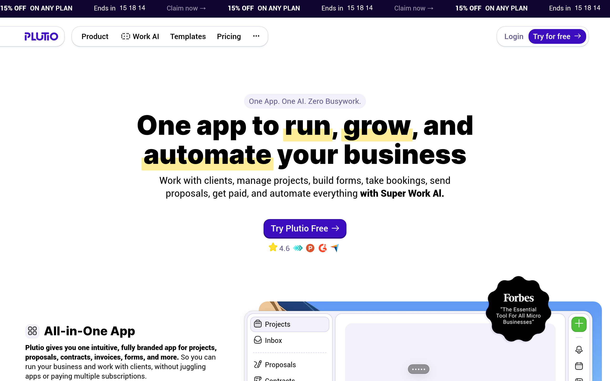
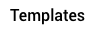

# plutio Design System

You are building UI for **plutio**. Dark-themed, warm palette, sans-serif typography (Roboto), standard density on a 5px grid, expressive motion.

## Visual Reference

**IMPORTANT**: Study ALL screenshots below before writing any UI. Match colors, typography, spacing, layout, and motion exactly as shown.

### Homepage



### Scroll Journey (Cinematic Visual States)

> These screenshots capture the website at different scroll depths. The design changes dramatically as you scroll — each frame shows a different cinematic state. Replicate these exact visual transitions.

#### 0% — Hero / Above the fold


#### 17% — Mid-page at 17% scroll


#### 33% — Mid-page at 33% scroll


#### 50% — Mid-page at 50% scroll


#### 67% — Mid-page at 67% scroll


#### 83% — Mid-page at 83% scroll


#### 100% — Footer / End of page


> Read `references/DESIGN.md` for full token details. Read `references/ANIMATIONS.md` for motion specs. Read `references/LAYOUT.md` for layout structure. Read `references/COMPONENTS.md` for component patterns.

## Ultra Reference Files

This package includes extended documentation. **Read these files before implementing:**

| File                         | Contents                                                           |
| ---------------------------- | ------------------------------------------------------------------ |
| `references/DESIGN.md`       | Full design system tokens, colors, typography, spacing             |
| `references/VISUAL_GUIDE.md` | **START HERE** — Master visual guide with all screenshots embedded |
| `references/ANIMATIONS.md`   | CSS keyframes, scroll triggers, motion library stack, video specs  |
| `references/LAYOUT.md`       | Flex/grid containers, page structure, spacing relationships        |
| `references/COMPONENTS.md`   | DOM component patterns, HTML structure, class fingerprints         |
| `references/INTERACTIONS.md` | Hover/focus states with before/after style diffs                   |
| `screens/scroll/`            | 7 scroll journey screenshots showing cinematic states              |

### Animation Stack Detected

- **Web Animations API (4 active)** — animation

## Design Philosophy

- **Layered depth** — use shadow tokens to create a sense of physical layering. Each elevation level has a specific shadow.
- **Gradient accents** — gradients are used thoughtfully for emphasis, not decoration.
- **Type pairing** — Roboto for body/UI text, plutio-icons-set for headings/display. Never introduce a third typeface.
- **standard density** — 5px base grid. Every dimension is a multiple of 5.
- **warm palette** — the color temperature runs warm, matching the sans-serif typography.
- **Restrained accent** — `#ffb800` is the only pop of color. Used exclusively for CTAs, links, focus rings, and active states.
- **Expressive motion** — animations are an integral part of the experience. Use spring physics and layout animations.

## Color System

### Core Palette

| Role         | Token            | Hex       | Use                      |
| ------------ | ---------------- | --------- | ------------------------ |
| Background   | `--background`   | `#000000` | Page/app background      |
| Surface      | `--surface`      | `#1a1a1a` | Cards, panels, modals    |
| Text Primary | `--text-primary` | `#ffffff` | Headings, body text      |
| Text Muted   | `--text-muted`   | `#605a90` | Captions, placeholders   |
| Accent       | `--accent`       | `#ffb800` | CTAs, links, focus rings |
| Border       | `--border`       | `#333333` | Dividers, card borders   |

### Status Colors

| Status  | Hex       | Use                            |
| ------- | --------- | ------------------------------ |
| Success | `#00d26a` | Confirmations, positive trends |
| Warning | `#f4ede4` | Caution states, pending items  |
| Danger  | `#ff4757` | Errors, destructive actions    |

### Extended Palette

- **primary-label:** `#f5f1ff` — Light surface or highlight color
- **primary:** `#3d0ebf`
- **borders:** `#d2d2eb`
- `#1a1a2e`
- `#2563eb`
- `#666666`
- `#16213e`
- **borders-dark:** `#bcbcd7`

### CSS Variable Tokens

```css
--font-secondary: #462dc1;
--font-secondary-light: #bdacff;
--primary: #3d0ebf;
--primary-border: #350cab;
--primary-light: #470fec;
--primary-dark: #370bb4;
--primary-label: #f5f1ff;
--primary-label-border: #e9e0fa;
--primary-label-text: #3d0ebf;
--primary-shadow: #4214c44d;
--primary-shadow-light: #4214c412;
--primary-tint: #6c63ff14;
--secondary: #100432;
--secondary-border: #000;
--secondary-light: #17034d;
--cta-button-border: #2d0a91;
--inner-background: #f1f1f9;
--inner-background-overlay: #f1f1f9e8;
--inner-background-light: #f8f8fc;
--inner-background-dark: #eaeaf6;
```

## Typography

### Font Stack

- **Roboto** — Heading 1, Heading 2, Heading 3
- **plutio-icons-set** — Body, Caption
- **Roboto Mono** — Code

### Font Sources

```css
@font-face {
  font-family: 'plutio-icons-set';
  src: url('fonts/plutio-icons-set-Regular.woff2') format('woff2');
  font-weight: 400;
}
@font-face {
  font-family: 'Roboto';
  src: url('fonts/Roboto-Bold.ttf') format('truetype');
  font-weight: 700;
}
@font-face {
  font-family: 'Roboto';
  src: url('fonts/Roboto-Regular.ttf') format('truetype');
  font-weight: 400;
}
@font-face {
  font-family: 'Inter';
  src: url('fonts/Inter-Bold.ttf') format('truetype');
  font-weight: 700;
}
@font-face {
  font-family: 'Inter';
  src: url('fonts/Inter-Regular.ttf') format('truetype');
  font-weight: 400;
}
@font-face {
  font-family: 'Roboto Mono';
  src: url('fonts/RobotoMono-Bold.ttf') format('truetype');
  font-weight: 700;
}
@font-face {
  font-family: 'Roboto Mono';
  src: url('fonts/RobotoMono-Regular.ttf') format('truetype');
  font-weight: 400;
}
```

### Type Scale

| Role      | Family           | Size | Weight |
| --------- | ---------------- | ---- | ------ |
| Heading 1 | Roboto           | 5rem | 700    |
| Heading 2 | Roboto           | 56px | 700    |
| Heading 3 | Roboto           | 3rem | 700    |
| Body      | plutio-icons-set | 10px | 400    |
| Caption   | plutio-icons-set | 12px | 400    |
| Code      | Roboto Mono      | 14px | 400    |

### Typography Rules

- Body/UI: **Roboto**, Headings: **plutio-icons-set** — these are the only display fonts
- Max 3-4 font sizes per screen
- Headings: weight 600-700, body: weight 400
- Use color and opacity for text hierarchy, not additional font sizes
- Line height: 1.5 for body, 1.2 for headings

## Spacing & Layout

### Base Grid: 5px

Every dimension (margin, padding, gap, width, height) must be a multiple of **5px**.

### Spacing Scale

`5, 10, 15, 20, 25, 30, 35, 40, 45, 50, 55, 60` px

### Spacing as Meaning

| Spacing | Use                                 |
| ------- | ----------------------------------- |
| 2.5-5px | Tight: related items within a group |
| 10px    | Medium: between groups              |
| 15-20px | Wide: between sections              |
| 30px+   | Vast: major section breaks          |

### Border Radius

Scale: `4px, 10px, inherit, 1px, 2px, 3px, 5px, 6px, 8px, 9px, 13px, 14px, 18px, 20px, 24px, 40px, 50px, 100%`
Default: `9px`

### Container

Max-width: `1300px`, centered with auto margins.

### Breakpoints

| Name | Value  |
| ---- | ------ |
| sm   | 500px  |
| sm   | 640px  |
| md   | 650px  |
| md   | 700px  |
| lg   | 800px  |
| lg   | 870px  |
| lg   | 900px  |
| lg   | 951px  |
| lg   | 991px  |
| lg   | 1000px |

Mobile-first: design for small screens, layer on responsive overrides.

## Component Patterns

### Card

```css
.card {
  background: #1a1a1a;
  border: 1px solid #333333;
  border-radius: 9px;
  padding: 20px;
  box-shadow: 0 3px 3px 0 var(--shadow-shade);
}
```

```html
<div class="card">
  <h3>Card Title</h3>
  <p>Card content goes here.</p>
</div>
```

### Button

```css
/* Primary */
.btn-primary {
  background: #ffb800;
  color: #ffffff;
  border-radius: 9px;
  padding: 10px 20px;
  font-weight: 500;
  transition: opacity 150ms ease;
}
.btn-primary:hover {
  opacity: 0.9;
}

/* Ghost */
.btn-ghost {
  background: transparent;
  border: 1px solid #333333;
  color: #ffffff;
  border-radius: 9px;
  padding: 10px 20px;
}
```

```html
<button class="btn-primary">Get Started</button>
<button class="btn-ghost">Learn More</button>
```

### Input

```css
.input {
  background: #000000;
  border: 1px solid #333333;
  border-radius: 9px;
  padding: 10px 15px;
  color: #ffffff;
  font-size: 14px;
}
.input:focus {
  border-color: #ffb800;
  outline: none;
}
```

```html
<input class="input" type="text" placeholder="Search..." />
```

### Badge / Chip

```css
.badge {
  display: inline-flex;
  align-items: center;
  padding: 5px 10px;
  border-radius: 9999px;
  font-size: 12px;
  font-weight: 500;
  background: #1a1a1a;
  color: #605a90;
}
```

```html
<span class="badge">New</span> <span class="badge">Beta</span>
```

### Modal / Dialog

```css
.modal-backdrop {
  background: rgba(0, 0, 0, 0.6);
}
.modal {
  background: #1a1a1a;
  border: 1px solid #333333;
  border-radius: 100%;
  padding: 30px;
  max-width: 480px;
  width: 90vw;
  box-shadow: 0 0 14px 0 var(--shadow-shade);
}
```

```html
<div class="modal-backdrop">
  <div class="modal">
    <h2>Dialog Title</h2>
    <p>Dialog content.</p>
    <button class="btn-primary">Confirm</button>
    <button class="btn-ghost">Cancel</button>
  </div>
</div>
```

### Table

```css
.table {
  width: 100%;
  border-collapse: collapse;
}
.table th {
  text-align: left;
  padding: 10px 15px;
  font-weight: 500;
  font-size: 12px;
  color: #605a90;
  text-transform: uppercase;
  letter-spacing: 0.05em;
  border-bottom: 1px solid #333333;
}
.table td {
  padding: 15px;
  border-bottom: 1px solid #333333;
}
```

```html
<table class="table">
  <thead>
    <tr>
      <th>Name</th>
      <th>Status</th>
      <th>Date</th>
    </tr>
  </thead>
  <tbody>
    <tr>
      <td>Item One</td>
      <td>Active</td>
      <td>Jan 1</td>
    </tr>
    <tr>
      <td>Item Two</td>
      <td>Pending</td>
      <td>Jan 2</td>
    </tr>
  </tbody>
</table>
```

### Navigation

```css
.nav {
  display: flex;
  align-items: center;
  gap: 10px;
  padding: 15px 20px;
  border-bottom: 1px solid #333333;
}
.nav-link {
  color: #605a90;
  padding: 10px 15px;
  border-radius: 9px;
  transition: color 150ms;
}
.nav-link:hover {
  color: #ffffff;
}
.nav-link.active {
  color: #ffb800;
}
```

```html
<nav class="nav">
  <a href="/" class="nav-link active">Home</a>
  <a href="/about" class="nav-link">About</a>
  <a href="/pricing" class="nav-link">Pricing</a>
  <button class="btn-primary" style="margin-left: auto">Get Started</button>
</nav>
```

### Extracted Components

These components were found in the codebase:

**Navigation** (`html`)

**Badge** (`html`)

## Page Structure

The following page sections were detected:

- **Navigation** — Top navigation bar (5 items)
- **Hero** — Hero/banner section with headline and CTAs
- **Footer** — Page footer with links and info (152 items)
- **Cta** — Call-to-action section
- **Testimonials** — Testimonials/reviews section
- **Features** — Feature/benefit cards grid
- **Faq** — FAQ/accordion section

When building pages, follow this section order and structure.

## Animation & Motion

This project uses **expressive motion**. Animations are part of the design language.

### CSS Animations

- `banner-ticker`
- `globe-live-dot-animation`
- `slideLogos`
- `fadeInUp`
- `slideUpBounce`

### Motion Tokens

- **Duration scale:** `.5s`, `.55s`, `.6s`, `.65s`, `.7s`, `2s`, `3s`, `50ms`, `90ms`, `100ms`, `150ms`, `200ms`, `250ms`, `300ms`, `350ms`, `400ms`, `500ms`, `800ms`, `1000ms`
- **Easing functions:** `ease`, `cubic-bezier(.4,0,.2,1)`, `ease-out`, `cubic-bezier(.34,1.56,.64,1)`, `cubic-bezier(.22,1,.36,1)`

### Motion Guidelines

- **Duration:** Use values from the duration scale above. Short (.5s) for micro-interactions, long (1000ms) for page transitions
- **Easing:** Use `ease` as the default easing curve
- **Direction:** Elements enter from bottom/right, exit to top/left
- **Reduced motion:** Always respect `prefers-reduced-motion` — disable animations when set

## Depth & Elevation

### Shadow Tokens

- Subtle: `0 2px 0 var(--cta-button-border)`
- Subtle: `0 1px 0 var(--cta-button-border)`
- Subtle: `0 1px 2px #0000000d`
- Subtle: `0 0 0 2px #4dbf3933`
- Subtle: `0 1px 2px #0000001a`
- Subtle: `rgb(45, 10, 145) 0px 2px 0px 0px`

### Z-Index Scale

`0, 1, 2, 3, 4, 5, 10, 15, 20, 99, 100, 1000, 10000, 10001, 10002`

Use these exact values — never invent z-index values.

## Anti-Patterns (Never Do)

- **No blur effects** — no backdrop-blur, no filter: blur()
- **No zebra striping** — tables and lists use borders for separation
- **No invented colors** — every hex value must come from the palette above
- **No arbitrary spacing** — every dimension is a multiple of 5px
- **No extra fonts** — only Roboto and plutio-icons-set and Roboto Mono are allowed
- **No arbitrary border-radius** — use the scale: 4px, 10px, 1px, 2px, 3px, 5px, 6px, 8px, 9px, 13px
- **No opacity for disabled states** — use muted colors instead

## Workflow

1. **Read** `references/DESIGN.md` before writing any UI code
2. **Pick colors** from the Color System section — never invent new ones
3. **Set typography** — Roboto, plutio-icons-set, Roboto Mono only, using the type scale
4. **Build layout** on the 5px grid — check every margin, padding, gap
5. **Match components** to patterns above before creating new ones
6. **Apply elevation** — use shadow tokens
7. **Validate** — every value traces back to a design token. No magic numbers.

## Brand Spec

- **Favicon:** `/static/images/favicon/apple-icon-57x57.png`
- **Site URL:** `https://www.plutio.com/`
- **Brand color:** `#ffb800`
- **Brand typeface:** Roboto

## Quick Reference

```
Background:     #000000
Surface:        #1a1a1a
Text:           #ffffff / #605a90
Accent:         #ffb800
Border:         #333333
Font:           Roboto
Spacing:        5px grid
Radius:         9px
Components:     7 detected
```

## When to Trigger

Activate this skill when:

- Creating new components, pages, or visual elements for plutio
- Writing CSS, Tailwind classes, styled-components, or inline styles
- Building page layouts, templates, or responsive designs
- Reviewing UI code for design consistency
- The user mentions "plutio" design, style, UI, or theme
- Generating mockups, wireframes, or visual prototypes

---

# Full Reference Files

> Every output file is embedded below. Claude has full design system context from /skills alone.

## Design System Tokens (DESIGN.md)

# plutio DESIGN.md

> Auto-generated design system — reverse-engineered via static analysis by skillui.
> Frameworks: None detected
> Colors: 20 · Fonts: 3 · Components: 7
> Icon library: not detected · State: not detected
> Primary theme: dark · Dark mode toggle: no · Motion: expressive

## Visual Reference

**Match this design exactly** — study colors, fonts, spacing, and component shapes before writing any UI code.


---

## 1. Visual Theme & Atmosphere

This is a **dark-themed** interface with a warm tone. Depth is expressed through layered shadows and subtle surface color variation. Typography pairs **plutio-icons-set** for display/headings with **Roboto** for body text, creating clear visual hierarchy through type contrast. Spacing follows a **5px base grid** (standard density), with scale: 5, 10, 15, 20, 25, 30, 35, 40px. The accent color **#ffb800** anchors interactive elements (buttons, links, focus rings). Motion is expressive — spring physics, layout animations, and staggered reveals are part of the visual language.

---

## 2. Color Palette & Roles

| Token                | Hex       | Role         | Use                                     |
| -------------------- | --------- | ------------ | --------------------------------------- |
| secondary-border     | `#000000` | background   | Page background, darkest surface        |
| surface              | `#1a1a1a` | surface      | Card and panel backgrounds              |
| tile-color           | `#ffffff` | text-primary | Headings and body text                  |
| text-muted           | `#605a90` | text-muted   | Captions, placeholders, secondary info  |
| border               | `#333333` | border       | Dividers, card borders, outlines        |
| accent               | `#ffb800` | accent       | CTAs, links, focus rings, active states |
| danger               | `#ff4757` | danger       | Error states, destructive actions       |
| success              | `#00d26a` | success      | Success states, positive indicators     |
| warning              | `#f4ede4` | warning      | Warning states, caution indicators      |
| primary-label        | `#f5f1ff` | info         | Informational highlights                |
| primary              | `#3d0ebf` | unknown      | Palette color                           |
| borders              | `#d2d2eb` | unknown      | Palette color                           |
| unknown              | `#1a1a2e` | unknown      | Palette color                           |
| unknown              | `#2563eb` | unknown      | Palette color                           |
| unknown              | `#666666` | unknown      | Palette color                           |
| unknown              | `#16213e` | unknown      | Palette color                           |
| borders-dark         | `#bcbcd7` | unknown      | Palette color                           |
| primary-label-border | `#e9e0fa` | unknown      | Palette color                           |
| secondary            | `#100432` | unknown      | Palette color                           |
| grey-label-border    | `#dce3f2` | unknown      | Palette color                           |

### CSS Variable Tokens

```css
--font-secondary: #462dc1;
--font-secondary-light: #bdacff;
--primary: #3d0ebf;
--primary-border: #350cab;
--primary-light: #470fec;
--primary-dark: #370bb4;
--primary-label: #f5f1ff;
--primary-label-border: #e9e0fa;
--primary-label-text: #3d0ebf;
--primary-shadow: #4214c44d;
--primary-shadow-light: #4214c412;
--primary-tint: #6c63ff14;
--secondary: #100432;
--secondary-border: #000;
--secondary-light: #17034d;
--cta-button-border: #2d0a91;
--inner-background: #f1f1f9;
--inner-background-overlay: #f1f1f9e8;
--inner-background-light: #f8f8fc;
--inner-background-dark: #eaeaf6;
```

---

## 3. Typography Rules

**Font Stack:**

- **Roboto** — Heading 1, Heading 2, Heading 3
- **plutio-icons-set** — Body, Caption
- **Roboto Mono** — Code

**Font Sources:**

```css
@font-face {
  font-family: 'plutio-icons-set';
  src: url('fonts/plutio-icons-set-Regular.woff2') format('woff2');
  font-weight: 400;
}
@font-face {
  font-family: 'Roboto';
  src: url('fonts/Roboto-Bold.ttf') format('truetype');
  font-weight: 700;
}
@font-face {
  font-family: 'Roboto';
  src: url('fonts/Roboto-Regular.ttf') format('truetype');
  font-weight: 400;
}
@font-face {
  font-family: 'Inter';
  src: url('fonts/Inter-Bold.ttf') format('truetype');
  font-weight: 700;
}
@font-face {
  font-family: 'Inter';
  src: url('fonts/Inter-Regular.ttf') format('truetype');
  font-weight: 400;
}
@font-face {
  font-family: 'Roboto Mono';
  src: url('fonts/RobotoMono-Bold.ttf') format('truetype');
  font-weight: 700;
}
@font-face {
  font-family: 'Roboto Mono';
  src: url('fonts/RobotoMono-Regular.ttf') format('truetype');
  font-weight: 400;
}
```

| Role      | Font             | Size | Weight |
| --------- | ---------------- | ---- | ------ |
| Heading 1 | Roboto           | 5rem | 700    |
| Heading 2 | Roboto           | 56px | 700    |
| Heading 3 | Roboto           | 3rem | 700    |
| Body      | plutio-icons-set | 10px | 400    |
| Caption   | plutio-icons-set | 12px | 400    |
| Code      | Roboto Mono      | 14px | 400    |

**Typographic Rules:**

- Limit to 3 font families max per screen
- Use **Roboto** for body/UI text, **plutio-icons-set** for display/headings
- Maintain consistent hierarchy: no more than 3-4 font sizes per screen
- Headings use bold (600-700), body uses regular (400)
- Line height: 1.5 for body text, 1.2 for headings
- Use color and opacity for secondary hierarchy, not additional font sizes

---

## 4. Component Stylings

### Layout (1)

**Footer** — `html`

### Navigation (1)

**Navigation** — `html`

### Data Display (2)

**Badge** — `html`

**List** — `html`

### Data Input (1)

**Button** — `html`

- Animation:

### Overlay (1)

**Modal** — `html`

### Media (1)

**Image** — `html`

---

## 5. Layout Principles

- **Base spacing unit:** 5px
- **Spacing scale:** 5, 10, 15, 20, 25, 30, 35, 40, 45, 50, 55, 60
- **Border radius:** 4px, 10px, inherit, 1px, 2px, 3px, 5px, 6px, 8px, 9px, 13px, 14px, 18px, 20px, 24px, 40px, 50px, 100%
- **Max content width:** 1300px

**Spacing as Meaning:**
| Spacing | Use |
|---|---|
| 2.5-5px | Tight: related items within a group |
| 10px | Medium: between groups |
| 15-20px | Wide: between sections |
| 30px+ | Vast: major section breaks |

---

## 6. Depth & Elevation

### Flat — subtle depth hints

- `0 2px 0 var(--cta-button-border)`
- `0 1px 0 var(--cta-button-border)`
- `0 1px 2px #0000000d`

### Raised — cards, buttons, interactive elements

- `0 3px 3px 0 var(--shadow-shade)`
- `var(--shadow-shade-s)`
- `0 4px 0 var(--cta-button-border)`

### Floating — dropdowns, popovers, modals

- `0 0 14px 0 var(--shadow-shade)`
- `0 3px 3px 0 0 0 14px 0`
- `0 0 14px 0 var(--shadow-shade-l)`

### Overlay — full-screen overlays, top-level dialogs

- `0 0 0 3px rgba(var(--primary),.2),0 8px 24px rgba(var(--primary),.3),0 0 40px rgba(var(--primary),.15)`
- `0 0 0 3px rgba(var(--primary),.3),0 8px 32px rgba(var(--primary),.4),0 0 60px rgba(var(--primary),.25)`
- `0 8px 24px #0000001f`

### Z-Index Scale

`0, 1, 2, 3, 4, 5, 10, 15, 20, 99, 100, 1000, 10000, 10001, 10002`

---

## 7. Animation & Motion

This project uses **expressive motion**. Animations are an integral part of the experience.

### CSS Animations

- `@keyframes banner-ticker`
- `@keyframes globe-live-dot-animation`
- `@keyframes slideLogos`
- `@keyframes fadeInUp`
- `@keyframes slideUpBounce`
- `@keyframes bubbleFadeIn`
- `@keyframes revealChar`
- `@keyframes fillIn`

### Animated Components

- **Button**:

### Motion Guidelines

- Duration: 150-300ms for micro-interactions, 300-500ms for page transitions
- Easing: `ease-out` for enters, `ease-in` for exits
- Always respect `prefers-reduced-motion`

---

## 8. Do's and Don'ts

### Do's

- Use `#ffb800` for interactive elements (buttons, links, focus rings)
- Use `#000000` as the primary page background
- Pair **Roboto** (body) with **plutio-icons-set** (display) — these are the only allowed fonts
- Follow the **5px** spacing grid for all margins, padding, and gaps
- Use the defined shadow tokens for elevation — see Section 6
- Use border-radius from the scale: 4px, 10px, inherit, 1px, 2px
- Reuse existing components from Section 4 before creating new ones

### Don'ts

- Don't introduce colors outside this palette — extend the design tokens first
- Don't introduce additional font families beyond Roboto and plutio-icons-set and Roboto Mono
- Don't use arbitrary spacing values — stick to multiples of 5px
- Don't create custom box-shadow values outside the system tokens
- Don't use arbitrary border-radius values — pick from the defined scale
- Don't duplicate component patterns — check Section 4 first
- Don't use backdrop-blur or blur effects

### Anti-Patterns (detected from codebase)

- No blur or backdrop-blur effects
- No zebra striping on tables/lists

---

## 9. Responsive Behavior

| Name | Value  | Source |
| ---- | ------ | ------ |
| sm   | 500px  | css    |
| sm   | 640px  | css    |
| md   | 650px  | css    |
| md   | 700px  | css    |
| lg   | 800px  | css    |
| lg   | 870px  | css    |
| lg   | 900px  | css    |
| lg   | 951px  | css    |
| lg   | 991px  | css    |
| lg   | 1000px | css    |

**Approach:** Use `@media (min-width: ...)` queries matching the breakpoints above.

---

## 10. Agent Prompt Guide

Use these as starting points when building new UI:

### Build a Card

```
Background: #1a1a1a
Border: 1px solid #333333
Radius: 9px
Padding: 20px
Font: Roboto
Use shadow tokens from Section 6.
```

### Build a Button

```
Primary: bg #ffb800, text white
Ghost: bg transparent, border #333333
Padding: 10px 20px
Radius: 9px
Hover: opacity 0.9 or lighter shade
Focus: ring with #ffb800
```

### Build a Page Layout

```
Background: #000000
Max-width: 1300px, centered
Grid: 5px base
Responsive: mobile-first, breakpoints from Section 9
```

### Build a Stats Card

```
Surface: #1a1a1a
Label: #605a90 (muted, 12px, uppercase)
Value: #ffffff (primary, 24-32px, bold)
Status: use success/warning/danger from Section 2
```

### Build a Form

```
Input bg: #000000
Input border: 1px solid #333333
Focus: border-color #ffb800
Label: #605a90 12px
Spacing: 20px between fields
Radius: 9px
```

### General Component

```
1. Read DESIGN.md Sections 2-6 for tokens
2. Colors: only from palette
3. Font: Roboto, type scale from Section 3
4. Spacing: 5px grid
5. Components: match patterns from Section 4
6. Elevation: shadow tokens
```

## Visual Guide — Screenshots (VISUAL_GUIDE.md)

# plutio — Visual Guide

> Master visual reference. Study every screenshot carefully before implementing any UI.
> Match colors, layout, typography, spacing, and motion states exactly.

**Motion Stack:** **Web Animations API (4 active)**

## Scroll Journey

The page has cinematic scroll animations. Each screenshot below shows the exact visual state at that scroll depth.
**Replicate these transitions precisely** — the design changes dramatically as you scroll.

### Hero — Above the fold

_Scroll position: 0px of 900px total_


### 17% scroll depth

_Scroll position: 0px of 900px total_


### 33% scroll depth

_Scroll position: 0px of 900px total_


### 50% scroll depth

_Scroll position: 0px of 900px total_


### 67% scroll depth

_Scroll position: 0px of 900px total_


### 83% scroll depth

_Scroll position: 0px of 900px total_


### Footer — End of page

_Scroll position: 0px of 900px total_


## Full Page Screenshots

### Plutio - One app to run, grow, and automate your business

_URL: `https://www.plutio.com/`_


### Plutio Pal – Super Work AI that runs your business as if it were you

_URL: `https://www.plutio.com/pal`_


### Professional templates for every business need

_URL: `https://www.plutio.com/templates`_


### Pricing - Plutio | All-in-one business management

_URL: `https://www.plutio.com/pricing`_


### Plutio Integrations - Connect with Stripe, Zapier, QuickBooks, Google Calendar & 5000+ Apps

_URL: `https://www.plutio.com/integrations`_


## Section Screenshots

Clipped sections showing individual components in context.

### Section 1 — `section`

_1440×597px_


### Section 6 — `header`

_1210×337px_


### Section 9 — `[class*="section"]`

_1440×665px_


### Section 1 — `section`

_1440×563px_


### Section 2 — `section`

_1440×665px_


### Section 5 — `header`

_1210×303px_


### Section 1 — `section`

_1440×415px_


### Section 3 — `[class*="section"]`

_1440×1200px_


### Section 4 — `[class*="section"]`

_1210×350px_


### Section 1 — `section`

_1440×479px_


### Section 6 — `header`

_1210×219px_


### Section 8 — `[class*="section"]`

_1440×729px_


### Section 1 — `section`

_1440×821px_


### Section 4 — `header`

_1210×561px_


### Section 6 — `main > div`

_1440×1200px_


## Animations & Motion (ANIMATIONS.md)

# Animation Reference

> Cinematic motion design extracted from live DOM. Follow these specs exactly to recreate the experience.

## Motion Technology Stack

| Library                           | Type      | Notes |
| --------------------------------- | --------- | ----- |
| **Web Animations API (4 active)** | animation |       |

## Scroll Journey

The page is **900px** tall. Each frame below shows what the user sees at that scroll depth.

> **Use these screenshots to understand WHAT animates, WHEN it animates, and HOW it moves.**

### 0% — Top / Hero

Scroll position: 0px


### 17% — Opening Section

Scroll position: 0px


### 33% — First Feature Section

Scroll position: 0px


### 50% — Mid-Page

Scroll position: 0px


### 67% — Lower Content

Scroll position: 0px


### 83% — Near Footer

Scroll position: 0px


### 100% — Bottom / Footer

Scroll position: 0px


## CSS Keyframes (76 extracted)

### `@keyframes featureMilestonePop`

Duration: `0.5s` · Easing: `cubic-bezier(0.34, 1.56, 0.64, 1)` · Delay: `0s` · Iteration: `1` · Fill: `backwards`

Used by: `.canvas-feature .feature-milestone`, `.canvas-feature .feature-portal_card`, `.canvas-feature .feature-portal_project`, `.canvas-feature .feature-portal_invoice`

```css
@keyframes featureMilestonePop {
  0% {
    opacity: 0;
    transform: translateY(14px) scale(0.92);
  }
  100% {
    opacity: 1;
    transform: translateY(0px) scale(1);
  }
}
```

> Fade + motion enter animation

### `@keyframes scoreBarFill`

Duration: `0.8s` · Easing: `ease-out` · Delay: `0.4s` · Iteration: `1` · Fill: `backwards`

Used by: `.canvas-compare .compare-card .compare-card_score-bar-fill`, `.canvas-compare .compare-card._plutio._winner .compare-card_score-bar-fill`, `.canvas-alternative .alternative-card .alternative-card_score-bar-fill`, `.canvas-alternative .alternative-card._winner._selected .alternative-card_score-`

```css
@keyframes scoreBarFill {
  0% {
    width: 0px;
  }
}
```

> Dimension expand/collapse

### `@keyframes rotate`

Duration: `2s` · Easing: `linear` · Delay: `0s` · Iteration: `infinite` · Fill: `none`

Used by: `.tool._quiz .tool-block._analyzing .analyzing-loader .icon.isSpinning`, `.place-search .place-search-input .place-search-loader`, `.places-map .places-map-loading .map-loader`

```css
@keyframes rotate {
  0% {
    transform: rotate(0deg);
  }
  100% {
    transform: rotate(1turn);
  }
}
```

> Transform/motion animation

### `@keyframes featureSpotlightPop`

Duration: `0.5s` · Easing: `cubic-bezier(0.34, 1.56, 0.64, 1)` · Delay: `0s` · Iteration: `1` · Fill: `backwards`

Used by: `.canvas-feature .feature-spotlight_card`, `.canvas-feature .feature-spotlight_value`, `.canvas-feature .feature-spotlight_stat`

```css
@keyframes featureSpotlightPop {
  0% {
    opacity: 0;
    transform: scale(0.92) translateY(12px);
  }
  100% {
    opacity: 1;
    transform: scale(1) translateY(0px);
  }
}
```

> Fade + motion enter animation

### `@keyframes statFadeIn`

Duration: `0.6s` · Easing: `cubic-bezier(0.34, 1.56, 0.64, 1)` · Delay: `0s` · Iteration: `1` · Fill: `backwards`

Used by: `.canvas-cost-of-chaos .cost-of-chaos_stat`, `.canvas-cost-of-chaos .cost-of-chaos_stack`, `.canvas-cost-of-chaos .cost-of-chaos_solution`

```css
@keyframes statFadeIn {
  0% {
    opacity: 0;
    transform: translateY(20px);
  }
  100% {
    opacity: 1;
    transform: translateY(0px);
  }
}
```

> Fade + motion enter animation

### `@keyframes popupOverlayFadeIn`

Duration: `0.2s` · Easing: `ease-out` · Delay: `0s` · Iteration: `1` · Fill: `none`

Used by: `.demo-window .content-layout-block._canvas .desktop-container .desktop-element .`, `.ui-scene .scene-content .desktop-container .desktop-element .demo-overlay`

```css
@keyframes popupOverlayFadeIn {
  0% {
    opacity: 0;
  }
  100% {
    opacity: 1;
  }
}
```

> Opacity fade

### `@keyframes popupScaleIn`

Duration: `0.25s` · Easing: `cubic-bezier(0.34, 1.56, 0.64, 1)` · Delay: `0s` · Iteration: `1` · Fill: `none`

Used by: `.demo-window .content-layout-block._canvas .desktop-container .desktop-element .`, `.ui-scene .scene-content .desktop-container .desktop-element .demo-popup`

```css
@keyframes popupScaleIn {
  0% {
    opacity: 0;
    transform: scale(0.96) translateY(6px);
  }
  100% {
    opacity: 1;
    transform: scale(1) translateY(0px);
  }
}
```

> Fade + motion enter animation

### `@keyframes soundWave`

Duration: `0.8s` · Easing: `ease-in-out` · Delay: `0s` · Iteration: `infinite` · Fill: `none`

Used by: `.demo-window .content-layout-block._canvas .desktop-container .desktop-element._`, `.ui-scene .scene-content .desktop-container .desktop-element._ai-indicator .desk`

```css
@keyframes soundWave {
  0%,
  100% {
    height: 3px;
  }
  50% {
    height: 7px;
  }
}
```

> Dimension expand/collapse

### `@keyframes quickPulse`

Duration: `0.2s` · Easing: `ease-out` · Delay: `0s` · Iteration: `1` · Fill: `none`

Used by: `.demo-window .content-layout-block._canvas .desktop-container .desktop-element._`, `.ui-scene .scene-content .desktop-container .desktop-element._ai-indicator .desk`

```css
@keyframes quickPulse {
  0% {
    transform: scale(1);
  }
  50% {
    transform: scale(1.15);
  }
  100% {
    transform: scale(1);
  }
}
```

> Transform/motion animation

### `@keyframes ripple`

Duration: `0.6s` · Easing: `ease-out` · Delay: `0s` · Iteration: `1` · Fill: `none`

Used by: `.demo-window .content-layout-block._canvas .desktop-container .desktop-element._`, `.ui-scene .scene-content .desktop-container .desktop-element._ai-indicator .desk`

```css
@keyframes ripple {
  0% {
    transform: scale(0);
    opacity: 1;
  }
  100% {
    transform: scale(8);
    opacity: 0;
  }
}
```

> Fade + motion enter animation

### `@keyframes checkmark-appear`

Duration: `0.3s` · Easing: `ease-out` · Delay: `0s` · Iteration: `1` · Fill: `none`

Used by: `.demo-window .content-layout-block._canvas .desktop-container .desktop-element._`, `.ui-scene .scene-content .desktop-container .desktop-element._ai-indicator .desk`

```css
@keyframes checkmark-appear {
  0% {
    transform: scale(0);
    opacity: 0;
  }
  50% {
    transform: scale(1.2);
  }
  100% {
    transform: scale(1);
    opacity: 1;
  }
}
```

> Fade + motion enter animation

### `@keyframes spin`

Duration: `0.8s` · Easing: `linear` · Delay: `0s` · Iteration: `infinite` · Fill: `none`

Used by: `.demo-window .content-layout-block._canvas .desktop-container .desktop-element._`, `.ui-scene .scene-content .desktop-container .desktop-element._ai-indicator .desk`

```css
@keyframes spin {
  0% {
    transform: rotate(0deg);
  }
  100% {
    transform: rotate(1turn);
  }
}
```

> Transform/motion animation

### `@keyframes cardPopIn`

Duration: `0.5s` · Easing: `cubic-bezier(0.34, 1.56, 0.64, 1)` · Delay: `0s` · Iteration: `1` · Fill: `backwards`

Used by: `.canvas-compare .compare-card._compact`, `.canvas-alternative .alternative-card`

```css
@keyframes cardPopIn {
  0% {
    opacity: 0;
    transform: scale(0.7) translateY(30px);
  }
  100% {
    opacity: 1;
    transform: scale(1) translateY(0px);
  }
}
```

> Fade + motion enter animation

### `@keyframes featureJourneyDotPop`

Duration: `0.4s` · Easing: `cubic-bezier(0.34, 1.56, 0.64, 1)` · Delay: `0s` · Iteration: `1` · Fill: `backwards`

Used by: `.canvas-feature .feature-journey_dot-circle`, `.canvas-feature .feature-journey_dot._active .feature-journey_dot-circle`

```css
@keyframes featureJourneyDotPop {
  0% {
    opacity: 0;
    transform: scale(0.2);
  }
  100% {
    opacity: 1;
    transform: scale(1);
  }
}
```

> Fade + motion enter animation

### `@keyframes featureSpotlightFill`

Duration: `0.8s` · Easing: `ease-out` · Delay: `0.3s` · Iteration: `1` · Fill: `backwards`

Used by: `.canvas-feature .feature-spotlight_progress-fill`, `.canvas-feature .feature-portal_project-fill`

```css
@keyframes featureSpotlightFill {
  0% {
    width: 0px;
  }
}
```

> Dimension expand/collapse

### `@keyframes featureDashPop`

Duration: `0.5s` · Easing: `cubic-bezier(0.34, 1.56, 0.64, 1)` · Delay: `0s` · Iteration: `1` · Fill: `backwards`

Used by: `.canvas-feature .feature-dashboard_panel`, `.canvas-feature .feature-dashboard_tile`

```css
@keyframes featureDashPop {
  0% {
    opacity: 0;
    transform: scale(0.92) translateY(10px);
  }
  100% {
    opacity: 1;
    transform: scale(1) translateY(0px);
  }
}
```

> Fade + motion enter animation

### `@keyframes banner-ticker`

Duration: `66s` · Easing: `linear` · Delay: `0s` · Iteration: `infinite` · Fill: `none`

Used by: `.announcement-banner .announcement-banner_track`

```css
@keyframes banner-ticker {
  0% {
    transform: translateZ(0px);
  }
  100% {
    transform: translate3d(-100%, 0px, 0px);
  }
}
```

> Transform/motion animation

### `@keyframes globe-live-dot-animation`

Duration: `2s` · Iteration: `infinite` · Fill: `forwards`

Used by: `.section.section_stats .content-wrapper .content-wrapper-section .content-layout`

```css
@keyframes globe-live-dot-animation {
  50% {
    opacity: 1;
  }
  100% {
    opacity: 0.4;
  }
}
```

> Opacity fade

### `@keyframes slideLogos`

Duration: `80s` · Easing: `linear` · Delay: `0s` · Iteration: `infinite` · Fill: `none`

Used by: `.demo-window .content-layout-block._menu .menu-items .menu-item .menu-item-secti`

```css
@keyframes slideLogos {
  0% {
    transform: translateX(0px);
  }
  100% {
    transform: translateX(-100%);
  }
}
```

> Transform/motion animation

### `@keyframes revealChar`

Duration: `0.3s` · Easing: `ease-out` · Delay: `0s` · Iteration: `1` · Fill: `forwards`

Used by: `.demo-window .content-layout-block._canvas .desktop-container .desktop-element._`

```css
@keyframes revealChar {
  0% {
    opacity: 0;
    filter: blur(2px);
  }
  100% {
    opacity: 1;
    filter: blur(0px);
  }
}
```

> Opacity fade · Filter effect (blur/brightness)

### `@keyframes pulse-recording`

Duration: `1.5s` · Easing: `ease-in-out` · Delay: `0s` · Iteration: `infinite` · Fill: `none`

Used by: `.ui-scene .scene-content .desktop-container .desktop-element._plutio-app .deskto`

```css
@keyframes pulse-recording {
  0%,
  100% {
    opacity: 1;
    transform: scale(1);
  }
  50% {
    opacity: 0.7;
    transform: scale(1.05);
  }
}
```

> Fade + motion enter animation

### `@keyframes blink`

Duration: `1s` · Easing: `ease` · Delay: `0s` · Iteration: `infinite` · Fill: `none`

Used by: `.ui-scene.ui-scene--voice-to-text .scene-content .reveal-text .typing-cursor`

```css
@keyframes blink {
  0%,
  50% {
    opacity: 1;
  }
  51%,
  100% {
    opacity: 0;
  }
}
```

> Opacity fade

### `@keyframes glare`

Duration: `4s` · Easing: `ease-in-out` · Delay: `2s` · Iteration: `infinite` · Fill: `none`

Used by: `.button.isCTA::before, .layout._compare .layout-item .layout-item_content .layou`

```css
@keyframes glare {
  0% {
    left: -100%;
  }
  20% {
    left: 100%;
  }
  100% {
    left: 100%;
  }
}
```

### `@keyframes video-popup-fade-in`

Duration: `0.1s` · Easing: `ease-out` · Delay: `0s` · Iteration: `1` · Fill: `forwards`

Used by: `.video-popup`

```css
@keyframes video-popup-fade-in {
  0% {
    opacity: 0;
  }
  100% {
    opacity: 1;
  }
}
```

> Opacity fade

### `@keyframes popup-fade-in`

Duration: `0.15s` · Easing: `ease-out` · Delay: `0s` · Iteration: `1` · Fill: `forwards`

Used by: `.popup-overlay`

```css
@keyframes popup-fade-in {
  0% {
    opacity: 0;
  }
  100% {
    opacity: 1;
  }
}
```

> Opacity fade

### `@keyframes popup-slide-up`

Duration: `0.2s` · Easing: `ease-out` · Delay: `0s` · Iteration: `1` · Fill: `forwards`

Used by: `.popup`

```css
@keyframes popup-slide-up {
  0% {
    opacity: 0;
    transform: translateY(16px);
  }
  100% {
    opacity: 1;
    transform: translateY(0px);
  }
}
```

> Fade + motion enter animation

### `@keyframes fadeA`

Duration: `4s` · Easing: `ease-in-out` · Delay: `0s` · Iteration: `infinite` · Fill: `none`

Used by: `.zero-page .zero-page-section._hero .zero-page-section-block._story ._4 .possibi`

```css
@keyframes fadeA {
  0%,
  100% {
    opacity: 0.15;
  }
  50% {
    opacity: 0.6;
  }
}
```

> Opacity fade

### `@keyframes fadeB`

Duration: `5s` · Easing: `ease-in-out` · Delay: `1s` · Iteration: `infinite` · Fill: `none`

Used by: `.zero-page .zero-page-section._hero .zero-page-section-block._story ._4 .possibi`

```css
@keyframes fadeB {
  0%,
  100% {
    opacity: 0.5;
  }
  50% {
    opacity: 0.15;
  }
}
```

> Opacity fade

### `@keyframes fadeC`

Duration: `4.5s` · Easing: `ease-in-out` · Delay: `0.5s` · Iteration: `infinite` · Fill: `none`

Used by: `.zero-page .zero-page-section._hero .zero-page-section-block._story ._4 .possibi`

```css
@keyframes fadeC {
  0%,
  100% {
    opacity: 0.3;
  }
  50% {
    opacity: 0.55;
  }
}
```

> Opacity fade

### `@keyframes scrollHint`

Duration: `2s` · Easing: `ease-in-out` · Delay: `0s` · Iteration: `infinite` · Fill: `none`

Used by: `.zero-page .zero-page-section._hero .zero-page-section-block._connector .circula`

```css
@keyframes scrollHint {
  0%,
  100% {
    transform: translateY(0px);
  }
  50% {
    transform: translateY(8px);
  }
}
```

> Transform/motion animation

### `@keyframes exitFadeIn`

Duration: `0.2s` · Easing: `ease-out` · Delay: `0s` · Iteration: `1` · Fill: `none`

Used by: `.exit-popup-overlay`

```css
@keyframes exitFadeIn {
  0% {
    opacity: 0;
  }
  100% {
    opacity: 1;
  }
}
```

> Opacity fade

### `@keyframes exitSlideDown`

Duration: `0.3s` · Easing: `ease-out` · Delay: `0s` · Iteration: `1` · Fill: `none`

Used by: `.exit-popup`

```css
@keyframes exitSlideDown {
  0% {
    opacity: 0;
    transform: translateY(-100%);
  }
  100% {
    opacity: 1;
    transform: translateY(0px);
  }
}
```

> Fade + motion enter animation

### `@keyframes pulse`

Duration: `1.5s` · Easing: `ease` · Delay: `0s` · Iteration: `infinite` · Fill: `none`

Used by: `.tool._quiz .tool-block._analyzing p`

```css
@keyframes pulse {
  0%,
  100% {
    opacity: 1;
  }
  50% {
    opacity: 0.5;
  }
}
```

> Opacity fade

### `@keyframes slideDown`

Duration: `0.2s` · Easing: `ease` · Delay: `0s` · Iteration: `1` · Fill: `none`

Used by: `.nomad-card .nomad-card-details`

```css
@keyframes slideDown {
  0% {
    opacity: 0;
    max-height: 0px;
  }
  100% {
    opacity: 1;
    max-height: 200px;
  }
}
```

> Opacity fade · Dimension expand/collapse

### `@keyframes shimmer`

Duration: `1.5s` · Easing: `ease` · Delay: `0s` · Iteration: `infinite` · Fill: `none`

Used by: `.nomad-card._skeleton ._shimmer`

```css
@keyframes shimmer {
  0% {
    background-position-x: -200px;
    background-position-y: 0px;
  }
  100% {
    background-position-x: 200px;
    background-position-y: 0px;
  }
}
```

> Background color/gradient shift · Background position (shimmer/scroll)

### `@keyframes plutioCardPopIn`

Duration: `0.5s` · Easing: `cubic-bezier(0.34, 1.56, 0.64, 1)` · Delay: `0s` · Iteration: `1` · Fill: `backwards`

Used by: `.canvas-compare .compare-card._plutio`

```css
@keyframes plutioCardPopIn {
  0% {
    opacity: 0;
    transform: scale(0.7) translateY(30px) rotate(-4deg) translateX(10px);
  }
  100% {
    opacity: 1;
    transform: rotate(-4deg) translateX(10px);
  }
}
```

> Fade + motion enter animation

### `@keyframes plutioWinnerPopIn`

Duration: `0.7s` · Easing: `cubic-bezier(0.34, 1.56, 0.64, 1)` · Delay: `0s` · Iteration: `1` · Fill: `backwards`

Used by: `.canvas-compare .compare-card._plutio._winner`

```css
@keyframes plutioWinnerPopIn {
  0% {
    opacity: 0;
    transform: scale(0.5) translateY(40px) rotate(-4deg) translateX(10px);
  }
  60% {
    opacity: 1;
    transform: scale(1.08) translateY(-5px) rotate(-4deg) translateX(10px);
  }
  80% {
    transform: scale(0.98) translateY(2px) rotate(-4deg) translateX(10px);
  }
  100% {
    transform: rotate(-4deg) translateX(10px);
  }
}
```

> Fade + motion enter animation

### `@keyframes competitorCardPopIn`

Duration: `0.5s` · Easing: `cubic-bezier(0.34, 1.56, 0.64, 1)` · Delay: `0.15s` · Iteration: `1` · Fill: `backwards`

Used by: `.canvas-compare .compare-card:not(._plutio)`

```css
@keyframes competitorCardPopIn {
  0% {
    opacity: 0;
    transform: scale(0.7) translateY(30px) rotate(3deg) translateX(-10px);
  }
  100% {
    opacity: 1;
    transform: rotate(3deg) translateX(-10px);
  }
}
```

> Fade + motion enter animation

### `@keyframes plutioSectionSlideUp`

Duration: `0.6s` · Easing: `cubic-bezier(0.34, 1.56, 0.64, 1)` · Delay: `0.4s` · Iteration: `1` · Fill: `backwards`

Used by: `.canvas-rivals_plutio-section`

```css
@keyframes plutioSectionSlideUp {
  0% {
    opacity: 0;
    transform: translateY(30px);
  }
  100% {
    opacity: 1;
    transform: translateY(0px);
  }
}
```

> Fade + motion enter animation

### `@keyframes plutioBadgePop`

Duration: `0.5s` · Easing: `cubic-bezier(0.34, 1.56, 0.64, 1)` · Delay: `0.6s` · Iteration: `1` · Fill: `backwards`

Used by: `.canvas-rivals_plutio-badge`

```css
@keyframes plutioBadgePop {
  0% {
    opacity: 0;
    transform: translateX(-50%) scale(0.5);
  }
  60% {
    transform: translateX(-50%) scale(1.1);
  }
  100% {
    opacity: 1;
    transform: translateX(-50%) scale(1);
  }
}
```

> Fade + motion enter animation

### `@keyframes plutioScoreBarFill`

Duration: `0.8s` · Easing: `ease-out` · Delay: `0.8s` · Iteration: `1` · Fill: `backwards`

Used by: `.canvas-rivals_plutio-score-bar-fill`

```css
@keyframes plutioScoreBarFill {
  0% {
    width: 0px;
  }
}
```

> Dimension expand/collapse

### `@keyframes winnerPopIn`

Duration: `0.7s` · Easing: `cubic-bezier(0.34, 1.56, 0.64, 1)` · Delay: `0s` · Iteration: `1` · Fill: `backwards`

Used by: `.canvas-alternative .alternative-card._winner._selected`

```css
@keyframes winnerPopIn {
  0% {
    opacity: 0;
    transform: scale(0.5) translateY(40px);
  }
  60% {
    opacity: 1;
    transform: scale(1.08) translateY(-5px);
  }
  80% {
    transform: scale(0.98) translateY(2px);
  }
  100% {
    transform: scale(1) translateY(0px);
  }
}
```

> Fade + motion enter animation

### `@keyframes featureJourneyCardPop`

Duration: `0.5s` · Easing: `cubic-bezier(0.34, 1.56, 0.64, 1)` · Delay: `0s` · Iteration: `1` · Fill: `backwards`

Used by: `.canvas-feature .feature-journey_card`

```css
@keyframes featureJourneyCardPop {
  0% {
    opacity: 0;
    transform: translateY(14px) scale(0.88);
  }
  100% {
    opacity: 1;
    transform: translateY(0px) scale(1);
  }
}
```

> Fade + motion enter animation

### `@keyframes featureJourneyLineFill`

Duration: `0.7s` · Easing: `ease-out` · Delay: `0.08s` · Iteration: `1` · Fill: `backwards`

Used by: `.canvas-feature .feature-journey_track-fill`

```css
@keyframes featureJourneyLineFill {
  0% {
    width: 0px;
  }
}
```

> Dimension expand/collapse

### `@keyframes featureJourneyPulse`

Duration: `0.4s, 2.3s` · Easing: `cubic-bezier(0.34, 1.56, 0.64, 1), ease-in-out` · Delay: `0s, 0.5s` · Iteration: `1, infinite` · Fill: `backwards, none`

Used by: `.canvas-feature .feature-journey_dot._active .feature-journey_dot-circle`

```css
@keyframes featureJourneyPulse {
  0%,
  100% {
    box-shadow: 0 0 0 0 var(--primary-shadow);
  }
  50% {
    box-shadow: rgba(0, 0, 0, 0) 0px 0px 0px 7px;
  }
}
```

> Shadow pulse/glow effect

### `@keyframes featureFlowNodePop`

Duration: `0.5s` · Easing: `cubic-bezier(0.34, 1.56, 0.64, 1)` · Delay: `0s` · Iteration: `1` · Fill: `backwards`

Used by: `.canvas-feature .feature-flow_node`

```css
@keyframes featureFlowNodePop {
  0% {
    opacity: 0;
    transform: scale(0.85) translateY(10px);
  }
  100% {
    opacity: 1;
    transform: scale(1) translateY(0px);
  }
}
```

> Fade + motion enter animation

### `@keyframes featureFlowArrowSlide`

Duration: `0.3s` · Easing: `ease-out` · Delay: `0s` · Iteration: `1` · Fill: `backwards`

Used by: `.canvas-feature .feature-flow_arrow`

```css
@keyframes featureFlowArrowSlide {
  0% {
    opacity: 0;
    transform: translateX(-6px);
  }
  100% {
    opacity: 1;
    transform: translateX(0px);
  }
}
```

> Fade + motion enter animation

### `@keyframes featureStackPop`

Duration: `0.5s` · Easing: `cubic-bezier(0.34, 1.56, 0.64, 1)` · Delay: `0s` · Iteration: `1` · Fill: `backwards`

Used by: `.canvas-feature .feature-stack_card`

```css
@keyframes featureStackPop {
  0% {
    opacity: 0;
    transform: scale(0.85) translateY(20px) rotate(0deg);
  }
  100% {
    opacity: 1;
  }
}
```

> Fade + motion enter animation

### `@keyframes bundleCardPopIn`

Duration: `0.6s` · Easing: `cubic-bezier(0.34, 1.56, 0.64, 1)` · Delay: `0s` · Iteration: `1` · Fill: `backwards`

Used by: `.canvas-bundle-offer .bundle-offer_card`

```css
@keyframes bundleCardPopIn {
  0% {
    opacity: 0;
    transform: scale(0.85) translateY(25px);
  }
  100% {
    opacity: 1;
    transform: scale(1) translateY(0px);
  }
}
```

> Fade + motion enter animation

### `@keyframes badgePulse`

Duration: `2s` · Easing: `ease-in-out` · Delay: `0s` · Iteration: `infinite` · Fill: `none`

Used by: `.canvas-bundle-offer .bundle-offer_badge`

```css
@keyframes badgePulse {
  0%,
  100% {
    transform: translateX(-50%) scale(1);
  }
  50% {
    transform: translateX(-50%) scale(1.05);
  }
}
```

> Transform/motion animation

### `@keyframes itemSlideIn`

Duration: `0.4s` · Easing: `ease` · Delay: `0s` · Iteration: `1` · Fill: `backwards`

Used by: `.canvas-bundle-offer .bundle-offer_item`

```css
@keyframes itemSlideIn {
  0% {
    opacity: 0;
    transform: translateX(-12px);
  }
  100% {
    opacity: 1;
    transform: translateX(0px);
  }
}
```

> Fade + motion enter animation

### `@keyframes featureBundlePopIn`

Duration: `0.6s` · Easing: `cubic-bezier(0.34, 1.56, 0.64, 1)` · Delay: `0s` · Iteration: `1` · Fill: `backwards`

Used by: `.canvas-feature-bundle .feature-bundle_card`

```css
@keyframes featureBundlePopIn {
  0% {
    opacity: 0;
    transform: scale(0.85) translateY(25px);
  }
  100% {
    opacity: 1;
    transform: scale(1) translateY(0px);
  }
}
```

> Fade + motion enter animation

### `@keyframes featureBundleItemSlide`

Duration: `0.4s` · Easing: `ease` · Delay: `0s` · Iteration: `1` · Fill: `backwards`

Used by: `.canvas-feature-bundle .feature-bundle_item`

```css
@keyframes featureBundleItemSlide {
  0% {
    opacity: 0;
    transform: translateX(-12px);
  }
  100% {
    opacity: 1;
    transform: translateX(0px);
  }
}
```

> Fade + motion enter animation

### `@keyframes statPulse`

Duration: `3s` · Easing: `ease-in-out` · Delay: `0s` · Iteration: `infinite` · Fill: `none`

Used by: `.canvas-cost-of-chaos .cost-of-chaos_stat-value`

```css
@keyframes statPulse {
  0%,
  100% {
    transform: scale(1);
  }
  50% {
    transform: scale(1.02);
  }
}
```

> Transform/motion animation

### `@keyframes stackItemSlide`

Duration: `0.4s` · Easing: `ease` · Delay: `0s` · Iteration: `1` · Fill: `backwards`

Used by: `.canvas-cost-of-chaos .cost-of-chaos_stack-item`

```css
@keyframes stackItemSlide {
  0% {
    opacity: 0;
    transform: translateX(-12px);
  }
  100% {
    opacity: 1;
    transform: translateX(0px);
  }
}
```

> Fade + motion enter animation

### `@keyframes magazineCardPopIn`

Duration: `0.6s` · Easing: `cubic-bezier(0.34, 1.56, 0.64, 1)` · Delay: `0.1s` · Iteration: `1` · Fill: `backwards`

Used by: `.canvas-magazine .magazine-canvas_card`

```css
@keyframes magazineCardPopIn {
  0% {
    opacity: 0;
    transform: scale(0.9) translateY(20px);
  }
  100% {
    opacity: 1;
    transform: scale(1) translateY(0px);
  }
}
```

> Fade + motion enter animation

### `@keyframes magazineBadgePop`

Duration: `0.5s` · Easing: `cubic-bezier(0.34, 1.56, 0.64, 1)` · Delay: `0s` · Iteration: `1` · Fill: `backwards`

Used by: `.canvas-magazine .magazine-canvas_badge`

```css
@keyframes magazineBadgePop {
  0% {
    opacity: 0;
    transform: translateX(-50%) scale(0.7);
  }
  100% {
    opacity: 1;
    transform: translateX(-50%) scale(1);
  }
}
```

> Fade + motion enter animation

### `@keyframes magazineTocSlide`

Duration: `0.4s` · Easing: `ease` · Delay: `0s` · Iteration: `1` · Fill: `backwards`

Used by: `.canvas-magazine .magazine-canvas_toc-item`

```css
@keyframes magazineTocSlide {
  0% {
    opacity: 0;
    transform: translateX(-10px);
  }
  100% {
    opacity: 1;
    transform: translateX(0px);
  }
}
```

> Fade + motion enter animation

### `@keyframes magazineStatCount`

Duration: `0.7s` · Easing: `cubic-bezier(0.34, 1.56, 0.64, 1)` · Delay: `0.3s` · Iteration: `1` · Fill: `backwards`

Used by: `.canvas-magazine .magazine-canvas_stat-value`

```css
@keyframes magazineStatCount {
  0% {
    opacity: 0;
    transform: scale(0.5);
  }
  60% {
    transform: scale(1.05);
  }
  100% {
    opacity: 1;
    transform: scale(1);
  }
}
```

> Fade + motion enter animation

### `@keyframes magazineOfferCardPopIn`

Duration: `0.6s` · Easing: `cubic-bezier(0.34, 1.56, 0.64, 1)` · Delay: `0.2s` · Iteration: `1` · Fill: `backwards`

Used by: `.canvas-magazine-offer .magazine-offer_card`

```css
@keyframes magazineOfferCardPopIn {
  0% {
    opacity: 0;
    transform: scale(0.85) translateY(25px);
  }
  100% {
    opacity: 1;
    transform: scale(1) translateY(0px);
  }
}
```

> Fade + motion enter animation

### `@keyframes magazineOfferBadgePulse`

Duration: `2s` · Easing: `ease-in-out` · Delay: `0s` · Iteration: `infinite` · Fill: `none`

Used by: `.canvas-magazine-offer .magazine-offer_badge`

```css
@keyframes magazineOfferBadgePulse {
  0%,
  100% {
    transform: translateX(-50%) scale(1);
  }
  50% {
    transform: translateX(-50%) scale(1.05);
  }
}
```

> Transform/motion animation

### `@keyframes magazineOfferBarFill`

Duration: `0.8s` · Easing: `cubic-bezier(0.34, 1.56, 0.64, 1)` · Delay: `0.2s` · Iteration: `1` · Fill: `backwards`

Used by: `.canvas-magazine-offer .magazine-offer_bar-fill`

```css
@keyframes magazineOfferBarFill {
  0% {
    width: 0px;
  }
}
```

> Dimension expand/collapse

### `@keyframes magazineOfferItemSlide`

Duration: `0.4s` · Easing: `ease` · Delay: `0s` · Iteration: `1` · Fill: `backwards`

Used by: `.canvas-magazine-offer .magazine-offer_item`

```css
@keyframes magazineOfferItemSlide {
  0% {
    opacity: 0;
    transform: translateX(-12px);
  }
  100% {
    opacity: 1;
    transform: translateX(0px);
  }
}
```

> Fade + motion enter animation

### `@keyframes reviewCardPopIn`

Duration: `0.6s` · Easing: `cubic-bezier(0.34, 1.56, 0.64, 1)` · Delay: `0.1s` · Iteration: `1` · Fill: `backwards`

Used by: `.canvas-review-stack .review-stack_stack`

```css
@keyframes reviewCardPopIn {
  0% {
    opacity: 0;
    transform: scale(0.9) translateY(20px);
  }
  100% {
    opacity: 1;
    transform: scale(1) translateY(0px);
  }
}
```

> Fade + motion enter animation

### `@keyframes reviewBadgePulse`

Duration: `2s` · Easing: `ease-in-out` · Delay: `0s` · Iteration: `infinite` · Fill: `none`

Used by: `.canvas-review-stack .review-stack_badge`

```css
@keyframes reviewBadgePulse {
  0%,
  100% {
    transform: translateX(-50%) scale(1);
  }
  50% {
    transform: translateX(-50%) scale(1.05);
  }
}
```

> Transform/motion animation

### `@keyframes announcementCardPopIn`

Duration: `0.6s` · Easing: `cubic-bezier(0.34, 1.56, 0.64, 1)` · Delay: `0.2s` · Iteration: `1` · Fill: `backwards`

Used by: `.canvas-announcement .announcement_card`

```css
@keyframes announcementCardPopIn {
  0% {
    opacity: 0;
    transform: scale(0.85) translateY(25px);
  }
  100% {
    opacity: 1;
    transform: scale(1) translateY(0px);
  }
}
```

> Fade + motion enter animation

### `@keyframes announcementBadgePulse`

Duration: `2s` · Easing: `ease-in-out` · Delay: `0s` · Iteration: `infinite` · Fill: `none`

Used by: `.canvas-announcement .announcement_badge`

```css
@keyframes announcementBadgePulse {
  0%,
  100% {
    transform: translateX(-50%) scale(1);
  }
  50% {
    transform: translateX(-50%) scale(1.05);
  }
}
```

> Transform/motion animation

### `@keyframes announcementCountPop`

Duration: `0.6s` · Easing: `cubic-bezier(0.34, 1.56, 0.64, 1)` · Delay: `0.3s` · Iteration: `1` · Fill: `backwards`

Used by: `.canvas-announcement .announcement_count`

```css
@keyframes announcementCountPop {
  0% {
    opacity: 0;
    transform: scale(0.5) translateY(10px);
  }
  60% {
    opacity: 1;
    transform: scale(1.08) translateY(-3px);
  }
  100% {
    transform: scale(1) translateY(0px);
  }
}
```

> Fade + motion enter animation

### `@keyframes announcementCategorySlide`

Duration: `0.4s` · Easing: `ease` · Delay: `0s` · Iteration: `1` · Fill: `backwards`

Used by: `.canvas-announcement .announcement_category`

```css
@keyframes announcementCategorySlide {
  0% {
    opacity: 0;
    transform: translateY(8px);
  }
  100% {
    opacity: 1;
    transform: translateY(0px);
  }
}
```

> Fade + motion enter animation

### `@keyframes fadeInUp`

```css
@keyframes fadeInUp {
  0% {
    opacity: 0;
    transform: translateY(10px);
  }
  100% {
    opacity: 1;
    transform: translateY(0px);
  }
}
```

> Fade + motion enter animation

### `@keyframes slideUpBounce`

```css
@keyframes slideUpBounce {
  0% {
    opacity: 0;
    transform: translate3d(0px, 12px, 0px);
  }
  50% {
    opacity: 1;
    transform: translate3d(0px, -2px, 0px);
  }
  100% {
    opacity: 1;
    transform: translateZ(0px);
  }
}
```

> Fade + motion enter animation

### `@keyframes bubbleFadeIn`

```css
@keyframes bubbleFadeIn {
  0% {
    opacity: 0;
    transform: translateY(15px) scale(0.95);
  }
  100% {
    opacity: 1;
    transform: translateY(0px) scale(1);
  }
}
```

> Fade + motion enter animation

### `@keyframes fillIn`

```css
@keyframes fillIn {
  0% {
    opacity: 0;
    transform: translateY(-4px);
  }
  100% {
    opacity: 1;
    transform: translateY(0px);
  }
}
```

> Fade + motion enter animation

### `@keyframes cardGlow`

```css
@keyframes cardGlow {
  0%,
  100% {
    box-shadow:
      0 0 0 3px rgba(var(--primary), 0.2),
      0 8px 24px rgba(var(--primary), 0.3),
      0 0 40px rgba(var(--primary), 0.15);
  }
  50% {
    box-shadow:
      0 0 0 3px rgba(var(--primary), 0.3),
      0 8px 32px rgba(var(--primary), 0.4),
      0 0 60px rgba(var(--primary), 0.25);
  }
}
```

> Shadow pulse/glow effect

### `@keyframes sparkle1`

```css
@keyframes sparkle1 {
  0%,
  100% {
    transform: scale(1) translateY(0px);
    opacity: 1;
  }
  50% {
    transform: scale(1.2) translateY(-4px);
    opacity: 0.7;
  }
}
```

> Fade + motion enter animation

### `@keyframes sparkle2`

```css
@keyframes sparkle2 {
  0%,
  100% {
    transform: scale(1) translateX(0px);
    opacity: 0.8;
  }
  50% {
    transform: scale(0.8) translateX(4px);
    opacity: 1;
  }
}
```

> Fade + motion enter animation

## Global Transition Declarations

These `transition` values were extracted from CSS rules across the site:

```css
transition: 0.09s;
transition:
  transform 0.15s,
  box-shadow 0.15s,
  background-color 0.15s;
transition:
  opacity 0.2s,
  transform 0.2s;
transition: 0.15s;
transition:
  opacity 0.5s cubic-bezier(0.4, 0, 0.2, 1),
  transform 0.5s cubic-bezier(0.4, 0, 0.2, 1);
transition: height 0.15s;
transition: transform 0.2s;
transition: opacity 0.4s;
transition:
  transform 0.4s,
  box-shadow 0.4s;
transition:
  transform 0.5s,
  box-shadow 0.4s;
transition: opacity 0.3s;
transition: 0.3s;
```

## How to Recreate This Motion Design

### Step 1 — Install Dependencies

```bash

```

### Step 2 — Scroll-Reveal Pattern

Elements that animate into view follow this pattern:

```css
/* Initial hidden state */
.reveal {
  opacity: 0;
  transform: translateY(40px);
  transition:
    opacity 0.09s cubic-bezier(0.4, 0, 0.2, 1),
    transform 0.09s cubic-bezier(0.4, 0, 0.2, 1);
}
.reveal.visible {
  opacity: 1;
  transform: translateY(0);
}
```

### Step 3 — Key Motion Principles

- **Duration scale:** `0.09s` · `0.15s` · `0.2s` — use these values, never invent new durations
- **Always add** `@media (prefers-reduced-motion: reduce) { * { animation-duration: 0.01ms !important; transition-duration: 0.01ms !important; } }`

### Step 4 — Scroll Journey Reference

Match what happens at each scroll position:

- **0%** (`0px`) → `screens/scroll/scroll-000.png`
- **17%** (`0px`) → `screens/scroll/scroll-017.png`
- **33%** (`0px`) → `screens/scroll/scroll-033.png`
- **50%** (`0px`) → `screens/scroll/scroll-050.png`
- **67%** (`0px`) → `screens/scroll/scroll-067.png`
- **83%** (`0px`) → `screens/scroll/scroll-083.png`
- **100%** (`0px`) → `screens/scroll/scroll-100.png`

## Layout & Grid (LAYOUT.md)

# Layout Reference

> Auto-extracted from live DOM. Use this to understand how the site is structured spatially.

## Spacing System

**Base grid:** 5px

**Scale:** `5, 10, 15, 20, 25, 30, 35, 40, 45, 50, 55, 60, 65, 70, 75` px

| Spacing | Semantic Use                   |
| ------- | ------------------------------ |
| 5px     | Tight — within a component     |
| 10px    | Medium — between sibling items |
| 20px    | Wide — between sections        |
| 40px    | Vast — major section breaks    |

## Flex Layouts

| Element                                   | Direction | Justify       | Align  | Gap  | Children |
| ----------------------------------------- | --------- | ------------- | ------ | ---- | -------- |
| `header.header`                           | row       | —             | —      | —    | 4        |
| `div.content-wrapper`                     | row       | space-between | center | 8px  | 3        |
| `div.footer-wrapper._main`                | column    | —             | center | —    | 4        |
| `div.footer-wrapper._logo`                | column    | —             | center | —    | 1        |
| `nav.main-menu`                           | row       | —             | center | —    | 5        |
| `div.content-wrapper`                     | row       | —             | —      | 60px | 1        |
| `header.content-wrapper-section._main`    | column    | —             | center | —    | 4        |
| `footer.content-wrapper-section._actions` | row       | center        | center | —    | 1        |
| `div.content-wrapper-section._body`       | column    | —             | —      | 60px | 1        |
| `div.content-wrapper-section._body`       | column    | —             | —      | 60px | 1        |
| `div.content-wrapper-section._body`       | column    | —             | —      | 60px | 1        |
| `div.content-wrapper-section._body`       | column    | —             | —      | 60px | 1        |
| `div.content-wrapper-section._actions`    | row       | center        | center | —    | 1        |
| `div.content-wrapper-section._body`       | column    | —             | —      | 60px | 1        |
| `div.content-wrapper-section._body`       | column    | —             | —      | 60px | 1        |

## Structural Containers

### `<header>` (`header.header`)

```
display:          flex
flex-direction:   row
justify-content:  —
align-items:      —
children:         4
```

### `<main>` (`main.page`)

```
display:          block
max-width:        1440px
children:         2
```

### `<footer>` (`footer#footer-menu.footer`)

```
display:          block
padding:          0px 45px 45px
max-width:        1300px
children:         2
```

### `<nav>` (`nav.main-menu`)

```
display:          flex
flex-direction:   row
justify-content:  —
align-items:      center
children:         5
```

### `<section>` (`section.topSection.isCentred`)

```
display:          block
padding:          60px 0px 0px
children:         1
```

### `<section>` (`section.section.section_socialproof`)

```
display:          block
max-width:        1440px
children:         1
```

### `<section>` (`section.section.section_stats`)

```
display:          block
children:         1
```

### `<section>` (`section.section.section_items`)

```
display:          block
max-width:        1440px
children:         1
```

### `<section>` (`section.section.section_templates`)

```
display:          block
padding:          36px 0px 0px
max-width:        1440px
children:         1
```

### `<header>` (`header.content-wrapper-section._main`)

```
display:          flex
flex-direction:   column
justify-content:  —
align-items:      center
children:         4
```

### `<header>` (`header.content-wrapper-section._head`)

```
display:          block
padding:          0px 0px 45px
children:         1
```

### `<header>` (`header.content-wrapper-section._head`)

```
display:          block
padding:          0px 0px 45px
children:         1
```

## Layout Rules

- **Container max-width:** `1440px` — always center with `margin: auto`
- Primary layout system: **Flexbox**
- Every spacing value must be a multiple of **5px**
- Never use arbitrary margin/padding values outside the spacing scale

## Component Patterns (COMPONENTS.md)

# Component Reference

> Repeated DOM patterns detected by structural analysis. Each component appeared 3+ times.

## Detected Components

| Component           | Category | Instances | Key Classes                                        |
| ------------------- | -------- | --------- | -------------------------------------------------- |
| **Logo**            | unknown  | 50×       | `.logo`                                            |
| **Menu Item**       | card     | 12×       | `.menu-item`                                       |
| **Body**            | unknown  | 9×        | `._body`, `.content-wrapper-section`               |
| **Sup Title**       | unknown  | 5×        | `._sup-title`                                      |
| **Highlight**       | unknown  | 5×        | `.highlight`                                       |
| **Content Wrapper** | unknown  | 5×        | `.content-wrapper`                                 |
| **Content**         | unknown  | 5×        | `._content`                                        |
| **Button**          | button   | 4×        | `.button`, `.isCTA`, `.signup-button`              |
| **Menu**            | unknown  | 4×        | `._menu`, `.content-layout-block`                  |
| **Head**            | card     | 4×        | `._head`, `.menu-item-section`                     |
| **Title**           | unknown  | 4×        | `._title`                                          |
| **Action**          | unknown  | 4×        | `._action`                                         |
| **A**               | unknown  | 3×        |                                                    |
| **Menu**            | unknown  | 3×        | `._menu`, `.desktop-window-section`                |
| **Head**            | unknown  | 3×        | `._head`, `.content-wrapper-section`, `.isCentred` |
| **Body**            | card     | 3×        | `._body`, `._item-content`                         |
| **Overlay**         | unknown  | 3×        | `._overlay`                                        |
| **Meta**            | unknown  | 3×        | `._meta`                                           |
| **Quote**           | unknown  | 3×        | `._quote`                                          |
| **Button**          | button   | 3×        | `.button`, `.isSmall`, `.isSub`                    |

## Cards

### Menu Item

**Instances found:** 12

**CSS classes:** `.menu-item`

**HTML structure:**

```html
<div class="menu-item ">
  <div class="icon">
    <div class="icon-inbox">
      <span class="path"></span><span class="path1"></span
      ><span class="path2"></span><span class="path3"></span
      ><span class="path4"></span><span class="path5"></span
      ><span class="path6"></span><span class="path7"></span
      ><span class="path8"></span><span class="path9"></span>
    </div>
  </div>
</div>
```

**Base styles (from design tokens):**

````css
.menu-item {
  background: #1a1a1a;
  border: 1px solid #333333;
  border-radius: 9px;
  padding: 10px;
}```

### Head

**Instances found:** 4

**CSS classes:** `._head` `.menu-item-section`

**HTML structure:**

```html
<div class="menu-item-section _head"><div class="menu-item-block _icon"><div class="icon"><div class="icon-apps"><span class="path"></span><span class="path1"></span><span class="path2"></span><span class="path3"></span><span class="path4"></span><span class="path5"></span><span class="path6"></span><span class="path7"></span><span class="path8"></span></div></div></div></div>
````

**Base styles (from design tokens):**

````css
._head {
  background: #1a1a1a;
  border: 1px solid #333333;
  border-radius: 9px;
  padding: 10px;
}```

### Body

**Instances found:** 3

**CSS classes:** `._body` `._item-content`

**HTML structure:**

```html
<div class="_item-content _body" role="img" aria-label="Yazan &amp; Mawaheb's story background" style="background-image: url(&quot;https://cdn.builder.io/api/v1/image/assets%2F01e4388314244b52988ebaae14b10f10%2F743529d90eaa43dc85ea235192fb2113?format=webp&amp;width=720&quot;);"><span class="_overlay" style="background: linear-gradient(rgba(0, 0, 0, 0) 0%, rgb(33, 42, 75) 60%);"></span><div class="_content"><div class="_meta"><div role="img" aria-label="Yazan &amp; Mawaheb's company logo" style="background-image: url(&quot;https://cdn.builder.io/api/v1/image/assets%2F01e4388314244b52988ebaae14b
````

**Base styles (from design tokens):**

````css
._body {
  background: #1a1a1a;
  border: 1px solid #333333;
  border-radius: 9px;
  padding: 10px;
}```

## Buttons

### Button

**Instances found:** 4

**CSS classes:** `.button` `.isCTA` `.signup-button`

**HTML structure:**

```html
<a href="https://app.plutio.com/signup" class="button signup-button isCTA" target="_blank" rel="noreferrer noopener" data-cta="TopSection"><span class="link-content"><span>Try Plutio Free</span><div class="icon"><div class="icon-arrow-right"><span class="path"></span><span class="path1"></span><span class="path2"></span><span class="path3"></span><span class="path4"></span><span class="path5"></span><span class="path6"></span><span class="path7"></span></div></div></span></a>
````

**Base styles (from design tokens):**

````css
.button {
  background: #ffb800;
  color: #ffffff;
  border-radius: 9px;
  padding: 5px 10px;
  cursor: pointer;
}```

### Button

**Instances found:** 3

**CSS classes:** `.button` `.isSmall` `.isSub`

**HTML structure:**

```html
<a href="/stories/yaz-marketing" class="button isSub isSmall" target="_blank" rel="noreferrer noopener"><span class="link-content"><span>Read Story</span><div class="icon"><div class="icon-arrow-top-right"><span class="path"></span><span class="path1"></span><span class="path2"></span><span class="path3"></span><span class="path4"></span><span class="path5"></span><span class="path6"></span><span class="path7"></span></div></div></span></a>
````

**Base styles (from design tokens):**

````css
.button {
  background: #ffb800;
  color: #ffffff;
  border-radius: 9px;
  padding: 5px 10px;
  cursor: pointer;
}```

## Other Components

### Logo

**Instances found:** 50

**CSS classes:** `.logo`

**HTML structure:**

```html
<div class="logo"><svg role="img" viewBox="0 0 24 24" xmlns="http://www.w3.org/2000/svg" fill="currentColor" style="width: 100%; height: 100%;"><title>Basecamp</title><path d="M12.6516 22.453c-4.0328 0-7.575-1.5542-10.244-4.4946a1.11 1.11 0 0 1-.219-1.1338c.7008-1.8884 2.5935-6.2808 5.0205-6.2948h.0125c1.219 0 2.1312.9655 2.8648 1.7412.2192.2324.555.5875.7818.7611.5656-.5587 1.6775-2.4158 2.5422-4.2779.259-.5567.9203-.7985 1.4765-.5402.557.2584.7988.919.5404 1.4762-2.6217 5.6503-4.019 5.6503-4.478 5.6503-1.022 0-1.7628-.7843-2.4791-1.5422-.3208-.339-.9878-1.045-1.2482-1.045h-.0004c-.5665.095-1
````

**Base styles (from design tokens):**

````css
.logo {
  background: #1a1a1a;
  padding: 5px;
}```

### Body

**Instances found:** 9

**CSS classes:** `._body` `.content-wrapper-section`

**HTML structure:**

```html
<div class="content-wrapper-section _body"><div class="demo-window hasTabs "><div class="content-layout-block _menu"><div class="menu-items"><div><a class="menu-item active"><div class="menu-item-section _head"><div class="menu-item-block _icon"><div class="icon"><div class="icon-apps"><span class="path"></span><span class="path1"></span><span class="path2"></span></div></div></div></div></a></div></div></div></div></div>
````

**Base styles (from design tokens):**

````css
._body {
  background: #1a1a1a;
  padding: 5px;
}```

### Sup Title

**Instances found:** 5

**CSS classes:** `._sup-title`

**HTML structure:**

```html
<div class="_sup-title"><p>One App. One AI. Zero Busywork.</p></div>
````

**Base styles (from design tokens):**

````css
._sup-title {
  background: #1a1a1a;
  padding: 5px;
}```

### Highlight

**Instances found:** 5

**CSS classes:** `.highlight`

**HTML structure:**

```html
<span class="highlight">run</span>
````

**Base styles (from design tokens):**

````css
.highlight {
  background: #1a1a1a;
  padding: 5px;
}```

### Content Wrapper

**Instances found:** 5

**CSS classes:** `.content-wrapper`

**HTML structure:**

```html
<div class="content-wrapper"><div class="content-wrapper-section _body"><div class="demo-window hasTabs "><div class="content-layout-block _menu"><div class="menu-items"><div><a class="menu-item active"><div class="menu-item-section _head"><div class="menu-item-block _icon"><div class="icon"><div class="icon-apps"><span class="path"></span><span class="path1"></span></div></div></div></div></a></div></div></div></div></div></div>
````

**Base styles (from design tokens):**

````css
.content-wrapper {
  background: #1a1a1a;
  padding: 5px;
}```

### Content

**Instances found:** 5

**CSS classes:** `._content`

**HTML structure:**

```html
<div class="_content"><div class="_meta"><div role="img" aria-label="Yazan &amp; Mawaheb's company logo" style="background-image: url(&quot;https://cdn.builder.io/api/v1/image/assets%2F01e4388314244b52988ebaae14b10f10%2F78416d081bab4e4f877c9516542af221?format=webp&amp;width=720&quot;);"></div><p>Yazan &amp; Mawaheb<span>YazMarketing</span></p></div><div class="_quote"><h3>"We boosted our sales pipeline by 80% wi…</h3></div></div>
````

**Base styles (from design tokens):**

````css
._content {
  background: #1a1a1a;
  padding: 5px;
}```

### Menu

**Instances found:** 4

**CSS classes:** `._menu` `.content-layout-block`

**HTML structure:**

```html
<div class="content-layout-block _menu"><div class="menu-items"><div><a class="menu-item active"><div class="menu-item-section _head"><div class="menu-item-block _icon"><div class="icon"><div class="icon-apps"><span class="path"></span><span class="path1"></span><span class="path2"></span><span class="path3"></span><span class="path4"></span></div></div></div></div></a></div></div></div>
````

**Base styles (from design tokens):**

````css
._menu {
  background: #1a1a1a;
  padding: 5px;
}```

### Title

**Instances found:** 4

**CSS classes:** `._title`

**HTML structure:**

```html
<h2 class="_title">"I used to waste hours every day on admin… now it’s handled for me.”</h2>
````

**Base styles (from design tokens):**

````css
._title {
  background: #1a1a1a;
  padding: 5px;
}```

### Action

**Instances found:** 4

**CSS classes:** `._action`

**HTML structure:**

```html
<div class="_action"><a href="/stories/yaz-marketing" class="button isSub isSmall" target="_blank" rel="noreferrer noopener"><span class="link-content"><span>Read Story</span><div class="icon"><div class="icon-arrow-top-right"><span class="path"></span><span class="path1"></span><span class="path2"></span><span class="path3"></span><span class="path4"></span><span class="path5"></span><span class="path6"></span></div></div></span></a></div>
````

**Base styles (from design tokens):**

````css
._action {
  background: #1a1a1a;
  padding: 5px;
}```

### A

**Instances found:** 3

**HTML structure:**

```html
<a class="" href="/pal"><span class="link-content"><div class="icon"><div class="icon-pal"><span class="path"></span><span class="path1"></span><span class="path2"></span><span class="path3"></span><span class="path4"></span><span class="path5"></span><span class="path6"></span><span class="path7"></span><span class="path8"></span></div></div></span></a>
````

**Base styles (from design tokens):**

````css
.a {
  background: #1a1a1a;
  padding: 5px;
}```

### Menu

**Instances found:** 3

**CSS classes:** `._menu` `.desktop-window-section`

**HTML structure:**

```html
<div class="desktop-window-section _menu"><div class="menu-items"><div class="menu-item active"><div class="icon"><div class="icon-toolkit"><span class="path"></span><span class="path1"></span><span class="path2"></span><span class="path3"></span><span class="path4"></span><span class="path5"></span><span class="path6"></span><span class="path7"></span></div></div></div></div></div>
````

**Base styles (from design tokens):**

````css
._menu {
  background: #1a1a1a;
  padding: 5px;
}```

### Head

**Instances found:** 3

**CSS classes:** `._head` `.content-wrapper-section` `.isCentred`

**HTML structure:**

```html
<header class="content-wrapper-section _head isCentred"><div class="content-block"><h2 class="_title">"I used to waste hours every day on admi…</h2><div class="_sub-title"><p><br></p></div></div></header>
````

**Base styles (from design tokens):**

````css
._head {
  background: #1a1a1a;
  padding: 5px;
}```

### Overlay

**Instances found:** 3

**CSS classes:** `._overlay`

**HTML structure:**

```html
<span class="_overlay" style="background: linear-gradient(rgba(0, 0, 0, 0) 0%, rgb(33, 42, 75) 60%);"></span>
````

**Base styles (from design tokens):**

````css
._overlay {
  background: #1a1a1a;
  padding: 5px;
}```

### Meta

**Instances found:** 3

**CSS classes:** `._meta`

**HTML structure:**

```html
<div class="_meta"><div role="img" aria-label="Yazan &amp; Mawaheb's company logo" style="background-image: url(&quot;https://cdn.builder.io/api/v1/image/assets%2F01e4388314244b52988ebaae14b10f10%2F78416d081bab4e4f877c9516542af221?format=webp&amp;width=720&quot;);"></div><p>Yazan &amp; Mawaheb<span>YazMarketing</span></p></div>
````

**Base styles (from design tokens):**

````css
._meta {
  background: #1a1a1a;
  padding: 5px;
}```

### Quote

**Instances found:** 3

**CSS classes:** `._quote`

**HTML structure:**

```html
<div class="_quote"><h3>"We boosted our sales pipeline by 80% wi…</h3></div>
````

**Base styles (from design tokens):**

````css
._quote {
  background: #1a1a1a;
  padding: 5px;
}```

## Component Rules

- Match class names exactly from the patterns above
- Each component instance must be visually identical to others of its type
- Do not add extra wrappers or change the DOM structure
- Use `#333333` for all dividers within components
- Use `#ffb800` for all interactive/active states

## Interactions & States (INTERACTIONS.md)

# Interaction Reference

> Micro-interactions extracted from live DOM. Recreate these exactly for authentic feel.

## Coverage

| Component Type | Count | States Captured |
|----------------|-------|----------------|
| Role Button | 1 | default, hover, focus |
| Link | 3 | default, hover, focus |

## Transition System

These transition declarations were extracted from interactive elements:

```css
transition: all;
````

Apply these to all interactive elements. Never invent new durations or easings.

## Role Button Interactions

### Role Button 1 — `Activate AI assistant`

**States:**

- Default: `../screens/states/role-button-1-default.png`
- Hover: `../screens/states/role-button-1-hover.png`
- Focus: `../screens/states/role-button-1-focus.png`

**On hover:**

```css
/* background-color: rgba(0, 0, 0, 0.4) → */
background-color: rgba(0, 0, 0, 0.5);
```

**Transition:** `all`

## Link Interactions

### Link 1 — `a`

**States:**

- Default: `../screens/states/link-1-default.png`
- Hover: `../screens/states/link-1-hover.png`
- Focus: `../screens/states/link-1-focus.png`

**Transition:** `all`

_No visible style changes detected for this element._

### Link 2 — `Work AI`

**States:**

- Default: `../screens/states/link-2-default.png`
- Hover: `../screens/states/link-2-hover.png`
- Focus: `../screens/states/link-2-focus.png`

**On hover:**

```css
/* background-color: rgba(0, 0, 0, 0) → */
background-color: rgb(248, 248, 252);
```

**Transition:** `all`

### Link 3 — `Templates`

**States:**

- Default: `../screens/states/link-3-default.png`
- Hover: `../screens/states/link-3-hover.png`
- Focus: `../screens/states/link-3-focus.png`

**On hover:**

```css
/* background-color: rgba(0, 0, 0, 0) → */
background-color: rgb(248, 248, 252);
```

**Transition:** `all`

## Interaction Rules

- Accent color `#ffb800` is used for focus rings, active states, and hover highlights
- Hover effects include **color transitions** — use the extracted values, not approximations
- Always respect `prefers-reduced-motion` — set all transitions to `0s` when enabled

## Design Tokens — JSON Files

### tokens/colors.json

```json
{
  "$schema": "https://design-tokens.github.io/community-group/format/",
  "core": {
    "background": {
      "value": "#000000",
      "role": "background",
      "name": "secondary-border"
    },
    "text-muted": {
      "value": "#605a90",
      "role": "text-muted"
    },
    "text-primary": {
      "value": "#ffffff",
      "role": "text-primary",
      "name": "tile-color"
    },
    "surface": {
      "value": "#1a1a1a",
      "role": "surface"
    },
    "border": {
      "value": "#333333",
      "role": "border"
    },
    "accent": {
      "value": "#ffb800",
      "role": "accent"
    }
  },
  "status": {
    "warning": {
      "value": "#f4ede4",
      "role": "warning"
    },
    "success": {
      "value": "#00d26a",
      "role": "success"
    },
    "danger": {
      "value": "#ff4757",
      "role": "danger"
    }
  },
  "extended": {
    "primary-label": {
      "value": "#f5f1ff",
      "role": "info",
      "name": "primary-label"
    },
    "primary": {
      "value": "#3d0ebf",
      "role": "unknown",
      "name": "primary"
    },
    "borders": {
      "value": "#d2d2eb",
      "role": "unknown",
      "name": "borders"
    },
    "color-1a1a2e": {
      "value": "#1a1a2e",
      "role": "unknown"
    },
    "color-2563eb": {
      "value": "#2563eb",
      "role": "unknown"
    },
    "color-666666": {
      "value": "#666666",
      "role": "unknown"
    },
    "color-16213e": {
      "value": "#16213e",
      "role": "unknown"
    },
    "borders-dark": {
      "value": "#bcbcd7",
      "role": "unknown",
      "name": "borders-dark"
    },
    "primary-label-border": {
      "value": "#e9e0fa",
      "role": "unknown",
      "name": "primary-label-border"
    },
    "secondary": {
      "value": "#100432",
      "role": "unknown",
      "name": "secondary"
    },
    "grey-label-border": {
      "value": "#dce3f2",
      "role": "unknown",
      "name": "grey-label-border"
    }
  },
  "meta": {
    "theme": "dark",
    "extracted": "2026-06-14"
  }
}
```

### tokens/spacing.json

```json
{
  "base": {
    "value": "5px",
    "description": "Grid unit — all spacing must be multiples of this"
  },
  "unit": "px",
  "scale": {
    "xs": {
      "value": "5px",
      "px": 5
    },
    "sm": {
      "value": "10px",
      "px": 10
    },
    "md": {
      "value": "15px",
      "px": 15
    },
    "lg": {
      "value": "20px",
      "px": 20
    },
    "xl": {
      "value": "25px",
      "px": 25
    },
    "2xl": {
      "value": "30px",
      "px": 30
    },
    "3xl": {
      "value": "35px",
      "px": 35
    },
    "4xl": {
      "value": "40px",
      "px": 40
    },
    "5xl": {
      "value": "45px",
      "px": 45
    },
    "6xl": {
      "value": "50px",
      "px": 50
    }
  },
  "multipliers": {
    "1x": {
      "value": "5px",
      "raw": 5
    },
    "2x": {
      "value": "10px",
      "raw": 10
    },
    "3x": {
      "value": "15px",
      "raw": 15
    },
    "4x": {
      "value": "20px",
      "raw": 20
    },
    "5x": {
      "value": "25px",
      "raw": 25
    },
    "6x": {
      "value": "30px",
      "raw": 30
    },
    "7x": {
      "value": "35px",
      "raw": 35
    },
    "8x": {
      "value": "40px",
      "raw": 40
    },
    "9x": {
      "value": "45px",
      "raw": 45
    },
    "10x": {
      "value": "50px",
      "raw": 50
    },
    "11x": {
      "value": "55px",
      "raw": 55
    },
    "12x": {
      "value": "60px",
      "raw": 60
    },
    "13x": {
      "value": "65px",
      "raw": 65
    },
    "14x": {
      "value": "70px",
      "raw": 70
    },
    "15x": {
      "value": "75px",
      "raw": 75
    },
    "16x": {
      "value": "80px",
      "raw": 80
    }
  },
  "meta": {
    "totalValues": 15,
    "min": 5,
    "max": 75
  }
}
```

### tokens/typography.json

```json
{
  "families": ["Roboto", "plutio-icons-set", "Roboto Mono"],
  "scale": {
    "heading-1": {
      "fontFamily": "Roboto",
      "fontSize": "5rem",
      "fontWeight": "700",
      "lineHeight": null,
      "source": "css"
    },
    "heading-2": {
      "fontFamily": "Roboto",
      "fontSize": "56px",
      "fontWeight": "700",
      "lineHeight": null,
      "source": "css"
    },
    "heading-3": {
      "fontFamily": "Roboto",
      "fontSize": "3rem",
      "fontWeight": "700",
      "lineHeight": null,
      "source": "css"
    },
    "body": {
      "fontFamily": "plutio-icons-set",
      "fontSize": "10px",
      "fontWeight": "400",
      "lineHeight": null,
      "source": "css"
    },
    "caption": {
      "fontFamily": "plutio-icons-set",
      "fontSize": "12px",
      "fontWeight": "400",
      "lineHeight": null,
      "source": "css"
    },
    "code": {
      "fontFamily": "Roboto Mono",
      "fontSize": "14px",
      "fontWeight": "400",
      "lineHeight": null,
      "source": "css"
    }
  },
  "fontFaces": [
    {
      "family": "plutio-icons-set",
      "src": "https://www.plutio.com/static/icons/icons.woff2?vg3mwv",
      "format": "truetype",
      "weight": "400"
    },
    {
      "family": "plutio-icons-set",
      "src": "https://www.plutio.com/static/icons/icons.ttf?vg3mwv",
      "format": "truetype",
      "weight": "400"
    },
    {
      "family": "plutio-icons-set",
      "src": "https://www.plutio.com/static/icons/icons.woff?vg3mwv",
      "format": "truetype",
      "weight": "400"
    },
    {
      "family": "plutio-icons-set",
      "src": "https://www.plutio.com/static/icons/icons.svg?vg3mwv#icons",
      "format": "truetype",
      "weight": "400"
    },
    {
      "family": "Roboto",
      "src": "https://www.plutio.com/static/font/Roboto-Black.woff2",
      "format": "woff2",
      "weight": "900"
    },
    {
      "family": "Roboto",
      "src": "https://www.plutio.com/static/font/Roboto-Black.woff",
      "format": "woff",
      "weight": "900"
    },
    {
      "family": "Roboto",
      "src": "https://www.plutio.com/static/font/Roboto-BlackItalic.woff2",
      "format": "woff2",
      "weight": "900"
    },
    {
      "family": "Roboto",
      "src": "https://www.plutio.com/static/font/Roboto-BlackItalic.woff",
      "format": "woff",
      "weight": "900"
    },
    {
      "family": "Roboto",
      "src": "https://www.plutio.com/static/font/Roboto-Medium.woff2",
      "format": "woff2",
      "weight": "500"
    },
    {
      "family": "Roboto",
      "src": "https://www.plutio.com/static/font/Roboto-Medium.woff",
      "format": "woff",
      "weight": "500"
    },
    {
      "family": "Roboto",
      "src": "https://www.plutio.com/static/font/Roboto-Italic.woff2",
      "format": "woff2",
      "weight": "400"
    },
    {
      "family": "Roboto",
      "src": "https://www.plutio.com/static/font/Roboto-Italic.woff",
      "format": "woff",
      "weight": "400"
    },
    {
      "family": "Roboto",
      "src": "https://www.plutio.com/static/font/Roboto-Bold.woff2",
      "format": "woff2",
      "weight": "700"
    },
    {
      "family": "Roboto",
      "src": "https://www.plutio.com/static/font/Roboto-Bold.woff",
      "format": "woff",
      "weight": "700"
    },
    {
      "family": "Roboto",
      "src": "https://www.plutio.com/static/font/Roboto-Regular.woff2",
      "format": "woff2",
      "weight": "400"
    },
    {
      "family": "Roboto",
      "src": "https://www.plutio.com/static/font/Roboto-Regular.woff",
      "format": "woff",
      "weight": "400"
    },
    {
      "family": "Inter",
      "src": "https://www.plutio.com/static/font/Inter-Bold.woff2",
      "format": "woff2",
      "weight": "700"
    },
    {
      "family": "Inter",
      "src": "https://www.plutio.com/static/font/Inter-Bold.woff",
      "format": "woff",
      "weight": "700"
    },
    {
      "family": "Inter",
      "src": "https://www.plutio.com/static/font/Inter-Medium.woff2",
      "format": "woff2",
      "weight": "500"
    },
    {
      "family": "Inter",
      "src": "https://www.plutio.com/static/font/Inter-Medium.woff",
      "format": "woff",
      "weight": "500"
    },
    {
      "family": "Inter",
      "src": "https://www.plutio.com/static/font/Inter-ExtraBold.woff2",
      "format": "woff2",
      "weight": "700"
    },
    {
      "family": "Inter",
      "src": "https://www.plutio.com/static/font/Inter-ExtraBold.woff",
      "format": "woff",
      "weight": "700"
    },
    {
      "family": "Inter",
      "src": "https://www.plutio.com/static/font/Inter-ExtraLight.woff2",
      "format": "woff2",
      "weight": "200"
    },
    {
      "family": "Inter",
      "src": "https://www.plutio.com/static/font/Inter-ExtraLight.woff",
      "format": "woff",
      "weight": "200"
    },
    {
      "family": "Inter",
      "src": "https://www.plutio.com/static/font/Inter-Black.woff2",
      "format": "woff2",
      "weight": "900"
    },
    {
      "family": "Inter",
      "src": "https://www.plutio.com/static/font/Inter-Black.woff",
      "format": "woff",
      "weight": "900"
    },
    {
      "family": "Inter",
      "src": "https://www.plutio.com/static/font/Inter-Light.woff2",
      "format": "woff2",
      "weight": "300"
    },
    {
      "family": "Inter",
      "src": "https://www.plutio.com/static/font/Inter-Light.woff",
      "format": "woff",
      "weight": "300"
    },
    {
      "family": "Inter",
      "src": "https://www.plutio.com/static/font/Inter-Thin.woff2",
      "format": "woff2",
      "weight": "100"
    },
    {
      "family": "Inter",
      "src": "https://www.plutio.com/static/font/Inter-Thin.woff",
      "format": "woff",
      "weight": "100"
    },
    {
      "family": "Inter",
      "src": "https://www.plutio.com/static/font/Inter-SemiBold.woff2",
      "format": "woff2",
      "weight": "600"
    },
    {
      "family": "Inter",
      "src": "https://www.plutio.com/static/font/Inter-SemiBold.woff",
      "format": "woff",
      "weight": "600"
    },
    {
      "family": "Inter",
      "src": "https://www.plutio.com/static/font/Inter-Regular.woff2",
      "format": "woff2",
      "weight": "400"
    },
    {
      "family": "Inter",
      "src": "https://www.plutio.com/static/font/Inter-Regular.woff",
      "format": "woff",
      "weight": "400"
    }
  ],
  "rules": {
    "maxSizesPerScreen": 4,
    "headingWeightRange": "600-700",
    "bodyWeight": 400,
    "lineHeightBody": 1.5,
    "lineHeightHeading": 1.2
  }
}
```

## Bundled Fonts (fonts/)

The following font files are bundled in the `fonts/` directory:

- `fonts/Inter-Black.ttf`
- `fonts/Inter-Bold.ttf`
- `fonts/Inter-ExtraBold.ttf`
- `fonts/Inter-ExtraLight.ttf`
- `fonts/Inter-Light.ttf`
- `fonts/Inter-Medium.ttf`
- `fonts/Inter-Regular.ttf`
- `fonts/Inter-SemiBold.ttf`
- `fonts/Inter-Thin.ttf`
- `fonts/Roboto-Black.ttf`
- `fonts/Roboto-Bold.ttf`
- `fonts/Roboto-ExtraBold.ttf`
- `fonts/Roboto-ExtraLight.ttf`
- `fonts/Roboto-Light.ttf`
- `fonts/Roboto-Medium.ttf`
- `fonts/Roboto-Regular.ttf`
- `fonts/Roboto-SemiBold.ttf`
- `fonts/Roboto-Thin.ttf`
- `fonts/RobotoMono-Bold.ttf`
- `fonts/RobotoMono-ExtraLight.ttf`
- `fonts/RobotoMono-Light.ttf`
- `fonts/RobotoMono-Medium.ttf`
- `fonts/RobotoMono-Regular.ttf`
- `fonts/RobotoMono-SemiBold.ttf`
- `fonts/RobotoMono-Thin.ttf`
- `fonts/plutio-icons-set-Regular.ttf`
- `fonts/plutio-icons-set-Regular.woff`
- `fonts/plutio-icons-set-Regular.woff2`

Use these local font files in `@font-face` declarations instead of fetching from Google Fonts.

## Screenshots Inventory (screens/)

> Study all screenshots carefully before implementing any UI. Match every visual detail exactly.

### Scroll Journey (screens/scroll/)

_Cinematic scroll states — page visual at each scroll depth_


### Full Page Screenshots (screens/pages/)

_Full-page screenshots of each crawled URL_


### Section Clips (screens/sections/)

_Clipped individual sections and components_


### Interaction States (screens/states/)

_Hover, focus, and active state captures_





### Screenshot Index (screens/INDEX.md)

# Screenshot Index

## Scroll Journey

> Shows the cinematic state at each point of the page

| Scroll | Y Position | File                            |
| ------ | ---------- | ------------------------------- |
| 0%     | 0px        | `screens/scroll/scroll-000.png` |
| 17%    | 0px        | `screens/scroll/scroll-017.png` |
| 33%    | 0px        | `screens/scroll/scroll-033.png` |
| 50%    | 0px        | `screens/scroll/scroll-050.png` |
| 67%    | 0px        | `screens/scroll/scroll-067.png` |
| 83%    | 0px        | `screens/scroll/scroll-083.png` |
| 100%   | 0px        | `screens/scroll/scroll-100.png` |

## Pages

| Page                                                                                        | URL                                   | File                             |
| ------------------------------------------------------------------------------------------- | ------------------------------------- | -------------------------------- | --------------------------- |
| Plutio - One app to run, grow, and automate your business                                   | `https://www.plutio.com/`             | `screens/pages/home.png`         |
| Plutio Pal – Super Work AI that runs your business as if it were you                        | `https://www.plutio.com/pal`          | `screens/pages/pal.png`          |
| Professional templates for every business need                                              | `https://www.plutio.com/templates`    | `screens/pages/templates.png`    |
| Pricing - Plutio                                                                            | All-in-one business management        | `https://www.plutio.com/pricing` | `screens/pages/pricing.png` |
| Plutio Integrations - Connect with Stripe, Zapier, QuickBooks, Google Calendar & 5000+ Apps | `https://www.plutio.com/integrations` | `screens/pages/integrations.png` |

## Sections

| Page         | Section                 | File                                          |
| ------------ | ----------------------- | --------------------------------------------- |
| home         | #1 (section)            | `screens/sections/home-section-1.png`         |
| home         | #6 (header)             | `screens/sections/home-section-6.png`         |
| home         | #9 ([class*="section"]) | `screens/sections/home-section-9.png`         |
| pal          | #1 (section)            | `screens/sections/pal-section-1.png`          |
| pal          | #2 (section)            | `screens/sections/pal-section-2.png`          |
| pal          | #5 (header)             | `screens/sections/pal-section-5.png`          |
| templates    | #1 (section)            | `screens/sections/templates-section-1.png`    |
| templates    | #3 ([class*="section"]) | `screens/sections/templates-section-3.png`    |
| templates    | #4 ([class*="section"]) | `screens/sections/templates-section-4.png`    |
| pricing      | #1 (section)            | `screens/sections/pricing-section-1.png`      |
| pricing      | #6 (header)             | `screens/sections/pricing-section-6.png`      |
| pricing      | #8 ([class*="section"]) | `screens/sections/pricing-section-8.png`      |
| integrations | #1 (section)            | `screens/sections/integrations-section-1.png` |
| integrations | #4 (header)             | `screens/sections/integrations-section-4.png` |
| integrations | #6 (main > div)         | `screens/sections/integrations-section-6.png` |

## Homepage Screenshots (screenshots/)


