# plutio — Visual Guide

> Master visual reference. Study every screenshot carefully before implementing any UI.
> Match colors, layout, typography, spacing, and motion states exactly.

**Motion Stack:** **Web Animations API (4 active)**

## Scroll Journey

The page has cinematic scroll animations. Each screenshot below shows the exact visual state at that scroll depth.
**Replicate these transitions precisely** — the design changes dramatically as you scroll.

### Hero — Above the fold

_Scroll position: 0px of 900px total_

### 17% scroll depth

_Scroll position: 0px of 900px total_

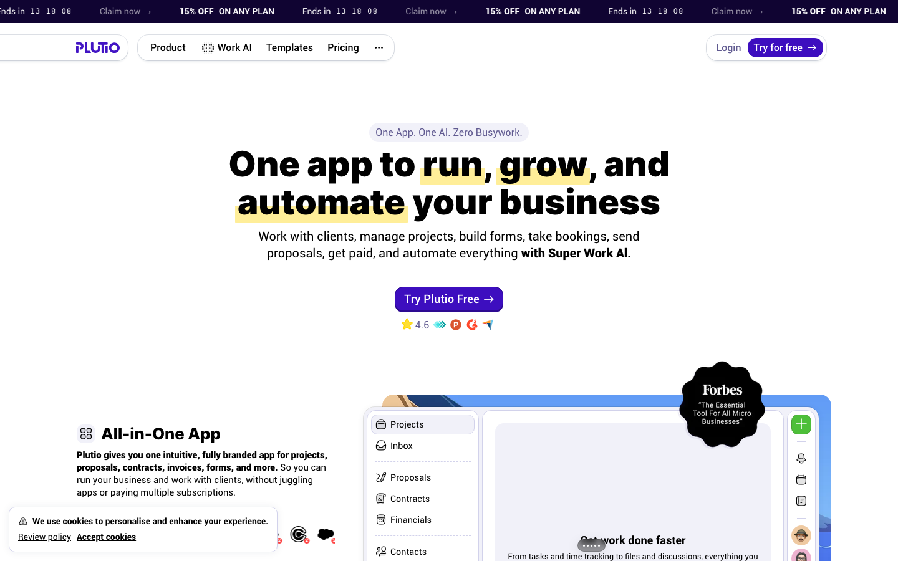

### 33% scroll depth

_Scroll position: 0px of 900px total_

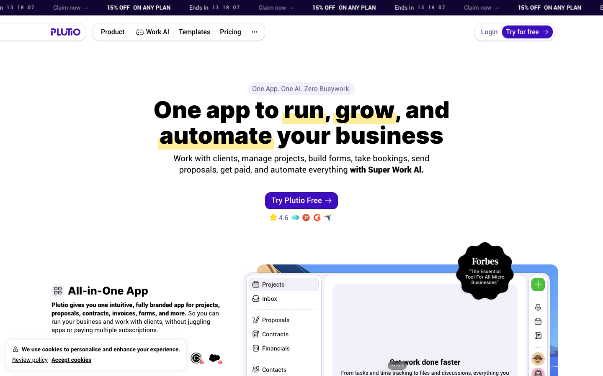

### 50% scroll depth

_Scroll position: 0px of 900px total_

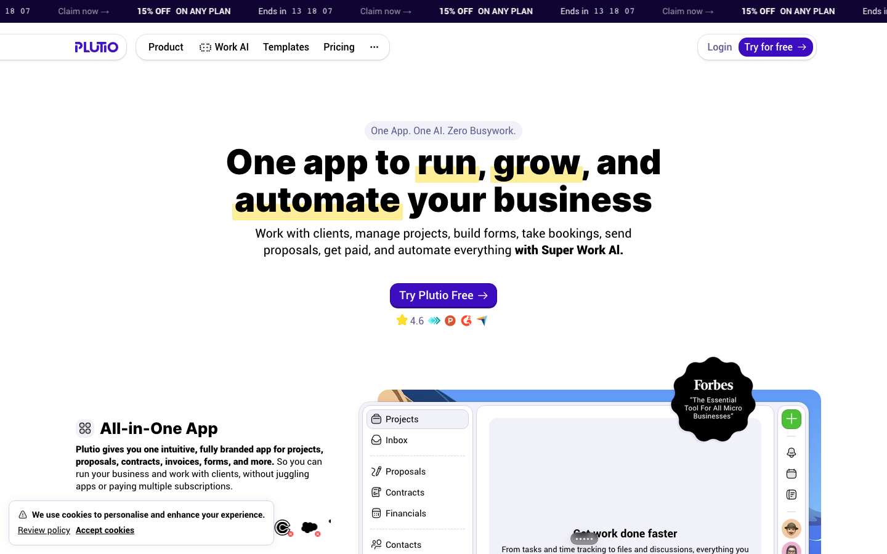

### 67% scroll depth

_Scroll position: 0px of 900px total_

### 83% scroll depth

_Scroll position: 0px of 900px total_

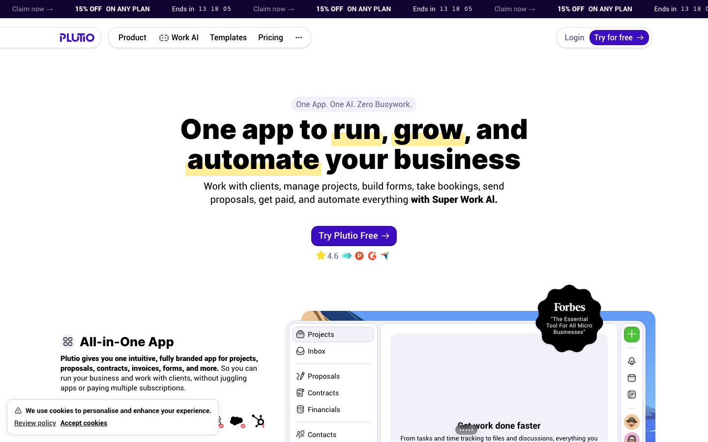

### Footer — End of page

_Scroll position: 0px of 900px total_

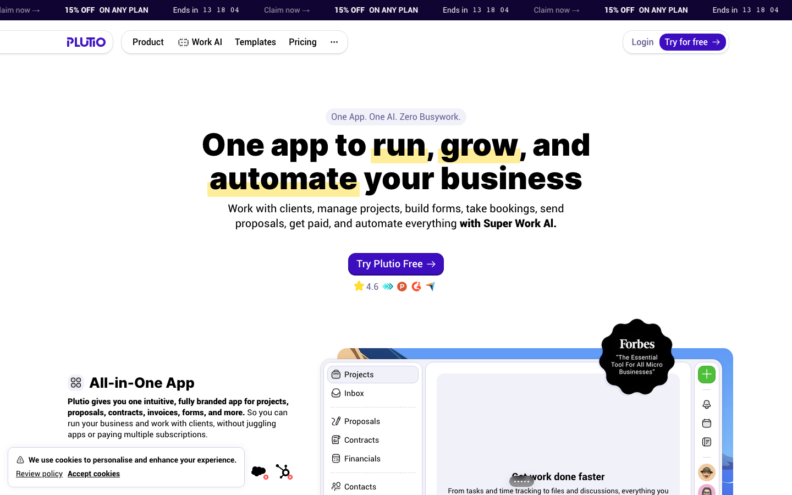

## Full Page Screenshots

### Plutio - One app to run, grow, and automate your business

_URL: `https://www.plutio.com/`_

### Plutio Pal – Super Work AI that runs your business as if it were you

_URL: `https://www.plutio.com/pal`_

### Professional templates for every business need

_URL: `https://www.plutio.com/templates`_

### Pricing - Plutio | All-in-one business management

_URL: `https://www.plutio.com/pricing`_

### Plutio Integrations - Connect with Stripe, Zapier, QuickBooks, Google Calendar & 5000+ Apps

_URL: `https://www.plutio.com/integrations`_

## Section Screenshots

Clipped sections showing individual components in context.

### Section 1 — `section`

_1440×597px_

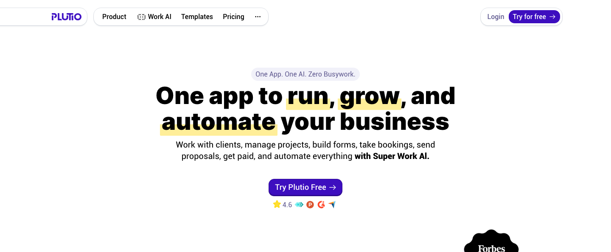

### Section 6 — `header`

_1210×337px_

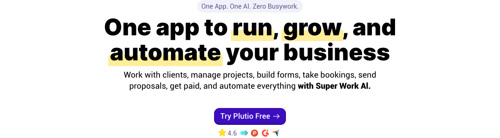

### Section 9 — `[class*="section"]`

_1440×665px_

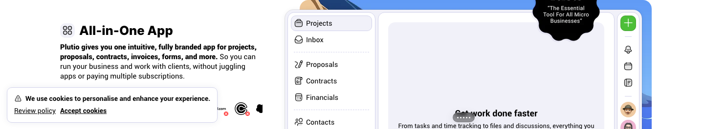

### Section 1 — `section`

_1440×563px_

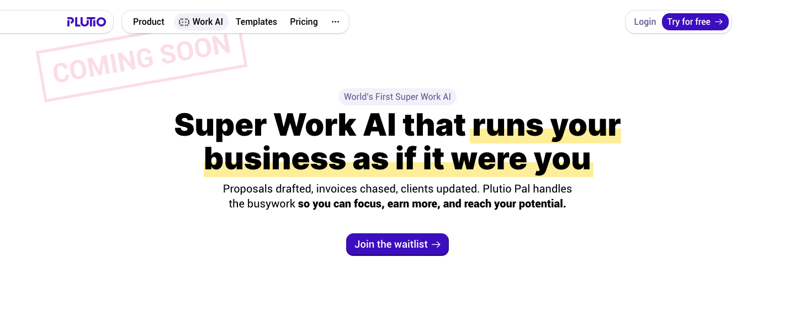

### Section 2 — `section`

_1440×665px_

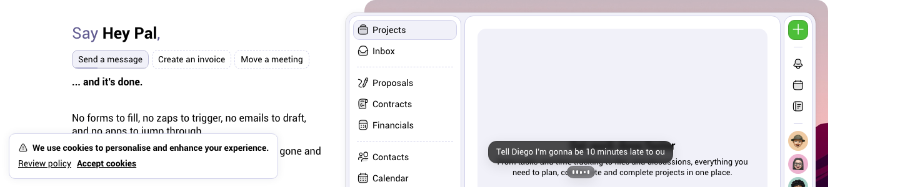

### Section 5 — `header`

_1210×303px_

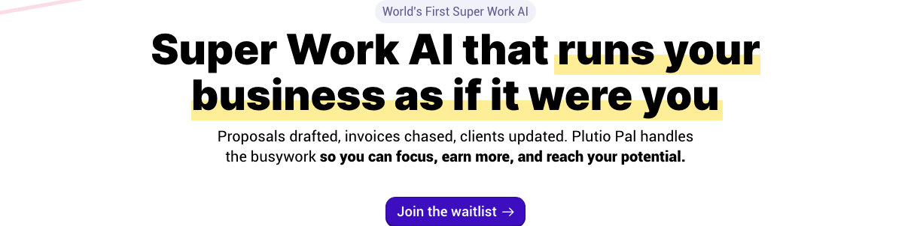

### Section 1 — `section`

_1440×415px_

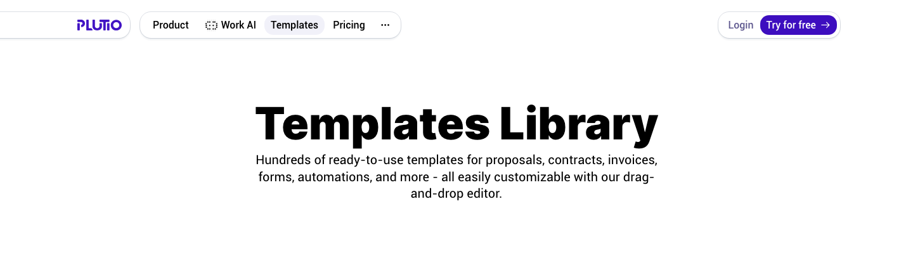

### Section 3 — `[class*="section"]`

_1440×1200px_

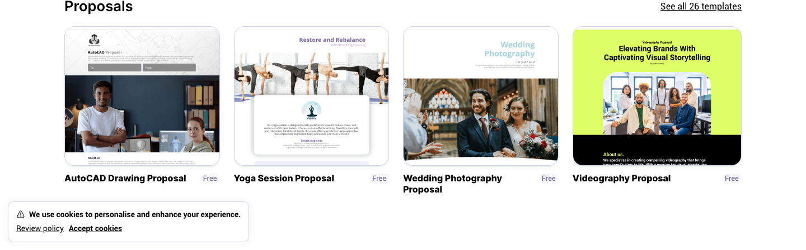

### Section 4 — `[class*="section"]`

_1210×350px_

### Section 1 — `section`

_1440×479px_

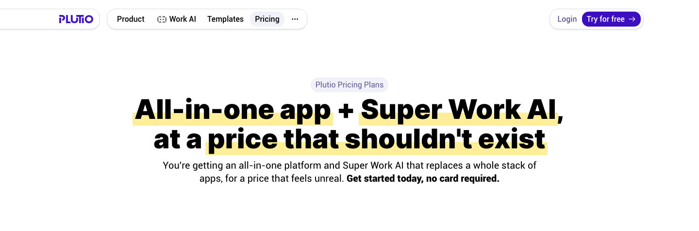

### Section 6 — `header`

_1210×219px_

### Section 8 — `[class*="section"]`

_1440×729px_

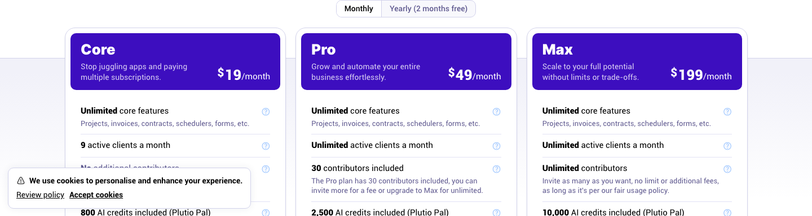

### Section 1 — `section`

_1440×821px_

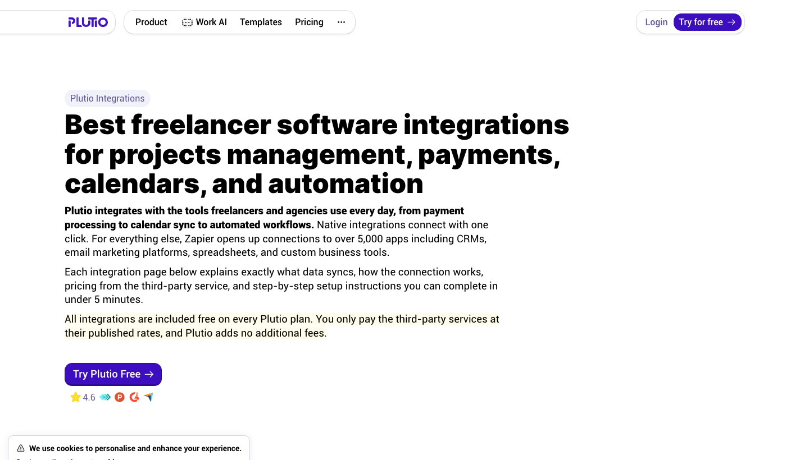

### Section 4 — `header`

_1210×561px_

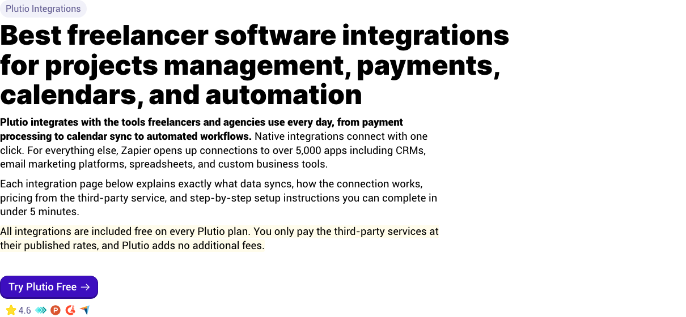

### Section 6 — `main > div`

_1440×1200px_

