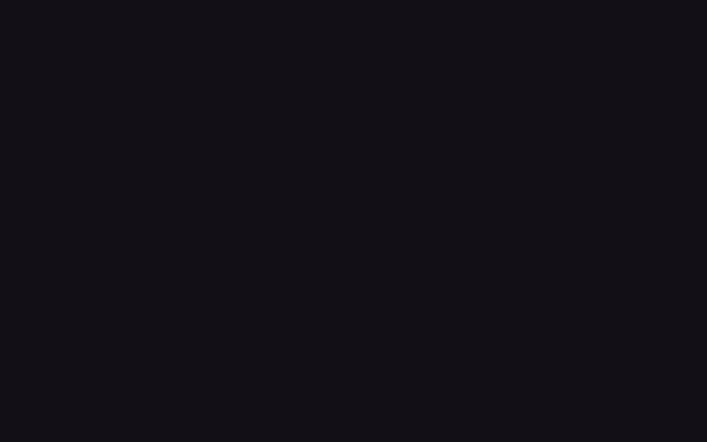

# reactbits Design System

You are building UI for **reactbits**. Light-themed, neutral palette, sans-serif typography (Gochi Hand), compact density on a 4px grid, expressive motion.

## Visual Reference

**IMPORTANT**: Study ALL screenshots below before writing any UI. Match colors, typography, spacing, layout, and motion exactly as shown.

### Homepage



### Scroll Journey (Cinematic Visual States)

> These screenshots capture the website at different scroll depths. The design changes dramatically as you scroll — each frame shows a different cinematic state. Replicate these exact visual transitions.

#### 0% — Hero / Above the fold


#### 17% — Mid-page at 17% scroll


#### 33% — Mid-page at 33% scroll


#### 50% — Mid-page at 50% scroll


#### 67% — Mid-page at 67% scroll


#### 83% — Mid-page at 83% scroll


#### 100% — Footer / End of page


> Read `references/DESIGN.md` for full token details. Read `references/ANIMATIONS.md` for motion specs. Read `references/LAYOUT.md` for layout structure. Read `references/COMPONENTS.md` for component patterns.

## Ultra Reference Files

This package includes extended documentation. **Read these files before implementing:**

| File                         | Contents                                                           |
| ---------------------------- | ------------------------------------------------------------------ |
| `references/DESIGN.md`       | Full design system tokens, colors, typography, spacing             |
| `references/VISUAL_GUIDE.md` | **START HERE** — Master visual guide with all screenshots embedded |
| `references/ANIMATIONS.md`   | CSS keyframes, scroll triggers, motion library stack, video specs  |
| `references/LAYOUT.md`       | Flex/grid containers, page structure, spacing relationships        |
| `references/COMPONENTS.md`   | DOM component patterns, HTML structure, class fingerprints         |
| `references/INTERACTIONS.md` | Hover/focus states with before/after style diffs                   |
| `screens/scroll/`            | 7 scroll journey screenshots showing cinematic states              |

### Animation Stack Detected

- **Web Animations API (1 active)** — animation

## Design Philosophy

- **Layered depth** — use shadow tokens to create a sense of physical layering. Each elevation level has a specific shadow.
- **Gradient accents** — gradients are used thoughtfully for emphasis, not decoration.
- **Type pairing** — Gochi Hand for body/UI text, Bricolage Grotesque for headings/display. Never introduce a third typeface.
- **compact density** — 4px base grid. Every dimension is a multiple of 4.
- **neutral palette** — the color temperature runs neutral, matching the sans-serif typography.
- **Restrained accent** — `#b497cf` is the only pop of color. Used exclusively for CTAs, links, focus rings, and active states.
- **Expressive motion** — animations are an integral part of the experience. Use spring physics and layout animations.

## Color System

### Core Palette

| Role         | Token            | Hex       | Use                      |
| ------------ | ---------------- | --------- | ------------------------ |
| Background   | `--background`   | `#ffffff` | Page/app background      |
| Surface      | `--surface`      | `#161026` | Cards, panels, modals    |
| Text Primary | `--text-primary` | `#120f17` | Headings, body text      |
| Text Muted   | `--text-muted`   | `#a6a6a6` | Captions, placeholders   |
| Accent       | `--accent`       | `#b497cf` | CTAs, links, focus rings |
| Border       | `--border`       | `#2f293a` | Dividers, card borders   |

### Extended Palette

- **color-primary:** `#a855f7`
- `#7c3aed`
- `#5227ff`
- `#222222`
- **color-black:** `#000000` — Deep background layer or shadow color
- `#221638`
- `#cccccc`
- `#dad1f6` — Light surface or highlight color

### CSS Variable Tokens

```css
--border-angle: 360deg;
--bg-card: #1b1722;
--border-primary: #2f293a;
--border-secondary: #2f293a;
--border-subtle: #2f293a;
--color-primary: #a855f7;
--color-accent: #b497cf;
--color-accent-muted: #b497cf;
--text-primary: #fff;
--text-secondary: #f5f5f5;
--text-muted: #aaa;
--shadow-primary: 0 2px 8px #5227ff66;
```

## Typography

### Font Stack

- **Gochi Hand** — Heading 1, Heading 2, Heading 3
- **Bricolage Grotesque** — Body, Caption
- **Geist Mono** — Code

### Font Sources

```css
@font-face {
  font-family: 'Geist';
  src: url('fonts/Geist-Bold.ttf') format('truetype');
  font-weight: 700;
}
@font-face {
  font-family: 'Geist';
  src: url('fonts/Geist-Regular.ttf') format('truetype');
  font-weight: 400;
}
@font-face {
  font-family: 'Geist Mono';
  src: url('fonts/GeistMono-Bold.ttf') format('truetype');
  font-weight: 700;
}
@font-face {
  font-family: 'Geist Mono';
  src: url('fonts/GeistMono-Regular.ttf') format('truetype');
  font-weight: 400;
}
@font-face {
  font-family: 'Bricolage Grotesque';
  src: url('fonts/BricolageGrotesque-Bold.ttf') format('truetype');
  font-weight: 700;
}
@font-face {
  font-family: 'Bricolage Grotesque';
  src: url('fonts/BricolageGrotesque-Regular.ttf') format('truetype');
  font-weight: 400;
}
@font-face {
  font-family: 'Gochi Hand';
  src: url('fonts/GochiHand-Regular.ttf') format('truetype');
  font-weight: 400;
}
@font-face {
  font-family: 'Press Start 2P';
  src: url('fonts/PressStart2P-Regular.ttf') format('truetype');
  font-weight: 400;
}
@font-face {
  font-family: 'Google Sans Code';
  src: url('fonts/GoogleSansCode-Bold.ttf') format('truetype');
  font-weight: 700;
}
@font-face {
  font-family: 'Google Sans Code';
  src: url('fonts/GoogleSansCode-Regular.ttf') format('truetype');
  font-weight: 400;
}
@font-face {
  font-family: 'Geist Pixel Square';
  src: url('https://reactbits.dev/assets/css/geist/dist/fonts/geist-pixel/GeistPixel-Square.woff2')
    format('woff2');
  font-weight: 500;
}
@font-face {
  font-family: 'Geist Pixel Grid';
  src: url('https://reactbits.dev/assets/css/geist/dist/fonts/geist-pixel/GeistPixel-Grid.woff2')
    format('woff2');
  font-weight: 500;
}
@font-face {
  font-family: 'Geist Pixel Circle';
  src: url('https://reactbits.dev/assets/css/geist/dist/fonts/geist-pixel/GeistPixel-Circle.woff2')
    format('woff2');
  font-weight: 500;
}
@font-face {
  font-family: 'Geist Pixel Triangle';
  src: url('https://reactbits.dev/assets/css/geist/dist/fonts/geist-pixel/GeistPixel-Triangle.woff2')
    format('woff2');
  font-weight: 500;
}
@font-face {
  font-family: 'Geist Pixel Line';
  src: url('https://reactbits.dev/assets/css/geist/dist/fonts/geist-pixel/GeistPixel-Line.woff2')
    format('woff2');
  font-weight: 500;
}
```

### Type Scale

| Role      | Family              | Size | Weight |
| --------- | ------------------- | ---- | ------ |
| Heading 1 | Gochi Hand          | 6rem | 700    |
| Heading 2 | Gochi Hand          | 5rem | 700    |
| Heading 3 | Gochi Hand          | 4rem | 700    |
| Body      | Bricolage Grotesque | 13px | 400    |
| Caption   | Bricolage Grotesque | 12px | 400    |
| Code      | Geist Mono          | 14px | 400    |

### Typography Rules

- Body/UI: **Gochi Hand**, Headings: **Bricolage Grotesque** — these are the only display fonts
- Max 3-4 font sizes per screen
- Headings: weight 600-700, body: weight 400
- Use color and opacity for text hierarchy, not additional font sizes
- Line height: 1.5 for body, 1.2 for headings

## Spacing & Layout

### Base Grid: 4px

Every dimension (margin, padding, gap, width, height) must be a multiple of **4px**.

### Spacing Scale

`2, 4, 6, 8, 10, 12, 14, 16, 18, 20, 22, 24` px

### Spacing as Meaning

| Spacing | Use                                                |
| ------- | -------------------------------------------------- |
| 4-8px   | Tight: related items (icon + label, avatar + name) |
| 12-16px | Medium: between groups within a section            |
| 24-32px | Wide: between distinct sections                    |
| 48px+   | Vast: major page section breaks                    |

### Border Radius

Scale: `.25rem, .5rem, .55rem, 1px, 1rem, 1.25em, 1.25rem, 1.5rem, 2px, 3px, 4px, 5px, 6px, 7px, 8px, 9px, 10px, 11px, 12px, 14px, 15px, 16px, 18px, 20px, 22px, 24px, 25px, 27px, 30px, 40px, 50px, 999px, inherit`
Default: `10px`

### Container

Max-width: `967px`, centered with auto margins.

### Breakpoints

| Name | Value  |
| ---- | ------ |
| sm   | 40rem  |
| md   | 48rem  |
| lg   | 64rem  |
| xl   | 80rem  |
| 2xl  | 96rem  |
| xs   | 375px  |
| xs   | 400px  |
| xs   | 480px  |
| sm   | 600px  |
| sm   | 640px  |
| md   | 768px  |
| lg   | 900px  |
| lg   | 967px  |
| lg   | 999px  |
| lg   | 1000px |
| lg   | 1001px |
| lg   | 1024px |
| xl   | 1100px |
| xl   | 1240px |
| xl   | 1275px |
| 2xl  | 1440px |

Mobile-first: design for small screens, layer on responsive overrides.

## Component Patterns

### Card

```css
.card {
  background: #161026;
  border: 1px solid #2f293a;
  border-radius: 10px;
  padding: 16px;
  box-shadow: 0 0 4px #0000008c;
}
```

```html
<div class="card">
  <h3>Card Title</h3>
  <p>Card content goes here.</p>
</div>
```

### Button

```css
/* Primary */
.btn-primary {
  background: #b497cf;
  color: #120f17;
  border-radius: 10px;
  padding: 8px 16px;
  font-weight: 500;
  transition: opacity 150ms ease;
}
.btn-primary:hover {
  opacity: 0.9;
}

/* Ghost */
.btn-ghost {
  background: transparent;
  border: 1px solid #2f293a;
  color: #120f17;
  border-radius: 10px;
  padding: 8px 16px;
}
```

```html
<button class="btn-primary">Get Started</button>
<button class="btn-ghost">Learn More</button>
```

### Input

```css
.input {
  background: #ffffff;
  border: 1px solid #2f293a;
  border-radius: 10px;
  padding: 8px 12px;
  color: #120f17;
  font-size: 14px;
}
.input:focus {
  border-color: #b497cf;
  outline: none;
}
```

```html
<input class="input" type="text" placeholder="Search..." />
```

### Badge / Chip

```css
.badge {
  display: inline-flex;
  align-items: center;
  padding: 4px 8px;
  border-radius: 9999px;
  font-size: 12px;
  font-weight: 500;
  background: #161026;
  color: #a6a6a6;
}
```

```html
<span class="badge">New</span> <span class="badge">Beta</span>
```

### Modal / Dialog

```css
.modal-backdrop {
  background: rgba(0, 0, 0, 0.6);
}
.modal {
  background: #161026;
  border: 1px solid #2f293a;
  border-radius: inherit;
  padding: 24px;
  max-width: 480px;
  width: 90vw;
  box-shadow:
    0 2px 16px #0003,
    inset 0 0.5px #ffffff0f;
}
```

```html
<div class="modal-backdrop">
  <div class="modal">
    <h2>Dialog Title</h2>
    <p>Dialog content.</p>
    <button class="btn-primary">Confirm</button>
    <button class="btn-ghost">Cancel</button>
  </div>
</div>
```

### Table

```css
.table {
  width: 100%;
  border-collapse: collapse;
}
.table th {
  text-align: left;
  padding: 8px 12px;
  font-weight: 500;
  font-size: 12px;
  color: #a6a6a6;
  text-transform: uppercase;
  letter-spacing: 0.05em;
  border-bottom: 1px solid #2f293a;
}
.table td {
  padding: 12px;
  border-bottom: 1px solid #2f293a;
}
```

```html
<table class="table">
  <thead>
    <tr>
      <th>Name</th>
      <th>Status</th>
      <th>Date</th>
    </tr>
  </thead>
  <tbody>
    <tr>
      <td>Item One</td>
      <td>Active</td>
      <td>Jan 1</td>
    </tr>
    <tr>
      <td>Item Two</td>
      <td>Pending</td>
      <td>Jan 2</td>
    </tr>
  </tbody>
</table>
```

### Navigation

```css
.nav {
  display: flex;
  align-items: center;
  gap: 8px;
  padding: 12px 16px;
  border-bottom: 1px solid #2f293a;
}
.nav-link {
  color: #a6a6a6;
  padding: 8px 12px;
  border-radius: 10px;
  transition: color 150ms;
}
.nav-link:hover {
  color: #120f17;
}
.nav-link.active {
  color: #b497cf;
}
```

```html
<nav class="nav">
  <a href="/" class="nav-link active">Home</a>
  <a href="/about" class="nav-link">About</a>
  <a href="/pricing" class="nav-link">Pricing</a>
  <button class="btn-primary" style="margin-left: auto">Get Started</button>
</nav>
```

## Animation & Motion

This project uses **expressive motion**. Animations are part of the design language.

### CSS Animations

- `search-fade-in`
- `search-slide-in`
- `announcement-modal-spin`
- `ln-pro-flow`
- `ln-pro-shine`

### Motion Tokens

- **Duration scale:** `.1s`, `.12s`, `.15s`, `.2s`, `.25s`, `.26s`, `.3s`, `.35s`, `.5s`, `1.5s`, `10ms`, `100ms`, `120ms`, `150ms`, `200ms`, `250ms`, `300ms`, `400ms`, `500ms`, `600ms`, `700ms`, `800ms`
- **Easing functions:** `ease`, `cubic-bezier(.4,0,.2,1)`, `cubic-bezier(.16,1,.3,1)`, `cubic-bezier(0,0,0,1)`, `cubic-bezier(.5,1,.89,1)`, `cubic-bezier(.83,0,.17,1)`, `linear`, `cubic-bezier(.175,.885,.32,1.275)`
- **Animated properties:** `border-color`

### Motion Guidelines

- **Duration:** Use values from the duration scale above. Short (.1s) for micro-interactions, long (800ms) for page transitions
- **Easing:** Use `ease` as the default easing curve
- **Direction:** Elements enter from bottom/right, exit to top/left
- **Reduced motion:** Always respect `prefers-reduced-motion` — disable animations when set

## Depth & Elevation

### Shadow Tokens

- Subtle: `0 0 0 1px #00d8ff80`
- Raised (cards, buttons): `0 0 4px #0000008c`
- Raised (cards, buttons): `0 2px 4px #0000001a`
- Raised (cards, buttons): `0 0#a855f773`
- Raised (cards, buttons): `0 0 0 4px #a855f700`
- Raised (cards, buttons): `0 2px 8px #0000001a`

### Z-Index Scale

`0, 1, 2, 3, 4, 5, 6, 8, 10, 15, 20, 30, 40, 50, 60, 99, 100, 900, 998, 1000, 1001, 1500, 9999, 10000`

Use these exact values — never invent z-index values.

## Anti-Patterns (Never Do)

- **No blur effects** — no backdrop-blur, no filter: blur()
- **No zebra striping** — tables and lists use borders for separation
- **No invented colors** — every hex value must come from the palette above
- **No arbitrary spacing** — every dimension is a multiple of 4px
- **No extra fonts** — only Gochi Hand and Bricolage Grotesque and Geist Mono are allowed
- **No arbitrary border-radius** — use the scale: .25rem, .5rem, .55rem, 1px, 1rem, 1.25em, 1.25rem, 1.5rem, 2px, 3px
- **No opacity for disabled states** — use muted colors instead

## Workflow

1. **Read** `references/DESIGN.md` before writing any UI code
2. **Pick colors** from the Color System section — never invent new ones
3. **Set typography** — Gochi Hand, Bricolage Grotesque, Geist Mono only, using the type scale
4. **Build layout** on the 4px grid — check every margin, padding, gap
5. **Match components** to patterns above before creating new ones
6. **Apply elevation** — use shadow tokens
7. **Validate** — every value traces back to a design token. No magic numbers.

## Brand Spec

- **Favicon:** `favicon.ico`
- **Site URL:** `https://reactbits.dev/components/`
- **Brand color:** `#b497cf`
- **Brand typeface:** Gochi Hand

## Quick Reference

```
Background:     #ffffff
Surface:        #161026
Text:           #120f17 / #a6a6a6
Accent:         #b497cf
Border:         #2f293a
Font:           Gochi Hand
Spacing:        4px grid
Radius:         10px
Components:     0 detected
```

## When to Trigger

Activate this skill when:

- Creating new components, pages, or visual elements for reactbits
- Writing CSS, Tailwind classes, styled-components, or inline styles
- Building page layouts, templates, or responsive designs
- Reviewing UI code for design consistency
- The user mentions "reactbits" design, style, UI, or theme
- Generating mockups, wireframes, or visual prototypes

---

# Full Reference Files

> Every output file is embedded below. Claude has full design system context from /skills alone.

## Design System Tokens (DESIGN.md)

# reactbits DESIGN.md

> Auto-generated design system — reverse-engineered via static analysis by skillui.
> Frameworks: None detected
> Colors: 20 · Fonts: 3 · Components: 0
> Icon library: not detected · State: not detected
> Primary theme: light · Dark mode toggle: no · Motion: expressive

## Visual Reference

**Match this design exactly** — study colors, fonts, spacing, and component shapes before writing any UI code.


---

## 1. Visual Theme & Atmosphere

This is a **light-themed** interface with a neutral, approachable feel. The light background emphasizes content clarity. Typography pairs **Bricolage Grotesque** for display/headings with **Gochi Hand** for body text, creating clear visual hierarchy through type contrast. Spacing follows a **4px base grid** (compact density), with scale: 2, 4, 6, 8, 10, 12, 14, 16px. The palette is predominantly monochromatic with **#b497cf** as the single accent color — used sparingly for interactive elements and emphasis. Motion is expressive — spring physics, layout animations, and staggered reveals are part of the visual language.

---

## 2. Color Palette & Roles

| Token                | Hex       | Role         | Use                                     |
| -------------------- | --------- | ------------ | --------------------------------------- |
| tw-ring-offset-color | `#ffffff` | background   | Page background, darkest surface        |
| bg-card              | `#161026` | surface      | Card and panel backgrounds              |
| surface              | `#e2e8f0` | surface      | Card and panel backgrounds              |
| theme-color          | `#120f17` | text-primary | Headings and body text                  |
| text-muted           | `#a6a6a6` | text-muted   | Captions, placeholders, secondary info  |
| text-secondary       | `#f1f5f9` | text-muted   | Captions, placeholders, secondary info  |
| text-muted           | `#988bc7` | text-muted   | Captions, placeholders, secondary info  |
| border-primary       | `#2f293a` | border       | Dividers, card borders, outlines        |
| color-accent         | `#b497cf` | accent       | CTAs, links, focus rings, active states |
| info                 | `#5227ff` | info         | Informational highlights                |
| color-primary        | `#a855f7` | unknown      | Palette color                           |
| unknown              | `#7c3aed` | unknown      | Palette color                           |
| unknown              | `#222222` | unknown      | Palette color                           |
| color-black          | `#000000` | unknown      | Palette color                           |
| unknown              | `#221638` | unknown      | Palette color                           |
| unknown              | `#cccccc` | unknown      | Palette color                           |
| unknown              | `#dad1f6` | unknown      | Palette color                           |
| unknown              | `#78d1e1` | unknown      | Palette color                           |
| unknown              | `#08060c` | unknown      | Palette color                           |
| unknown              | `#c084fc` | unknown      | Palette color                           |

### CSS Variable Tokens

```css
--border-angle: 360deg;
--tw-border-style: solid;
--tw-border-style: none;
--tw-border-style: solid;
--bg-card: #1b1722;
--border-primary: #2f293a;
--border-secondary: #2f293a;
--border-subtle: #2f293a;
--color-primary: #a855f7;
--color-accent: #b497cf;
--color-accent-muted: #b497cf;
--text-primary: #fff;
--text-secondary: #f5f5f5;
--text-muted: #aaa;
--shadow-primary: 0 2px 8px #5227ff66;
```

---

## 3. Typography Rules

**Font Stack:**

- **Gochi Hand** — Heading 1, Heading 2, Heading 3
- **Bricolage Grotesque** — Body, Caption
- **Geist Mono** — Code

**Font Sources:**

```css
@font-face {
  font-family: 'Geist';
  src: url('fonts/Geist-Bold.ttf') format('truetype');
  font-weight: 700;
}
@font-face {
  font-family: 'Geist';
  src: url('fonts/Geist-Regular.ttf') format('truetype');
  font-weight: 400;
}
@font-face {
  font-family: 'Geist Mono';
  src: url('fonts/GeistMono-Bold.ttf') format('truetype');
  font-weight: 700;
}
@font-face {
  font-family: 'Geist Mono';
  src: url('fonts/GeistMono-Regular.ttf') format('truetype');
  font-weight: 400;
}
@font-face {
  font-family: 'Bricolage Grotesque';
  src: url('fonts/BricolageGrotesque-Bold.ttf') format('truetype');
  font-weight: 700;
}
@font-face {
  font-family: 'Bricolage Grotesque';
  src: url('fonts/BricolageGrotesque-Regular.ttf') format('truetype');
  font-weight: 400;
}
@font-face {
  font-family: 'Gochi Hand';
  src: url('fonts/GochiHand-Regular.ttf') format('truetype');
  font-weight: 400;
}
@font-face {
  font-family: 'Press Start 2P';
  src: url('fonts/PressStart2P-Regular.ttf') format('truetype');
  font-weight: 400;
}
@font-face {
  font-family: 'Google Sans Code';
  src: url('fonts/GoogleSansCode-Bold.ttf') format('truetype');
  font-weight: 700;
}
@font-face {
  font-family: 'Google Sans Code';
  src: url('fonts/GoogleSansCode-Regular.ttf') format('truetype');
  font-weight: 400;
}
@font-face {
  font-family: 'Geist Pixel Square';
  src: url('https://reactbits.dev/assets/css/geist/dist/fonts/geist-pixel/GeistPixel-Square.woff2')
    format('woff2');
  font-weight: 500;
}
@font-face {
  font-family: 'Geist Pixel Grid';
  src: url('https://reactbits.dev/assets/css/geist/dist/fonts/geist-pixel/GeistPixel-Grid.woff2')
    format('woff2');
  font-weight: 500;
}
@font-face {
  font-family: 'Geist Pixel Circle';
  src: url('https://reactbits.dev/assets/css/geist/dist/fonts/geist-pixel/GeistPixel-Circle.woff2')
    format('woff2');
  font-weight: 500;
}
@font-face {
  font-family: 'Geist Pixel Triangle';
  src: url('https://reactbits.dev/assets/css/geist/dist/fonts/geist-pixel/GeistPixel-Triangle.woff2')
    format('woff2');
  font-weight: 500;
}
@font-face {
  font-family: 'Geist Pixel Line';
  src: url('https://reactbits.dev/assets/css/geist/dist/fonts/geist-pixel/GeistPixel-Line.woff2')
    format('woff2');
  font-weight: 500;
}
```

| Role      | Font                | Size | Weight |
| --------- | ------------------- | ---- | ------ |
| Heading 1 | Gochi Hand          | 6rem | 700    |
| Heading 2 | Gochi Hand          | 5rem | 700    |
| Heading 3 | Gochi Hand          | 4rem | 700    |
| Body      | Bricolage Grotesque | 13px | 400    |
| Caption   | Bricolage Grotesque | 12px | 400    |
| Code      | Geist Mono          | 14px | 400    |

**Typographic Rules:**

- Limit to 3 font families max per screen
- Use **Gochi Hand** for body/UI text, **Bricolage Grotesque** for display/headings
- Maintain consistent hierarchy: no more than 3-4 font sizes per screen
- Headings use bold (600-700), body uses regular (400)
- Line height: 1.5 for body text, 1.2 for headings
- Use color and opacity for secondary hierarchy, not additional font sizes

---

## 4. Component Stylings

No components detected. Scan `src/components/` or `components/` to populate this section.

---

## 5. Layout Principles

- **Base spacing unit:** 4px
- **Spacing scale:** 2, 4, 6, 8, 10, 12, 14, 16, 18, 20, 22, 24
- **Border radius:** .25rem, .5rem, .55rem, 1px, 1rem, 1.25em, 1.25rem, 1.5rem, 2px, 3px, 4px, 5px, 6px, 7px, 8px, 9px, 10px, 11px, 12px, 14px, 15px, 16px, 18px, 20px, 22px, 24px, 25px, 27px, 30px, 40px, 50px, 999px, inherit
- **Max content width:** 967px

**Spacing as Meaning:**
| Spacing | Use |
|---|---|
| 4-8px | Tight: related items within a group |
| 12-16px | Medium: between groups |
| 24-32px | Wide: between sections |
| 48px+ | Vast: major section breaks |

---

## 6. Depth & Elevation

### Flat — subtle depth hints

- `0 0 0 1px #00d8ff80`

### Raised — cards, buttons, interactive elements

- `0 0 4px #0000008c`
- `0 2px 4px #0000001a`
- `0 0#a855f773`

### Floating — dropdowns, popovers, modals

- `0 2px 16px #0003,inset 0 .5px #ffffff0f`
- `0 2px 10px #a855f759`
- `0 2px 12px #00000040,inset 0 .5px #ffffff0f`

### Overlay — full-screen overlays, top-level dialogs

- `0 8px 40px #00000080,0 0 0 1px #ffffff08`
- `0 4px 32px #0006,0 0 80px #5227ff26,inset 0 .5px #ffffff0f`
- `0 0 16px rgba(var(--pro-glow,168,85,247),.5),0 0 40px rgba(var(--pro-glow,168,85,247),.2)`

### Z-Index Scale

`0, 1, 2, 3, 4, 5, 6, 8, 10, 15, 20, 30, 40, 50, 60, 99, 100, 900, 998, 1000, 1001, 1500, 9999, 10000`

---

## 7. Animation & Motion

This project uses **expressive motion**. Animations are an integral part of the experience.

### CSS Animations

- `@keyframes search-fade-in`
- `@keyframes search-slide-in`
- `@keyframes announcement-modal-spin`
- `@keyframes ln-pro-flow`
- `@keyframes ln-pro-shine`
- `@keyframes ln-menu-fade-in`
- `@keyframes ln-menu-slide-in`
- `@keyframes marqueeScroll`

### Motion Guidelines

- Duration: 150-300ms for micro-interactions, 300-500ms for page transitions
- Easing: `ease-out` for enters, `ease-in` for exits
- Always respect `prefers-reduced-motion`

---

## 8. Do's and Don'ts

### Do's

- Use `#b497cf` for interactive elements (buttons, links, focus rings)
- Use `#ffffff` as the primary page background
- Pair **Gochi Hand** (body) with **Bricolage Grotesque** (display) — these are the only allowed fonts
- Follow the **4px** spacing grid for all margins, padding, and gaps
- Use the defined shadow tokens for elevation — see Section 6
- Use border-radius from the scale: .25rem, .5rem, .55rem, 1px, 1rem

### Don'ts

- Don't introduce colors outside this palette — extend the design tokens first
- Don't introduce additional font families beyond Gochi Hand and Bricolage Grotesque and Geist Mono
- Don't use arbitrary spacing values — stick to multiples of 4px
- Don't create custom box-shadow values outside the system tokens
- Don't use arbitrary border-radius values — pick from the defined scale
- Don't use backdrop-blur or blur effects

### Anti-Patterns (detected from codebase)

- No blur or backdrop-blur effects
- No zebra striping on tables/lists

---

## 9. Responsive Behavior

| Name | Value  | Source |
| ---- | ------ | ------ |
| sm   | 40rem  | css    |
| md   | 48rem  | css    |
| lg   | 64rem  | css    |
| xl   | 80rem  | css    |
| 2xl  | 96rem  | css    |
| xs   | 375px  | css    |
| xs   | 400px  | css    |
| xs   | 480px  | css    |
| sm   | 600px  | css    |
| sm   | 640px  | css    |
| md   | 768px  | css    |
| lg   | 900px  | css    |
| lg   | 967px  | css    |
| lg   | 999px  | css    |
| lg   | 1000px | css    |
| lg   | 1001px | css    |
| lg   | 1024px | css    |
| xl   | 1100px | css    |
| xl   | 1240px | css    |
| xl   | 1275px | css    |
| 2xl  | 1440px | css    |

**Approach:** Use `@media (min-width: ...)` queries matching the breakpoints above.

---

## 10. Agent Prompt Guide

Use these as starting points when building new UI:

### Build a Card

```
Background: #161026
Border: 1px solid #2f293a
Radius: 10px
Padding: 16px
Font: Gochi Hand
Use shadow tokens from Section 6.
```

### Build a Button

```
Primary: bg #b497cf, text white
Ghost: bg transparent, border #2f293a
Padding: 8px 16px
Radius: 10px
Hover: opacity 0.9 or lighter shade
Focus: ring with #b497cf
```

### Build a Page Layout

```
Background: #ffffff
Max-width: 967px, centered
Grid: 4px base
Responsive: mobile-first, breakpoints from Section 9
```

### Build a Stats Card

```
Surface: #161026
Label: #a6a6a6 (muted, 12px, uppercase)
Value: #120f17 (primary, 24-32px, bold)
Status: use success/warning/danger from Section 2
```

### Build a Form

```
Input bg: #ffffff
Input border: 1px solid #2f293a
Focus: border-color #b497cf
Label: #a6a6a6 12px
Spacing: 16px between fields
Radius: 10px
```

### General Component

```
1. Read DESIGN.md Sections 2-6 for tokens
2. Colors: only from palette
3. Font: Gochi Hand, type scale from Section 3
4. Spacing: 4px grid
5. Components: match patterns from Section 4
6. Elevation: shadow tokens
```

## Visual Guide — Screenshots (VISUAL_GUIDE.md)

# reactbits — Visual Guide

> Master visual reference. Study every screenshot carefully before implementing any UI.
> Match colors, layout, typography, spacing, and motion states exactly.

**Motion Stack:** **Web Animations API (1 active)**

## Scroll Journey

The page has cinematic scroll animations. Each screenshot below shows the exact visual state at that scroll depth.
**Replicate these transitions precisely** — the design changes dramatically as you scroll.

### Hero — Above the fold

_Scroll position: 0px of 900px total_


### 17% scroll depth

_Scroll position: 0px of 900px total_


### 33% scroll depth

_Scroll position: 0px of 900px total_


### 50% scroll depth

_Scroll position: 0px of 900px total_


### 67% scroll depth

_Scroll position: 0px of 900px total_


### 83% scroll depth

_Scroll position: 0px of 900px total_


### Footer — End of page

_Scroll position: 0px of 900px total_


## Full Page Screenshots

### React Bits - Animated UI Components For React

_URL: `https://reactbits.dev/components/`_


## Animations & Motion (ANIMATIONS.md)

# Animation Reference

> Cinematic motion design extracted from live DOM. Follow these specs exactly to recreate the experience.

## Motion Technology Stack

| Library                           | Type      | Notes |
| --------------------------------- | --------- | ----- |
| **Web Animations API (1 active)** | animation |       |

## Scroll Journey

The page is **900px** tall. Each frame below shows what the user sees at that scroll depth.

> **Use these screenshots to understand WHAT animates, WHEN it animates, and HOW it moves.**

### 0% — Top / Hero

Scroll position: 0px


### 17% — Opening Section

Scroll position: 0px


### 33% — First Feature Section

Scroll position: 0px


### 50% — Mid-Page

Scroll position: 0px


### 67% — Lower Content

Scroll position: 0px


### 83% — Near Footer

Scroll position: 0px


### 100% — Bottom / Footer

Scroll position: 0px


## CSS Keyframes (43 extracted)

### `@keyframes ln-menu-slide-in`

Duration: `0.2s` · Easing: `ease` · Delay: `0s` · Iteration: `1` · Fill: `none`

Used by: `.ln-navbar-mobile-menu`, `.ln-navbar-prefs-menu`

```css
@keyframes ln-menu-slide-in {
  0% {
    opacity: 0;
    transform: translateY(-6px);
  }
  100% {
    opacity: 1;
    transform: translateY(0px);
  }
}
```

> Fade + motion enter animation

### `@keyframes spinCW`

Duration: `20s` · Easing: `linear` · Delay: `0s` · Iteration: `infinite` · Fill: `none`

Used by: `.ln-feat-orbit-ring--1`, `.ln-feat-orbit-ring--2 .ln-feat-orbit-node svg`

```css
@keyframes spinCW {
  0% {
    transform: rotate(0deg);
  }
  100% {
    transform: rotate(360deg);
  }
}
```

> Transform/motion animation

### `@keyframes spinCCW`

Duration: `30s` · Easing: `linear` · Delay: `0s` · Iteration: `infinite` · Fill: `none`

Used by: `.ln-feat-orbit-ring--2`, `.ln-feat-orbit-ring--1 .ln-feat-orbit-node svg`

```css
@keyframes spinCCW {
  0% {
    transform: rotate(0deg);
  }
  100% {
    transform: rotate(-360deg);
  }
}
```

> Transform/motion animation

### `@keyframes rotateBorder`

Duration: `4s` · Easing: `linear` · Delay: `0s` · Iteration: `infinite` · Fill: `none`

Used by: `.tool-selector-wrapper::before`, `.tool-selector-wrapper::after`

```css
@keyframes rotateBorder {
  100% {
    --border-angle: 360deg;
  }
}
```

> Border animation

### `@keyframes search-fade-in`

Duration: `0.15s` · Easing: `ease` · Delay: `0s` · Iteration: `1` · Fill: `none`

Used by: `.search-backdrop`

```css
@keyframes search-fade-in {
  0% {
    opacity: 0;
  }
  100% {
    opacity: 1;
  }
}
```

> Opacity fade

### `@keyframes search-slide-in`

Duration: `0.2s` · Easing: `ease` · Delay: `0s` · Iteration: `1` · Fill: `none`

Used by: `.search-dialog`

```css
@keyframes search-slide-in {
  0% {
    opacity: 0;
    transform: translateY(-8px) scale(0.98);
  }
  100% {
    opacity: 1;
    transform: translateY(0px) scale(1);
  }
}
```

> Fade + motion enter animation

### `@keyframes announcement-modal-spin`

Duration: `8s` · Easing: `linear` · Delay: `0s` · Iteration: `infinite` · Fill: `none`

Used by: `.announcement-modal-border`

```css
@keyframes announcement-modal-spin {
  100% {
    --announcement-angle: 360deg;
  }
}
```

### `@keyframes ln-pro-flow`

Duration: `3s` · Easing: `ease` · Delay: `0s` · Iteration: `infinite` · Fill: `none`

Used by: `.ln-navbar-pro`

```css
@keyframes ln-pro-flow {
  0% {
    background-position-x: 0%;
    background-position-y: 50%;
  }
  50% {
    background-position-x: 100%;
    background-position-y: 50%;
  }
  100% {
    background-position-x: 0%;
    background-position-y: 50%;
  }
}
```

> Background color/gradient shift · Background position (shimmer/scroll)

### `@keyframes ln-pro-shine`

Duration: `10s` · Easing: `ease-in-out` · Delay: `0s` · Iteration: `infinite` · Fill: `none`

Used by: `.ln-navbar-pro::before`

```css
@keyframes ln-pro-shine {
  0% {
    background-position-x: -200%;
    background-position-y: 0px;
  }
  100% {
    background-position-x: 200%;
    background-position-y: 0px;
  }
}
```

> Background color/gradient shift · Background position (shimmer/scroll)

### `@keyframes ln-menu-fade-in`

Duration: `0.2s` · Easing: `ease` · Delay: `0s` · Iteration: `1` · Fill: `none`

Used by: `.ln-navbar-mobile-menu-docs`

```css
@keyframes ln-menu-fade-in {
  0% {
    opacity: 0;
  }
  100% {
    opacity: 1;
  }
}
```

> Opacity fade

### `@keyframes marqueeScroll`

Duration: `25s` · Easing: `linear` · Delay: `0s` · Iteration: `infinite` · Fill: `none`

Used by: `.ln-feat-marquee-scroll`

```css
@keyframes marqueeScroll {
  0% {
    transform: translate(0px);
  }
  100% {
    transform: translate(-50%);
  }
}
```

> Transform/motion animation

### `@keyframes marqueeScrollRev`

Duration: `28s` · Easing: `linear` · Delay: `0s` · Iteration: `infinite` · Fill: `none`

Used by: `.ln-feat-marquee-scroll--rev`

```css
@keyframes marqueeScrollRev {
  0% {
    transform: translate(-50%);
  }
  100% {
    transform: translate(0px);
  }
}
```

> Transform/motion animation

### `@keyframes thinkPulse`

Duration: `1.2s` · Easing: `ease-in-out` · Delay: `0s` · Iteration: `infinite` · Fill: `none`

Used by: `.ln-feat-aichat-thinking span`

```css
@keyframes thinkPulse {
  0%,
  100% {
    opacity: 0.2;
    transform: scale(0.85);
  }
  50% {
    opacity: 0.7;
    transform: scale(1);
  }
}
```

> Fade + motion enter animation

### `@keyframes cursorBlink`

Duration: `0.8s` · Easing: `ease-in-out` · Delay: `0s` · Iteration: `infinite` · Fill: `none`

Used by: `.ln-feat-aichat-cursor`

```css
@keyframes cursorBlink {
  0%,
  100% {
    opacity: 1;
  }
  50% {
    opacity: 0;
  }
}
```

> Opacity fade

### `@keyframes testScrollUp`

Duration: `35s` · Easing: `linear` · Delay: `0s` · Iteration: `infinite` · Fill: `none`

Used by: `.ln-test-col-scroll--up`

```css
@keyframes testScrollUp {
  0% {
    transform: translateY(0px);
  }
  100% {
    transform: translateY(-33.333%);
  }
}
```

> Transform/motion animation

### `@keyframes testScrollDown`

Duration: `35s` · Easing: `linear` · Delay: `0s` · Iteration: `infinite` · Fill: `none`

Used by: `.ln-test-col-scroll--down`

```css
@keyframes testScrollDown {
  0% {
    transform: translateY(-33.333%);
  }
  100% {
    transform: translateY(0px);
  }
}
```

> Transform/motion animation

### `@keyframes cta-border-spin`

Duration: `8s` · Easing: `linear` · Delay: `0s` · Iteration: `infinite` · Fill: `none`

Used by: `.ln-cta-card-border`

```css
@keyframes cta-border-spin {
  100% {
    --cta-angle: 360deg;
  }
}
```

### `@keyframes ln-loader-pulse`

Duration: `1.8s` · Easing: `ease-in-out` · Delay: `0s` · Iteration: `infinite` · Fill: `none`

Used by: `.ln-loader-logo`

```css
@keyframes ln-loader-pulse {
  0%,
  100% {
    opacity: 0.3;
    transform: scale(1);
  }
  50% {
    opacity: 0.7;
    transform: scale(1.08);
  }
}
```

> Fade + motion enter animation

### `@keyframes shimmer`

Duration: `1s` · Easing: `ease-in-out` · Delay: `0s` · Iteration: `infinite` · Fill: `none`

Used by: `.skeleton-pulse`

```css
@keyframes shimmer {
  0% {
    background-position-x: -200%;
    background-position-y: 0px;
  }
  100% {
    background-position-x: 200%;
    background-position-y: 0px;
  }
}
```

> Background color/gradient shift · Background position (shimmer/scroll)

### `@keyframes shimmer-overlay`

Duration: `1s` · Easing: `ease-in-out` · Delay: `0s` · Iteration: `infinite` · Fill: `none`

Used by: `.skeleton-pulse::before`

```css
@keyframes shimmer-overlay {
  0% {
    left: -100%;
  }
  50% {
    left: 100%;
  }
  100% {
    left: 100%;
  }
}
```

### `@keyframes pro-card-promo-spin`

Duration: `4s` · Easing: `linear` · Delay: `0s` · Iteration: `infinite` · Fill: `none`

Used by: `.pro-card-promo::before`

```css
@keyframes pro-card-promo-spin {
  100% {
    --pro-promo-angle: 360deg;
  }
}
```

### `@keyframes pro-card-promo-pulse`

Duration: `2.4s` · Easing: `ease-in-out` · Delay: `0s` · Iteration: `infinite` · Fill: `none`

Used by: `.pro-card-promo`

```css
@keyframes pro-card-promo-pulse {
  0%,
  100% {
    box-shadow: rgba(168, 85, 247, 0.45) 0px 0px;
  }
  50% {
    box-shadow: rgba(168, 85, 247, 0) 0px 0px 0px 4px;
  }
}
```

> Shadow pulse/glow effect

### `@keyframes border-dance`

Duration: `4s` · Easing: `linear` · Delay: `0s` · Iteration: `infinite` · Fill: `none`

Used by: `.landing-button::after`

```css
@keyframes border-dance {
  0% {
    background-position-x: 0%;
    background-position-y: center;
  }
  50% {
    background-position-x: 100%;
    background-position-y: center;
  }
  100% {
    background-position-x: 0%;
    background-position-y: center;
  }
}
```

> Background color/gradient shift · Background position (shimmer/scroll)

### `@keyframes heroTextFadeIn`

Duration: `0.8s` · Easing: `cubic-bezier(0.16, 1, 0.3, 1)` · Delay: `0s` · Iteration: `1` · Fill: `forwards`

Used by: `.hero-text-animate`

```css
@keyframes heroTextFadeIn {
  0% {
    opacity: 0;
    transform: translateY(20px);
  }
  100% {
    opacity: 1;
    transform: translateY(0px);
  }
}
```

> Fade + motion enter animation

### `@keyframes fadeIn`

Duration: `0.3s` · Easing: `cubic-bezier(0.4, 0, 0.2, 1)` · Delay: `0s` · Iteration: `1` · Fill: `none`

Used by: `.skeleton-loader`

```css
@keyframes fadeIn {
  0% {
    opacity: 0;
  }
  100% {
    opacity: 1;
  }
}
```

> Opacity fade

### `@keyframes swipe-out-left`

Used by: `[data-sonner-toast][data-swipe-out="true"][data-swipe-direction="left"]`

```css
@keyframes swipe-out-left {
  0% {
    transform: var(--y) translate(var(--swipe-amount-x));
    opacity: 1;
  }
  100% {
    transform: var(--y) translate(calc(var(--swipe-amount-x) - 100%));
    opacity: 0;
  }
}
```

> Fade + motion enter animation

### `@keyframes swipe-out-right`

Used by: `[data-sonner-toast][data-swipe-out="true"][data-swipe-direction="right"]`

```css
@keyframes swipe-out-right {
  0% {
    transform: var(--y) translate(var(--swipe-amount-x));
    opacity: 1;
  }
  100% {
    transform: var(--y) translate(calc(var(--swipe-amount-x) + 100%));
    opacity: 0;
  }
}
```

> Fade + motion enter animation

### `@keyframes swipe-out-up`

Used by: `[data-sonner-toast][data-swipe-out="true"][data-swipe-direction="up"]`

```css
@keyframes swipe-out-up {
  0% {
    transform: var(--y) translateY(var(--swipe-amount-y));
    opacity: 1;
  }
  100% {
    transform: var(--y) translateY(calc(var(--swipe-amount-y) - 100%));
    opacity: 0;
  }
}
```

> Fade + motion enter animation

### `@keyframes swipe-out-down`

Used by: `[data-sonner-toast][data-swipe-out="true"][data-swipe-direction="down"]`

```css
@keyframes swipe-out-down {
  0% {
    transform: var(--y) translateY(var(--swipe-amount-y));
    opacity: 1;
  }
  100% {
    transform: var(--y) translateY(calc(var(--swipe-amount-y) + 100%));
    opacity: 0;
  }
}
```

> Fade + motion enter animation

### `@keyframes sonner-fade-in`

Duration: `0.3s` · Easing: `ease` · Delay: `0s` · Iteration: `1` · Fill: `forwards`

Used by: `:where([data-sonner-toast][data-promise="true"]) :where([data-icon]) > svg`

```css
@keyframes sonner-fade-in {
  0% {
    opacity: 0;
    transform: scale(0.8);
  }
  100% {
    opacity: 1;
    transform: scale(1);
  }
}
```

> Fade + motion enter animation

### `@keyframes sonner-fade-out`

Duration: `0.2s` · Easing: `ease` · Delay: `0s` · Iteration: `1` · Fill: `forwards`

Used by: `.sonner-loading-wrapper[data-visible="false"]`

```css
@keyframes sonner-fade-out {
  0% {
    opacity: 1;
    transform: scale(1);
  }
  100% {
    opacity: 0;
    transform: scale(0.8);
  }
}
```

> Fade + motion enter animation

### `@keyframes sonner-spin`

Duration: `1.2s` · Easing: `linear` · Delay: `0s` · Iteration: `infinite` · Fill: `none`

Used by: `.sonner-loading-bar`

```css
@keyframes sonner-spin {
  0% {
    opacity: 1;
  }
  100% {
    opacity: 0.15;
  }
}
```

> Opacity fade

### `@keyframes ln-fade-in`

```css
@keyframes ln-fade-in {
  0% {
    opacity: 0;
  }
  100% {
    opacity: 1;
  }
}
```

> Opacity fade

### `@keyframes gradientShift`

```css
@keyframes gradientShift {
  0%,
  100% {
    background-position-x: 0%;
    background-position-y: center;
  }
  50% {
    background-position-x: 100%;
    background-position-y: center;
  }
}
```

> Background color/gradient shift · Background position (shimmer/scroll)

### `@keyframes glow-pulse`

```css
@keyframes glow-pulse {
  0% {
    filter: brightness() saturate();
  }
  100% {
    filter: brightness(1.1) saturate(1.2);
  }
}
```

> Filter effect (blur/brightness)

### `@keyframes fadeInUp`

```css
@keyframes fadeInUp {
  0% {
    opacity: 0;
    transform: translateY(30px) scale(0.9);
  }
  100% {
    opacity: 1;
    transform: translateY(0px) scale(1);
  }
}
```

> Fade + motion enter animation

### `@keyframes fadeInUpRotate1`

```css
@keyframes fadeInUpRotate1 {
  0% {
    opacity: 0;
    transform: translateY(30px) scale(0.9) rotate(-13deg);
  }
  100% {
    opacity: 1;
    transform: translateY(0px) scale(1) rotate(-13deg);
  }
}
```

> Fade + motion enter animation

### `@keyframes fadeInUpRotate2`

```css
@keyframes fadeInUpRotate2 {
  0% {
    opacity: 0;
    transform: translateY(30px) scale(0.9) rotate(10deg);
  }
  100% {
    opacity: 1;
    transform: translateY(0px) scale(1) rotate(10deg);
  }
}
```

> Fade + motion enter animation

### `@keyframes fadeInUpRotate3`

```css
@keyframes fadeInUpRotate3 {
  0% {
    opacity: 0;
    transform: translateY(30px) scale(0.9) rotate(-5deg);
  }
  100% {
    opacity: 1;
    transform: translateY(0px) scale(1) rotate(-5deg);
  }
}
```

> Fade + motion enter animation

### `@keyframes fadeInUpMobile`

```css
@keyframes fadeInUpMobile {
  0% {
    opacity: 0;
    transform: translateY(30px) scale(0.9);
  }
  100% {
    opacity: 1;
    transform: translateY(0px) scale(1);
  }
}
```

> Fade + motion enter animation

### `@keyframes fadeInUpMobileRotate1`

```css
@keyframes fadeInUpMobileRotate1 {
  0% {
    opacity: 0;
    transform: translateY(30px) scale(0.9) rotate(-13deg);
  }
  100% {
    opacity: 1;
    transform: translateY(0px) scale(1) rotate(-13deg);
  }
}
```

> Fade + motion enter animation

### `@keyframes fadeInUpMobileRotate2`

```css
@keyframes fadeInUpMobileRotate2 {
  0% {
    opacity: 0;
    transform: translateY(30px) scale(0.9) rotate(10deg);
  }
  100% {
    opacity: 1;
    transform: translateY(0px) scale(1) rotate(10deg);
  }
}
```

> Fade + motion enter animation

### `@keyframes fadeInUpMobileRotate3`

```css
@keyframes fadeInUpMobileRotate3 {
  0% {
    opacity: 0;
    transform: translateY(30px) scale(0.9) rotate(-5deg);
  }
  100% {
    opacity: 1;
    transform: translateY(0px) scale(1) rotate(-5deg);
  }
}
```

> Fade + motion enter animation

## Motion Tokens (CSS Variables)

### Duration Tokens

```css
--chakra-durations-slowest: 500ms;
--chakra-durations-fastest: 50ms;
--chakra-durations-slow: 300ms;
--chakra-durations-fast: 150ms;
--default-transition-duration: 0.15s;
--chakra-durations-moderate: 200ms;
--chakra-durations-faster: 100ms;
--chakra-durations-slower: 400ms;
```

### Easing Tokens

```css
--ease-in: cubic-bezier(0.4, 0, 1, 1);
--chakra-easings-ease-out: cubic-bezier(0, 0, 0.58, 1);
--chakra-easings-ease-in: cubic-bezier(0.42, 0, 1, 1);
--chakra-easings-ease-in-smooth: cubic-bezier(0.32, 0.72, 0, 1);
--default-transition-timing-function: cubic-bezier(0.4, 0, 0.2, 1);
--ease-out: cubic-bezier(0, 0, 0.2, 1);
--chakra-easings-ease-in-out: cubic-bezier(0.42, 0, 0.58, 1);
--ease-in-out: cubic-bezier(0.4, 0, 0.2, 1);
```

### Animation Tokens

```css
--chakra-animations-bounce: bounce 1s infinite;
--chakra-animations-spin: spin 1s linear infinite;
--chakra-animations-ping: ping 1s cubic-bezier(0, 0, 0.2, 1) infinite;
--chakra-animations-pulse: pulse 2s cubic-bezier(0.4, 0, 0.6, 1) infinite;
```

### Other Tokens

```css
--transition-fast: 0.15s ease;
--transition-base: 0.2s ease;
--transition-slow: 0.3s ease;
```

## Global Transition Declarations

These `transition` values were extracted from CSS rules across the site:

```css
transition: border-color 0.15s;
transition:
  background 0.15s,
  border-color 0.15s;
transition: opacity 0.3s;
transition:
  color 0.2s,
  border-color 0.2s,
  background 0.2s;
transition:
  filter 0.2s,
  transform 0.2s;
transition:
  max-width 0.5s,
  background 0.5s,
  border-color 0.5s,
  padding 0.5s;
transition:
  transform 0.3s,
  width 0.3s,
  height 0.3s,
  opacity 0.2s;
transition: color var(--transition-fast);
transition:
  border-color var(--transition-fast),
  background var(--transition-fast);
transition:
  transform 0.2s,
  box-shadow 0.3s;
transition:
  background var(--transition-fast),
  border-color var(--transition-fast);
transition:
  background 0.2s,
  border-color 0.2s;
```

## How to Recreate This Motion Design

### Step 1 — Install Dependencies

```bash

```

### Step 2 — Scroll-Reveal Pattern

Elements that animate into view follow this pattern:

```css
/* Initial hidden state */
.reveal {
  opacity: 0;
  transform: translateY(40px);
  transition:
    opacity 500ms cubic-bezier(0.4, 0, 1, 1),
    transform 500ms cubic-bezier(0.4, 0, 1, 1);
}
.reveal.visible {
  opacity: 1;
  transform: translateY(0);
}
```

### Step 3 — Key Motion Principles

- **Duration scale:** `500ms` · `50ms` · `300ms` · `150ms` · `.15s` · `200ms` · `100ms` · `400ms` · `0.15s` · `0.3s` · `0.2s` — use these values, never invent new durations
- **Always add** `@media (prefers-reduced-motion: reduce) { * { animation-duration: 0.01ms !important; transition-duration: 0.01ms !important; } }`

### Step 4 — Scroll Journey Reference

Match what happens at each scroll position:

- **0%** (`0px`) → `screens/scroll/scroll-000.png`
- **17%** (`0px`) → `screens/scroll/scroll-017.png`
- **33%** (`0px`) → `screens/scroll/scroll-033.png`
- **50%** (`0px`) → `screens/scroll/scroll-050.png`
- **67%** (`0px`) → `screens/scroll/scroll-067.png`
- **83%** (`0px`) → `screens/scroll/scroll-083.png`
- **100%** (`0px`) → `screens/scroll/scroll-100.png`

## Layout & Grid (LAYOUT.md)

# Layout Reference

> Auto-extracted from live DOM. Use this to understand how the site is structured spatially.

## Spacing System

**Base grid:** 4px

**Scale:** `2, 4, 6, 8, 10, 12, 14, 16, 18, 20, 22, 24, 26, 28, 32` px

| Spacing | Semantic Use                   |
| ------- | ------------------------------ |
| 4px     | Tight — within a component     |
| 8px     | Medium — between sibling items |
| 16px    | Wide — between sections        |
| 32px    | Vast — major section breaks    |

## Layout Rules

- Every spacing value must be a multiple of **4px**
- Never use arbitrary margin/padding values outside the spacing scale

## Component Patterns (COMPONENTS.md)

# Component Reference

> Repeated DOM patterns detected by structural analysis. Each component appeared 3+ times.

No repeated components detected (Playwright required).

## Interactions & States (INTERACTIONS.md)

# Interaction Reference

> Micro-interactions extracted from live DOM. Recreate these exactly for authentic feel.

## Coverage

| Component Type | Count | States Captured       |
| -------------- | ----- | --------------------- |
| Button         | 1     | default, hover, focus |
| Link           | 1     | default, hover, focus |

## Transition System

These transition declarations were extracted from interactive elements:

```css
transition:
  color 0.2s,
  border-color 0.2s,
  background 0.2s;
transition:
  filter 0.2s,
  transform 0.2s;
```

Apply these to all interactive elements. Never invent new durations or easings.

## Button Interactions

### Button 1 — `Close announcement`

**States:**

- Default: `../screens/states/button-1-default.png`
- Hover: `../screens/states/button-1-hover.png`
- Focus: `../screens/states/button-1-focus.png`

**On hover:**

```css
/* background-color: rgba(14, 11, 19, 0.6) → */
background-color: rgba(14, 11, 19, 0.8);
/* border-color: rgba(255, 255, 255, 0.12) → */
border-color: rgba(255, 255, 255, 0.25);
```

**On focus:**

```css
/* outline: rgb(255, 255, 255) none 3px → */
outline: rgb(167, 139, 250) solid 2px;
/* outline-color: rgb(255, 255, 255) → */
outline-color: rgb(167, 139, 250);
```

**Transition:** `color 0.2s, border-color 0.2s, background 0.2s`

## Link Interactions

### Link 1 — `Get React Bits Pro`

**States:**

- Default: `../screens/states/link-1-default.png`
- Hover: `../screens/states/link-1-hover.png`
- Focus: `../screens/states/link-1-focus.png`

**On hover:**

```css
/* transform: none → */
transform: matrix(1, 0, 0, 1, 0, -1);
```

**On focus:**

```css
/* outline: rgb(18, 15, 23) none 3px → */
outline: rgb(167, 139, 250) solid 2px;
/* outline-color: rgb(18, 15, 23) → */
outline-color: rgb(167, 139, 250);
```

**Transition:** `filter 0.2s, transform 0.2s`

## Interaction Rules

- Accent color `#b497cf` is used for focus rings, active states, and hover highlights
- Hover effects include **color transitions** — use the extracted values, not approximations
- Focus states use **outline** (not box-shadow) — always match the extracted focus ring
- Transition durations in use: `0.2s`
- Always respect `prefers-reduced-motion` — set all transitions to `0s` when enabled

## Design Tokens — JSON Files

### tokens/colors.json

```json
{
  "$schema": "https://design-tokens.github.io/community-group/format/",
  "core": {
    "background": {
      "value": "#ffffff",
      "role": "background",
      "name": "tw-ring-offset-color"
    },
    "text-primary": {
      "value": "#120f17",
      "role": "text-primary",
      "name": "theme-color"
    },
    "surface": {
      "value": "#e2e8f0",
      "role": "surface"
    },
    "border": {
      "value": "#2f293a",
      "role": "border",
      "name": "border-primary"
    },
    "accent": {
      "value": "#b497cf",
      "role": "accent",
      "name": "color-accent"
    },
    "text-muted": {
      "value": "#988bc7",
      "role": "text-muted"
    }
  },
  "status": {},
  "extended": {
    "color-primary": {
      "value": "#a855f7",
      "role": "unknown",
      "name": "color-primary"
    },
    "color-7c3aed": {
      "value": "#7c3aed",
      "role": "unknown"
    },
    "color-5227ff": {
      "value": "#5227ff",
      "role": "info"
    },
    "color-222222": {
      "value": "#222222",
      "role": "unknown"
    },
    "color-black": {
      "value": "#000000",
      "role": "unknown",
      "name": "color-black"
    },
    "color-221638": {
      "value": "#221638",
      "role": "unknown"
    },
    "color-cccccc": {
      "value": "#cccccc",
      "role": "unknown"
    },
    "color-dad1f6": {
      "value": "#dad1f6",
      "role": "unknown"
    },
    "color-78d1e1": {
      "value": "#78d1e1",
      "role": "unknown"
    },
    "color-08060c": {
      "value": "#08060c",
      "role": "unknown"
    },
    "color-c084fc": {
      "value": "#c084fc",
      "role": "unknown"
    }
  },
  "meta": {
    "theme": "light",
    "extracted": "2026-06-14"
  }
}
```

### tokens/spacing.json

```json
{
  "base": {
    "value": "4px",
    "description": "Grid unit — all spacing must be multiples of this"
  },
  "unit": "px",
  "scale": {
    "xs": {
      "value": "2px",
      "px": 2
    },
    "sm": {
      "value": "4px",
      "px": 4
    },
    "md": {
      "value": "6px",
      "px": 6
    },
    "lg": {
      "value": "8px",
      "px": 8
    },
    "xl": {
      "value": "10px",
      "px": 10
    },
    "2xl": {
      "value": "12px",
      "px": 12
    },
    "3xl": {
      "value": "14px",
      "px": 14
    },
    "4xl": {
      "value": "16px",
      "px": 16
    },
    "5xl": {
      "value": "18px",
      "px": 18
    },
    "6xl": {
      "value": "20px",
      "px": 20
    }
  },
  "multipliers": {
    "1x": {
      "value": "4px",
      "raw": 4
    },
    "2x": {
      "value": "8px",
      "raw": 8
    },
    "3x": {
      "value": "12px",
      "raw": 12
    },
    "4x": {
      "value": "16px",
      "raw": 16
    },
    "5x": {
      "value": "20px",
      "raw": 20
    },
    "6x": {
      "value": "24px",
      "raw": 24
    },
    "7x": {
      "value": "28px",
      "raw": 28
    },
    "8x": {
      "value": "32px",
      "raw": 32
    },
    "9x": {
      "value": "36px",
      "raw": 36
    },
    "10x": {
      "value": "40px",
      "raw": 40
    },
    "11x": {
      "value": "44px",
      "raw": 44
    },
    "12x": {
      "value": "48px",
      "raw": 48
    },
    "13x": {
      "value": "52px",
      "raw": 52
    },
    "14x": {
      "value": "56px",
      "raw": 56
    },
    "15x": {
      "value": "60px",
      "raw": 60
    },
    "16x": {
      "value": "64px",
      "raw": 64
    }
  },
  "meta": {
    "totalValues": 15,
    "min": 2,
    "max": 32
  }
}
```

### tokens/typography.json

```json
{
  "families": ["Gochi Hand", "Bricolage Grotesque", "Geist Mono"],
  "scale": {
    "heading-1": {
      "fontFamily": "Gochi Hand",
      "fontSize": "6rem",
      "fontWeight": "700",
      "lineHeight": null,
      "source": "css"
    },
    "heading-2": {
      "fontFamily": "Gochi Hand",
      "fontSize": "5rem",
      "fontWeight": "700",
      "lineHeight": null,
      "source": "css"
    },
    "heading-3": {
      "fontFamily": "Gochi Hand",
      "fontSize": "4rem",
      "fontWeight": "700",
      "lineHeight": null,
      "source": "css"
    },
    "body": {
      "fontFamily": "Bricolage Grotesque",
      "fontSize": "13px",
      "fontWeight": "400",
      "lineHeight": null,
      "source": "css"
    },
    "caption": {
      "fontFamily": "Bricolage Grotesque",
      "fontSize": "12px",
      "fontWeight": "400",
      "lineHeight": null,
      "source": "css"
    },
    "code": {
      "fontFamily": "Geist Mono",
      "fontSize": "14px",
      "fontWeight": "400",
      "lineHeight": null,
      "source": "css"
    }
  },
  "fontFaces": [
    {
      "family": "Geist",
      "src": "https://reactbits.dev/assets/css/geist/dist/fonts/geist-sans/Geist-Variable.woff2",
      "format": "woff2",
      "weight": "100"
    },
    {
      "family": "Geist",
      "src": "https://reactbits.dev/assets/css/geist/dist/fonts/geist-sans/Geist-Italic[wght].woff2",
      "format": "woff2",
      "weight": "100"
    },
    {
      "family": "Geist Mono",
      "src": "https://reactbits.dev/assets/css/geist/dist/fonts/geist-mono/GeistMono-Variable.woff2",
      "format": "woff2",
      "weight": "100"
    },
    {
      "family": "Geist Mono",
      "src": "https://reactbits.dev/assets/css/geist/dist/fonts/geist-mono/GeistMono-Italic[wght].woff2",
      "format": "woff2",
      "weight": "100"
    },
    {
      "family": "Geist Pixel Square",
      "src": "https://reactbits.dev/assets/css/geist/dist/fonts/geist-pixel/GeistPixel-Square.woff2",
      "format": "woff2",
      "weight": "500"
    },
    {
      "family": "Geist Pixel Grid",
      "src": "https://reactbits.dev/assets/css/geist/dist/fonts/geist-pixel/GeistPixel-Grid.woff2",
      "format": "woff2",
      "weight": "500"
    },
    {
      "family": "Geist Pixel Circle",
      "src": "https://reactbits.dev/assets/css/geist/dist/fonts/geist-pixel/GeistPixel-Circle.woff2",
      "format": "woff2",
      "weight": "500"
    },
    {
      "family": "Geist Pixel Triangle",
      "src": "https://reactbits.dev/assets/css/geist/dist/fonts/geist-pixel/GeistPixel-Triangle.woff2",
      "format": "woff2",
      "weight": "500"
    },
    {
      "family": "Geist Pixel Line",
      "src": "https://reactbits.dev/assets/css/geist/dist/fonts/geist-pixel/GeistPixel-Line.woff2",
      "format": "woff2",
      "weight": "500"
    },
    {
      "family": "Bricolage Grotesque",
      "src": "https://fonts.gstatic.com/s/bricolagegrotesque/v9/3y9U6as8bTXq_nANBjzKo3IeZx8z6up5BeSl5jBNz_19PpbpMXuECpwUxJBOm_OJWiaaD30YfKfjZZoLvZviyM0.ttf",
      "format": "truetype",
      "weight": "200"
    },
    {
      "family": "Bricolage Grotesque",
      "src": "https://fonts.gstatic.com/s/bricolagegrotesque/v9/3y9U6as8bTXq_nANBjzKo3IeZx8z6up5BeSl5jBNz_19PpbpMXuECpwUxJBOm_OJWiaaD30YfKfjZZoLvUXiyM0.ttf",
      "format": "truetype",
      "weight": "300"
    },
    {
      "family": "Bricolage Grotesque",
      "src": "https://fonts.gstatic.com/s/bricolagegrotesque/v9/3y9U6as8bTXq_nANBjzKo3IeZx8z6up5BeSl5jBNz_19PpbpMXuECpwUxJBOm_OJWiaaD30YfKfjZZoLvRviyM0.ttf",
      "format": "truetype",
      "weight": "400"
    },
    {
      "family": "Bricolage Grotesque",
      "src": "https://fonts.gstatic.com/s/bricolagegrotesque/v9/3y9U6as8bTXq_nANBjzKo3IeZx8z6up5BeSl5jBNz_19PpbpMXuECpwUxJBOm_OJWiaaD30YfKfjZZoLvSniyM0.ttf",
      "format": "truetype",
      "weight": "500"
    },
    {
      "family": "Bricolage Grotesque",
      "src": "https://fonts.gstatic.com/s/bricolagegrotesque/v9/3y9U6as8bTXq_nANBjzKo3IeZx8z6up5BeSl5jBNz_19PpbpMXuECpwUxJBOm_OJWiaaD30YfKfjZZoLvcXlyM0.ttf",
      "format": "truetype",
      "weight": "600"
    },
    {
      "family": "Bricolage Grotesque",
      "src": "https://fonts.gstatic.com/s/bricolagegrotesque/v9/3y9U6as8bTXq_nANBjzKo3IeZx8z6up5BeSl5jBNz_19PpbpMXuECpwUxJBOm_OJWiaaD30YfKfjZZoLvfzlyM0.ttf",
      "format": "truetype",
      "weight": "700"
    },
    {
      "family": "Bricolage Grotesque",
      "src": "https://fonts.gstatic.com/s/bricolagegrotesque/v9/3y9U6as8bTXq_nANBjzKo3IeZx8z6up5BeSl5jBNz_19PpbpMXuECpwUxJBOm_OJWiaaD30YfKfjZZoLvZvlyM0.ttf",
      "format": "truetype",
      "weight": "800"
    },
    {
      "family": "Gochi Hand",
      "src": "https://fonts.gstatic.com/s/gochihand/v25/hES06XlsOjtJsgCkx1PkTo4.ttf",
      "format": "truetype",
      "weight": "400"
    },
    {
      "family": "Press Start 2P",
      "src": "https://fonts.gstatic.com/s/pressstart2p/v16/e3t4euO8T-267oIAQAu6jDQyK0nS.ttf",
      "format": "truetype",
      "weight": "400"
    },
    {
      "family": "Google Sans Code",
      "src": "https://fonts.gstatic.com/s/googlesanscode/v17/pxijyogzv91QhV44Z_GQBHsGf5PuWEt-oWZnOk-ljWSpwaFB6rqcd6jvHiMYuidj8Akn.ttf",
      "format": "truetype",
      "weight": "300"
    },
    {
      "family": "Google Sans Code",
      "src": "https://fonts.gstatic.com/s/googlesanscode/v17/pxijyogzv91QhV44Z_GQBHsGf5PuWEt-oWZnOk-ljWSpwaFB6rqcd6jvHiMYuic98Akn.ttf",
      "format": "truetype",
      "weight": "400"
    },
    {
      "family": "Google Sans Code",
      "src": "https://fonts.gstatic.com/s/googlesanscode/v17/pxijyogzv91QhV44Z_GQBHsGf5PuWEt-oWZnOk-ljWSpwaFB6rqcd6jvHiMYuicP8Akn.ttf",
      "format": "truetype",
      "weight": "500"
    },
    {
      "family": "Google Sans Code",
      "src": "https://fonts.gstatic.com/s/googlesanscode/v17/pxijyogzv91QhV44Z_GQBHsGf5PuWEt-oWZnOk-ljWSpwaFB6rqcd6jvHiMYuifj9wkn.ttf",
      "format": "truetype",
      "weight": "600"
    },
    {
      "family": "Google Sans Code",
      "src": "https://fonts.gstatic.com/s/googlesanscode/v17/pxijyogzv91QhV44Z_GQBHsGf5PuWEt-oWZnOk-ljWSpwaFB6rqcd6jvHiMYuifa9wkn.ttf",
      "format": "truetype",
      "weight": "700"
    },
    {
      "family": "Google Sans Code",
      "src": "https://fonts.gstatic.com/s/googlesanscode/v17/pxijyogzv91QhV44Z_GQBHsGf5PuWEt-oWZnOk-ljWSpwaFB6rqcd6jvHiMYuie99wkn.ttf",
      "format": "truetype",
      "weight": "800"
    },
    {
      "family": "Google Sans Code",
      "src": "https://fonts.gstatic.com/s/googlesanscode/v17/pxihyogzv91QhV44Z_GQBHsGf5PuckJMZfIVTPZaiXEp_ht12EVEHsN1sCQNLGTVsw.ttf",
      "format": "truetype",
      "weight": "300"
    },
    {
      "family": "Google Sans Code",
      "src": "https://fonts.gstatic.com/s/googlesanscode/v17/pxihyogzv91QhV44Z_GQBHsGf5PuckJMZfIVTPZaiXEp_ht12EVEHsN1sCQNcmTVsw.ttf",
      "format": "truetype",
      "weight": "400"
    },
    {
      "family": "Google Sans Code",
      "src": "https://fonts.gstatic.com/s/googlesanscode/v17/pxihyogzv91QhV44Z_GQBHsGf5PuckJMZfIVTPZaiXEp_ht12EVEHsN1sCQNQGTVsw.ttf",
      "format": "truetype",
      "weight": "500"
    },
    {
      "family": "Google Sans Code",
      "src": "https://fonts.gstatic.com/s/googlesanscode/v17/pxihyogzv91QhV44Z_GQBHsGf5PuckJMZfIVTPZaiXEp_ht12EVEHsN1sCQNrGPVsw.ttf",
      "format": "truetype",
      "weight": "600"
    },
    {
      "family": "Google Sans Code",
      "src": "https://fonts.gstatic.com/s/googlesanscode/v17/pxihyogzv91QhV44Z_GQBHsGf5PuckJMZfIVTPZaiXEp_ht12EVEHsN1sCQNlWPVsw.ttf",
      "format": "truetype",
      "weight": "700"
    },
    {
      "family": "Google Sans Code",
      "src": "https://fonts.gstatic.com/s/googlesanscode/v17/pxihyogzv91QhV44Z_GQBHsGf5PuckJMZfIVTPZaiXEp_ht12EVEHsN1sCQN8mPVsw.ttf",
      "format": "truetype",
      "weight": "800"
    }
  ],
  "rules": {
    "maxSizesPerScreen": 4,
    "headingWeightRange": "600-700",
    "bodyWeight": 400,
    "lineHeightBody": 1.5,
    "lineHeightHeading": 1.2
  }
}
```

## Bundled Fonts (fonts/)

The following font files are bundled in the `fonts/` directory:

- `fonts/BricolageGrotesque-Bold.ttf`
- `fonts/BricolageGrotesque-ExtraBold.ttf`
- `fonts/BricolageGrotesque-ExtraLight.ttf`
- `fonts/BricolageGrotesque-Light.ttf`
- `fonts/BricolageGrotesque-Medium.ttf`
- `fonts/BricolageGrotesque-Regular.ttf`
- `fonts/BricolageGrotesque-SemiBold.ttf`
- `fonts/Geist-Black.ttf`
- `fonts/Geist-Bold.ttf`
- `fonts/Geist-ExtraBold.ttf`
- `fonts/Geist-ExtraLight.ttf`
- `fonts/Geist-Light.ttf`
- `fonts/Geist-Medium.ttf`
- `fonts/Geist-Regular.ttf`
- `fonts/Geist-SemiBold.ttf`
- `fonts/Geist-Thin.ttf`
- `fonts/GeistMono-Black.ttf`
- `fonts/GeistMono-Bold.ttf`
- `fonts/GeistMono-ExtraBold.ttf`
- `fonts/GeistMono-ExtraLight.ttf`
- `fonts/GeistMono-Light.ttf`
- `fonts/GeistMono-Medium.ttf`
- `fonts/GeistMono-Regular.ttf`
- `fonts/GeistMono-SemiBold.ttf`
- `fonts/GeistMono-Thin.ttf`
- `fonts/GochiHand-Regular.ttf`
- `fonts/GoogleSansCode-Bold.ttf`
- `fonts/GoogleSansCode-ExtraBold.ttf`
- `fonts/GoogleSansCode-Light.ttf`
- `fonts/GoogleSansCode-Medium.ttf`
- `fonts/GoogleSansCode-Regular.ttf`
- `fonts/GoogleSansCode-SemiBold.ttf`
- `fonts/PressStart2P-Regular.ttf`

Use these local font files in `@font-face` declarations instead of fetching from Google Fonts.

## Screenshots Inventory (screens/)

> Study all screenshots carefully before implementing any UI. Match every visual detail exactly.

### Scroll Journey (screens/scroll/)

_Cinematic scroll states — page visual at each scroll depth_


### Full Page Screenshots (screens/pages/)

_Full-page screenshots of each crawled URL_


### Interaction States (screens/states/)

_Hover, focus, and active state captures_


### Screenshot Index (screens/INDEX.md)

# Screenshot Index

## Scroll Journey

> Shows the cinematic state at each point of the page

| Scroll | Y Position | File                            |
| ------ | ---------- | ------------------------------- |
| 0%     | 0px        | `screens/scroll/scroll-000.png` |
| 17%    | 0px        | `screens/scroll/scroll-017.png` |
| 33%    | 0px        | `screens/scroll/scroll-033.png` |
| 50%    | 0px        | `screens/scroll/scroll-050.png` |
| 67%    | 0px        | `screens/scroll/scroll-067.png` |
| 83%    | 0px        | `screens/scroll/scroll-083.png` |
| 100%   | 0px        | `screens/scroll/scroll-100.png` |

## Pages

| Page                                          | URL                                 | File                           |
| --------------------------------------------- | ----------------------------------- | ------------------------------ |
| React Bits - Animated UI Components For React | `https://reactbits.dev/components/` | `screens/pages/components.png` |

## Homepage Screenshots (screenshots/)


