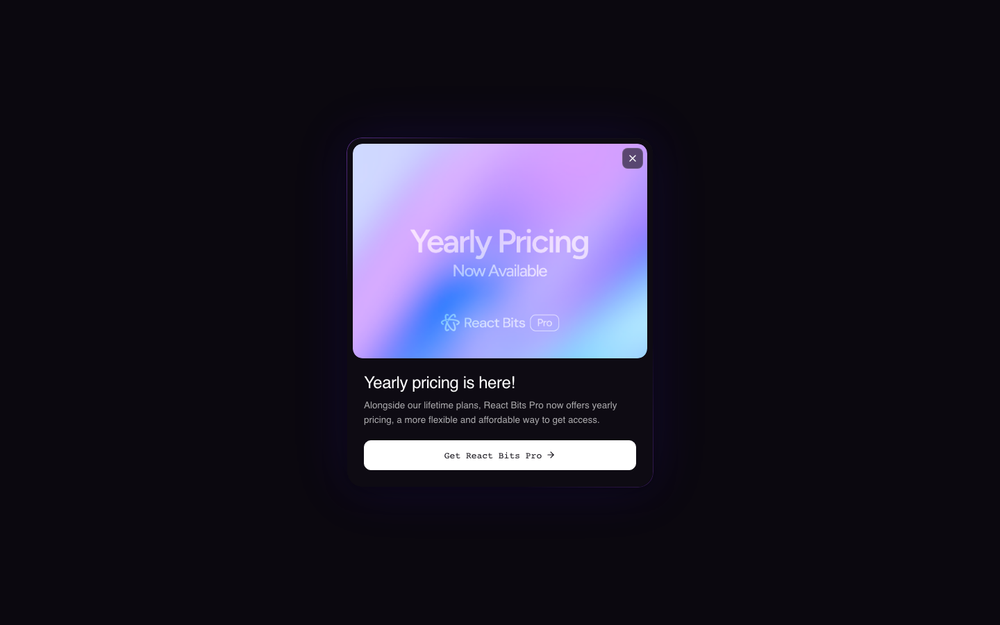

# reactbits — Visual Guide

> Master visual reference. Study every screenshot carefully before implementing any UI.
> Match colors, layout, typography, spacing, and motion states exactly.

**Motion Stack:** **Web Animations API (1 active)**

## Scroll Journey

The page has cinematic scroll animations. Each screenshot below shows the exact visual state at that scroll depth.
**Replicate these transitions precisely** — the design changes dramatically as you scroll.

### Hero — Above the fold

_Scroll position: 0px of 900px total_

### 17% scroll depth

_Scroll position: 0px of 900px total_

### 33% scroll depth

_Scroll position: 0px of 900px total_

### 50% scroll depth

_Scroll position: 0px of 900px total_

### 67% scroll depth

_Scroll position: 0px of 900px total_

### 83% scroll depth

_Scroll position: 0px of 900px total_

### Footer — End of page

_Scroll position: 0px of 900px total_

## Full Page Screenshots

### React Bits - Animated UI Components For React

_URL: `https://reactbits.dev/components/`_

