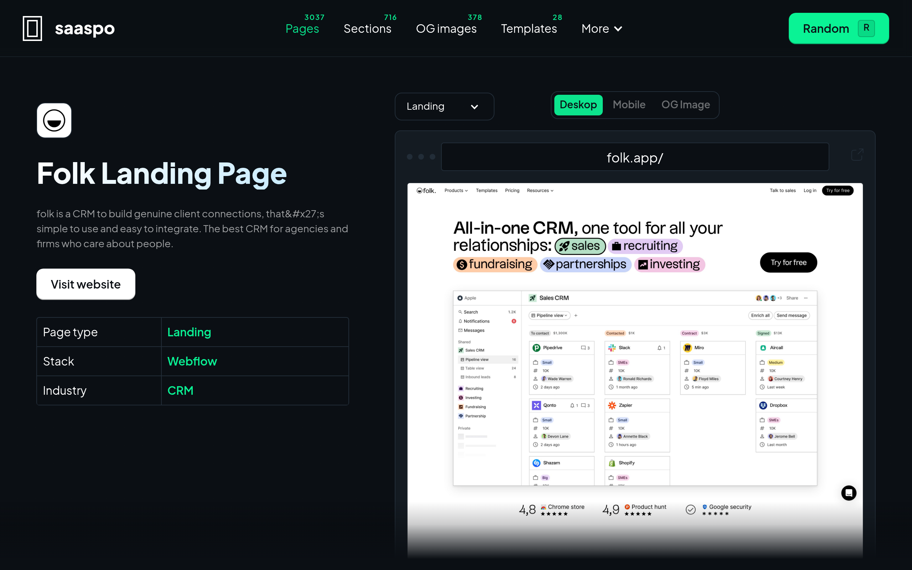
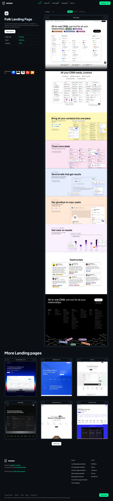
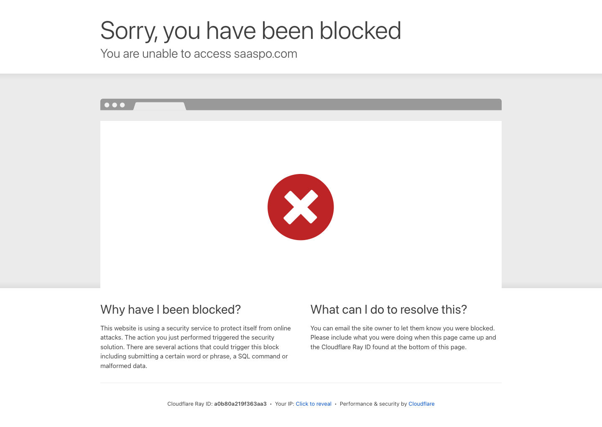
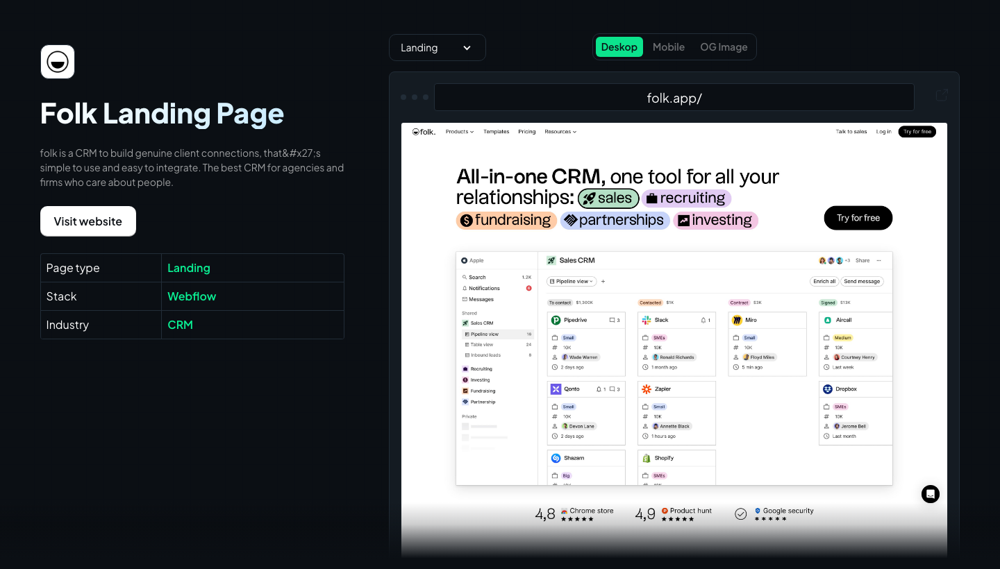
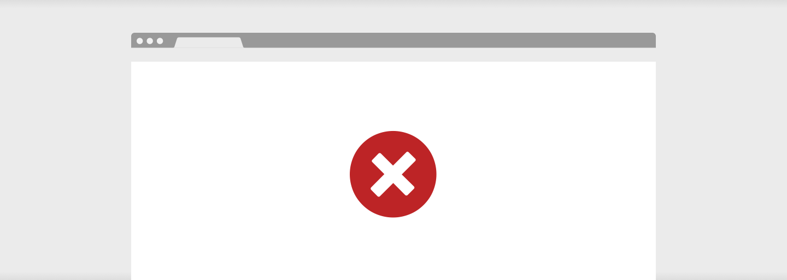
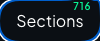
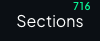
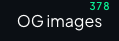
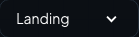

# saaspo-folk Design System

You are building UI for **saaspo-folk**. Dark-themed, warm palette, sans-serif typography (Times), compact density on a 4px grid.

## Visual Reference

**IMPORTANT**: Study ALL screenshots below before writing any UI. Match colors, typography, spacing, layout, and motion exactly as shown.

### Homepage



### Scroll Journey (Cinematic Visual States)

> These screenshots capture the website at different scroll depths. The design changes dramatically as you scroll — each frame shows a different cinematic state. Replicate these exact visual transitions.

#### 0% — Hero / Above the fold


#### 17% — Mid-page at 17% scroll


#### 33% — Mid-page at 33% scroll


#### 50% — Mid-page at 50% scroll


#### 67% — Mid-page at 67% scroll


#### 83% — Mid-page at 83% scroll


#### 100% — Footer / End of page


> Read `references/DESIGN.md` for full token details. Read `references/ANIMATIONS.md` for motion specs. Read `references/LAYOUT.md` for layout structure. Read `references/COMPONENTS.md` for component patterns.

## Ultra Reference Files

This package includes extended documentation. **Read these files before implementing:**

| File                         | Contents                                                           |
| ---------------------------- | ------------------------------------------------------------------ |
| `references/DESIGN.md`       | Full design system tokens, colors, typography, spacing             |
| `references/VISUAL_GUIDE.md` | **START HERE** — Master visual guide with all screenshots embedded |
| `references/ANIMATIONS.md`   | CSS keyframes, scroll triggers, motion library stack, video specs  |
| `references/LAYOUT.md`       | Flex/grid containers, page structure, spacing relationships        |
| `references/COMPONENTS.md`   | DOM component patterns, HTML structure, class fingerprints         |
| `references/INTERACTIONS.md` | Hover/focus states with before/after style diffs                   |
| `screens/scroll/`            | 7 scroll journey screenshots showing cinematic states              |

## Design Philosophy

- **Layered depth** — use shadow tokens to create a sense of physical layering. Each elevation level has a specific shadow.
- **Solid colors only** — no gradients anywhere. Every surface is a single flat color.
- **Type pairing** — Times for body/UI text, Plusjakartasans for headings/display. Never introduce a third typeface.
- **compact density** — 4px base grid. Every dimension is a multiple of 4.
- **warm palette** — the color temperature runs warm, matching the sans-serif typography.
- **Restrained accent** — `#ff7900` is the only pop of color. Used exclusively for CTAs, links, focus rings, and active states.
- **Minimal motion** — prefer instant state changes. Only use transitions for loading and page transitions.

## Color System

### Core Palette

| Role         | Token            | Hex       | Use                      |
| ------------ | ---------------- | --------- | ------------------------ |
| Background   | `--background`   | `#000000` | Page/app background      |
| Surface      | `--surface`      | `#222d38` | Cards, panels, modals    |
| Text Primary | `--text-primary` | `#ffffff` | Headings, body text      |
| Text Muted   | `--text-muted`   | `#404040` | Captions, placeholders   |
| Accent       | `--accent`       | `#ff7900` | CTAs, links, focus rings |
| Border       | `--border`       | `#595959` | Dividers, card borders   |

### Status Colors

| Status  | Hex       | Use                            |
| ------- | --------- | ------------------------------ |
| Success | `#0af395` | Confirmations, positive trends |
| Danger  | `#de5052` | Errors, destructive actions    |

### Extended Palette

- `#0b0f14` — Deep background layer or shadow color
- `#0051c3`
- `#333333`
- `#dddddd`
- `#0ce48d`
- `#ebebeb` — Light surface or highlight color
- `#521010`
- `#f63a22` — Warm accent — hover glow or decorative highlight

## Typography

### Font Stack

- **Times** — Heading 1, Heading 2, Heading 3
- **Plusjakartasans** — Body, Caption

### Type Scale

| Role      | Family          | Size           | Weight |
| --------- | --------------- | -------------- | ------ |
| Heading 1 | Times           | 48px / 3rem    | 700    |
| Heading 2 | Times           | 32px / 2rem    | 600    |
| Heading 3 | Times           | 24px / 1.5rem  | 600    |
| Body      | Plusjakartasans | 16px / 1rem    | 400    |
| Caption   | Plusjakartasans | 12px / 0.75rem | 400    |

### Typography Rules

- Body/UI: **Times**, Headings: **Plusjakartasans** — these are the only display fonts
- Max 3-4 font sizes per screen
- Headings: weight 600-700, body: weight 400
- Use color and opacity for text hierarchy, not additional font sizes
- Line height: 1.5 for body, 1.2 for headings

## Spacing & Layout

### Base Grid: 4px

Every dimension (margin, padding, gap, width, height) must be a multiple of **4px**.

### Spacing Scale

`2, 4, 8, 10, 12, 16, 20, 24, 30, 40, 60, 96` px

### Spacing as Meaning

| Spacing | Use                                                |
| ------- | -------------------------------------------------- |
| 4-8px   | Tight: related items (icon + label, avatar + name) |
| 12-16px | Medium: between groups within a section            |
| 24-32px | Wide: between distinct sections                    |
| 48px+   | Vast: major page section breaks                    |

### Border Radius

Scale: `2px, 4px, 5px 5px 0px 0px, 6px, 8px, 10px, 16px, 48px`
Default: `8px`

## Component Patterns

### Card

```css
.card {
  background: #222d38;
  border: 1px solid #595959;
  border-radius: 8px;
  padding: 16px;
  box-shadow: rgba(0, 0, 0, 0.4) 0px -1px 1px 0px inset;
}
```

```html
<div class="card">
  <h3>Card Title</h3>
  <p>Card content goes here.</p>
</div>
```

### Button

```css
/* Primary */
.btn-primary {
  background: #ff7900;
  color: #ffffff;
  border-radius: 8px;
  padding: 8px 16px;
  font-weight: 500;
  transition: opacity 150ms ease;
}
.btn-primary:hover {
  opacity: 0.9;
}

/* Ghost */
.btn-ghost {
  background: transparent;
  border: 1px solid #595959;
  color: #ffffff;
  border-radius: 8px;
  padding: 8px 16px;
}
```

```html
<button class="btn-primary">Get Started</button>
<button class="btn-ghost">Learn More</button>
```

### Input

```css
.input {
  background: #000000;
  border: 1px solid #595959;
  border-radius: 8px;
  padding: 8px 12px;
  color: #ffffff;
  font-size: 14px;
}
.input:focus {
  border-color: #ff7900;
  outline: none;
}
```

```html
<input class="input" type="text" placeholder="Search..." />
```

### Badge / Chip

```css
.badge {
  display: inline-flex;
  align-items: center;
  padding: 4px 8px;
  border-radius: 9999px;
  font-size: 12px;
  font-weight: 500;
  background: #222d38;
  color: #404040;
}
```

```html
<span class="badge">New</span> <span class="badge">Beta</span>
```

### Modal / Dialog

```css
.modal-backdrop {
  background: rgba(0, 0, 0, 0.6);
}
.modal {
  background: #222d38;
  border: 1px solid #595959;
  border-radius: 48px;
  padding: 24px;
  max-width: 480px;
  width: 90vw;
  box-shadow: rgba(0, 0, 0, 0.4) 0px -1px 1px 0px inset;
}
```

```html
<div class="modal-backdrop">
  <div class="modal">
    <h2>Dialog Title</h2>
    <p>Dialog content.</p>
    <button class="btn-primary">Confirm</button>
    <button class="btn-ghost">Cancel</button>
  </div>
</div>
```

### Table

```css
.table {
  width: 100%;
  border-collapse: collapse;
}
.table th {
  text-align: left;
  padding: 8px 12px;
  font-weight: 500;
  font-size: 12px;
  color: #404040;
  text-transform: uppercase;
  letter-spacing: 0.05em;
  border-bottom: 1px solid #595959;
}
.table td {
  padding: 12px;
  border-bottom: 1px solid #595959;
}
```

```html
<table class="table">
  <thead>
    <tr>
      <th>Name</th>
      <th>Status</th>
      <th>Date</th>
    </tr>
  </thead>
  <tbody>
    <tr>
      <td>Item One</td>
      <td>Active</td>
      <td>Jan 1</td>
    </tr>
    <tr>
      <td>Item Two</td>
      <td>Pending</td>
      <td>Jan 2</td>
    </tr>
  </tbody>
</table>
```

### Navigation

```css
.nav {
  display: flex;
  align-items: center;
  gap: 8px;
  padding: 12px 16px;
  border-bottom: 1px solid #595959;
}
.nav-link {
  color: #404040;
  padding: 8px 12px;
  border-radius: 8px;
  transition: color 150ms;
}
.nav-link:hover {
  color: #ffffff;
}
.nav-link.active {
  color: #ff7900;
}
```

```html
<nav class="nav">
  <a href="/" class="nav-link active">Home</a>
  <a href="/about" class="nav-link">About</a>
  <a href="/pricing" class="nav-link">Pricing</a>
  <button class="btn-primary" style="margin-left: auto">Get Started</button>
</nav>
```

## Animation & Motion

This project uses **subtle motion**. Transitions smooth state changes without calling attention.

### Motion Guidelines

- **Duration:** 150-300ms for micro-interactions, 300-500ms for page transitions
- **Easing:** `ease-out` for enters, `ease-in` for exits
- **Direction:** Elements enter from bottom/right, exit to top/left
- **Reduced motion:** Always respect `prefers-reduced-motion` — disable animations when set

## Depth & Elevation

### Shadow Tokens

- Subtle: `rgba(0, 0, 0, 0.4) 0px -1px 1px 0px inset`

## Anti-Patterns (Never Do)

- **No gradients** — solid colors only, everywhere
- **No blur effects** — no backdrop-blur, no filter: blur()
- **No zebra striping** — tables and lists use borders for separation
- **No invented colors** — every hex value must come from the palette above
- **No arbitrary spacing** — every dimension is a multiple of 4px
- **No extra fonts** — only Times and Plusjakartasans are allowed
- **No arbitrary border-radius** — use the scale: 2px, 4px, 6px, 8px, 10px, 16px, 48px
- **No opacity for disabled states** — use muted colors instead
- **No pill shapes** — this design doesn't use rounded-full / 9999px radius

## Workflow

1. **Read** `references/DESIGN.md` before writing any UI code
2. **Pick colors** from the Color System section — never invent new ones
3. **Set typography** — Times, Plusjakartasans only, using the type scale
4. **Build layout** on the 4px grid — check every margin, padding, gap
5. **Match components** to patterns above before creating new ones
6. **Apply elevation** — use shadow tokens
7. **Validate** — every value traces back to a design token. No magic numbers.

## Brand Spec

- **Site URL:** `https://saaspo.com/pages/folk-landing-page-v2`
- **Brand color:** `#ff7900`
- **Brand typeface:** Times

## Quick Reference

```
Background:     #000000
Surface:        #222d38
Text:           #ffffff / #404040
Accent:         #ff7900
Border:         #595959
Font:           Times
Spacing:        4px grid
Radius:         8px
Components:     0 detected
```

## When to Trigger

Activate this skill when:

- Creating new components, pages, or visual elements for saaspo-folk
- Writing CSS, Tailwind classes, styled-components, or inline styles
- Building page layouts, templates, or responsive designs
- Reviewing UI code for design consistency
- The user mentions "saaspo-folk" design, style, UI, or theme
- Generating mockups, wireframes, or visual prototypes

---

# Full Reference Files

> Every output file is embedded below. Claude has full design system context from /skills alone.

## Design System Tokens (DESIGN.md)

# saaspo-folk DESIGN.md

> Auto-generated design system — reverse-engineered via static analysis by skillui.
> Frameworks: None detected
> Colors: 16 · Fonts: 2 · Components: 0
> Icon library: not detected · State: not detected
> Primary theme: dark · Dark mode toggle: no · Motion: none

## Visual Reference

**Match this design exactly** — study colors, fonts, spacing, and component shapes before writing any UI code.


---

## 1. Visual Theme & Atmosphere

This is a **dark-themed** interface with a warm tone. Depth is expressed through layered shadows and subtle surface color variation. Typography pairs **Plusjakartasans** for display/headings with **Times** for body text, creating clear visual hierarchy through type contrast. Spacing follows a **4px base grid** (compact density), with scale: 2, 4, 8, 10, 12, 16, 20, 24px. The accent color **#ff7900** anchors interactive elements (buttons, links, focus rings).

---

## 2. Color Palette & Roles

| Token        | Hex       | Role         | Use                                     |
| ------------ | --------- | ------------ | --------------------------------------- |
| background   | `#000000` | background   | Page background, darkest surface        |
| surface      | `#222d38` | surface      | Card and panel backgrounds              |
| text-primary | `#ffffff` | text-primary | Headings and body text                  |
| text-muted   | `#404040` | text-muted   | Captions, placeholders, secondary info  |
| border       | `#595959` | border       | Dividers, card borders, outlines        |
| accent       | `#ff7900` | accent       | CTAs, links, focus rings, active states |
| danger       | `#de5052` | danger       | Error states, destructive actions       |
| success      | `#0af395` | success      | Success states, positive indicators     |
| info         | `#0051c3` | info         | Informational highlights                |
| unknown      | `#0b0f14` | unknown      | Palette color                           |
| unknown      | `#333333` | unknown      | Palette color                           |
| unknown      | `#dddddd` | unknown      | Palette color                           |
| unknown      | `#0ce48d` | unknown      | Palette color                           |
| unknown      | `#ebebeb` | unknown      | Palette color                           |
| unknown      | `#521010` | unknown      | Palette color                           |
| unknown      | `#f63a22` | unknown      | Palette color                           |

---

## 3. Typography Rules

**Font Stack:**

- **Times** — Heading 1, Heading 2, Heading 3
- **Plusjakartasans** — Body, Caption

| Role      | Font            | Size           | Weight |
| --------- | --------------- | -------------- | ------ |
| Heading 1 | Times           | 48px / 3rem    | 700    |
| Heading 2 | Times           | 32px / 2rem    | 600    |
| Heading 3 | Times           | 24px / 1.5rem  | 600    |
| Body      | Plusjakartasans | 16px / 1rem    | 400    |
| Caption   | Plusjakartasans | 12px / 0.75rem | 400    |

**Typographic Rules:**

- Limit to 2 font families max per screen
- Use **Times** for body/UI text, **Plusjakartasans** for display/headings
- Maintain consistent hierarchy: no more than 3-4 font sizes per screen
- Headings use bold (600-700), body uses regular (400)
- Line height: 1.5 for body text, 1.2 for headings
- Use color and opacity for secondary hierarchy, not additional font sizes

---

## 4. Component Stylings

No components detected. Scan `src/components/` or `components/` to populate this section.

---

## 5. Layout Principles

- **Base spacing unit:** 4px
- **Spacing scale:** 2, 4, 8, 10, 12, 16, 20, 24, 30, 40, 60, 96
- **Border radius:** 2px, 4px, 5px 5px 0px 0px, 6px, 8px, 10px, 16px, 48px

**Spacing as Meaning:**
| Spacing | Use |
|---|---|
| 4-8px | Tight: related items within a group |
| 12-16px | Medium: between groups |
| 24-32px | Wide: between sections |
| 48px+ | Vast: major section breaks |

---

## 6. Depth & Elevation

### Flat — subtle depth hints

- `rgba(0, 0, 0, 0.4) 0px -1px 1px 0px inset`

---

## 8. Do's and Don'ts

### Do's

- Use `#ff7900` for interactive elements (buttons, links, focus rings)
- Use `#000000` as the primary page background
- Pair **Times** (body) with **Plusjakartasans** (display) — these are the only allowed fonts
- Follow the **4px** spacing grid for all margins, padding, and gaps
- Use the defined shadow tokens for elevation — see Section 6
- Use border-radius from the scale: 2px, 4px, 5px 5px 0px 0px, 6px, 8px

### Don'ts

- Don't introduce colors outside this palette — extend the design tokens first
- Don't introduce additional font families beyond Times and Plusjakartasans
- Don't use arbitrary spacing values — stick to multiples of 4px
- Don't create custom box-shadow values outside the system tokens
- Don't use gradients — the design uses solid colors only
- Don't use arbitrary border-radius values — pick from the defined scale
- Don't use backdrop-blur or blur effects

### Anti-Patterns (detected from codebase)

- No gradient backgrounds
- No blur or backdrop-blur effects
- No zebra striping on tables/lists

---

## 9. Responsive Behavior

No breakpoints detected. Consider adding responsive breakpoints to the design system.

---

## 10. Agent Prompt Guide

Use these as starting points when building new UI:

### Build a Card

```
Background: #222d38
Border: 1px solid #595959
Radius: 8px
Padding: 16px
Font: Times
Use shadow tokens from Section 6.
```

### Build a Button

```
Primary: bg #ff7900, text white
Ghost: bg transparent, border #595959
Padding: 8px 16px
Radius: 8px
Hover: opacity 0.9 or lighter shade
Focus: ring with #ff7900
```

### Build a Page Layout

```
Background: #000000
Max-width: 1280px, centered
Grid: 4px base
Responsive: mobile-first, breakpoints from Section 9
```

### Build a Stats Card

```
Surface: #222d38
Label: #404040 (muted, 12px, uppercase)
Value: #ffffff (primary, 24-32px, bold)
Status: use success/warning/danger from Section 2
```

### Build a Form

```
Input bg: #000000
Input border: 1px solid #595959
Focus: border-color #ff7900
Label: #404040 12px
Spacing: 16px between fields
Radius: 8px
```

### General Component

```
1. Read DESIGN.md Sections 2-6 for tokens
2. Colors: only from palette
3. Font: Times, type scale from Section 3
4. Spacing: 4px grid
5. Components: match patterns from Section 4
6. Elevation: shadow tokens
```

## Visual Guide — Screenshots (VISUAL_GUIDE.md)

# saaspo-folk — Visual Guide

> Master visual reference. Study every screenshot carefully before implementing any UI.
> Match colors, layout, typography, spacing, and motion states exactly.

## Scroll Journey

The page has cinematic scroll animations. Each screenshot below shows the exact visual state at that scroll depth.
**Replicate these transitions precisely** — the design changes dramatically as you scroll.

### Hero — Above the fold

_Scroll position: 0px of 6341px total_


### 17% scroll depth

_Scroll position: 925px of 6341px total_


### 33% scroll depth

_Scroll position: 1796px of 6341px total_


### 50% scroll depth

_Scroll position: 2721px of 6341px total_


### 67% scroll depth

_Scroll position: 3645px of 6341px total_


### 83% scroll depth

_Scroll position: 4516px of 6341px total_


### Footer — End of page

_Scroll position: 5441px of 6341px total_


## Full Page Screenshots

### Saaspo | Folk Landing Page

_URL: `https://saaspo.com/pages/folk-landing-page-v2`_


### Attention Required! | Cloudflare

_URL: `https://saaspo.com/`_


### Attention Required! | Cloudflare

_URL: `https://saaspo.com/sections`_


## Section Screenshots

Clipped sections showing individual components in context.

### Section 2 — `main > div`

_1440×1200px_


### Section 1 — `[class*="section"]`

_1440×513px_


### Section 1 — `[class*="section"]`

_1440×513px_


## Animations & Motion (ANIMATIONS.md)

# Animation Reference

> Cinematic motion design extracted from live DOM. Follow these specs exactly to recreate the experience.

## Motion Technology Stack

Pure CSS animations — no external animation libraries detected.

## Scroll Journey

The page is **6,341px** tall. Each frame below shows what the user sees at that scroll depth.

> **Use these screenshots to understand WHAT animates, WHEN it animates, and HOW it moves.**

### 0% — Top / Hero

Scroll position: 0px


### 17% — Opening Section

Scroll position: 925px


### 33% — First Feature Section

Scroll position: 1,796px


### 50% — Mid-Page

Scroll position: 2,721px


### 67% — Lower Content

Scroll position: 3,645px


### 83% — Near Footer

Scroll position: 4,516px


### 100% — Bottom / Footer

Scroll position: 5,441px


## Scroll Animation Patterns

| Pattern        | Library | Element Count | Duration | Delay | Easing |
| -------------- | ------- | ------------- | -------- | ----- | ------ |
| scroll-trigger | GSAP    | 2             | —        | —     | —      |

### GSAP Implementation

```javascript
// GSAP ScrollTrigger
gsap.registerPlugin(ScrollTrigger);

gsap.from('.element', {
  opacity: 0,
  y: 60,
  duration: 0.8,
  ease: 'power2.out',
  scrollTrigger: {
    trigger: '.element',
    start: 'top 80%',
    end: 'bottom 20%',
  },
});
```

## CSS Keyframes (1 extracted)

### `@keyframes spin`

Duration: `0.8s` · Easing: `linear` · Delay: `0s` · Iteration: `infinite` · Fill: `none`

Used by: `.w-lightbox-spinner`

```css
@keyframes spin {
  0% {
    transform: rotate(0deg);
  }
  100% {
    transform: rotate(360deg);
  }
}
```

> Transform/motion animation

## Motion Tokens (CSS Variables)

### Other Tokens

```css
--medium-spring-green: #0af395;
```

## Global Transition Declarations

These `transition` values were extracted from CSS rules across the site:

```css
transition: inherit;
transition: unset;
transition:
  background-color 0.1s,
  color 0.1s;
transition: 0.3s;
transition: 0.2s;
transition: 0.6s;
```

## How to Recreate This Motion Design

### Step 2 — Scroll-Reveal Pattern

Elements that animate into view follow this pattern:

```css
/* Initial hidden state */
.reveal {
  opacity: 0;
  transform: translateY(40px);
  transition:
    opacity 0.6s cubic-bezier(0.4, 0, 0.2, 1),
    transform 0.6s cubic-bezier(0.4, 0, 0.2, 1);
}
.reveal.visible {
  opacity: 1;
  transform: translateY(0);
}
```

### Step 3 — Key Motion Principles

- **Duration scale:** `0.1s` · `0.3s` · `0.2s` · `0.6s` — use these values, never invent new durations
- **Always add** `@media (prefers-reduced-motion: reduce) { * { animation-duration: 0.01ms !important; transition-duration: 0.01ms !important; } }`

### Step 4 — Scroll Journey Reference

Match what happens at each scroll position:

- **0%** (`0px`) → `screens/scroll/scroll-000.png`
- **17%** (`925px`) → `screens/scroll/scroll-017.png`
- **33%** (`1796px`) → `screens/scroll/scroll-033.png`
- **50%** (`2721px`) → `screens/scroll/scroll-050.png`
- **67%** (`3645px`) → `screens/scroll/scroll-067.png`
- **83%** (`4516px`) → `screens/scroll/scroll-083.png`
- **100%** (`5441px`) → `screens/scroll/scroll-100.png`

## Layout & Grid (LAYOUT.md)

# Layout Reference

> Auto-extracted from live DOM. Use this to understand how the site is structured spatially.

## Spacing System

**Base grid:** 4px

**Scale:** `2, 4, 8, 10, 12, 16, 20, 24, 30, 40, 60, 96` px

| Spacing | Semantic Use                   |
| ------- | ------------------------------ |
| 4px     | Tight — within a component     |
| 8px     | Medium — between sibling items |
| 16px    | Wide — between sections        |
| 32px    | Vast — major section breaks    |

## Flex Layouts

| Element                                                        | Direction | Justify       | Align  | Gap         | Children |
| -------------------------------------------------------------- | --------- | ------------- | ------ | ----------- | -------- |
| `nav#w-node-b5f29dc8-d7e6-f1aa-3856-b4d4c0b1dad1-c0b1dacd.nav` | row       | center        | center | 2px         | 5        |
| `div.floating-nav_container.pointer-events-on`                 | row       | space-between | center | 2px         | 2        |
| `div#w-node-b5f29dc8-d7e6-f1aa-3856-b4d4c0b1daf6-c0b1dacd.nav` | row       | —             | —      | normal 16px | 2        |
| `nav#w-node-f99c36c2-8a64-441b-a609-eda65afbbe18-5afbbe13.nav` | row       | center        | center | 2px         | 3        |
| `div#w-node-f99c36c2-8a64-441b-a609-eda65afbbe3d-5afbbe13.nav` | row       | —             | —      | normal 16px | 2        |
| `div.footer1_bottom-wrapper`                                   | row       | space-between | center | —           | 2        |
| `div.footer1_left-wrapper`                                     | column    | —             | —      | —           | 2        |
| `div.meta-grid_component`                                      | column    | —             | —      | 0px         | 5        |
| `a.website-grid_nav.w-inline-block`                            | row       | space-between | —      | —           | 3        |
| `a.website-grid_item-link.w-inline-block`                      | column    | start         | —      | —           | 1        |
| `a.website-grid_nav.w-inline-block`                            | row       | space-between | —      | —           | 3        |
| `a.website-grid_item-link.w-inline-block`                      | column    | start         | —      | —           | 1        |

## Grid Layouts

| Element                                  | Template Columns                | Gap        | Children |
| ---------------------------------------- | ------------------------------- | ---------- | -------- |
| `div.nav_container`                      | `336px 672px 336px`             | 16px       | 3        |
| `div.w-layout-grid.footer1_top-wrapper`  | `708.484px 472.328px`           | 16px 144px | 2        |
| `div.w-layout-grid.footer1_menu-wrapper` | `220.156px 220.172px`           | 16px 32px  | 2        |
| `div.website-grid_list.w-dyn-items`      | `409.594px 409.609px 409.594px` | 48px       | 6        |
| `div.meta-grid_row`                      | `174.625px 261.938px`           | 0px        | 2        |
| `div.meta-grid_row`                      | `174.625px 261.938px`           | 0px        | 2        |
| `div.meta-grid_row`                      | `174.625px 261.938px`           | 0px        | 2        |

## Structural Containers

### `<main>` (`main.main-wrapper`)

```
display:          block
children:         3
```

### `<section>` (`section.section_website-grid`)

```
display:          block
children:         1
```

### `<nav>` (`nav#w-node-b5f29dc8-d7e6-f1aa-3856-b4d4c0b1dad1-c0b1dacd.nav`)

```
display:          flex
flex-direction:   row
justify-content:  center
align-items:      center
gap:              2px
children:         5
```

### `<nav>` (`nav#w-node-f99c36c2-8a64-441b-a609-eda65afbbe18-5afbbe13.nav`)

```
display:          flex
flex-direction:   row
justify-content:  center
align-items:      center
gap:              2px
children:         3
```

## Layout Rules

- **Container max-width:** `1440px` — always center with `margin: auto`
- Primary layout system: **Flexbox**
- Secondary layout system: **CSS Grid** (used for card grids and multi-column layouts)
- Every spacing value must be a multiple of **4px**
- Never use arbitrary margin/padding values outside the spacing scale

## Component Patterns (COMPONENTS.md)

# Component Reference

> Repeated DOM patterns detected by structural analysis. Each component appeared 3+ times.

## Detected Components

| Component                         | Category | Instances | Key Classes                                  |
| --------------------------------- | -------- | --------- | -------------------------------------------- |
| **Website Grid Dots Wrapper**     | unknown  | 7×        | `.website-grid_dots-wrapper`                 |
| **Website Grid External Wrapper** | unknown  | 7×        | `.website-grid_external-wrapper`             |
| **Website Grid Image**            | unknown  | 7×        | `.website-grid_image`                        |
| **Sponsors Tooltip Wrap**         | unknown  | 6×        | `.sponsors_tooltip-wrap`                     |
| **Sponsors Tooltip**              | unknown  | 6×        | `.sponsors_tooltip`                          |
| **W Dyn Item**                    | card     | 6×        | `.w-dyn-item`                                |
| **Website Grid Item**             | card     | 6×        | `.website-grid_item`                         |
| **W Inline Block**                | unknown  | 6×        | `.w-inline-block`, `.website-grid_nav`       |
| **Website Grid Navbar**           | unknown  | 6×        | `.website-grid_navbar`                       |
| **Website Grid Url**              | unknown  | 6×        | `.website-grid_url`                          |
| **W Inline Block**                | card     | 6×        | `.w-inline-block`, `.website-grid_item-link` |
| **Website Grid Image Wrapper**    | unknown  | 6×        | `.website-grid_image-wrapper`                |
| **Sponsors Item**                 | card     | 5×        | `.sponsors_item`, `.w-inline-block`          |
| **Button**                        | button   | 4×        | `.button`, `.w-button`                       |
| **Nav Link**                      | unknown  | 3×        | `.nav_link`, `.w-inline-block`               |
| **Padding Global**                | unknown  | 3×        | `.padding-global`                            |
| **Container Large**               | unknown  | 3×        | `.container-large`                           |
| **Meta Grid Row**                 | unknown  | 3×        | `.meta-grid_row`                             |
| **Meta Grid First Col**           | unknown  | 3×        | `.meta-grid_first-col`                       |
| **Link**                          | unknown  | 3×        | `.link`                                      |

## Cards

### W Dyn Item

**Instances found:** 6

**CSS classes:** `.w-dyn-item`

**HTML structure:**

```html
<div role="listitem" class="w-dyn-item"><div class="website-grid_item"><a data-w-id="b927e0b7-6274-8304-a9ce-3da433c84b55" href="https://cloud.laravel.com/?ref=saaspo.com" target="_blank" class="website-grid_nav w-inline-block"><div class="website-grid_dots-wrapper"><div style="background-color: rgb(34, 45, 56);" class="website-grid_dot red-dot"></div><div style="background-color: rgb(34, 45, 56);" class="website-grid_dot orange-dot"></div><div style="background-color: rgb(34, 45, 56);" class="website-grid_dot green-dot"></div></div><div class="website-grid_navbar"><div class="website-grid_url
```

**Base styles (from design tokens):**

````css
.w-dyn-item {
  background: #222d38;
  border: 1px solid #595959;
  border-radius: 8px;
  padding: 8px;
}```

### Website Grid Item

**Instances found:** 6

**CSS classes:** `.website-grid_item`

**HTML structure:**

```html
<div class="website-grid_item"><a data-w-id="b927e0b7-6274-8304-a9ce-3da433c84b55" href="https://cloud.laravel.com/?ref=saaspo.com" target="_blank" class="website-grid_nav w-inline-block"><div class="website-grid_dots-wrapper"><div style="background-color: rgb(34, 45, 56);" class="website-grid_dot red-dot"></div><div style="background-color: rgb(34, 45, 56);" class="website-grid_dot orange-dot"></div><div style="background-color: rgb(34, 45, 56);" class="website-grid_dot green-dot"></div></div><div class="website-grid_navbar"><div class="website-grid_url">cloud.laravel.com/</div></div><div sty
````

**Base styles (from design tokens):**

````css
.website-grid_item {
  background: #222d38;
  border: 1px solid #595959;
  border-radius: 8px;
  padding: 8px;
}```

### W Inline Block

**Instances found:** 6

**CSS classes:** `.w-inline-block` `.website-grid_item-link`

**HTML structure:**

```html
<a href="/pages/laravel-cloud-landing-page" class="website-grid_item-link w-inline-block"><div class="website-grid_image-wrapper"></div></a>
````

**Base styles (from design tokens):**

````css
.w-inline-block {
  background: #222d38;
  border: 1px solid #595959;
  border-radius: 8px;
  padding: 8px;
}```

### Sponsors Item

**Instances found:** 5

**CSS classes:** `.sponsors_item` `.w-inline-block`

**HTML structure:**

```html
<a href="https://framer.link/gPSSDYb" target="_blank" class="sponsors_item is-framer w-inline-block"><div class="sponsors_tooltip-wrap"><div class="sponsors_tooltip"><div class="sponsors_tooltip-text">Framer: Build better sites, faster</div></div></div></a>
````

**Base styles (from design tokens):**

````css
.sponsors_item {
  background: #222d38;
  border: 1px solid #595959;
  border-radius: 8px;
  padding: 8px;
}```

## Buttons

### Button

**Instances found:** 4

**CSS classes:** `.button` `.w-button`

**HTML structure:**

```html
<a rel="nofollow" href="https://www.folk.app/?ref=saaspo.com" target="_blank" class="button is-secondary w-button">Visit website</a>
````

**Base styles (from design tokens):**

````css
.button {
  background: #ff7900;
  color: #ffffff;
  border-radius: 8px;
  padding: 4px 8px;
  cursor: pointer;
}```

## Other Components

### Website Grid Dots Wrapper

**Instances found:** 7

**CSS classes:** `.website-grid_dots-wrapper`

**HTML structure:**

```html
<div class="website-grid_dots-wrapper"><div style="background-color: rgb(34, 45, 56);" class="website-grid_dot red-dot"></div><div style="background-color: rgb(34, 45, 56);" class="website-grid_dot orange-dot"></div><div style="background-color: rgb(34, 45, 56);" class="website-grid_dot green-dot"></div></div>
````

**Base styles (from design tokens):**

````css
.website-grid_dots-wrapper {
  background: #222d38;
  padding: 4px;
}```

### Website Grid External Wrapper

**Instances found:** 7

**CSS classes:** `.website-grid_external-wrapper`

**HTML structure:**

```html
<div style="color:rgb(34,45,56)" class="website-grid_external-wrapper"><div class="w-embed"><svg width="18" height="18" viewBox="0 0 18 18" fill="none" xmlns="http://www.w3.org/2000/svg"> <path d="M17.333 6.33333L17.333 1M17.333 1H11.9997M17.333 1L10.2219 8.11111M7.55523 2.77778H5.59967C4.1062 2.77778 3.35946 2.77778 2.78903 3.06843C2.28727 3.32409 1.87932 3.73204 1.62366 4.2338C1.33301 4.80423 1.33301 5.55097 1.33301 7.04444V12.7333C1.33301 14.2268 1.33301 14.9735 1.62366 15.544C1.87932 16.0457 2.28727 16.4537 2.78903 16.7094C3.35946 17 4.1062 17 5.59967 17H11.2886C12.782 17 13.5288 17 14.099
````

**Base styles (from design tokens):**

````css
.website-grid_external-wrapper {
  background: #222d38;
  padding: 4px;
}```

### Website Grid Image

**Instances found:** 7

**CSS classes:** `.website-grid_image`

**HTML structure:**

```html

````

**Base styles (from design tokens):**

````css
.website-grid_image {
  background: #222d38;
  padding: 4px;
}```

### Sponsors Tooltip Wrap

**Instances found:** 6

**CSS classes:** `.sponsors_tooltip-wrap`

**HTML structure:**

```html
<div class="sponsors_tooltip-wrap"><div class="sponsors_tooltip"><div class="sponsors_tooltip-text">Framer: Build better sites, faster</div></div></div>
````

**Base styles (from design tokens):**

````css
.sponsors_tooltip-wrap {
  background: #222d38;
  padding: 4px;
}```

### Sponsors Tooltip

**Instances found:** 6

**CSS classes:** `.sponsors_tooltip`

**HTML structure:**

```html
<div class="sponsors_tooltip"><div class="sponsors_tooltip-text">Framer: Build better sites, faster</div></div>
````

**Base styles (from design tokens):**

````css
.sponsors_tooltip {
  background: #222d38;
  padding: 4px;
}```

### W Inline Block

**Instances found:** 6

**CSS classes:** `.w-inline-block` `.website-grid_nav`

**HTML structure:**

```html
<a data-w-id="b927e0b7-6274-8304-a9ce-3da433c84b55" href="https://cloud.laravel.com/?ref=saaspo.com" target="_blank" class="website-grid_nav w-inline-block"><div class="website-grid_dots-wrapper"><div style="background-color: rgb(34, 45, 56);" class="website-grid_dot red-dot"></div><div style="background-color: rgb(34, 45, 56);" class="website-grid_dot orange-dot"></div><div style="background-color: rgb(34, 45, 56);" class="website-grid_dot green-dot"></div></div><div class="website-grid_navbar"><div class="website-grid_url">cloud.laravel.com/</div></div><div style="color:rgb(34,45,56)" class=
````

**Base styles (from design tokens):**

````css
.w-inline-block {
  background: #222d38;
  padding: 4px;
}```

### Website Grid Navbar

**Instances found:** 6

**CSS classes:** `.website-grid_navbar`

**HTML structure:**

```html
<div class="website-grid_navbar"><div class="website-grid_url">cloud.laravel.com/</div></div>
````

**Base styles (from design tokens):**

````css
.website-grid_navbar {
  background: #222d38;
  padding: 4px;
}```

### Website Grid Url

**Instances found:** 6

**CSS classes:** `.website-grid_url`

**HTML structure:**

```html
<div class="website-grid_url">cloud.laravel.com/</div>
````

**Base styles (from design tokens):**

````css
.website-grid_url {
  background: #222d38;
  padding: 4px;
}```

### Website Grid Image Wrapper

**Instances found:** 6

**CSS classes:** `.website-grid_image-wrapper`

**HTML structure:**

```html
<div class="website-grid_image-wrapper"></div>
````

**Base styles (from design tokens):**

````css
.website-grid_image-wrapper {
  background: #222d38;
  padding: 4px;
}```

### Nav Link

**Instances found:** 3

**CSS classes:** `.nav_link` `.w-inline-block`

**HTML structure:**

```html
<a is-active="false" href="/sections" class="nav_link w-inline-block"><div>Sections</div><div class="new-label">716</div></a>
````

**Base styles (from design tokens):**

````css
.nav_link {
  background: #222d38;
  padding: 4px;
}```

### Padding Global

**Instances found:** 3

**CSS classes:** `.padding-global`

**HTML structure:**

```html
<div class="padding-global"><div class="container-large"><div class="padding-section-small"><div class="page_component"><div class="page_left"><div class="page_left-top"><div class="page_site-icon-wrapper"></div><h1 class="heading-style-h3">Folk Landing Page</h1><div class="text-size-small">folk is a CRM to build genuine client co…</div><a rel="nofollow" href="https:/
````

**Base styles (from design tokens):**

````css
.padding-global {
  background: #222d38;
  padding: 4px;
}```

### Container Large

**Instances found:** 3

**CSS classes:** `.container-large`

**HTML structure:**

```html
<div class="container-large"><div class="padding-section-small"><div class="page_component"><div class="page_left"><div class="page_left-top"><div class="page_site-icon-wrapper"></div><h1 class="heading-style-h3">Folk Landing Page</h1><div class="text-size-small">folk is a CRM to build genuine client co…</div><a rel="nofollow" href="https://www.folk.app/?ref=saaspo.co
````

**Base styles (from design tokens):**

````css
.container-large {
  background: #222d38;
  padding: 4px;
}```

### Meta Grid Row

**Instances found:** 3

**CSS classes:** `.meta-grid_row`

**HTML structure:**

```html
<div class="meta-grid_row"><div class="meta-grid_first-col"><div> Page type</div></div><div id="w-node-_0c81bf8b-eee8-b64e-b182-d18642f27506-8cf3c51d" class="meta-grid_second-col"><a href="/page-types/saas-landing-page-examples" class="link w-inline-block"><div>Landing</div></a></div></div>
````

**Base styles (from design tokens):**

````css
.meta-grid_row {
  background: #222d38;
  padding: 4px;
}```

### Meta Grid First Col

**Instances found:** 3

**CSS classes:** `.meta-grid_first-col`

**HTML structure:**

```html
<div class="meta-grid_first-col"><div> Page type</div></div>
````

**Base styles (from design tokens):**

````css
.meta-grid_first-col {
  background: #222d38;
  padding: 4px;
}```

### Link

**Instances found:** 3

**CSS classes:** `.link`

**HTML structure:**

```html
<a href="https://twitter.com/andy_hooke" target="_blank" class="link">@andy_hooke</a>
````

**Base styles (from design tokens):**

````css
.link {
  background: #222d38;
  padding: 4px;
}```

## Component Rules

- Match class names exactly from the patterns above
- Each component instance must be visually identical to others of its type
- Do not add extra wrappers or change the DOM structure
- Use `#595959` for all dividers within components
- Use `#ff7900` for all interactive/active states

## Interactions & States (INTERACTIONS.md)

# Interaction Reference

> Micro-interactions extracted from live DOM. Recreate these exactly for authentic feel.

## Coverage

| Component Type | Count | States Captured |
|----------------|-------|----------------|
| Role Button | 2 | default, hover, focus |
| Link | 3 | default, hover, focus |

## Transition System

These transition declarations were extracted from interactive elements:

```css
transition: all;
````

Apply these to all interactive elements. Never invent new durations or easings.

## Role Button Interactions

### Role Button 1 — `More`

**States:**

- Default: `../screens/states/role-button-1-default.png`
- Hover: `../screens/states/role-button-1-hover.png`
- Focus: `../screens/states/role-button-1-focus.png`

**On focus:**

```css
/* outline: rgb(255, 255, 255) none 3px → */
outline: rgb(255, 255, 255) none 0px;
```

**Transition:** `all`

### Role Button 2 — `Landing`

**States:**

- Default: `../screens/states/role-button-2-default.png`
- Hover: `../screens/states/role-button-2-hover.png`
- Focus: `../screens/states/role-button-2-focus.png`

**On focus:**

```css
/* outline: rgb(255, 255, 255) none 3px → */
outline: rgb(255, 255, 255) none 0px;
```

**Transition:** `all`

## Link Interactions

### Link 1 — `home`

**States:**

- Default: `../screens/states/link-1-default.png`
- Hover: `../screens/states/link-1-hover.png`
- Focus: `../screens/states/link-1-focus.png`

**On hover:**

```css
/* outline: rgb(51, 51, 51) none 3px → */
outline: rgb(51, 51, 51) none 0px;
```

**On focus:**

```css
/* outline: rgb(51, 51, 51) none 3px → */
outline: rgb(0, 95, 204) auto 1px;
/* outline-color: rgb(51, 51, 51) → */
outline-color: rgb(0, 95, 204);
```

**Transition:** `all`

### Link 2 — `Sections

716`

**States:**

- Default: `../screens/states/link-2-default.png`
- Hover: `../screens/states/link-2-hover.png`
- Focus: `../screens/states/link-2-focus.png`

**On hover:**

```css
/* outline: rgb(255, 255, 255) none 3px → */
outline: rgb(255, 255, 255) none 0px;
```

**On focus:**

```css
/* outline: rgb(255, 255, 255) none 3px → */
outline: rgb(0, 95, 204) auto 1px;
/* outline-color: rgb(255, 255, 255) → */
outline-color: rgb(0, 95, 204);
```

**Transition:** `all`

### Link 3 — `OG images

378`

**States:**

- Default: `../screens/states/link-3-default.png`
- Hover: `../screens/states/link-3-hover.png`
- Focus: `../screens/states/link-3-focus.png`

**On hover:**

```css
/* outline: rgb(255, 255, 255) none 3px → */
outline: rgb(255, 255, 255) none 0px;
```

**On focus:**

```css
/* outline: rgb(255, 255, 255) none 3px → */
outline: rgb(0, 95, 204) auto 1px;
/* outline-color: rgb(255, 255, 255) → */
outline-color: rgb(0, 95, 204);
```

**Transition:** `all`

## Interaction Rules

- Accent color `#ff7900` is used for focus rings, active states, and hover highlights
- Focus states use **outline** (not box-shadow) — always match the extracted focus ring
- Always respect `prefers-reduced-motion` — set all transitions to `0s` when enabled

## Design Tokens — JSON Files

### tokens/colors.json

```json
{
  "$schema": "https://design-tokens.github.io/community-group/format/",
  "core": {
    "text-primary": {
      "value": "#ffffff",
      "role": "text-primary"
    },
    "background": {
      "value": "#000000",
      "role": "background"
    },
    "text-muted": {
      "value": "#404040",
      "role": "text-muted"
    },
    "surface": {
      "value": "#222d38",
      "role": "surface"
    },
    "border": {
      "value": "#595959",
      "role": "border"
    },
    "accent": {
      "value": "#ff7900",
      "role": "accent"
    }
  },
  "status": {
    "success": {
      "value": "#0af395",
      "role": "success"
    },
    "danger": {
      "value": "#de5052",
      "role": "danger"
    }
  },
  "extended": {
    "color-0b0f14": {
      "value": "#0b0f14",
      "role": "unknown"
    },
    "color-0051c3": {
      "value": "#0051c3",
      "role": "info"
    },
    "color-333333": {
      "value": "#333333",
      "role": "unknown"
    },
    "color-dddddd": {
      "value": "#dddddd",
      "role": "unknown"
    },
    "color-0ce48d": {
      "value": "#0ce48d",
      "role": "unknown"
    },
    "color-ebebeb": {
      "value": "#ebebeb",
      "role": "unknown"
    },
    "color-521010": {
      "value": "#521010",
      "role": "unknown"
    },
    "color-f63a22": {
      "value": "#f63a22",
      "role": "unknown"
    }
  },
  "meta": {
    "theme": "dark",
    "extracted": "2026-06-14"
  }
}
```

### tokens/spacing.json

```json
{
  "base": {
    "value": "4px",
    "description": "Grid unit — all spacing must be multiples of this"
  },
  "unit": "px",
  "scale": {
    "xs": {
      "value": "2px",
      "px": 2
    },
    "sm": {
      "value": "4px",
      "px": 4
    },
    "md": {
      "value": "8px",
      "px": 8
    },
    "lg": {
      "value": "10px",
      "px": 10
    },
    "xl": {
      "value": "12px",
      "px": 12
    },
    "2xl": {
      "value": "16px",
      "px": 16
    },
    "3xl": {
      "value": "20px",
      "px": 20
    },
    "4xl": {
      "value": "24px",
      "px": 24
    },
    "5xl": {
      "value": "30px",
      "px": 30
    },
    "6xl": {
      "value": "40px",
      "px": 40
    }
  },
  "multipliers": {
    "1x": {
      "value": "4px",
      "raw": 4
    },
    "2x": {
      "value": "8px",
      "raw": 8
    },
    "3x": {
      "value": "12px",
      "raw": 12
    },
    "4x": {
      "value": "16px",
      "raw": 16
    },
    "5x": {
      "value": "20px",
      "raw": 20
    },
    "6x": {
      "value": "24px",
      "raw": 24
    },
    "7x": {
      "value": "28px",
      "raw": 28
    },
    "8x": {
      "value": "32px",
      "raw": 32
    },
    "9x": {
      "value": "36px",
      "raw": 36
    },
    "10x": {
      "value": "40px",
      "raw": 40
    },
    "11x": {
      "value": "44px",
      "raw": 44
    },
    "12x": {
      "value": "48px",
      "raw": 48
    },
    "13x": {
      "value": "52px",
      "raw": 52
    },
    "14x": {
      "value": "56px",
      "raw": 56
    },
    "15x": {
      "value": "60px",
      "raw": 60
    },
    "16x": {
      "value": "64px",
      "raw": 64
    }
  },
  "meta": {
    "totalValues": 12,
    "min": 2,
    "max": 96
  }
}
```

### tokens/typography.json

```json
{
  "families": ["Times", "Plusjakartasans"],
  "scale": {
    "heading-1": {
      "fontFamily": "Times",
      "fontSize": "48px / 3rem",
      "fontWeight": "700",
      "lineHeight": null,
      "source": "computed"
    },
    "heading-2": {
      "fontFamily": "Times",
      "fontSize": "32px / 2rem",
      "fontWeight": "600",
      "lineHeight": null,
      "source": "computed"
    },
    "heading-3": {
      "fontFamily": "Times",
      "fontSize": "24px / 1.5rem",
      "fontWeight": "600",
      "lineHeight": null,
      "source": "computed"
    },
    "body": {
      "fontFamily": "Plusjakartasans",
      "fontSize": "16px / 1rem",
      "fontWeight": "400",
      "lineHeight": null,
      "source": "computed"
    },
    "caption": {
      "fontFamily": "Plusjakartasans",
      "fontSize": "12px / 0.75rem",
      "fontWeight": "400",
      "lineHeight": null,
      "source": "computed"
    }
  },
  "fontFaces": [],
  "rules": {
    "maxSizesPerScreen": 4,
    "headingWeightRange": "600-700",
    "bodyWeight": 400,
    "lineHeightBody": 1.5,
    "lineHeightHeading": 1.2
  }
}
```

## Screenshots Inventory (screens/)

> Study all screenshots carefully before implementing any UI. Match every visual detail exactly.

### Scroll Journey (screens/scroll/)

_Cinematic scroll states — page visual at each scroll depth_


### Full Page Screenshots (screens/pages/)

_Full-page screenshots of each crawled URL_






### Section Clips (screens/sections/)

_Clipped individual sections and components_






### Interaction States (screens/states/)

_Hover, focus, and active state captures_













### Screenshot Index (screens/INDEX.md)

# Screenshot Index

## Scroll Journey

> Shows the cinematic state at each point of the page

| Scroll | Y Position | File                            |
| ------ | ---------- | ------------------------------- |
| 0%     | 0px        | `screens/scroll/scroll-000.png` |
| 17%    | 925px      | `screens/scroll/scroll-017.png` |
| 33%    | 1796px     | `screens/scroll/scroll-033.png` |
| 50%    | 2721px     | `screens/scroll/scroll-050.png` |
| 67%    | 3645px     | `screens/scroll/scroll-067.png` |
| 83%    | 4516px     | `screens/scroll/scroll-083.png` |
| 100%   | 5441px     | `screens/scroll/scroll-100.png` |

## Pages

| Page                | URL               | File                                            |
| ------------------- | ----------------- | ----------------------------------------------- | ---------------------------------------------- |
| Saaspo              | Folk Landing Page | `https://saaspo.com/pages/folk-landing-page-v2` | `screens/pages/pages-folk-landing-page-v2.png` |
| Attention Required! | Cloudflare        | `https://saaspo.com/`                           | `screens/pages/home.png`                       |
| Attention Required! | Cloudflare        | `https://saaspo.com/sections`                   | `screens/pages/sections.png`                   |

## Sections

| Page                       | Section                 | File                                                        |
| -------------------------- | ----------------------- | ----------------------------------------------------------- |
| pages-folk-landing-page-v2 | #2 (main > div)         | `screens/sections/pages-folk-landing-page-v2-section-2.png` |
| home                       | #1 ([class*="section"]) | `screens/sections/home-section-1.png`                       |
| sections                   | #1 ([class*="section"]) | `screens/sections/sections-section-1.png`                   |

## Homepage Screenshots (screenshots/)


