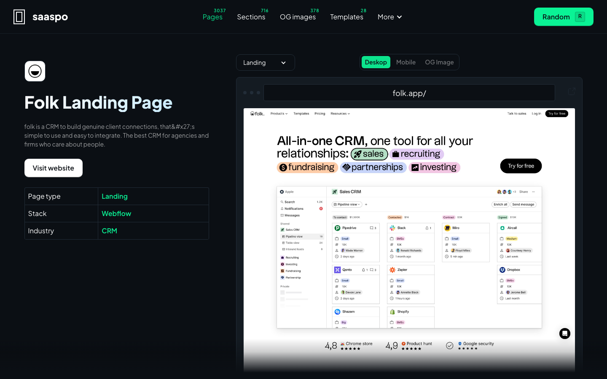
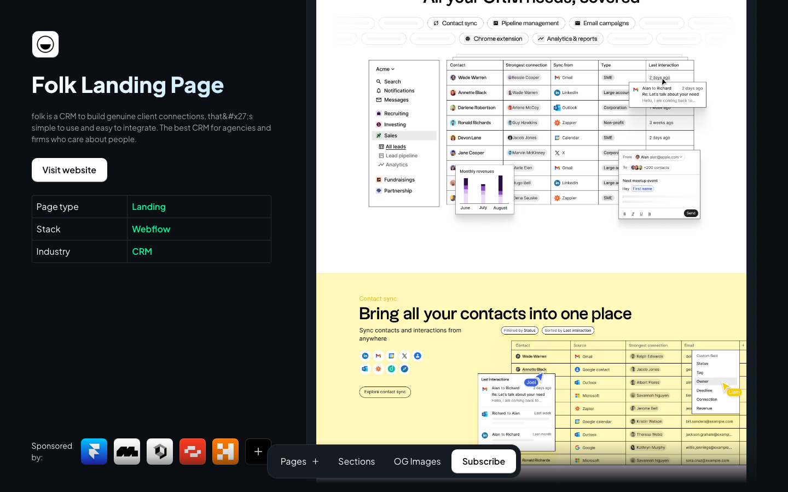
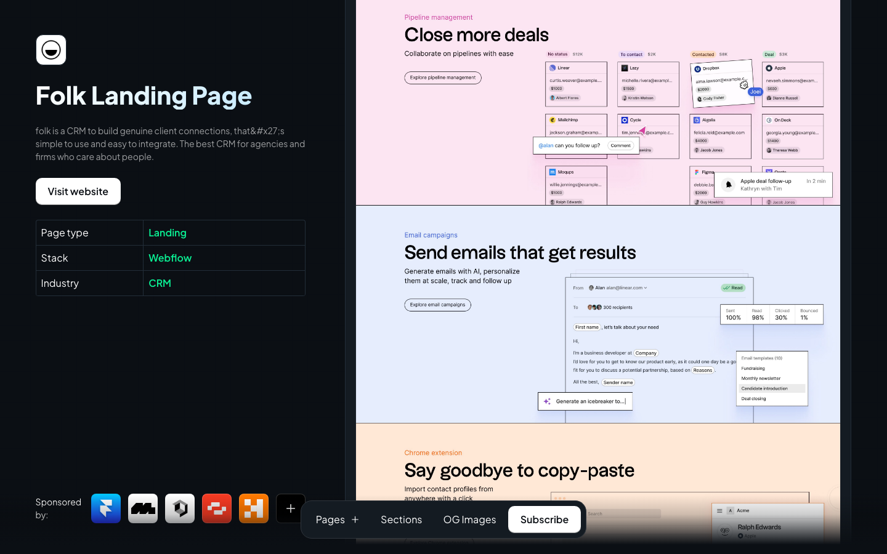
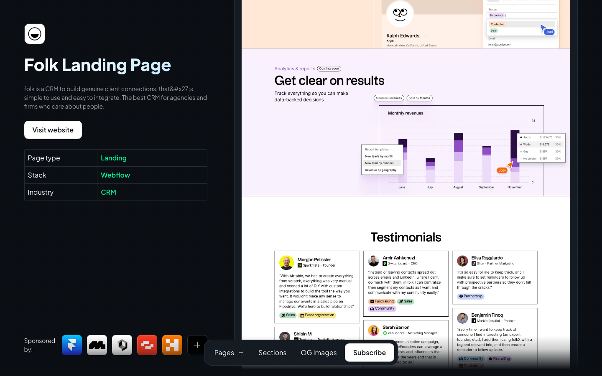
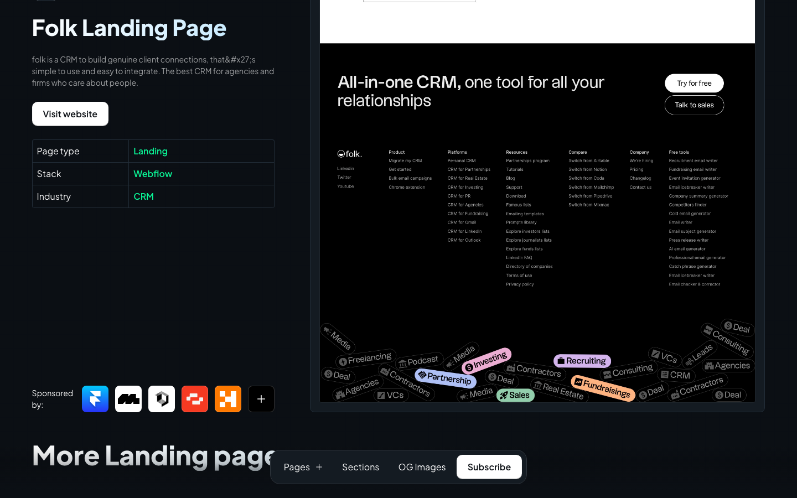
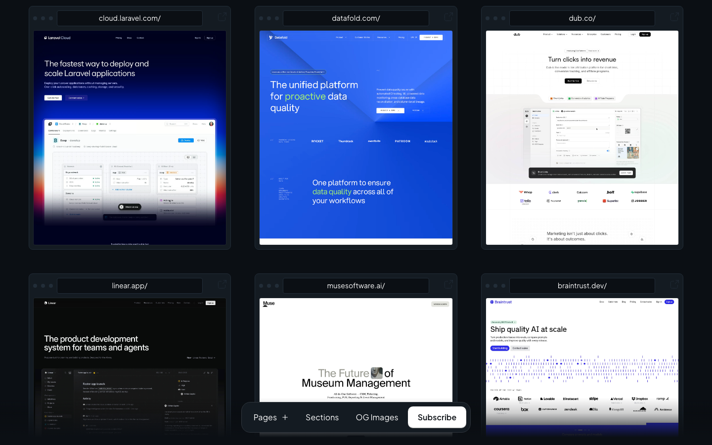
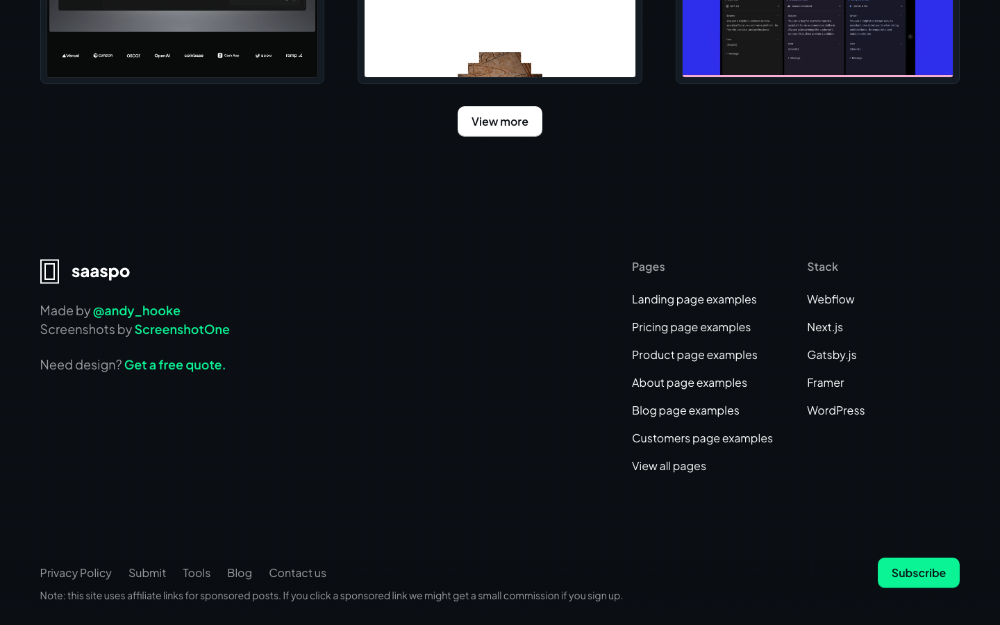

# Animation Reference

> Cinematic motion design extracted from live DOM. Follow these specs exactly to recreate the experience.

## Motion Technology Stack

Pure CSS animations — no external animation libraries detected.

## Scroll Journey

The page is **6,341px** tall. Each frame below shows what the user sees at that scroll depth.

> **Use these screenshots to understand WHAT animates, WHEN it animates, and HOW it moves.**

### 0% — Top / Hero

Scroll position: 0px



### 17% — Opening Section

Scroll position: 925px



### 33% — First Feature Section

Scroll position: 1,796px



### 50% — Mid-Page

Scroll position: 2,721px



### 67% — Lower Content

Scroll position: 3,645px



### 83% — Near Footer

Scroll position: 4,516px



### 100% — Bottom / Footer

Scroll position: 5,441px



## Scroll Animation Patterns

| Pattern        | Library | Element Count | Duration | Delay | Easing |
| -------------- | ------- | ------------- | -------- | ----- | ------ |
| scroll-trigger | GSAP    | 2             | —        | —     | —      |

### GSAP Implementation

```javascript
// GSAP ScrollTrigger
gsap.registerPlugin(ScrollTrigger);

gsap.from('.element', {
  opacity: 0,
  y: 60,
  duration: 0.8,
  ease: 'power2.out',
  scrollTrigger: {
    trigger: '.element',
    start: 'top 80%',
    end: 'bottom 20%',
  },
});
```

## CSS Keyframes (1 extracted)

### `@keyframes spin`

Duration: `0.8s` · Easing: `linear` · Delay: `0s` · Iteration: `infinite` · Fill: `none`

Used by: `.w-lightbox-spinner`

```css
@keyframes spin {
  0% {
    transform: rotate(0deg);
  }
  100% {
    transform: rotate(360deg);
  }
}
```

> Transform/motion animation

## Motion Tokens (CSS Variables)

### Other Tokens

```css
--medium-spring-green: #0af395;
```

## Global Transition Declarations

These `transition` values were extracted from CSS rules across the site:

```css
transition: inherit;
transition: unset;
transition:
  background-color 0.1s,
  color 0.1s;
transition: 0.3s;
transition: 0.2s;
transition: 0.6s;
```

## How to Recreate This Motion Design

### Step 2 — Scroll-Reveal Pattern

Elements that animate into view follow this pattern:

```css
/* Initial hidden state */
.reveal {
  opacity: 0;
  transform: translateY(40px);
  transition:
    opacity 0.6s cubic-bezier(0.4, 0, 0.2, 1),
    transform 0.6s cubic-bezier(0.4, 0, 0.2, 1);
}
.reveal.visible {
  opacity: 1;
  transform: translateY(0);
}
```

### Step 3 — Key Motion Principles

- **Duration scale:** `0.1s` · `0.3s` · `0.2s` · `0.6s` — use these values, never invent new durations
- **Always add** `@media (prefers-reduced-motion: reduce) { * { animation-duration: 0.01ms !important; transition-duration: 0.01ms !important; } }`

### Step 4 — Scroll Journey Reference

Match what happens at each scroll position:

- **0%** (`0px`) → `screens/scroll/scroll-000.png`
- **17%** (`925px`) → `screens/scroll/scroll-017.png`
- **33%** (`1796px`) → `screens/scroll/scroll-033.png`
- **50%** (`2721px`) → `screens/scroll/scroll-050.png`
- **67%** (`3645px`) → `screens/scroll/scroll-067.png`
- **83%** (`4516px`) → `screens/scroll/scroll-083.png`
- **100%** (`5441px`) → `screens/scroll/scroll-100.png`
