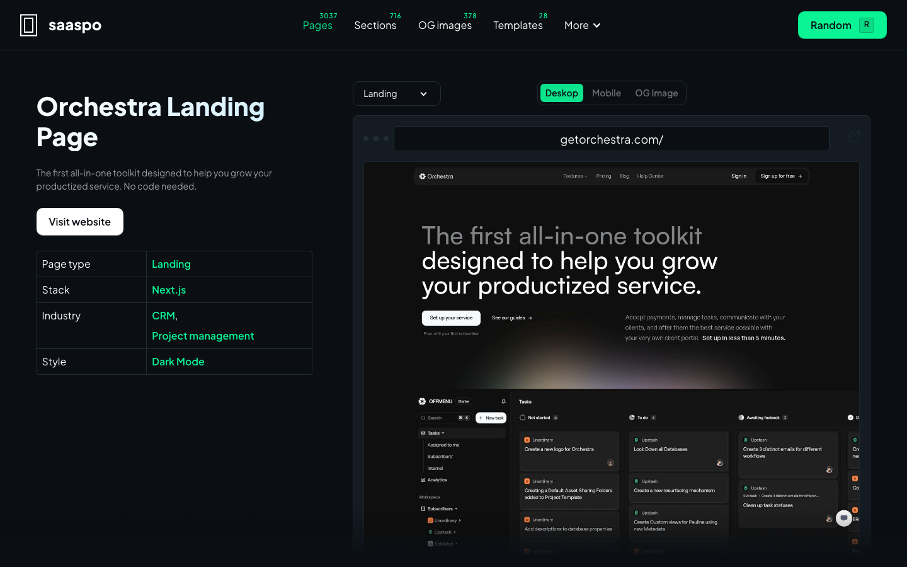
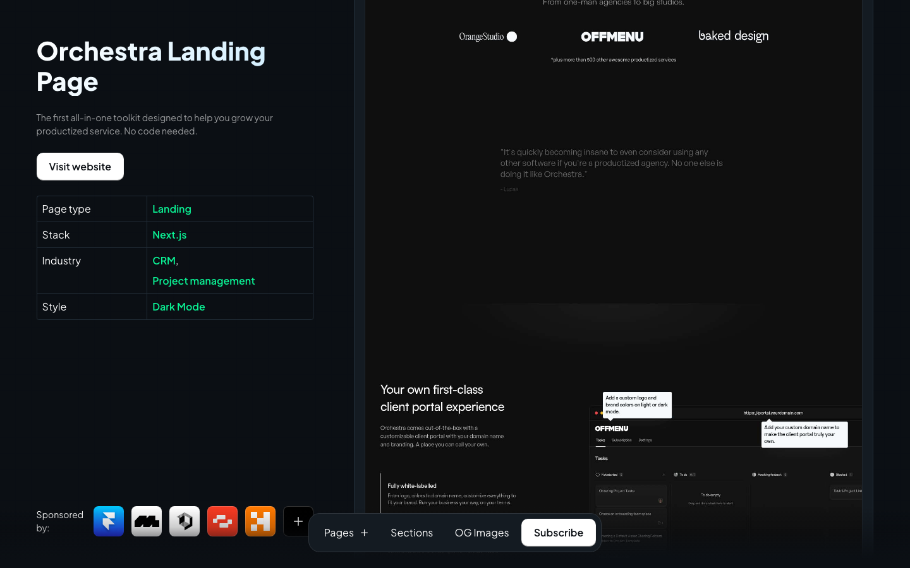
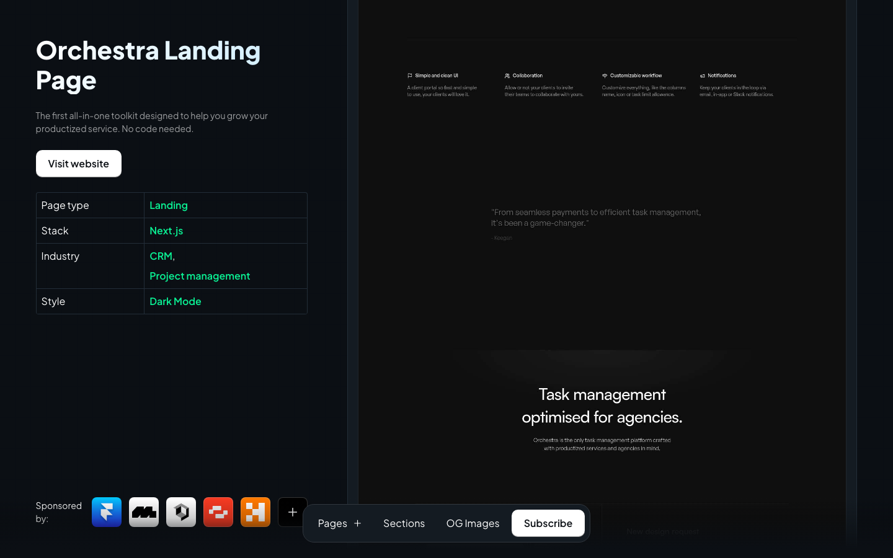
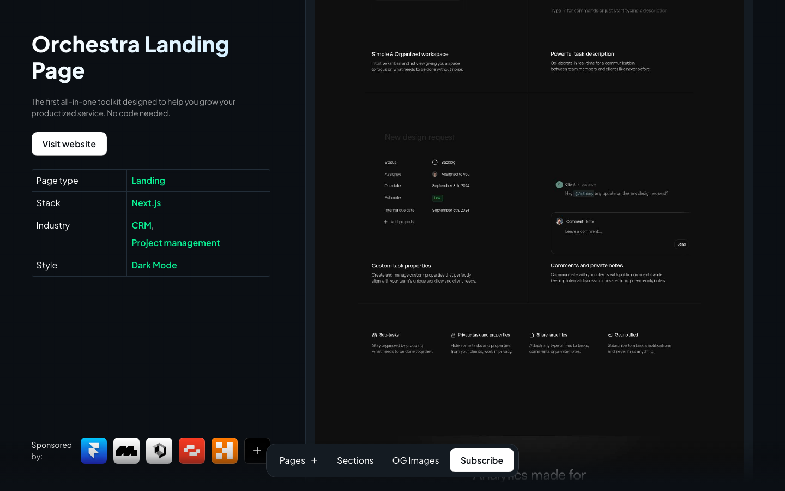
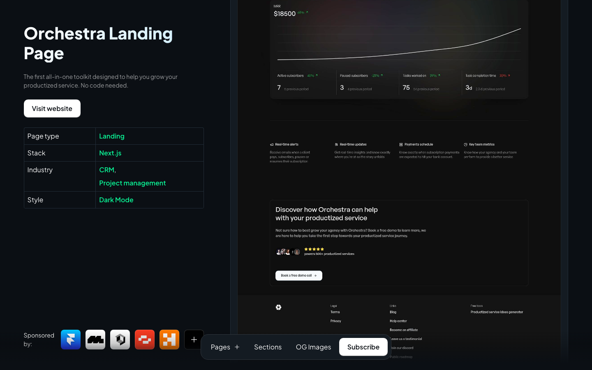
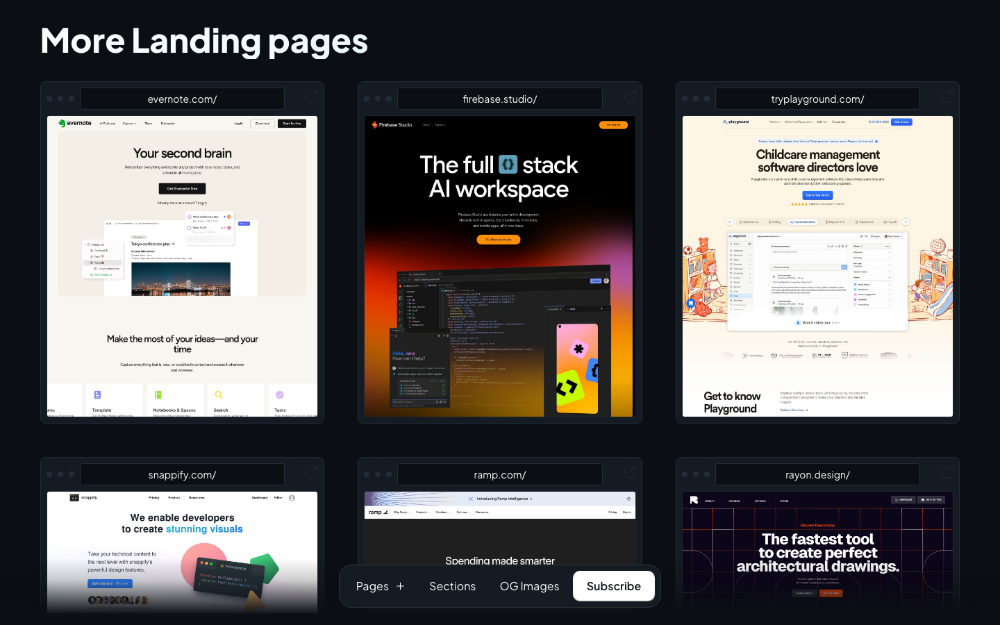
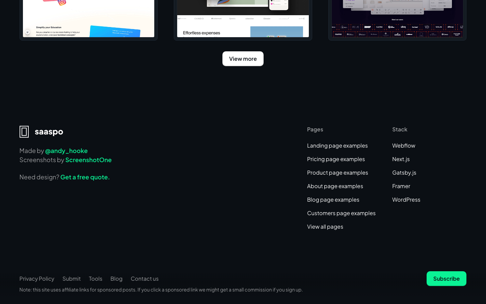
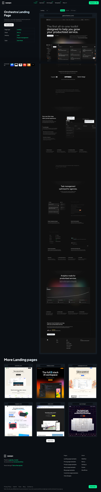
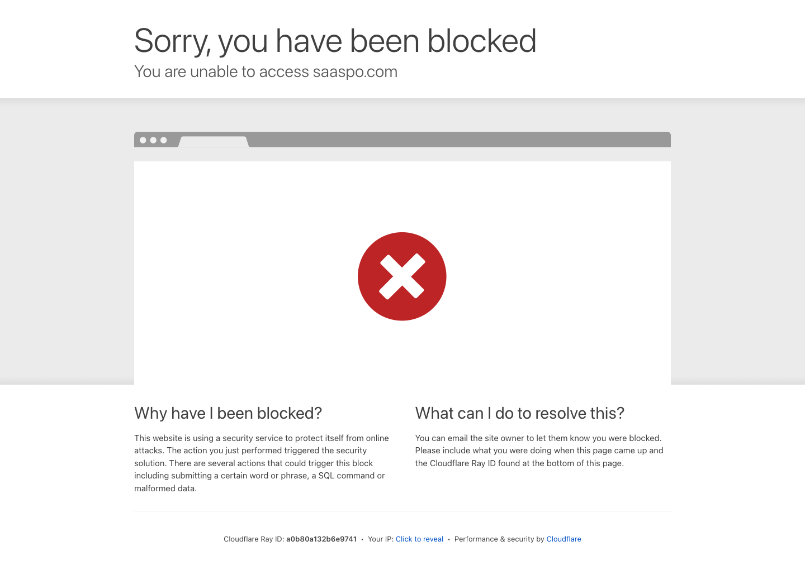
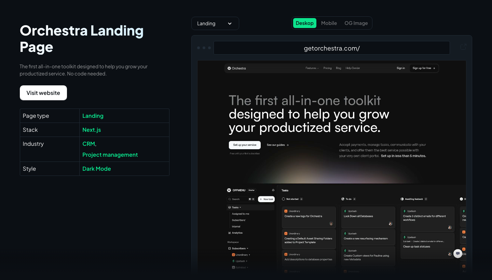

# saaspo-orchestra — Visual Guide

> Master visual reference. Study every screenshot carefully before implementing any UI.
> Match colors, layout, typography, spacing, and motion states exactly.

## Scroll Journey

The page has cinematic scroll animations. Each screenshot below shows the exact visual state at that scroll depth.
**Replicate these transitions precisely** — the design changes dramatically as you scroll.

### Hero — Above the fold

_Scroll position: 0px of 6965px total_

### 17% scroll depth

_Scroll position: 1031px of 6965px total_

### 33% scroll depth

_Scroll position: 2001px of 6965px total_

### 50% scroll depth

_Scroll position: 3033px of 6965px total_

### 67% scroll depth

_Scroll position: 4064px of 6965px total_

### 83% scroll depth

_Scroll position: 5034px of 6965px total_

### Footer — End of page

_Scroll position: 6065px of 6965px total_

## Full Page Screenshots

### Saaspo | Orchestra Landing Page

_URL: `https://saaspo.com/pages/orchestra-landing-page`_

### Attention Required! | Cloudflare

_URL: `https://saaspo.com/`_

### Attention Required! | Cloudflare

_URL: `https://saaspo.com/sections`_

## Section Screenshots

Clipped sections showing individual components in context.

### Section 2 — `main > div`

_1440×1200px_

### Section 1 — `[class*="section"]`

_1440×513px_

### Section 1 — `[class*="section"]`

_1440×513px_

